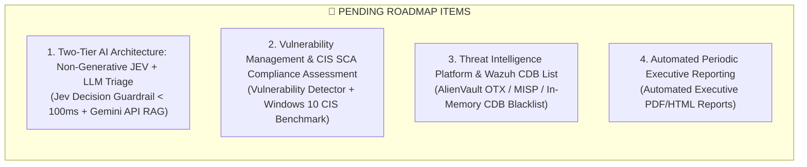

# 🚀 Upgrade & System Enhancement Plan for Wazuh SOC & SOAR Lab
> **Next Development Plan Document (Pending Improvements Backlog)**  
> **Version:** 2.2 | **Updated:** October 2026 | **Author:** SOC Lab Operations Engineering Team

---

## 📌 Current Baseline Summary

The system has completely finalized **10 core phases (Phase 1 – 10)** achieving Production-Ready status with a 100% testing success rate:

| Completed Phase | Implemented Technical Components | Status |
| :--- | :--- | :---: |
| **Phase 1 – 4: Core SIEM & Scenarios** | 3-VM Infrastructure (Ubuntu SIEM, Windows Endpoint, Kali Attacker); EDR Agent 4.14.5 + Sysmon v15.2; 3 real-world attack scenarios (RDP Brute-force, Web LFI, Multi-Stage Kill Chain). | ✅ Completed |
| **Phase 5: SOAR Closed-Loop** | n8n SOAR 2-way ChatOps with Telegram, Jira Cloud; 1-Click Safe Host Isolation (preserving ports 5985 & 1514/1515); Instant Rollback within 5 seconds. | ✅ Completed |
| **Phase 6: DevSecOps CI/CD** | GitHub Actions Automated Testing Pipeline, 22/22 Pytest Unit Checks PASS. | ✅ Completed |
| **Phase 7: Executive Dashboard** | 7 professional Visualizations on OpenSearch Dashboards (Port 443), 1-Click CLI import via REST API. | ✅ Completed |
| **Phase 8: Detection-as-Code** | Sigma SSOT Rules, SigWaz Compiler Engine, Zero-Drift Enforcement mechanism and auto-generated level 0 suppression rules for SOAR. | ✅ Completed |
| **Phase 9: Network Security (Suricata)** | Suricata NIDS 8.0.7 capturing raw network traffic on `ens33` (Nmap SYN scan, LFI on wire, Scanners), streaming EVE JSON directly into Wazuh & SOAR. | ✅ Completed |
| **Phase 10: Deception & Auto DFIR** | 3-Tier Honey-trap network (Canary File Event 4663 SACL, Honey-Account `backup_admin`, FTP Port 21 Decoy) achieving Zero False Positives (Zero FP); automated DFIR digital evidence compression (RAM dump, netstat, EVTX) sent to Jira Cloud. | ✅ Completed |
| **E2E Automation Runner** | `tests/e2e/scenario_full_killchain.py` and `scenario_deception_honeypot.py` scripts 100% automating attack execution and alert verification. | ✅ Completed |

---

## 🔮 PENDING BACKLOG ITEMS

Below are the strategic technical items **not yet implemented**, focused on expanding capabilities to **Two-Tier AI Architecture (Jev Decision Model + LLM)**, **Proactive Security**, and **Internal Threat Intelligence**:

---

### 1. 🤖 Item 1: Two-Tier AI Architecture for SOC (Two-Tier AI Architecture: Jev Decision Model & LLM)
* **Core Problem of Traditional GenAI in SOC:** Large text-generative language models (LLMs such as GPT-4, Gemini) have high latency (2–5 seconds), significant operational costs, and pose severe risks of dangerous **hallucinations** when issuing network infrastructure remediation commands.
* **Solution: Implement a Collaborative 2-Tier AI Model:**
  1. **Tier 1: Non-Generative AI Model — Jev Decision Model (System One AI):**
     - **Nature:** Non-generative / non-autoregressive parallel decision model developed by TypeSafe AI. Receives system state (JSON/Log) and returns structured decisions (Type-Safe Schema: booleans, enums, confidence score) with ultra-low latency of **70 – 200 milliseconds**, eliminating 100% of hallucinations.
     - **4 Battle-tested Applications in SOAR Lab:**
       * **🛑 Pre-Execution Guardrail (BSOD Prevention during Active Response):** Placed directly before the WinRM node to inspect process name, PID, CommandLine, and service ports. Jev returns `is_safe_to_terminate: boolean`, `bsod_risk_level: "LOW"|"HIGH"` within 80ms. If there is a risk of system crash or disconnecting management ports (WinRM 5985, Wazuh 1514), the command is automatically blocked and escalated for manual operator confirmation.
       * **⚡ Ultra-fast Alert Triage & False Positive Filtering (< 100ms):** Placed at the n8n Webhook to evaluate `is_malicious_intent: boolean` and `urgency_tier`. Routine accidental failed logins are classified as False Positives and audited to logs without disturbing Telegram in the middle of the night (**mitigating Alert Fatigue**).
       * **🎯 Autonomous Decision Router:** Replaces brittle `if/else` logic branches in n8n Workflow 2 with Jev Decision Router to automatically select response playbooks (`recommended_playbook: "SAFE_HOST_ISOLATION"|"KILL_PROC"|"BLOCK_IP"`).
       * **🔬 DFIR Dynamic Trigger:** Evaluates deep compromise probability (`deep_compromise_prob`) to dynamically determine whether triggering `collect_evidence.ps1` for RAM dumping is warranted, preventing unnecessary CPU and storage overhead.
  2. **Tier 2: Text-Generative AI Model — LLM RAG (Google Gemini API / OpenAI API):**
     - Positioned at the final stage after incident containment has completed.
     - **Executive Incident Summary:** Synthesizes attack context and parent-child process trees into natural English/Vietnamese prose.
     - **NIST SP 800-61r2 Playbook Guide:** Recommends the next 3 remediation steps for the SOC Analyst directly on Telegram.
     - **Auto Jira Description:** Automatically drafts comprehensive forensic analyses into Jira Cloud tickets.
* **Estimated Time:** 1 – 2 days.
* **Difficulty:** Moderate.
* **Academic Highlight:** Decisively resolves GenAI vulnerabilities in cybersecurity operations, demonstrating enterprise-grade SOC architecture design principles.

---

### 2. 🔍 Item 2: In-Depth Vulnerability Management & CIS Benchmark Compliance Assessment (SCA)
* **Problem Statement:** The current lab primarily emphasizes reactive defense following active attacks (Reactive Detection). Proactive risk governance and pre-exploitation prevention capabilities (Proactive Security) must be incorporated.
* **Technical Objectives:**
  1. **Fully Leverage Wazuh Vulnerability Detector Module:**
     - Configure Wazuh Manager to automatically synchronize vulnerability databases from NVD (National Vulnerability Database) and Microsoft Security Advisories.
     - Enable Wazuh Agent on Windows 10 to automatically inventory installed software (Apache, XAMPP, WinRAR, Python, browsers...) and accurately detect existing CVE identifiers alongside CVSS Scores.
     - Visually present vulnerability matrices categorized by severity (Critical, High, Medium) on the Dashboard.
  2. **Security Configuration Assessment according to CIS Benchmark (SCA):**
     - Activate and tune the built-in `cis_win10_enterprise.yaml` policy within Wazuh Agent.
     - Scan and compute compliance scores (Compliance Score %) for Windows 10: auditing password policies, disabling SMBv1, BitLocker activation state, User Account Control (UAC) configuration, and local firewall status.
     - Provide actionable remediation steps for each failed compliance check.
* **Estimated Time:** 0.5 – 1 day.
* **Difficulty:** Very Low (Module is already integrated into the Wazuh core, requiring configuration and UI validation).

---

### 3. 🗃️ Item 3: Centralized Threat Intelligence Platform & Wazuh CDB List
* **Problem Statement:** Whenever suspicious network activity is detected, n8n invokes external APIs against AbuseIPDB and VirusTotal over the Internet. This introduces network latency, external connectivity dependencies, and rapidly exhausts free tier quotas (Rate Limit / Quota).
* **Technical Objectives:**
  1. **Centralized Malicious IoC Feed Synchronization:**
     - Establish automated download and ingestion workflows for IoC blacklists (IPs, Domains, File Hashes) from reputable open-source threat intelligence providers such as **AlienVault OTX (Open Threat Exchange)**, **URLhaus**, or **Feodo Tracker**.
  2. **Load into Wazuh CDB List (Constant Database):**
     - Compile IoC lists into binary CDB format (`/var/ossec/etc/lists/malicious_ips.cdb`) on Wazuh Manager.
     - Tune Wazuh rulesets (`custom-rules/`) to cross-reference connecting IPs against the CDB List in-memory at ultra-high speed (Sub-millisecond latency).
  3. **Zero-Internet Instant Alerting:**
     - Trigger High/Critical severity alerts immediately when any process on Windows or raw network flow via Suricata touches an IP listed in the Threat Intel Blacklist, completely without consuming external API quotas.
* **Estimated Time:** 2 – 3 days.
* **Difficulty:** Moderate.

---

### 4. 📊 Item 4: Automated Periodic Executive Reporting (Executive SOC Reporting)
* **Problem Statement:** The project currently features real-time visual dashboards but lacks automated periodic generation of formalized digital documentation suitable for executive leadership or enterprise clients.
* **Technical Objectives:**
  1. **Establish Periodic Report Automation Pipeline (Weekly/Monthly Executive Report):**
     - Utilize n8n SOAR Cron Trigger (scheduled triggers) to query security incident data from OpenSearch/Wazuh API.
     - Aggregate cybersecurity KPI metrics: Total incidents, MTTA (Mean Time to Acknowledge), MTTR (Mean Time to Remediate), Top 5 most targeted MITRE ATT&CK techniques, and Containment Rate %.
  2. **Publish Professional PDF/HTML Reports:**
     - Automatically render PDF/HTML executive overview reports featuring visualizations and organizational branding.
     - Automatically distribute reports via Email or deliver them into internal management document repositories.
* **Estimated Time:** 1 – 2 days.
* **Difficulty:** Easy / Moderate.

---

## 🎯 Pending Priority Matrix

Priority order is determined by **Return on Investment (ROI = Impact / Effort)**:

| Rank | Improvement Item | Estimated Time | Difficulty | Value for Grading & Real-World Operations |
| :---: | :--- | :---: | :---: | :--- |
| 🥇 **TOP 1** | **Enable Vulnerability Management (Vulnerability Detector) & CIS SCA** | **0.5 – 1 Day** | **Very Low** | ⭐⭐⭐⭐⭐ (Comprehensive expansion from SOC to international Risk Governance & Compliance) |
| 🥈 **TOP 2** | **Two-Tier AI Architecture (Jev Decision Guardrail + Gemini LLM)** | **1 – 2 Days** | **Moderate** | ⭐⭐⭐⭐⭐ (Breakthrough academic highlight: Non-generative AI < 100ms BSOD prevention + GenAI summarization) |
| 🥉 **TOP 3** | **Threat Intelligence Feeds & Wazuh CDB List (OTX / In-Memory)** | **2 – 3 Days** | **Moderate** | ⭐⭐⭐⭐ (Performance optimization, sub-millisecond IoC lookups independent of external APIs) |
| 🏅 **TOP 4** | **Automated Periodic Security Reporting (Executive PDF/HTML Report)** | **1 – 2 Days** | **Easy** | ⭐⭐⭐⭐ (Finalizes enterprise-standard executive management reporting workflows) |

---

> 💡 **Recommended Next Action:**  
> Start immediately with **TOP 1 (Vulnerability Detector & CIS SCA)** because the module is natively available in Wazuh core, requiring only configuration in `ossec.conf` and Dashboard validation. Next, proceed with **TOP 2 (Two-Tier AI Architecture: Jev Decision Guardrail + Gemini LLM)** to create an unmatched, standout feature for final evaluation!
