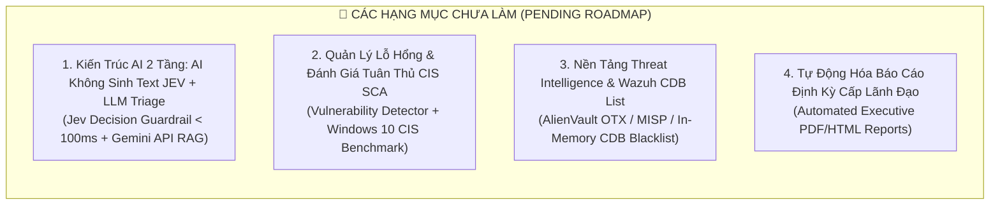

# 🚀 Kế Hoạch Nâng Cấp & Hoàn Thiện Hệ Thống Wazuh SOC & SOAR Lab
> **Tài liệu Kế hoạch Phát triển Tiếp theo (Pending Improvements Backlog)**  
> **Phiên bản:** 2.2 | **Ngày cập nhật:** Tháng 10/2026 | **Tác giả:** Đội ngũ Kỹ sư Vận hành SOC Lab

---

## 📌 Tóm Tắt Hiện Trạng Hệ Thống (Current Baseline Summary)

Hệ thống đã hoàn thiện trọn vẹn **10 giai đoạn cốt lõi (Phase 1 – 10)** đạt mức sẵn sàng vận hành thực tế (Production-Ready) với tỷ lệ kiểm thử thành công 100%:

| Giai Đoạn Đã Hoàn Thành | Thành Tố Kỹ Thuật Đã Triển Khai | Trạng Thái |
| :--- | :--- | :---: |
| **Phase 1 – 4: Core SIEM & Scenarios** | Hạ tầng 3 máy ảo (Ubuntu SIEM, Windows Endpoint, Kali Attacker); EDR Agent 4.14.5 + Sysmon v15.2; 3 kịch bản tấn công thực chiến (RDP Brute-force, Web LFI, Multi-Stage Kill Chain). | ✅ Hoàn thành |
| **Phase 5: SOAR Closed-Loop** | n8n SOAR ChatOps 2 chiều với Telegram, Jira Cloud; 1-Click Safe Host Isolation (giữ port 5985 & 1514/1515); Instant Rollback trong 5 giây. | ✅ Hoàn thành |
| **Phase 6: DevSecOps CI/CD** | GitHub Actions Pipeline kiểm thử tự động, 22/22 Pytest Unit Checks PASS. | ✅ Hoàn thành |
| **Phase 7: Executive Dashboard** | 7 Visualizations chuyên nghiệp trên OpenSearch Dashboards (Port 443), import 1-Click CLI qua REST API. | ✅ Hoàn thành |
| **Phase 8: Detection-as-Code** | Sigma SSOT Rules, SigWaz Compiler Engine, cơ chế Zero-Drift Enforcement và tự sinh luật ức chế level 0 cho SOAR. | ✅ Hoàn thành |
| **Phase 9: Network Security (Suricata)** | Suricata NIDS 8.0.7 bắt luồng mạng thô trên `ens33` (Nmap SYN scan, LFI on wire, Scanners), stream EVE JSON trực tiếp vào Wazuh & SOAR. | ✅ Hoàn thành |
| **Phase 10: Deception & Auto DFIR** | Mạng lưới bẫy mồi 3 tầng (Canary File Event 4663 SACL, Honey-Account `backup_admin`, FTP Port 21 Decoy) đạt 0% cảnh báo giả (Zero FP); tự động nén chứng cứ số DFIR (RAM dump, netstat, EVTX) gửi Jira Cloud. | ✅ Hoàn thành |
| **E2E Automation Runner** | Script `tests/e2e/scenario_full_killchain.py` và `scenario_deception_honeypot.py` tự động hóa 100% quy trình tấn công và kiểm toán cảnh báo. | ✅ Hoàn thành |

---

## 🔮 DANH MỤC CÁC HẠNG MỤC CHƯA LÀM (PENDING BACKLOG)

Dưới đây là các hạng mục kỹ thuật chiến lược **chưa triển khai**, tập trung mở rộng năng lực sang **Two-Tier AI Architecture (Jev Decision Model + LLM)**, **Quản lý rủi ro chủ động (Proactive Security)**, và **Threat Intelligence nội bộ**:

---

### 1. 🤖 Hạng Mục 1: Kiến Trúc AI 2 Tầng Cho SOC (Two-Tier AI Architecture: Jev Decision Model & LLM)
* **Vấn đề cốt lõi của GenAI truyền thống trong SOC:** Các mô hình ngôn ngữ lớn sinh văn bản (LLM như GPT-4, Gemini) có độ trễ cao (2–5 giây), chi phí lớn và tiềm ẩn nguy cơ **ảo giác (hallucination)** nguy hiểm khi ra lệnh can thiệp hạ tầng mạng.
* **Giải pháp: Áp dụng Mô hình AI 2 Tầng phối hợp:**
  1. **Tầng 1: Mô hình AI KHÔNG sinh text — Jev Decision Model (System One AI):**
     - **Bản chất:** Mô hình ra quyết định song song (Non-generative / Non-autoregressive) phát triển bởi TypeSafe AI. Nhận trạng thái hệ thống (JSON/Log) và trả về quyết định có cấu trúc (Type-Safe Schema: booleans, enums, confidence score) với độ trễ siêu tốc **70 – 200 mili-giây**, triệt tiêu 100% ảo giác.
     - **4 Ứng dụng thực chiến trong SOAR Lab:**
       * **🛑 Pre-Execution Guardrail (Chống BSOD khi Active Response):** Đặt Jev ngay trước node WinRM để kiểm duyệt tên tiến trình, PID, CommandLine và cổng dịch vụ. Jev trả về `is_safe_to_terminate: boolean`, `bsod_risk_level: "LOW"|"HIGH"` trong 80ms. Nếu có nguy cơ sập máy hoặc ngắt cổng quản trị (WinRM 5985, Wazuh 1514), lệnh tự động bị chặn và chuyển sang xin ý kiến trực ban.
       * **⚡ Siêu phân loại Alert Triage & Lọc cảnh báo giả (< 100ms):** Đặt tại Webhook n8n để đánh giá `is_malicious_intent: boolean` và `urgency_tier`. Các lỗi đăng nhập nhầm thông thường được gán False Positive và ghi log audit mà không làm phiền Telegram lúc nửa đêm (**giảm Alert Fatigue**).
       * **🎯 Autonomous Decision Router:** Thay thế các node `if/else` cứng nhắc trong n8n Workflow 2 bằng Jev Decision Router để tự động chọn Playbook phản ứng (`recommended_playbook: "SAFE_HOST_ISOLATION"|"KILL_PROC"|"BLOCK_IP"`).
       * **🔬 DFIR Dynamic Trigger:** Đánh giá xác suất xâm hại sâu (`deep_compromise_prob`) để tự động quyết định có cần kích hoạt `collect_evidence.ps1` dump RAM hay không, tránh lãng phí CPU và lưu trữ.
  2. **Tầng 2: Mô hình AI Sinh Text — LLM RAG (Google Gemini API / OpenAI API):**
     - Đặt ở khâu cuối cùng sau khi đã ngăn chặn xong sự cố.
     - **Executive Incident Summary:** Diễn giải ngữ cảnh tấn công, cây tiến trình cha-con thành đoạn văn tiếng Việt/tiếng Anh tự nhiên.
     - **NIST SP 800-61r2 Playbook Guide:** Đề xuất 3 bước xử lý tiếp theo cho SOC Analyst trên Telegram.
     - **Auto Jira Description:** Tự động soạn thảo phần phân tích chi tiết vào ticket Jira Cloud.
* **Thời gian dự kiến:** 1 – 2 ngày.
* **Độ khó:** Vừa phải.
* **Điểm nhấn học thuật:** Khắc phục triệt để điểm yếu của GenAI trong vận hành an ninh mạng, thể hiện tư duy thiết kế hệ thống cấp độ chuyên gia (Enterprise-grade SOC Architecture).

---

### 2. 🔍 Hạng Mục 2: Quản Lý Lỗ Hổng Chuyên Sâu & Đánh Giá Tuân Thủ CIS Benchmark (SCA)
* **Vấn đề cần giải quyết:** Lab hiện tại tập trung chủ yếu vào phòng thủ bị động khi đã có tấn công (Reactive Detection). Cần bổ sung năng lực phòng ngừa và kiểm soát rủi ro trước khi tin tặc khai thác (Proactive Security).
* **Mục tiêu kỹ thuật:**
  1. **Khai thác toàn diện Module Vulnerability Detector trên Wazuh:**
     - Cấu hình Wazuh Manager tự động đồng bộ cơ sở dữ liệu lỗ hổng NVD (National Vulnerability Database) và Microsoft Security Advisories.
     - Cho phép Wazuh Agent trên Windows 10 tự động kiểm kê phần mềm đã cài đặt (Apache, XAMPP, WinRAR, Python, trình duyệt...) và phát hiện chính xác các mã CVE tồn tại kèm điểm CVSS Score.
     - Hiển thị trực quan bảng lỗ hổng theo mức độ nghiêm trọng (Critical, High, Medium) trên Dashboard.
  2. **Đánh giá cấu hình an ninh theo chuẩn CIS Benchmark (Security Configuration Assessment - SCA):**
     - Kích hoạt và tinh chỉnh bộ luật `cis_win10_enterprise.yaml` tích hợp sẵn trong Wazuh Agent.
     - Quét và tính toán điểm tuân thủ (Compliance Score %) của máy Windows 10: kiểm tra chính sách mật khẩu, vô hiệu hóa SMBv1, trạng thái kích hoạt BitLocker, cấu hình User Account Control (UAC), tường lửa cục bộ.
     - Cung cấp hướng dẫn khắc phục (Remediation steps) cho từng tiêu chí không đạt.
* **Thời gian dự kiến:** 0.5 – 1 ngày.
* **Độ khó:** Rất Dễ (Module đã tích hợp sẵn trong lõi Wazuh, cần cấu hình và kiểm chứng kết quả trên giao diện).

---

### 3. 🗃️ Hạng Mục 3: Nền Tảng Threat Intelligence Tập Trung & Wazuh CDB List
* **Vấn đề cần giải quyết:** Mỗi khi có kết nối mạng đáng ngờ, n8n phải gọi API ra AbuseIPDB và VirusTotal qua Internet. Việc này gây độ trễ, phụ thuộc đường truyền mạng ngoài, và nhanh chóng chạm ngưỡng giới hạn số lần gọi miễn phí (Rate Limit / Quota).
* **Mục tiêu kỹ thuật:**
  1. **Đồng bộ danh sách IoC độc hại tập trung:**
     - Thiết lập cơ chế tự động tải và cập nhật các danh sách đen IoC (IPs, Domains, File Hashes) từ các nguồn mở uy tín như **AlienVault OTX (Open Threat Exchange)**, **URLhaus**, hoặc **Feodo Tracker**.
  2. **Nạp vào bảng tra cứu Wazuh CDB List (Constant Database):**
     - Biên dịch danh sách IoC thành định dạng CDB nhị phân (`/var/ossec/etc/lists/malicious_ips.cdb`) trên Wazuh Manager.
     - Tinh chỉnh tập luật Wazuh (`custom-rules/`) để đối chiếu IP kết nối với CDB List trong bộ nhớ RAM ở tốc độ siêu cao (Sub-millisecond latency).
  3. **Cảnh báo tức thì không cần Internet:**
     - Kích hoạt cảnh báo mức High/Critical ngay khi có bất kỳ tiến trình nào trên Windows hoặc luồng mạng qua Suricata chạm vào IP nằm trong Threat Intel Blacklist, hoàn toàn không tốn quota API ngoài.
* **Thời gian dự kiến:** 2 – 3 ngày.
* **Độ khó:** Vừa phải.

---

### 4. 📊 Hạng Mục 4: Tự Động Hóa Báo Cáo Định Kỳ Cấp Lãnh Đạo (Executive SOC Reporting)
* **Vấn đề cần giải quyết:** Đồ án hiện đã có Dashboard trực quan nhưng thiếu quy trình tự động xuất báo cáo định kỳ dạng tài liệu số hóa phục vụ ban lãnh đạo hoặc khách hàng doanh nghiệp.
* **Mục tiêu kỹ thuật:**
  1. **Thiết lập Pipeline tự động tạo báo cáo định kỳ (Weekly/Monthly Executive Report):**
     - Tận dụng n8n SOAR Cron Trigger (lập lịch định kỳ) truy vấn dữ liệu sự cố từ OpenSearch/Wazuh API.
     - Tổng hợp các chỉ số KPI an ninh mạng: Tổng số sự cố, MTTA (Mean Time to Acknowledge), MTTR (Mean Time to Remediate), Top 5 kỹ thuật MITRE ATT&CK bị tấn công nhiều nhất, Tỷ lệ ngăn chặn thành công (Containment Rate %).
  2. **Xuất bản báo cáo chuẩn PDF/HTML chuyên nghiệp:**
     - Tự động sinh file PDF/HTML báo cáo tổng quan có biểu đồ và logo tổ chức.
     - Gửi tự động qua Email hoặc đẩy vào kênh lưu trữ nội bộ cho cán bộ quản lý.
* **Thời gian dự kiến:** 1 – 2 ngày.
* **Độ khó:** Dễ / Vừa phải.

---

## 🎯 Bảng Ma Trận Ưu Tiên Triển Khai (Pending Priority Matrix)

Thứ tự ưu tiên được sắp xếp theo tỷ lệ **Hiệu quả mang lại / Thời gian công sức (ROI - Return on Investment)**:

| Thứ Tự | Hạng Mục Cải Tiến | Thời Gian Ước Tính | Độ Khó | Giá Trị Mang Lại Cho Điểm Số & Thực Chiến |
| :---: | :--- | :---: | :---: | :--- |
| 🥇 **TOP 1** | **Bật Quản lý Lỗ hổng (Vulnerability Detector) & CIS SCA** | **0.5 – 1 Ngày** | **Rất Dễ** | ⭐⭐⭐⭐⭐ (Mở rộng toàn diện từ SOC sang Quản trị rủi ro & Tuân thủ quốc tế) |
| 🥈 **TOP 2** | **Kiến trúc AI 2 Tầng (Jev Decision Guardrail + Gemini LLM)** | **1 – 2 Ngày** | **Vừa** | ⭐⭐⭐⭐⭐ (Điểm nhấn học thuật đột phá: AI không sinh text < 100ms chống BSOD + GenAI tóm tắt) |
| 🥉 **TOP 3** | **Threat Intelligence Feeds & Wazuh CDB List (OTX / In-Memory)** | **2 – 3 Ngày** | **Vừa** | ⭐⭐⭐⭐ (Tối ưu hóa hiệu năng, tra cứu IoC mili-giây không phụ thuộc API ngoài) |
| 🏅 **TOP 4** | **Tự động xuất Báo cáo An ninh định kỳ (Executive PDF/HTML Report)** | **1 – 2 Ngày** | **Dễ** | ⭐⭐⭐⭐ (Hoàn thiện quy trình báo cáo cấp quản lý chuẩn doanh nghiệp) |

---

> 💡 **Khuyến nghị hành động tiếp theo:**  
> Bạn nên bắt tay triển khai ngay **TOP 1 (Vulnerability Detector & CIS SCA)** vì module đã có sẵn trong lõi Wazuh, chỉ cần bật cấu hình trong `ossec.conf` và kiểm chứng trên Dashboard. Sau đó, tiếp tục với **TOP 2 (Kiến trúc AI 2 tầng: Jev Decision Guardrail + Gemini LLM)** để tạo ra sự khác biệt độc nhất vô nhị trước hội đồng chấm đồ án tốt nghiệp!
