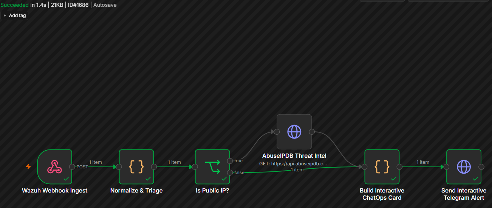
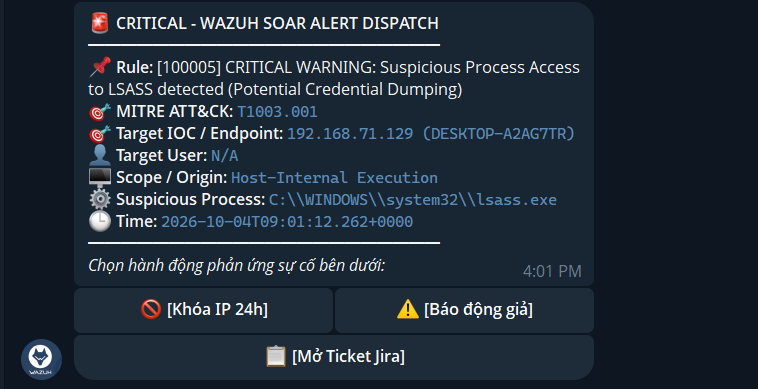
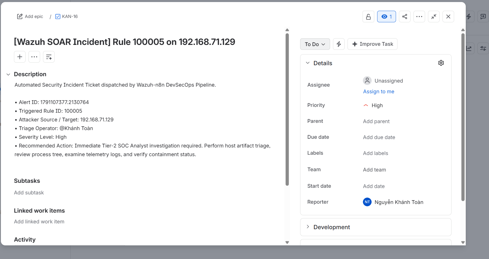
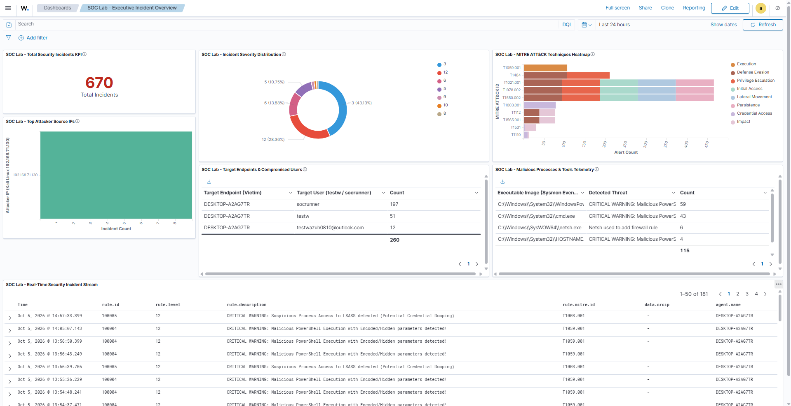
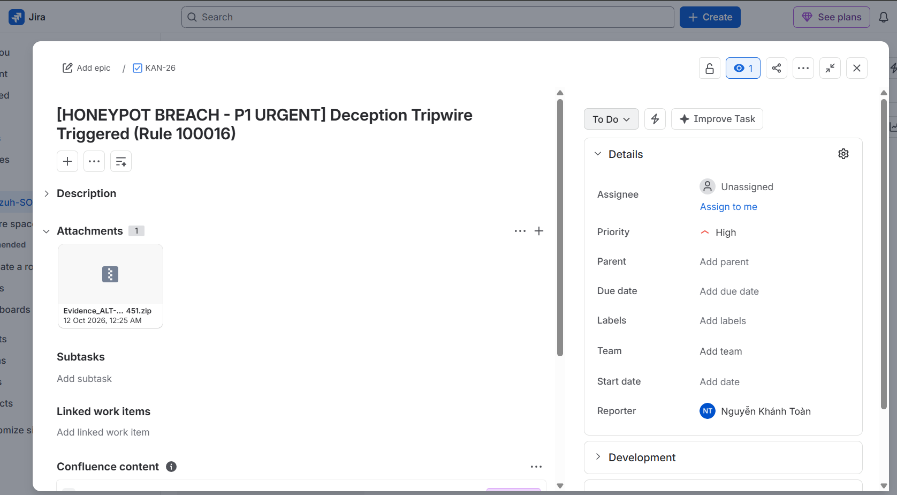
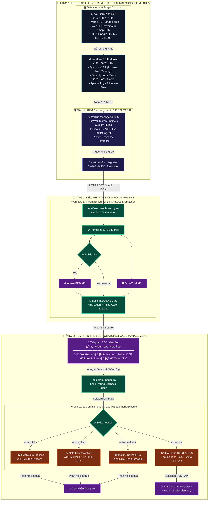

# 🛡️ Wazuh Next-Gen SOC, SOAR & Detection Engineering Lab

[](https://opensource.org/licenses/MIT)
[](https://wazuh.com/)
[](https://suricata.io/)
[](https://learn.microsoft.com/en-us/sysinternals/downloads/sysmon)
[](https://n8n.io/)
[](https://telegram.org/)
[](https://www.atlassian.com/software/jira)
[](https://github.com/tofan0810/Wazuh-SOC-lab/actions/workflows/test.yml)

> 🌐 Switch to the [feature/english-version](https://github.com/tofan0810/Wazuh-SOC-lab/tree/feature/english-version) branch to view this documentation in English.

---

## ⚡ Executive Spotlight & Key Performance Indicators (KPIs)

Dự án mô phỏng trung tâm điều hành an ninh mạng (**SOC / XDR / SOAR**) cấp doanh nghiệp với các chỉ số đo lường vượt trội:

| ⚡ MTTA (Mean Time to Acknowledge) | 🛡️ MTTR (Mean Time to Remediate) | 🟢 1-Click Rollback Time | 🎯 Deception False Positive | 🧪 DevSecOps CI Quality Gate |
| :---: | :---: | :---: | :---: | :---: |
| **< 3 Giây**<br/>(Telegram Realtime Alert) | **< 20 Giây**<br/>(WinRM Safe Isolation & Kill) | **5 Giây**<br/>(Zero-Downtime Recovery) | **0% FP**<br/>(Canary SACL & Honeypot) | **22/22 Checks PASS**<br/>(GitHub Actions CI Gate) |

---

## 📸 Visual Showcase & Proof of Concept (Minh Chứng Thực Nghiệm)

### 1. 🌐 Bird's Eye View of my SOC & SOAR Infrastructure

> **Mô hình kiến trúc phòng Lab hoàn chỉnh:** Tích hợp giữa Wazuh SIEM v4.14.5, Windows 10 Sysmon EDR, Suricata 8.0.7 NIDS, n8n SOAR Automation Engine, AbuseIPDB/VirusTotal Threat Intel, Telegram ChatOps 2-way và Atlassian Jira Cloud.

---

### 2. ⚡ Incident Handling & Containment Workflow

> **Quy trình tiếp nhận & xử lý tự động:** Cảnh báo từ Wazuh Manager được truyền qua Webhook JSON, chuẩn hóa với cơ chế Dual-Mode IOC Resolution, tra cứu danh tiếng IP độc hại tự động và phân luồng xử lý phản ứng sự cố theo thời gian thực.

---

### 3. 📲 Real-time Interactive ChatOps via Telegram

> **Cảnh báo tức thì & Phản ứng tương tác (Human-in-the-Loop):** Thông báo gửi về Telegram trong < 3 giây với đầy đủ thông tin bối cảnh tấn công và 3 nút bấm hành động cho phép SOC Analyst ra quyết định trực tiếp từ điện thoại.

---

### 4. 🎫 Automated Jira Cloud Incident Case Management

> **Quản lý hồ sơ sự cố tự động:** Khởi tạo Ticket Incident trên Atlassian Jira Cloud REST API v3 (Project `KAN`), lưu trữ đầy đủ Alert ID, MITRE ATT&CK ID, IOC và hướng dẫn điều tra cho Analyst L2.

---

### 5. 📊 Executive Incident Dashboard on OpenSearch (Port 443)

> **Trung tâm trực quan hóa sự cố chuyên nghiệp:** 7 Visualizations thời gian thực (KPI MTTA/MTTR, Donut chart phân bổ mức độ, Heatmap MITRE ATT&CK, Top Attacker IPs, Endpoint & Users, Malicious Processes, Incident Stream).

---

### 6. 🍯 Deception Technology & Automated Live DFIR Preservation

> **Phòng thủ chủ động 0% cảnh báo giả & Bảo tồn chứng cứ số:** Hệ sinh thái bẫy mồi 3 tầng (Canary Honey-File, Honey-Account, FTP Decoy 21) tự động nén chứng cứ DFIR (RAM dump, netstat, active sessions, security EVTX) thành file `.zip` và tự động đính kèm lên Jira Cloud.

---

## 🏗️ Kiến Trúc Luồng Dữ Liệu Tự Động Hóa (Interactive Dataflow)



---

## 🎯 Ma Trận Tấn Công & Phát Hiện (MITRE ATT&CK Matrix)

| Kịch Bản & Kỹ Thuật MITRE | Nguồn Telemetry | Cơ Chế Phát Hiện & Rule ID | Cơ Chế Phản Ứng Tự Động (Active Response / SOAR) | Minh Chứng (PoC) |
| :--- | :--- | :--- | :--- | :---: |
| **T1110.001 - RDP Brute Force** | Windows Security Event ID 4625 | **Rule 100001** (Level 12)<br/>Tần suất đăng nhập thất bại cao | Tự động gọi `netsh` chặn IP attacker 600s + Gửi thẻ cảnh báo Telegram | [Chi tiết](reports/Phase-3/Phase-3_Scenario-1.md) |
| **T1190 - Web LFI / Path Traversal** | Apache Access Log (`access.log`) | **Rule 100002** (Level 10)<br/>Decoder bóc tách `..%2f`, `win.ini` | Tự động khóa IP nguồn 600s + ChatOps Telegram | [Chi tiết](reports/Phase-3/Phase-3_Scenario-2.md) |
| **T1027 - File Mã Độc (VirusTotal)** | Wazuh FIM (Syscheck SHA256) | **Rule 87105** (Level 12)<br/>VirusTotal Cloud API đối soát $\ge 1$ AV | Cảnh báo khẩn cấp Telegram + Đính kèm điểm VirusTotal | [Chi tiết](integrations/virustotal/README.md) |
| **T1059.001 - Malicious PowerShell** | Sysmon Event ID 1 (Process Create) | **Rule 100004** (Level 12)<br/>Cờ Base64 `-EncodedCommand` | Active Response diệt PID tức thì (`kill-process.ps1`) | [Chi tiết](reports/Phase-3/Phase-3_Scenario-3.md) |
| **T1548.002 - UAC Bypass Fodhelper** | Sysmon Event ID 12/13 (Registry) | **Rule 100007** (Level 12)<br/>Hijack registry `ms-settings` | ChatOps thông báo + Nút dọn dẹp Registry Persistence | [Chi tiết](reports/Phase-3/Phase-3_Scenario-3.md) |
| **T1547.001 - Registry Run Persistence** | Sysmon Event ID 12/13 (Registry) | **Rule 100006** (Level 10)<br/>Ghi khóa `CurrentVersion\Run` | ChatOps thông báo + Nút 1-Click dọn sạch Registry Run | [Chi tiết](reports/Phase-3/Phase-3_Scenario-3.md) |
| **T1003.001 - LSASS Memory Dumping** | Sysmon Event ID 10 (ProcessAccess) | **Rule 100005** (Level 12)<br/>Mở handle đọc bộ nhớ `lsass.exe` | Active Response diệt PID lập tức + Thông báo khẩn L2 | [Chi tiết](reports/Phase-3/Phase-3_Scenario-3.md) |
| **T1046 - Network Recon & Scanner** | Suricata NIDS (`eve.json`) | **Rule 100011 - 100013** (L8-10)<br/>Nmap Stealth SYN, LFI on wire | Cảnh báo luồng mạng về Telegram + Đẩy vào Jira Ticket | [Chi tiết](reports/Phase-9/README.md) |
| **T1083 / T1078 - Deception Honeypots** | SACL Event 4663, Event 4625, Decoy 21 | **Rule 100014 - 100016** (L10-12)<br/>**Zero False Positive (0% FP)** | Tự động thu thập chứng cứ DFIR (RAM dump, EVTX) nén `.zip` gửi Jira | [Chi tiết](reports/Phase-10/README.md) |

---

## 🏛️ Bảng Tổng Hợp 10 Giai Đoạn Triển Khai (Phase 1 – 10)

| Giai Đoạn | Tên Phân Hệ & Chức Năng Chính | Trạng Thái | Báo Cáo Kỹ Thuật |
| :---: | :--- | :---: | :---: |
| **Phase 1** | **Hạ Tầng Triển Khai (Infrastructure Deployment)** | ✅ Hoàn thành | [Báo cáo Phase 1](reports/Phase-1_Infrastructure-Deployment.md) |
| **Phase 2** | **Cấu Hình Giám Sát Endpoint (Sysmon & Agent)** | ✅ Hoàn thành | [Báo cáo Phase 2](reports/Phase-2_Agent-Sysmon-Configuration.md) |
| **Phase 3** | **Kịch Bản Tấn Công & Phát Hiện Thực Chiến (Scenarios 1-3)** | ✅ Hoàn thành | [Báo cáo Phase 3](reports/Phase-3/README.md) |
| **Phase 4** | **Tự Động Hóa Kiểm Thử Hồi Quy (Regression Testing)** | ✅ Hoàn thành | [Báo cáo Phase 4](reports/Phase-4/README.md) |
| **Phase 5** | **Điều Phối SOAR & Phản Ứng Khép Kín (Closed-Loop)** | ✅ Hoàn thành | [Báo cáo Phase 5](reports/Phase-5/README.md) |
| **Phase 6** | **DevSecOps CI/CD Pipeline (GitHub Actions 22/22 PASS)** | ✅ Hoàn thành | [Báo cáo Phase 6](reports/Phase-6/README.md) |
| **Phase 7** | **Trực Quan Hóa Sự Cố (Executive Incident Dashboard)** | ✅ Hoàn thành | [Báo cáo Phase 7](reports/Phase-7/README.md) |
| **Phase 8** | **Detection-as-Code SSOT (Sigma Rules & SigWaz Compiler)** | ✅ Hoàn thành | [Báo cáo Phase 8](reports/Phase-8/README.md) |
| **Phase 9** | **Giám Sát Mạng Sâu Suricata NIDS (XDR Integration)** | ✅ Hoàn thành | [Báo cáo Phase 9](reports/Phase-9/README.md) |
| **Phase 10** | **Bẫy Mồi Deception & Tự Động Thu Thập Chứng Cứ DFIR** | ✅ Hoàn thành | [Báo cáo Phase 10](reports/Phase-10/README.md) |

---

## 🗂️ Cấu Trúc Thư Mục Dự Án (Directory Hub)

```text
wazuh-soc-lab/
├── architecture/       # Sơ đồ topology mạng và luồng dữ liệu 
├── commands/           # Cẩm nang tra cứu lệnh SSH, WinRM, kịch bản test
├── custom-rules/       # Quy tắc phát hiện Sigma SSOT & XML compiled 
├── deployment/         # Cấu hình ossec.conf, Docker, Sysmon, Suricata, Deception 
├── documents/          # Sổ tay lý thuyết SIEM/SOC và cẩm nang vận hành 
├── integrations/       # Module tích hợp SOAR n8n, Telegram ChatOps, VirusTotal 
├── playbooks/          # Quy trình chuẩn ứng phó sự cố (SOP) theo NIST / SANS 
├── reports/            # Báo cáo thực nghiệm chi tiết 10 giai đoạn Phase 1 – 10 
├── scripts/            # Script tự động hóa đồng bộ .env, nạp dashboard, Sigma compiler 
├── tests/              # Bộ kiểm thử tự động hóa E2E và CI/CD Unit tests 
```

---

## ⚡ Khởi Chạy Nhanh & Kiểm Thử (Quickstart)

```powershell
# 1. Đồng bộ cấu hình môi trường (.env) và kiểm tra API
sync_env.bat

# 2. Chạy kiểm thử chất lượng luật (DevSecOps CI Checks)
pytest tests/unit/ -v

# 3. Nạp nhanh Executive Dashboard lên OpenSearch
python scripts/import_dashboard.py

# 4. Kích hoạt bài kiểm thử tự động toàn diện (Full Kill Chain E2E)
python tests/e2e/scenario_full_killchain.py --execute
```

---

## 📚 Quy Trình Chuẩn Ứng Phó Sự Cố (SOP Playbooks)
* **[SOP-01: RDP Brute Force Response](playbooks/SOP-01_RDP_Brute_Force_Response.md)**: Ma trận phân loại sự cố, kiểm tra chiếm quyền thành công (Logon Type 10) và củng cố GPO.
* **[SOP-02: Web LFI & Path Traversal Mitigation](playbooks/SOP-02_Web_LFI_Mitigation.md)**: Phân tích log Apache, rà soát Web Shell qua Sysmon và vá code PHP an toàn.
* **[SOP-03: SOAR Automated Containment & ChatOps Response](playbooks/SOP-03_SOAR_Automated_Containment.md)**: Điều phối phản ứng khép kín, cách ly máy trạm an toàn và hoàn tác (Rollback) trong 5 giây.
* **[SOP-04: Endpoint Kill Chain & Credential Dumping Response](playbooks/SOP-04_Endpoint_Kill_Chain_Response.md)**: Ứng phó PowerShell Base64, UAC Bypass, Run Key Persistence và tấn công dump LSASS.
* **[SOP-05: Network NIDS Suricata & XDR Intrusion Response](playbooks/SOP-05_Network_NIDS_Suricata_Response.md)**: Bắt packet trinh sát Nmap SYN, LFI on wire, phân tích stream EVE JSON và chặn IP nguồn.
* **[SOP-06: Deception Honeypot Breach & Live DFIR Forensics](playbooks/SOP-06_Deception_Honeypot_and_Forensics.md)**: Xử lý kích hoạt bẫy mồi (0% FP), tự động trích xuất RAM dump, netstat, EVTX nén `.zip` gửi Jira Cloud.
