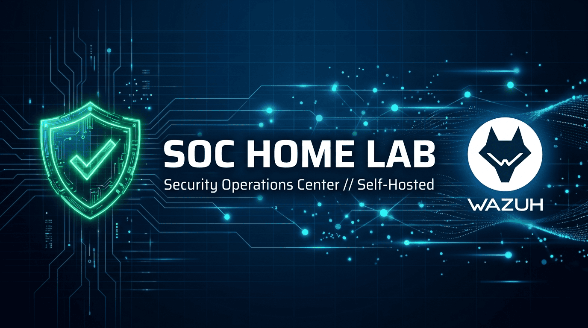
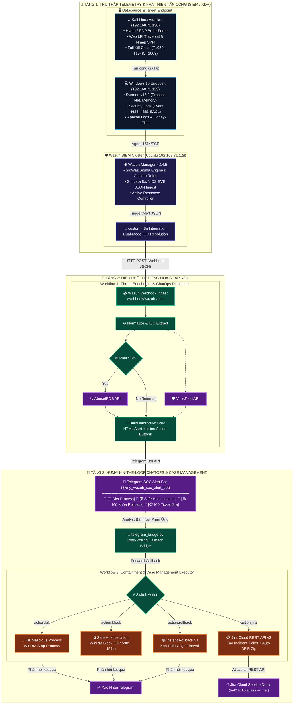

# 🛡️ Wazuh Next-Gen SOC, SOAR & Detection Engineering Lab

[](https://github.com/tofan0810/Wazuh-SOC-lab/stargazers)
[](https://opensource.org/licenses/MIT)
[](https://wazuh.com/)
[](https://suricata.io/)
[](https://learn.microsoft.com/en-us/sysinternals/downloads/sysmon)
[](https://n8n.io/)
[](https://telegram.org/)
[](https://www.atlassian.com/software/jira)
[](https://github.com/tofan0810/Wazuh-SOC-lab/actions/workflows/test.yml)


> 🌐 Switch to the [feature/english-version](https://github.com/tofan0810/Wazuh-SOC-lab/tree/feature/english-version) branch to view this documentation in English.

---

## ⚡ Executive Spotlight & Key Performance Indicators (KPIs)

Dự án mô phỏng trung tâm điều hành an ninh mạng (**SOC / XDR / SOAR**) cấp doanh nghiệp, tích hợp phòng thủ chủ động và phản ứng sự cố khép kín với các chỉ số đo lường vượt trội:

| ⚡ MTTA (Mean Time to Acknowledge) | 🛡️ MTTR (Mean Time to Remediate) | 🟢 1-Click Rollback Time | 🎯 Deception False Positive | 🧪 DevSecOps CI Quality Gate |
| :---: | :---: | :---: | :---: | :---: |
| **< 3 Giây**<br/>(Telegram Realtime Alert) | **< 20 Giây**<br/>(WinRM Safe Isolation & Kill) | **5 Giây**<br/>(Zero-Downtime Recovery) | **0% FP**<br/>(Canary SACL & Honeypot) | **22/22 Checks PASS**<br/>(GitHub Actions CI Gate) |

#### 🏛️ Điểm Nhấn Kiến Trúc & Năng Lực Cốt Lõi (Architectural Highlights)
* **Wazuh SIEM/XDR Single-Node Cluster:** Triển khai theo mô hình All-in-One containerized trên Docker (chạy đồng thời Manager 4.14.5, OpenSearch Indexer & Dashboard 443), tinh chỉnh Linux Kernel (`vm.max_map_count=262144`), thu nạp đồng thời telemetry từ Wazuh Agent (TCP 1514) và NIDS Suricata EVE JSON.
* **Suricata 8.x NIDS Promiscuous Engine:** Đặt card mạng ở chế độ Promiscuous để giám sát luồng lưu lượng mạng, phân tích gói tin Layer 4–7 nhằm chặn đứng các kỹ thuật trinh sát (Nmap Stealth SYN) và khai thác Web LFI ngay từ tầng mạng.
* **Endpoint Telemetry & Deception Grid:** Phối hợp Microsoft Sysmon v15.2 (Process, Memory LSASS, Registry) với Windows Object Access SACL (Event 4663) và lưới bẫy mồi chủ động (Canary Files / Honey-Accounts) triệt tiêu hoàn toàn báo động giả (0% False Positive).
* **SOAR Event-Driven & 2-Way ChatOps:** Động cơ n8n kết nối 2 chiều với Telegram Bot và Atlassian Jira Cloud REST API v3; thực thi **Safe Host Isolation** qua WinRM (Port 5985 - bảo toàn tuyệt đối kênh quản trị) kèm cơ chế 1-Click Rollback hoàn tác trong 5 giây.
* **Detection-as-Code & Quality Gate:** Quản lý quy tắc phát hiện tập trung theo chuẩn Sigma SSOT, tích hợp CI Gate tự động kiểm thử 22 bài unit test (100% PASS) trước khi đồng bộ cấu hình vào sản xuất.

---

## 📸 Visual Showcase & Proof of Concept (Minh Chứng Thực Nghiệm)

### 1. 🌐 Bird's Eye View of my SOC & SOAR Infrastructure

> **Mô hình kiến trúc phòng Lab hoàn chỉnh:** Tích hợp giữa Wazuh SIEM v4.14.5, Windows 10 Sysmon EDR, Suricata 8.0.7 NIDS, n8n SOAR Automation Engine, AbuseIPDB/VirusTotal Threat Intel, Telegram ChatOps 2-way và Atlassian Jira Cloud.

---

### 2. ⚡ Incident Handling & Containment Workflow

> **Quy trình tiếp nhận & xử lý tự động:** Cảnh báo từ Wazuh Manager được truyền qua Webhook JSON, chuẩn hóa với cơ chế Dual-Mode IOC Resolution, tra cứu danh tiếng IP độc hại tự động và phân luồng xử lý phản ứng sự cố theo thời gian thực.

---

### 3. 📲 Real-time Interactive ChatOps via Telegram

> **Cảnh báo tức thì & Phản ứng tương tác (Human-in-the-Loop):** Thông báo gửi về Telegram trong < 3 giây với đầy đủ thông tin bối cảnh tấn công và 3 nút bấm hành động cho phép SOC Analyst ra quyết định trực tiếp từ điện thoại.

---

### 4. 🎫 Automated Jira Cloud Incident Case Management

> **Quản lý hồ sơ sự cố tự động:** Khởi tạo Ticket Incident trên Atlassian Jira Cloud REST API v3 (Project `KAN`), lưu trữ đầy đủ Alert ID, MITRE ATT&CK ID, IOC và hướng dẫn điều tra cho Analyst L2.

---

### 5. 📊 Executive Incident Dashboard on OpenSearch (Port 443)

> **Trung tâm trực quan hóa sự cố chuyên nghiệp:** 7 Visualizations thời gian thực (KPI MTTA/MTTR, Donut chart phân bổ mức độ, Heatmap MITRE ATT&CK, Top Attacker IPs, Endpoint & Users, Malicious Processes, Incident Stream).

---

### 6. 🍯 Deception Technology & Automated Live DFIR Preservation

> **Phòng thủ chủ động 0% cảnh báo giả & Bảo tồn chứng cứ số:** Hệ sinh thái bẫy mồi 3 tầng (Canary Honey-File, Honey-Account, FTP Decoy 21) tự động nén chứng cứ DFIR (RAM dump, netstat, active sessions, security EVTX) thành file `.zip` và tự động đính kèm lên Jira Cloud.

---

## 🏗️ Kiến Trúc Luồng Dữ Liệu Tự Động Hóa (Interactive Dataflow)



---

## 🎯 Ma Trận Tấn Công & Phát Hiện (MITRE ATT&CK Matrix)

| Kịch Bản & Kỹ Thuật MITRE | Nguồn Telemetry | Cơ Chế Phát Hiện & Rule ID | Cơ Chế Phản Ứng Tự Động (Active Response / SOAR) | Minh Chứng (PoC) |
| :--- | :--- | :--- | :--- | :---: |
| **T1110.001 - RDP Brute Force** | Windows Security Event ID 4625 | **Rule 100001** (Level 12)<br/>Tần suất đăng nhập thất bại cao | Tự động gọi `netsh` chặn IP attacker 600s + Gửi thẻ cảnh báo Telegram | [Chi tiết](reports/Phase-3/Phase-3_Scenario-1.md) |
| **T1190 - Web LFI / Path Traversal** | Apache Access Log (`access.log`) | **Rule 100002** (Level 10)<br/>Decoder bóc tách `..%2f`, `win.ini` | Tự động khóa IP nguồn 600s + ChatOps Telegram | [Chi tiết](reports/Phase-3/Phase-3_Scenario-2.md) |
| **T1027 - File Mã Độc (VirusTotal)** | Wazuh FIM (Syscheck SHA256) | **Rule 87105** (Level 12)<br/>VirusTotal Cloud API đối soát $\ge 1$ AV | Cảnh báo khẩn cấp Telegram + Đính kèm điểm VirusTotal | [Chi tiết](integrations/virustotal/README.md) |
| **T1059.001 - Malicious PowerShell** | Sysmon Event ID 1 (Process Create) | **Rule 100004** (Level 12)<br/>Cờ Base64 `-EncodedCommand` | Active Response diệt PID tức thì (`kill-process.ps1`) | [Chi tiết](reports/Phase-3/Phase-3_Scenario-3.md) |
| **T1548.002 - UAC Bypass Fodhelper** | Sysmon Event ID 12/13 (Registry) | **Rule 100007** (Level 12)<br/>Hijack registry `ms-settings` | ChatOps thông báo + Nút dọn dẹp Registry Persistence | [Chi tiết](reports/Phase-3/Phase-3_Scenario-3.md) |
| **T1547.001 - Registry Run Persistence** | Sysmon Event ID 12/13 (Registry) | **Rule 100006** (Level 10)<br/>Ghi khóa `CurrentVersion\Run` | ChatOps thông báo + Nút 1-Click dọn sạch Registry Run | [Chi tiết](reports/Phase-3/Phase-3_Scenario-3.md) |
| **T1003.001 - LSASS Memory Dumping** | Sysmon Event ID 10 (ProcessAccess) | **Rule 100005** (Level 12)<br/>Mở handle đọc bộ nhớ `lsass.exe` | Active Response diệt PID lập tức + Thông báo khẩn L2 | [Chi tiết](reports/Phase-3/Phase-3_Scenario-3.md) |
| **T1046 - Network Recon & Scanner** | Suricata NIDS (`eve.json`) | **Rule 100011 - 100013** (L8-10)<br/>Nmap Stealth SYN, LFI on wire | Cảnh báo luồng mạng về Telegram + Đẩy vào Jira Ticket | [Chi tiết](reports/Phase-9/README.md) |
| **T1083 / T1078 - Deception Honeypots** | SACL Event 4663, Event 4625, Decoy 21 | **Rule 100014 - 100016** (L10-12)<br/>**Zero False Positive (0% FP)** | Tự động thu thập chứng cứ DFIR (RAM dump, EVTX) nén `.zip` gửi Jira | [Chi tiết](reports/Phase-10/README.md) |

---

## 🗂️ Cấu Trúc Thư Mục Dự Án (Directory Hub)

```text
wazuh-soc-lab/
├── manager/                    # Gói triển khai hoàn chỉnh cho Ubuntu Wazuh SIEM/SOAR/NIDS Server
│   ├── docker/                 # Cụm Wazuh Stack All-in-One (Manager, Indexer, Dashboard) & n8n SOAR
│   ├── rules/                  # Detection-as-Code SSOT: Sigma YAMLs (win/net), local_rules.xml, local_decoder.xml
│   ├── suricata/               # Cấu hình NIDS 
│   ├── soar/                   # SOAR workflows JSON, custom-n8n.py webhook, telegram_bridge.py
│   ├── dashboard/              # Saved Objects (soc_lab_executive_dashboard.ndjson, import_dashboard.py)
│   ├── setup_manager.sh        # Master 1-Click Provisioning Script cho Ubuntu Server
│   └── README.md               # Hướng dẫn chi tiết triển khai máy chủ SIEM/SOAR
├── endpoint/                   # Gói triển khai hoàn chỉnh cho Windows 10 Target Endpoint
│   ├── config/                 # Cấu hình trung tâm ossec.conf (Agent) & sysmon-config.xml (Sysmon v15.2)
│   ├── active-response/        # Script phản ứng tức thì (kill-process.ps1, collect-evidence.ps1)
│   ├── deception/              # Lưới bẫy mồi chủ động (setup_canary.ps1, network_decoy.ps1/py)
│   ├── setup_endpoint.ps1      # Master 1-Click Provisioning Script cho Windows Endpoint
│   └── README.md               # Hướng dẫn chi tiết triển khai máy trạm bảo vệ
├── architecture/               # Sơ đồ thiết kế hệ thống & vector pipeline SVG
├── commands/                   # Trung tâm tra cứu lệnh vận hành & kiểm thử
├── documents/                  # Sổ tay lý thuyết SIEM/SOC & cẩm nang vận hành đồ án
├── playbooks/                  # 6 Quy trình chuẩn ứng phó sự cố (SOP-01 đến SOP-06) theo NIST/SANS
├── reports/                    # Báo cáo thực nghiệm chi tiết các giai đoạn (Phase-1 đến Phase-10)
├── scripts/                    # Kịch bản tự động hóa vận hành (sync_env.py, sigma_compiler.py, import_dashboard.py)
└── tests/                      # Khung kiểm thử tự động hóa Detection-as-Code (unit 22 checks & e2e)
```

---

## ⚡ Hướng Dẫn Cài Đặt & Tái Lập Phòng Lab (Deployment Guide)

Để một người dùng mới có thể áp dụng toàn bộ đồ án này vào hệ thống của họ, hệ thống yêu cầu cấu hình theo mô hình 3 máy ảo (hoặc máy vật lý) trong cùng dải mạng (ví dụ dải Lab mặc định: `192.168.71.0/24`):
- **Wazuh SIEM / SOAR Server (Ubuntu 22.04 LTS):** `192.168.71.128` (4-8 GB RAM)
- **Target Endpoint (Windows 10 Pro/Enterprise):** `192.168.71.129` (2-4 GB RAM)
- **Attacker VM (Kali Linux):** `192.168.71.130` (2 GB RAM)

---

### Bước 0: Chuẩn bị biến môi trường (`.env`)
Tạo file `.env` tại thư mục gốc của dự án (hoặc copy từ template [`.env.example`](.env.example)) và điền thông tin cấu hình của bạn:

```env
# Telegram ChatOps (2-Way Human-in-the-Loop)
TELEGRAM_BOT_TOKEN="YOUR_TELEGRAM_BOT_TOKEN"
TELEGRAM_CHAT_ID="YOUR_TELEGRAM_CHAT_ID"

# Threat Intelligence API
ABUSEIPDB_API_KEY="YOUR_ABUSEIPDB_API_KEY"
VIRUSTOTAL_API_KEY="YOUR_VIRUSTOTAL_API_KEY"

# Atlassian Jira Cloud Case Management
JIRA_DOMAIN="your-domain.atlassian.net"
JIRA_EMAIL="your-email@example.com"
JIRA_API_TOKEN="YOUR_JIRA_API_TOKEN"
JIRA_PROJECT_KEY="KAN"

# Endpoint Credentials cho SOAR WinRM Remediation (Cổng 5985)
LAB_WINDOWS_IP="192.168.71.129"
LAB_WINDOWS_USER="socrunner"
LAB_WINDOWS_PASSWORD="YOUR_SOCRUNNER_PASSWORD"
```

> [!TIP]
> Bạn có thể chạy [`sync_env.bat`](sync_env.bat) (trên Windows) hoặc `python scripts/sync_env.py` để tự động kiểm tra tính sống còn của các API Token và đồng bộ cấu hình vào toàn bộ hệ thống.

---

### Bước 1: Triển khai trên máy chủ Ubuntu (Wazuh SIEM, NIDS Suricata & n8n SOAR)

#### 1. Cài đặt các gói phần mềm nền tảng:
Trên máy ảo Ubuntu Server 22.04 LTS mới, chạy lệnh cài đặt:
```bash
sudo apt update && sudo apt install -y docker.io docker-compose-plugin suricata jq python3-pip python3
```

#### 2. Chạy Script Master tự động hóa 1-Click:
Di chuyển vào thư mục [`manager/`](/manager/):
```bash
cd manager
chmod +x setup_manager.sh
sudo ./setup_manager.sh
```
> **Script [`setup_manager.sh`](/manager/setup_manager.sh) sẽ tự động thực hiện 100%:**
> 1. Chỉnh tham số Linux Kernel `vm.max_map_count=262144` cho Wazuh Indexer / OpenSearch.
> 2. Khởi chạy cụm Wazuh All-in-One (`docker-compose.yml`) và n8n SOAR (`docker-compose-n8n.yml`).
> 3. Tự động bơm bộ luật XML `local_rules.xml` (Rule 100001 - 100016), `local_decoder.xml` và `custom-n8n.py` vào container Wazuh Manager.
> 4. Kích hoạt Suricata 8.x NIDS trên card mạng, stream `eve.json` trực tiếp vào Wazuh.
> 5. Khởi chạy ngầm tiến trình [`telegram_bridge.py`](/manager/soar/telegram_bridge.py) để đón nhận nút bấm tương tác từ Telegram.

#### 3. Nạp Workflows vào n8n SOAR Engine:
1. Mở trình duyệt truy cập: `http://192.168.71.128:5678` (tạo tài khoản admin nếu là lần đầu).
2. Vào **Workflows** $\rightarrow$ **Add Workflow** $\rightarrow$ bấm biểu tượng 3 chấm $\rightarrow$ chọn **Import from File...**
3. Import lần lượt 3 file workflow từ thư mục [`manager/soar/workflows/`](/manager/soar/workflows/):
   - [`01_wazuh_soar_threat_enrichment.json`](/manager/soar/workflows/01_wazuh_soar_threat_enrichment.json): Làm giàu IoC & phát cảnh báo Telegram kèm nút bấm.
   - [`02_containment_action_executor.json`](/manager/soar/workflows/02_containment_action_executor.json): Điều phối phản ứng ngăn chặn và tạo Ticket Jira.
   - [`03_scheduled_healthcheck_cron.json`](/manager/soar/workflows/03_scheduled_healthcheck_cron.json): Tự động kiểm tra sức khỏe hệ thống định kỳ 6h.
4. Bật công tắc chuyển sang **Active** cho cả 3 workflow.

#### 4. Nạp Executive Dashboard lên OpenSearch:
```bash
python3 manager/dashboard/import_dashboard.py
```
Truy cập Wazuh Dashboard tại `https://192.168.71.128:443` để xem 7 Visualizations thời gian thực.

---

### Bước 2: Triển khai trên máy trạm Windows 10 (Target Endpoint)

#### 1. Cài đặt các công cụ nền tảng:
- **Wazuh Agent 4.14.5:** Tải file [wazuh-agent-4.14.5-1.msi](https://packages.wazuh.com/4.x/windows/wazuh-agent-4.14.5-1.msi). Mở CMD (Run as Admin) và chạy:
  ```cmd
  msiexec.exe /i wazuh-agent-4.14.5-1.msi /q WAZUH_MANAGER="192.168.71.128" WAZUH_REGISTRATION_SERVER="192.168.71.128"
  ```
- **Microsoft Sysmon v15.2:** Tải [Sysmon.zip](https://download.sysinternals.com/files/Sysmon.zip), giải nén và mở CMD (Admin) chạy:
  ```cmd
  Sysmon64.exe -accepteula -i
  ```
- **Tạo tài khoản quản trị `socrunner`** (dành cho SOAR WinRM):
  ```cmd
  net user socrunner YourPassword123! /add
  net localgroup Administrators socrunner /add
  ```

#### 2. Chạy Script Master tự động hóa 1-Click:
Mở **PowerShell với quyền Administrator** tại thư mục [`endpoint/`](/endpoint/):
```powershell
cd endpoint
Set-ExecutionPolicy -Scope Process -ExecutionPolicy Bypass
.\setup_endpoint.ps1 -WazuhManagerIP "192.168.71.128"
```
> **Script [`setup_endpoint.ps1`](/endpoint/setup_endpoint.ps1) sẽ tự động thực hiện 100%:**
> 1. Nạp cấu hình lọc sự kiện Sysmon tối ưu theo MITRE ATT&CK (`config\sysmon-config.xml`).
> 2. Nạp cấu hình Agent `ossec.conf` (FIM realtime cho `C:\Users\Public`, Eventchannel Sysmon, Apache log).
> 3. Triển khai script Active Response (`kill-process.ps1`, `collect-evidence.ps1`) vào `active-response\bin`.
> 4. Bật kiểm toán tập tin SACL (Event 4663).
> 5. Khởi tạo mạng lưới bẫy mồi Deception (Canary File `IT_Admin_Credentials.xlsx` và Honey-Account `backup_admin`).
> 6. Cấu hình an toàn kênh WinRM Port 5985 cho phản ứng khép kín SOAR.
> 7. Khởi động lại dịch vụ Wazuh Agent.

---

### Bước 3: Vận hành, Kiểm thử E2E & Kích hoạt Tấn công Giả lập

Sau khi triển khai 2 máy, thực hiện kiểm thử tự động hóa để đảm bảo toàn bộ hệ sinh thái hoạt động thông suốt:

```powershell
# 1. Chạy 22 Unit Tests kiểm định chất lượng luật Detection-as-Code (CI Quality Gate)
pytest tests/unit/ -v

# 2. Kiểm thử đường truyền n8n SOAR Webhook & Telegram Bridge Callback
python tests/e2e/test_soar_webhook.py

# 3. Kích hoạt kịch bản tấn công giả lập toàn diện (Full Kill Chain E2E)
python tests/e2e/scenario_full_killchain.py --execute
```

> [!NOTE]
> Để thực hiện các đợt tấn công giả lập thủ công từ **Kali Linux (192.168.71.130)** (như RDP Hydra Brute-force, Apache LFI Traversal, Mimikatz Dump, Port Scan SYN), vui lòng xem chi tiết từng dòng lệnh trong [`commands/attack_scenarios.md`](/commands/attack_scenarios.md).

---

## 📚 Quy Trình Chuẩn Ứng Phó Sự Cố (SOP Playbooks)
* **[SOP-01: RDP Brute Force Response](playbooks/SOP-01_RDP_Brute_Force_Response.md)**: Ma trận phân loại sự cố, kiểm tra chiếm quyền thành công (Logon Type 10) và củng cố GPO.
* **[SOP-02: Web LFI & Path Traversal Mitigation](playbooks/SOP-02_Web_LFI_Mitigation.md)**: Phân tích log Apache, rà soát Web Shell qua Sysmon và vá code PHP an toàn.
* **[SOP-03: SOAR Automated Containment & ChatOps Response](playbooks/SOP-03_SOAR_Automated_Containment.md)**: Điều phối phản ứng khép kín, cách ly máy trạm an toàn và hoàn tác (Rollback) trong 5 giây.
* **[SOP-04: Endpoint Kill Chain & Credential Dumping Response](playbooks/SOP-04_Endpoint_Kill_Chain_Response.md)**: Ứng phó PowerShell Base64, UAC Bypass, Run Key Persistence và tấn công dump LSASS.
* **[SOP-05: Network NIDS Suricata & XDR Intrusion Response](playbooks/SOP-05_Network_NIDS_Suricata_Response.md)**: Bắt packet trinh sát Nmap SYN, LFI on wire, phân tích stream EVE JSON và chặn IP nguồn.
* **[SOP-06: Deception Honeypot Breach & Live DFIR Forensics](playbooks/SOP-06_Deception_Honeypot_and_Forensics.md)**: Xử lý kích hoạt bẫy mồi (0% FP), tự động trích xuất RAM dump, netstat, EVTX nén `.zip` gửi Jira Cloud.
