# Wazuh SIEM & Detection Engineering Lab

[](https://opensource.org/licenses/MIT)
[](https://wazuh.com/)
[](https://attack.mitre.org/)
[](https://github.com/tofan0810/Wazuh-SOC-lab/actions/workflows/test.yml)

> 🌐 Switch to the [feature/english-version](https://github.com/tofan0810/Wazuh-SOC-lab/tree/feature/english-version) branch to view this documentation in English.

## 📝 Tổng quan Đồ án

Kho lưu trữ này chứa sơ đồ kiến trúc, các file cấu hình và chi tiết triển khai của **Hệ thống Giám sát An ninh mạng & Ứng phó Sự cố Tập trung** được xây dựng trên nền tảng **Wazuh SIEM/XDR**. Được thiết kế nhằm giả lập môi trường vận hành thực tế của một doanh nghiệp, đồ án này tập trung sâu vào việc thu thập log, tự viết luật phát hiện tấn công (**Detection Engineering**) chuẩn hóa theo framework **MITRE ATT&CK**, tự động hóa phòng thủ (**Active Response**) và kích hoạt cảnh báo theo thời gian thực.

### Mục tiêu Cốt lõi:
*   Triển khai hạ tầng SIEM/XDR hoạt động ổn định sử dụng mã nguồn mở.
*   Cấu hình kiểm toán chuyên sâu trên máy trạm (Endpoint Auditing) thông qua **Windows Sysmon** và log hệ thống.
*   Xây dựng **Custom Decoders và Rules (Luật tự viết)** để phát hiện các kỹ thuật tấn công tinh vi.
*   Triển khai cơ chế phòng thủ chủ động **Active Response** để tự động ngăn chặn các mối đe dọa đang diễn ra.
*   Tích hợp hệ thống cảnh báo thời gian thực về kênh giám sát tập trung qua **Telegram ChatOps**.
*   Tự động hóa đối soát mối đe dọa với nền tảng **Threat Intelligence (VirusTotal API)**.
*   Xây dựng bộ quy trình chuẩn ứng phó sự cố (**Incident Response Playbooks / SOP**) theo tiêu chuẩn **NIST SP 800-61** và **SANS PICERL**.

---

## 🏗️ Kiến trúc & Thiết lập Lab

### Mô hình Topology và Luồng Dữ Liệu Tự Động Hóa (Interactive Architecture Diagram)

```mermaid
flowchart TD
    classDef endpoint fill:#0f172a,stroke:#38bdf8,stroke-width:2px,color:#f8fafc;
    classDef siem fill:#1e1b4b,stroke:#818cf8,stroke-width:2px,color:#f8fafc;
    classDef soar fill:#064e3b,stroke:#34d399,stroke-width:2px,color:#f8fafc;
    classDef cloud fill:#581c87,stroke:#c084fc,stroke-width:2px,color:#f8fafc;
    classDef action fill:#7c2d12,stroke:#fb923c,stroke-width:2px,color:#f8fafc;

    subgraph INGEST ["📡 TẦNG 1: THU THẬP TELEMETRY & PHÁT HIỆN TẤN CÔNG (SIEM DETECTION)"]
        direction LR
        subgraph SOURCES ["🖥️ Datasource & Target Endpoint"]
            WIN["💻 Windows 10 Endpoint (192.168.71.129)<br/>• Sysmon v15.2 (Process, Network, Memory)<br/>• Windows Security Logs (Event ID 4625)<br/>• Apache Web Access Logs"]:::endpoint
            KALI["⚔️ Kali Linux Attacker (192.168.71.130)<br/>• Hydra / xfreerdp (T1110)<br/>• Web LFI Exploits (T1190)<br/>• Full Kill Chain (T1059, T1548, T1003)"]:::endpoint
            KALI -.->|"Tấn công giả lập"| WIN
        end

        subgraph WAZUH_CLUSTER ["🛡️ Wazuh SIEM Cluster (Ubuntu 192.168.71.128)"]
            MGR["⚙️ Wazuh Manager 4.14.5<br/>• Decoders & Custom Rules<br/>• Correlation & Alert Engine<br/>• Active Response Controller"]:::siem
            INTEG["🔌 custom-n8n Integration<br/>custom-n8n.py<br/>Dual-Mode IOC Resolution"]:::siem
            DASH["📊 Wazuh Dashboard & Indexer<br/>Port 443 / OpenSearch Visualizations"]:::siem
            WIN -->|"Wazuh Agent 1514/TCP"| MGR
            MGR -->|"Index Events"| DASH
            MGR -->|"Trigger Alert JSON"| INTEG
        end
    end

    INTEG ==>|"HTTP POST (Webhook JSON)"| WF1

    subgraph PIPELINE ["🤖 TẦNG 2: QUY TRÌNH TỰ ĐỘNG HÓA SOAR N8N (SOAR ENGINE)"]
        direction LR
        subgraph WF_ENRICH ["Workflow 1: Threat Enrichment & ChatOps Dispatcher"]
            WF1["📥 Wazuh Webhook Ingest<br/>/webhook/wazuh-alert"]:::soar
            PARSE["⚙️ Normalize & Triage<br/>Dual-Mode IOC Extract"]:::soar
            TI_CHECK{"🌐 Public IP?"}:::soar
            ABUSE["🔍 AbuseIPDB API<br/>Threat Intelligence Lookup"]:::cloud
            VT["🛡️ VirusTotal API<br/>Hash & File Reputation"]:::cloud
            CARD["📱 Build Interactive Card<br/>HTML Alert + Inline Action Buttons"]:::soar

            WF1 --> PARSE --> TI_CHECK
            TI_CHECK -- "Yes" --> ABUSE --> CARD
            TI_CHECK -- "No (Internal)" --> CARD
            PARSE -.-> VT -.-> CARD
        end
    end

    CARD ==>|"Telegram Bot API"| TG_ALERT

    subgraph CHATOPS ["👤 TẦNG 3: HUMAN-IN-THE-LOOP CHATOPS & CASE MANAGEMENT"]
        direction TB
        TG_ALERT["📲 Telegram SOC Alert Bot (@my_wazuh_soc_alert_bot)<br/>━━━━━━━━━━━━━━━━━━━━━━━━━━━━━━━━━━━━━<br/>🔘 [🚫 Khóa IP 24h]  🔘 [⚠️ Báo động giả]  🔘 [📋 Mở Ticket Jira]"]:::cloud

        BRIDGE["🔄 telegram_bridge.py<br/>Long-Polling Callback Bridge"]:::soar
        TG_ALERT -.->|"Analyst Bấm Nút Phản Ứng"| BRIDGE
        BRIDGE ==>|"Forward Callback"| SWITCH

        subgraph ACTIONS ["Workflow 2: Containment & Case Management Executor"]
            SWITCH{"⚡ Switch Action"}:::soar
            
            ACT_BLOCK["🔒 1. Containment Action<br/>WinRM Active Response<br/>Thêm Rule Chặn Firewall DROP"]:::action
            ACT_IGNORE["⚠️ 2. Ignore / False Positive<br/>Đánh dấu cảnh báo giả<br/>Ghi Audit Trail"]:::action
            ACT_JIRA["📋 3. Jira Cloud Case Mgmt<br/>POST /rest/api/3/issue<br/>Khởi tạo Ticket Incident"]:::action

            SWITCH -- "action:block" --> ACT_BLOCK
            SWITCH -- "action:ignore" --> ACT_IGNORE
            SWITCH -- "action:jira" --> ACT_JIRA
        end

        ACT_BLOCK -->|"Xác nhận cách ly"| TG_CONFIRM["✅ Thông Báo Phản Hồi Telegram"]:::cloud
        ACT_IGNORE -->|"Xác nhận bỏ qua"| TG_CONFIRM
        ACT_JIRA -->|"Gửi Direct URL Ticket"| TG_CONFIRM
        ACT_JIRA ==>|"Atlassian REST API v3"| JIRA_BOARD["🎫 Jira Cloud Service Desk (tn421015.atlassian.net)<br/>Incident Ticket Project: KAN"]:::cloud
    end
```



> 💡 **Lưu ý:** Chi tiết các bước triển khai được ghi lại trong các báo cáo tại thư mục `reports/`.

### Thông số kỹ thuật các thành phần:
1. **Wazuh Manager (Chạy trên Ubuntu Server 22.04/24.04):**
   - Đóng vai trò trung tâm chịu trách nhiệm biên dịch log (decode), đối khớp rule, kích hoạt alert và phát lệnh ứng phó tự động.
   - Triển khai qua Docker Compose (Single-Node Architecture).
   - Đã cấu hình thay đổi mật khẩu quản trị, giới hạn log container, kernel hardening (`vm.max_map_count=262144`).
   - Tích hợp module `wazuh-integratord` để liên kết Threat Intelligence và gửi cảnh báo ChatOps.
2. **Giám sát Endpoint (Máy Windows 10 Pro):**
   - Được cài đặt **Wazuh Agent 4.14.5** phối hợp cùng **Microsoft Sysmon v15.2** (sử dụng file cấu hình tùy chỉnh) nhằm bắt trọn các hành vi ở tầng nhân (kernel) và tiến trình hệ thống.
   - Đã cấu hình FIM (File Integrity Monitoring) với cơ chế realtime trên các thư mục quan trọng.
3. **Nền tảng Tấn công (Máy Kali Linux):**
   - Sử dụng để giả lập các kỹ thuật tấn công của tin tặc (`xfreerdp`, `curl`, payload LFI) hướng vào máy Windows 10 nhằm sinh log kiểm thử.

---

## 🗂️ Cấu trúc Thư mục Repo

```text
wazuh-soc-lab/
│
├── .github/
│   └── workflows/
│       └── test.yml            # CI/CD Pipeline kiểm thử tự động Detection Engineering (GitHub Actions)
│
├── README.md               # Tài liệu tổng quan hệ thống & hướng dẫn bắt đầu
├── sync_env.bat            # Công cụ 1-Click tự động đồng bộ cấu hình .env lên toàn hệ thống
├── .env.example            # File mẫu cấu hình biến môi trường và API keys
│
├── commands/               # Trung tâm Cẩm nang Lệnh (Command Central Hub)
│   ├── README.md           # Chỉ dẫn nhanh & bảng tra cứu IP/Port máy ảo
│   ├── REMOTE_EXECUTION.md # Lệnh gọi SSH / WinRM từ máy Host
│   ├── ATTACK_AND_TEST_GUIDE.md # Cẩm nang kích hoạt tấn công 3 Scenario & E2E Tests
│   ├── SOAR_CHATOPS_OPS.md # Cẩm nang vận hành n8n, Telegram Bridge & Jira Cloud
│   └── CONFIG_SYNC_COMMANDS.md  # Cẩm nang đồng bộ cấu hình và troubleshooting
│
├── scripts/                # Kịch bản tự động hóa vận hành hệ thống
│   ├── sync_env.py         # Engine tự động kiểm tra API và đồng bộ .env sang Wazuh & n8n
│   ├── import_dashboard.py # Engine 1-Click nạp Executive Dashboard lên Wazuh qua HTTPS API
│   └── sigma_compiler.py   # SigWaz-based Compiler: Biên dịch Sigma YAML -> Wazuh XML + Zero Drift Check
│
├── architecture/           # Sơ đồ mạng và kiến trúc kết nối Lab
│
├── deployment/             # Hướng dẫn và file cấu hình triển khai
│   ├── dashboards/         # Cấu hình Custom Dashboard chuyên biệt trên Wazuh SIEM
│   │   ├── soc_lab_executive_dashboard.ndjson # File Saved Objects nạp 1-click lên OpenSearch Dashboards
│   │   └── README.md       # Cẩm nang trực quan hóa và hướng dẫn Import
│   ├── suricata/           # Động cơ Suricata 7.x NIDS & Cấu hình giám sát tầng mạng (XDR)
│   │   ├── suricata.yaml   # Cấu hình tối ưu capture ens33 & EVE JSON stream
│   │   ├── local.rules     # 4 Custom Signatures thực chiến (Nmap, LFI, Nikto, RDP)
│   │   ├── setup_suricata.sh # Script 1-Click tự động hóa cài đặt & cấu hình service
│   │   └── README.md       # Cẩm nang vận hành Suricata NIDS
│   ├── docker-compose.yml  # Triển khai Wazuh Manager, Indexer, Dashboard
│   ├── ossec.conf          # File cấu hình chuẩn của Wazuh Manager (tích hợp eve.json)
│   └── sysmon-config.xml   # Cấu hình Sysmon v15.2 tối ưu theo MITRE ATT&CK
│
├── custom-rules/           # Quy tắc phát hiện và bộ giải mã tùy chỉnh (Detection-as-Code)
│   ├── sigma/              # Kho luật chuẩn hóa Sigma YAML (Single Source of Truth - SSOT)
│   │   ├── win_rdp_brute_force.yml
│   │   ├── web_lfi_directory_traversal.yml
│   │   ├── win_powershell_malicious_execution.yml
│   │   ├── win_registry_uac_bypass_ms_settings.yml
│   │   ├── win_registry_persistence_run_keys.yml
│   │   ├── win_lsass_access_credential_dumping.yml
│   │   ├── net_suricata_nmap_scan.yml
│   │   ├── net_suricata_web_traversal.yml
│   │   ├── net_suricata_vulnerability_scanner.yml
│   │   └── README.md       # Cẩm nang quy chuẩn phát hiện Sigma & hướng dẫn vận hành
│   ├── local_rules.xml     # Rules được biên dịch tự động bởi SigWaz Engine (100% Zero-Drift)
│   └── local_decoder.xml   # Decoder bóc tách log Apache Web Server
│
├── integrations/           # Phân hệ tích hợp mở rộng
│   ├── n8n/                # SOAR Automation Engine, Webhooks & Jira Case Management
│   │   ├── workflows/      # 3 Workflows chuẩn hóa (Enrichment, Containment/Jira, Cron)
│   │   ├── custom-n8n.py   # Script chuẩn hóa alert và dispatch tới n8n Webhook
│   │   ├── telegram_bridge.py # Cầu nối nhận Callback tương tác nút bấm Telegram
│   │   ├── restart_bridge.sh  # Script hỗ trợ khởi động lại daemon Telegram Bridge
│   │   └── README.md       # Hướng dẫn chi tiết cấu hình n8n, AbuseIPDB, Jira Cloud
│   ├── telegram/           # ChatOps cảnh báo thời gian thực về Telegram Bot
│   └── virustotal/         # Tự động tra cứu danh tiếng file lạ qua VirusTotal API
│
├── playbooks/              # Quy trình chuẩn ứng phó sự cố (SOP) theo NIST / SANS
│   ├── README.md           # Ma trận phân loại sự cố và hướng dẫn quy trình
│   ├── SOP-01_RDP_Brute_Force_Response.md
│   ├── SOP-02_Web_LFI_Mitigation.md
│   └── SOP-03_SOAR_Automated_Containment.md # Ứng phó tự động hóa qua SOAR & ChatOps
│
├── tests/                  # Bộ công cụ tự động hóa kiểm thử (Detection-as-Code)
│   ├── e2e/                # Kịch bản kiểm thử End-to-End từ Attacker -> Victim -> SIEM
│   │   ├── scenario_rdp_bruteforce.py # Kiểm thử tự động Scenario 1 (RDP Brute Force)
│   │   ├── scenario_lfi_web.py        # Kiểm thử tự động Scenario 2 (Web Apache LFI)
│   │   ├── scenario_full_killchain.py # Kiểm thử trọn bộ 4 stages Kill Chain
│   │   ├── scenario_nids_suricata.py  # Kiểm thử NIDS Suricata & tương quan XDR trên dây mạng
│   │   ├── test_soar_webhook.py       # Kiểm thử toàn trình pipeline SOAR n8n Webhook
│   │   ├── lab_health.py              # Kiểm tra sức khỏe toàn diện cả 3 máy ảo
│   │   └── README.md                  # Hướng dẫn chạy bộ test E2E
│   └── unit/               # Kiểm thử đơn vị cú pháp XML Rules, Decoders, NIDS & Sigma (20 Checks)
│
└── reports/                # Báo cáo chi tiết các giai đoạn triển khai
    ├── Phase-1_Infrastructure-Deployment.md
    ├── Phase-2_Agent-Sysmon-Configuration.md
    ├── Phase-3/            # Kịch bản tấn công & phát hiện thực chiến
    │   ├── Phase-3_Scenario-1.md
    │   ├── Phase-3_Scenario-2.md
    │   ├── Phase-3_Scenario-3.md
    │   └── images/
    ├── Phase-4/            # Tự động hóa kiểm thử hồi quy (Detection-as-Code)
    │   ├── Phase-4_Regression-Test-Automation.md
    │   └── images/
    ├── Phase-5/            # Tự động hóa SOAR, ChatOps 2 chiều & Phản ứng khép kín
    │   ├── Phase-5_SOAR-Workflow-Automation.md
    │   ├── Phase-5_Closed-Loop-Containment-and-Rollback.md
    │   └── images/
    ├── Phase-6/            # Tự động hóa CI/CD Pipeline cho Detection Engineering (GitHub Actions)
    │   ├── Phase-6_Detection-Engineering-CICD-Pipeline.md
    │   └── images/
    ├── Phase-7/            # Trực quan hóa sự cố chuyên sâu (Wazuh Executive Incident Dashboard)
    │   ├── Phase-7_Executive-Incident-Dashboard.md
    │   └── images/
    ├── Phase-8/            # Chuẩn hóa luật phát hiện Sigma (Detection-as-Code SSOT)
    │   └── Phase-8_Sigma-Rules-Integration.md
    ├── Phase-9/            # Giám sát tầng mạng sâu NIDS Suricata & Mở rộng hệ thống XDR
    │   └── Phase-9_Suricata-NIDS-XDR-Integration.md
    └── images/             # Ảnh minh chứng hạ tầng Phase 1 & Phase 2
```

---

## 🚀 Kịch bản Tấn công & Phát hiện Thực chiến (Đã triển khai thành công)

### 🔹 Kịch bản 1: T1110 - PHÁT HIỆN TẤN CÔNG BRUTE FORCE RDP & TỰ ĐỘNG KHÓA IP (ACTIVE RESPONSE)
* **Mô hình tấn công:** Sử dụng `xfreerdp` từ máy Kali Linux để thực hiện quét dò mật khẩu tốc độ cao qua giao thức RDP.
* **Thu thập Telemetry (Log):** Theo dõi log đăng nhập hệ thống Windows Event ID 4625 (Đăng nhập thất bại).
* **Chiến lược phát hiện:** Custom Rule ID 100001 (Level 12) phát hiện nhiều lần đăng nhập thất bại liên tiếp.
* **Phản ứng giảm thiểu (Active Response):** Tự động gọi lệnh `netsh` trên Windows Agent để block IP attacker trong 600 giây (10 phút).
* **Minh chứng thực tế (PoC):** Xem chi tiết tại [reports/Phase-3/Phase-3_Scenario-1.md](reports/Phase-3/Phase-3_Scenario-1.md).


### 🔹 Kịch bản 2: T1190 - KHAI THÁC LỖ HỔNG ỨNG DỤNG WEB (LOCAL FILE INCLUSION - LFI / DIRECTORY TRAVERSAL)
* **Mô hình tấn công:** Sử dụng `curl` từ Kali để khai thác lỗ hổng LFI trên ứng dụng XAMPP Apache, cố gắng đọc file `win.ini`.
* **Thu thập Telemetry (Log):** Cấu hình Wazuh Agent thu thập Apache Access Log.
* **Chiến lược phát hiện:** Custom Decoder bóc tách URL + Custom Rule ID 100002 (Level 10) phát hiện các chuỗi ký tự độc hại (`..%2f`, `..%252f`, `win.ini`, `boot.ini`).
* **Phản ứng giảm thiểu (Active Response):** Tự động block IP attacker trong 600 giây.
* **Minh chứng thực tế (PoC):** Xem chi tiết tại [reports/Phase-3/Phase-3_Scenario-2.md](reports/Phase-3/Phase-3_Scenario-2.md).


### 🔹 Kịch bản 3: T1027 / T1204 - PHÁT HIỆN TỆP TIN ĐỘC HẠI BẰNG THREAT INTELLIGENCE (VIRUSTOTAL API)
* **Mô hình thử nghiệm:** Thả file mã độc mẫu chuẩn quốc tế EICAR vào các thư mục giám sát (`C:\Users\Public`).
* **Thu thập Telemetry (Log):** Module FIM (Syscheck) phát hiện tệp tin mới tạo và tự động tính toán mã băm SHA256/MD5.
* **Chiến lược phát hiện:** `wazuh-integratord` gửi mã băm lên VirusTotal Cloud API đối soát với >70 Antivirus Engines. Khi có >= 1 Engine báo độc, tự động kích hoạt **Rule ID 87105 (Level 12 - High Severity)**.
* **Minh chứng & Hướng dẫn:** Xem chi tiết tại [integrations/virustotal/README.md](integrations/virustotal/README.md).


### 🔹 Kịch bản 4: FULL KILL CHAIN ATTACK & DETECTION VỚI MICROSOFT SYSMON TELEMETRY
Bao phủ chuỗi tấn công hoàn chỉnh (Full Attack Lifecycle) với telemetry chuyên sâu từ Microsoft Sysmon v15.2 trên Windows Endpoint:
* **Stage 1 - Execution (`T1059.001`):** Thực thi PowerShell ẩn danh với cờ mã hóa Base64 (`-EncodedCommand`, `-w hidden`, `-nop`) $\rightarrow$ Kích hoạt **Rule 100004 (Level 12)** từ Sysmon Event ID 1.
* **Stage 2 - Privilege Escalation (`T1548.002`):** Lạm dụng kỹ thuật UAC Bypass thông qua registry hijacking khóa `ms-settings\Shell\Open\command` $\rightarrow$ Kích hoạt **Rule 100007 (Level 12)** từ Sysmon Event ID 12/13.
* **Stage 3 - Persistence (`T1547.001`):** Đăng ký tự khởi động bám trụ qua `HKCU\Software\Microsoft\Windows\CurrentVersion\Run` bằng `reg.exe` $\rightarrow$ Kích hoạt **Rule 100006 (Level 10)** từ Sysmon Event ID 12/13.
* **Stage 4 - Credential Access (`T1003.001`):** Mở handle đọc trộm bộ nhớ tiến trình xác thực `lsass.exe` (Mimikatz simulation) $\rightarrow$ Kích hoạt **Rule 100005 (Level 12)** từ Sysmon Event ID 10.
* **Tự động hóa E2E:** Kịch bản được vận hành hoàn toàn tự động qua [`tests/e2e/scenario_full_killchain.py`](tests/e2e/scenario_full_killchain.py).
* **Minh chứng thực tế (PoC):** Xem chi tiết tại [reports/Phase-3/Phase-3_Scenario-3.md](reports/Phase-3/Phase-3_Scenario-3.md).

---

## 🤖 Tích hợp ChatOps: Cảnh báo Thời Gian Thực về Telegram

Hệ thống đã được trang bị phân hệ ChatOps hoàn chỉnh, giúp đội ngũ SOC tiếp nhận và phân tích cảnh báo tức thì ngay trên Telegram:

* **Tự động bóc tách & định dạng:** Script tích hợp tùy chỉnh ([`custom-telegram.py`](integrations/telegram/custom-telegram.py)) xử lý alert JSON từ Wazuh Manager, trích xuất đầy đủ: IP Kẻ tấn công, tài khoản mục tiêu, Endpoint bị ảnh hưởng, Rule ID, mức độ nghiêm trọng và ánh xạ chiến thuật/kỹ thuật theo **MITRE ATT&CK**.
* **Thẻ cảnh báo trực quan:** Sử dụng HTML Rich Formatting kèm các icon phân cấp mức độ (🚨 Critical / ⚠️ Medium / 🛡️ Active Response).
* **Quy tắc tự động kích hoạt cảnh báo:**
  * **Rule 100001:** Cảnh báo tấn công RDP Brute Force dồn dập.
  * **Rule 100002:** Cảnh báo tấn công khai thác lỗ hổng Web LFI.
  * **Rule 87105:** Cảnh báo VirusTotal phát hiện tệp tin độc hại.
  * **Rule 100004 - 100007:** Cảnh báo tức thì trọn bộ chuỗi tấn công Full Kill Chain (PowerShell, UAC Bypass, Run Key, LSASS Dump).
* **Hướng dẫn cấu hình & kiểm thử:** Xem chi tiết tại [integrations/telegram/README.md](integrations/telegram/README.md).

---

## ⚡ Tự động hóa SOAR & SecOps Workflow với n8n & Jira Cloud (Phase 5)

Mô hình SOAR (Security Orchestration, Automation, and Response) độc lập kết hợp giữa **Wazuh SIEM Manager**, **n8n Automation Engine**, **AbuseIPDB Threat Intelligence**, và **Jira Cloud REST API v3**:

* **Engine n8n Độc lập trên Docker:** Chạy tại cổng `5678` trên máy chủ `wazuh-vm`, tiếp nhận các cảnh báo thông qua endpoint `/webhook/wazuh-alert`.
* **Làm giàu Tình báo Mối đe dọa (Threat Enrichment):** Tự động phân loại IP Public vs RFC1918 Private, tra cứu điểm tín nhiệm và số lượng báo cáo vi phạm qua **AbuseIPDB Cloud API v2**.
* **Tương tác 2 chiều (Human-in-the-Loop ChatOps):** Gửi cảnh báo về Telegram kèm 3 nút bấm tương tác:
  * **`[🚫 Khóa IP 24h]`**: Tự động áp dụng luật chặn Inbound/Outbound trên Windows Defender Firewall qua PowerShell/WinRM.
  * **`[⚠️ Bỏ qua / Báo động giả]`**: Ghi log phân loại False Positive vào SOAR Audit Trail, giảm thiểu Alert Fatigue.
  * **`[📋 Mở Ticket Jira]`**: Tự động gọi **Jira Cloud REST API v3** (`POST /rest/api/3/issue`) khởi tạo Incident Ticket trong Project `KAN` và gửi link xem trực tiếp về Telegram cho Analyst L2.
* **Báo cáo Sức khỏe Định kỳ (Cron Trigger):** Tự động kiểm tra trạng thái 3 VM, container Docker và Wazuh Manager mỗi 6 giờ.
* **Tài liệu & Kịch bản Kiểm thử:**
  - Hướng dẫn chi tiết: [integrations/n8n/README.md](integrations/n8n/README.md)
  - Playbook phản ứng sự cố SOAR (Closed-Loop): [playbooks/SOP-03_SOAR_Automated_Containment.md](playbooks/SOP-03_SOAR_Automated_Containment.md)
  - Báo cáo thực nghiệm Phase 5 (Phần 1 - SOAR & Jira): [reports/Phase-5/Phase-5_SOAR-Workflow-Automation.md](reports/Phase-5/Phase-5_SOAR-Workflow-Automation.md)
  - Báo cáo thực nghiệm Phase 5 (Phần 2 - Closed-Loop & Rollback): [reports/Phase-5/Phase-5_Closed-Loop-Containment-and-Rollback.md](reports/Phase-5/Phase-5_Closed-Loop-Containment-and-Rollback.md)
  - Test Runner E2E (Webhook & Jira): `python tests/e2e/test_soar_webhook.py` (PASS 100%).
  - Test Runner E2E (Closed-Loop Containment & Rollback): `python tests/e2e/test_soar_closed_loop.py` (PASS 15/15 100%).

---

## 🔄 Tự Động Hóa CI/CD Detection Engineering (GitHub Actions)

Hệ thống áp dụng phương pháp luận **Detection-as-Code (DaC)** theo chuẩn doanh nghiệp hiện đại. Mỗi khi có commit hoặc Pull Request chỉnh sửa rules XML, decoders hoặc kịch bản kiểm thử, GitHub Actions tự động kích hoạt pipeline kiểm tra chất lượng:
* **Workflow CI:** [`.github/workflows/test.yml`](.github/workflows/test.yml) chạy trên môi trường Linux Ubuntu với ma trận đa phiên bản Python (`3.10`, `3.11`).
* **Huy hiệu trạng thái:** [](https://github.com/tofan0810/Wazuh-SOC-lab/actions/workflows/test.yml)
* **Phạm vi kiểm thử tự động (12 Verification Checks):**
  1. **XML Syntax & Well-Formedness:** Kiểm tra tính toàn vẹn cú pháp của `local_rules.xml`, `local_decoder.xml`, `ossec.conf` và `sysmon-config.xml`, bảo vệ dịch vụ `wazuh-analysisd` không bị crash.
  2. **Rule ID Namespace & Uniqueness:** Đảm bảo toàn bộ Rule ID tùy biến là duy nhất và nằm trong dải số quy ước `>= 100000`.
  3. **Alert Severity Range (0–16):** Kiểm tra giới hạn cấp độ cảnh báo theo đúng chuẩn Wazuh.
  4. **MITRE ATT&CK Schema Format:** Xác thực cú pháp kỹ thuật MITRE (`Txxxx` hoặc `Txxxx.xxx`) cho toàn bộ 6 kỹ thuật tấn công trọng yếu.
  5. **Regex & PCRE2 Compilation:** Kiểm tra an toàn biên dịch biểu thức chính quy của bộ giải mã (Apache Web Access Log) và các trường lọc Sysmon (`commandLine`, `targetObject`, `image`).
  6. **Hierarchical Child Suppression Rules (Level 0):** Xác thực cấu trúc luật ức chế phân cấp (Rule 100008, 100009, 100010) cho hành động khắc phục của SOAR (`socrunner` qua WinRM) sử dụng logic AND chuẩn xác.
  7. **Zero Secret Leakage Compliance:** Rà soát tự động đảm bảo không có token thực tế hoặc mật khẩu bị lộ trong các template cấu hình.
  8. **SIEM Integration Architecture Integrity:** Xác nhận duy nhất 1 block `<integration>` cho `custom-n8n` Webhook.

* **Chạy kiểm thử cục bộ trước khi push:**
  ```powershell
  python -m unittest discover -s tests/unit -v
  # hoặc dùng pytest:
  pytest tests/unit/ -v --cov=tests/unit
  ```

---

## 📊 Trực Quan Hóa Sự Cố Chuyên Sâu (Wazuh Executive Incident Dashboard)

Hệ thống cung cấp một **Custom Dashboard chuyên biệt** được thiết kế riêng cho kịch bản phòng Lab, vận hành trên nền tảng **OpenSearch Dashboards** (Wazuh Dashboard Port 443):
* **Tên Dashboard:** `SOC Lab - Executive Incident Overview`
* **Đường dẫn truy cập trực tiếp:** `https://192.168.71.128/app/dashboards#/view/soc-lab-executive-overview`
* **Bố cục 7 Thành phần Trực quan hóa (7 Visualizations):**
  1. **Metric Widget Group:** Thống kê tổng số sự cố, số cảnh báo Critical (L12), High (L10) và chỉ số KPI thời gian MTTA (< 3s), MTTR (< 20s).
  2. **Incident Severity Distribution (Donut Chart):** Tỷ lệ phân bổ % mức độ nghiêm trọng của toàn bộ cuộc tấn công.
  3. **MITRE ATT&CK Matrix Heatmap:** Thống kê vi phạm theo 6 kỹ thuật tấn công thực chiến (`T1110.001`, `T1190`, `T1059.001`, `T1548.002`, `T1547.001`, `T1003.001`).
  4. **Top Attacker Source IPs:** Bảng xếp hạng các địa chỉ IP phát động tấn công (đứng đầu là Kali Linux `192.168.71.130`).
  5. **Target Endpoints & Users (Data Table):** Bảng chi tiết máy nạn nhân Windows 10 (`agent.name`) và tài khoản bị xâm hại (`testw`, `socrunner`).
  6. **Malicious Processes Telemetry (Data Table):** Thống kê các file thực thi độc hại (`powershell.exe`, `fodhelper.exe`, `lsass.exe`, `httpd.exe`).
  7. **Real-time Incident Stream (Saved Search Table):** Bảng luồng sự cố trực tiếp với đầy đủ timestamp, Rule ID, mô tả, MITRE ID và IP nguồn.

* **Nạp Dashboard 1-Click tự động:**
  ```powershell
  python scripts/import_dashboard.py
  ```
  *(Chi tiết cấu hình và hướng dẫn import thủ công qua Web xem tại [deployment/dashboards/README.md](deployment/dashboards/README.md))*

---

## 📋 Quy trình Chuẩn Ứng phó Sự cố (Incident Response Playbooks / SOP)

Nhằm đáp ứng tiêu chuẩn vận hành an ninh chuyên nghiệp của Trung tâm Điều hành An ninh mạng (SOC), hệ thống được trang bị bộ tài liệu SOP chuẩn hóa theo khuyến nghị **NIST SP 800-61 Rev. 2** và chu trình **SANS PICERL** (Preparation, Identification, Containment, Eradication, Recovery, Lessons Learned):

1. **[SOP-01: RDP Brute Force Response](playbooks/SOP-01_RDP_Brute_Force_Response.md):**
   - Tiêu chí phân loại sự cố (Triage Severity Matrix).
   - Kiểm tra nguy cơ tài khoản bị chiếm đoạt thành công (Windows Event ID 4624 - Logon Type 10).
   - Hướng dẫn cô lập thủ công khi Active Response gặp sự cố (Fallback Containment).
   - Biện pháp củng cố an ninh hậu sự cố (GPO Account Lockout Threshold, NLA, đổi cổng RDP mặc định).

2. **[SOP-02: Web LFI & Path Traversal Mitigation](playbooks/SOP-02_Web_LFI_Mitigation.md):**
   - Phân tích Apache Access Logs và chuỗi payload độc hại.
   - Rà soát Web Shell và tiến trình con bất thường bằng **Sysmon Event ID 1 & Event ID 11**.
   - Hướng dẫn vá lỗ hổng code PHP (áp dụng Whitelist validation và hàm `basename()`).
   - Củng cố máy chủ Web (phân quyền thư mục `htdocs`, cấm thực thi script trong thư mục upload).

3. **[SOP-03: SOAR Automated Containment & ChatOps Response](playbooks/SOP-03_SOAR_Automated_Containment.md):**
   - Mô hình điều phối sự cố tự động hóa Human-in-the-Loop giữa Wazuh, n8n, Telegram và Jira Cloud.
   - Quy trình phân loại tự động và kích hoạt cách ly IP qua Windows Defender Firewall.
   - Bàn giao hồ sơ sự cố (Incident Case Management) trên Jira Cloud REST API v3.

> 📘 Xem toàn bộ kiến trúc quy trình và ma trận leo thang tại [playbooks/README.md](playbooks/README.md).

---

## 🛠️ Hướng dẫn Cài đặt & Triển khai
Xem chi tiết các bước tại các tài liệu chuyên đề:
1. Triển khai hạ tầng Wazuh Stack: `reports/Phase-1_Infrastructure-Deployment.md`
2. Cấu hình Agent và Sysmon: `reports/Phase-2_Agent-Sysmon-Configuration.md`
3. Triển khai kịch bản tấn công và phát hiện: `reports/Phase-3/Phase-3_Scenario-1.md` và `reports/Phase-3/Phase-3_Scenario-2.md`
4. Kịch bản Full Kill Chain Telemetry: `reports/Phase-3/Phase-3_Scenario-3.md`
5. Tự động hóa kiểm thử hồi quy (Detection-as-Code): `reports/Phase-4/Phase-4_Regression-Test-Automation.md`
6. Tự động hóa SOAR, ChatOps 2 chiều & Phản ứng khép kín:
   - Phần 1 (Workflow Engine & Jira API): `reports/Phase-5/Phase-5_SOAR-Workflow-Automation.md`
   - Phần 2 (Closed-Loop Containment & Rollback): `reports/Phase-5/Phase-5_Closed-Loop-Containment-and-Rollback.md`
7. Tự động hóa CI/CD Detection Engineering (GitHub Actions): `reports/Phase-6/Phase-6_Detection-Engineering-CICD-Pipeline.md`
8. Trực quan hóa sự cố (Wazuh Executive Dashboard): `reports/Phase-7/Phase-7_Executive-Incident-Dashboard.md` và [deployment/dashboards/README.md](deployment/dashboards/README.md)
9. Tích hợp Threat Intelligence (VirusTotal): [integrations/virustotal/README.md](integrations/virustotal/README.md)
10. Tích hợp ChatOps cảnh báo Telegram: [integrations/telegram/README.md](integrations/telegram/README.md)
11. Tích hợp SOAR Engine & Jira Cloud: [integrations/n8n/README.md](integrations/n8n/README.md)
12. Quy trình ứng phó sự cố SOC (SOP-01, SOP-02, SOP-03): [playbooks/README.md](playbooks/README.md)

### Điều kiện tiên quyết:
*   Phần mềm máy ảo: VMware Workstation hoặc VirtualBox.
*   Tài nguyên phần cứng khuyến nghị:
  - Ubuntu Server: Ít nhất 2 vCPU, 4GB RAM, 65GB SSD.
  - Windows 10: Ít nhất 2 vCPU, 2GB RAM.

---

## 📊 Kỹ năng Thực tế Đạt được qua Đồ án này
*   **Quản trị và Vận hành SIEM/XDR:** Nắm vững kiến trúc hệ thống, cài đặt phân hệ Agent, quản lý luồng log nạp vào.
*   **Kỹ nghệ Phát hiện Tấn công (Detection Engineering):** Thành thạo kỹ năng viết luật bằng XML, thiết kế bộ giải mã decoder, sử dụng biểu thức chính quy (Regex) và tối ưu giảm thiểu cảnh báo giả (False-Positive).
*   **Phân tích Telemetry Máy trạm (Endpoint):** Hiểu sâu sắc cơ chế ghi log Windows Event Logs, cấu trúc bảng dữ liệu nâng cao của Sysmon v15.2 và phân hệ FIM.
*   **Tự động hóa Phòng thủ (SOAR & Active Response):** Kích hoạt phản ứng tự động cô lập máy chủ qua tường lửa (`netsh`) và tích hợp luồng cảnh báo tức thì qua Telegram ChatOps.
*   **Tình báo Mối đe dọa (Threat Intelligence):** Khai thác VirusTotal API phục vụ tra cứu danh tiếng mã độc tự động theo thời gian thực.
*   **Quy trình Vận hành SOC (Incident Response):** Nắm vững quy chuẩn ứng phó sự cố theo khung NIST SP 800-61 / SANS PICERL.

---

## 📚 Tài liệu tham khảo
- [Wazuh Official Documentation](https://documentation.wazuh.com/)
- [MITRE ATT&CK Framework](https://attack.mitre.org/)
- [Sysinternals Sysmon](https://learn.microsoft.com/en-us/sysinternals/downloads/sysmon)
- [NIST SP 800-61 Rev. 2: Computer Security Incident Handling Guide](https://csrc.nist.gov/publications/detail/sp/800-61/rev-2/final)
- [VirusTotal API v3 Documentation](https://developers.virustotal.com/reference/overview)
