# 🛡️ Wazuh Next-Gen SOC, SOAR & Detection Engineering Lab
[](https://github.com/tofan0810/Wazuh-SOC-lab/stargazers)               
[](https://opensource.org/licenses/MIT)
[](https://wazuh.com/)
[](https://suricata.io/)
[](https://learn.microsoft.com/en-us/sysinternals/downloads/sysmon)
[](https://n8n.io/)
[](https://telegram.org/)
[](https://www.atlassian.com/software/jira)
[](https://github.com/tofan0810/Wazuh-SOC-lab/actions/workflows/test.yml)


> 🌐 Switch to the [feature/english-version](https://github.com/tofan0810/Wazuh-SOC-lab/tree/feature/english-version) branch to view this documentation in English.

---

## Table of Contents
- [Executive Spotlight & KPIs](#executive-spotlight--key-performance-indicators-kpis)
  - [Architectural Highlights](#architectural-highlights)
- [Visual Showcase & Proof of Concept](#visual-showcase--proof-of-concept)
- [Interactive Dataflow](#interactive-dataflow)
- [MITRE ATT&CK Matrix](#mitre-attck-matrix)
- [Directory Hub](#directory-hub)
- [Deployment Guide](#deployment-guide)
  - [Step 0: Prepare Environment Variables (.env)](#step-0-prepare-environment-variables-env)
  - [Step 1: Deploy on Ubuntu Server (Wazuh SIEM, NIDS Suricata & n8n SOAR)](#step-1-deploy-on-ubuntu-server-wazuh-siem-nids-suricata--n8n-soar)
  - [Step 2: Deploy on Windows 10 Target Endpoint](#step-2-deploy-on-windows-10-target-endpoint)
  - [Step 3: Operations, E2E Testing & Simulated Attack Execution](#step-3-operations-e2e-testing--simulated-attack-execution)
- [SOP Playbooks](#sop-playbooks)

---

## Executive Spotlight & Key Performance Indicators (KPIs)

The project simulates an enterprise-grade Security Operations Center (**SOC / XDR / SOAR**), integrating proactive defense and closed-loop incident response with benchmark-setting performance metrics:

| ⚡ MTTA (Mean Time to Acknowledge) | 🛡️ MTTR (Mean Time to Remediate) | 🟢 1-Click Rollback Time | 🎯 Deception False Positive | 🧪 DevSecOps CI Quality Gate |
| :---: | :---: | :---: | :---: | :---: |
| **< 3 Seconds**<br/>(Telegram Realtime Alert) | **< 20 Seconds**<br/>(WinRM Safe Isolation & Kill) | **5 Seconds**<br/>(Zero-Downtime Recovery) | **0% FP**<br/>(Canary SACL & Honeypot) | **22/22 Checks PASS**<br/>(GitHub Actions CI Gate) |

### Architectural Highlights

| Capability Pillar | Deployed Technology | Operational Mechanism & Key Advantages |
| :--- | :--- | :--- |
| 🛡️ **SIEM / XDR Core** | **Wazuh 4.14.5 Single-Node**<br/>*(All-in-One Docker Stack)* | • Optimized Linux Kernel `vm.max_map_count=262144` for OpenSearch<br/>• Concurrent telemetry ingestion from Wazuh Agent (TCP 1514) & NIDS EVE JSON<br/>• Centralized management via OpenSearch Indexer & Dashboard (HTTPS 443) |
| 📡 **Network Detection** | **Suricata 8.x NIDS**<br/>*(Promiscuous Mode Engine)* | • Deep Packet Inspection of network traffic flows at Layer 4–7<br/>• Detects Nmap Stealth SYN Scan & Web LFI directly from network layer<br/>• Streams `eve.json` alert logs directly to Wazuh Manager |
| 💻 **Endpoint & Deception** | **Sysmon v15.2 + SACL Auditing**<br/>*(Active Deception Grid)* | • Process monitoring, LSASS RAM dump detection, and Registry Run Key audits<br/>• **0% False Positive:** Active Canary File + Honey-Account deception grid<br/>• Automated DFIR evidence acquisition compressed into `.zip` upon trap breach |
| 🤖 **SOAR & Closed-Loop** | **n8n Engine + Telegram ChatOps**<br/>*(2-Way Human-in-the-Loop)* | • **Safe Host Isolation:** Isolates endpoint via WinRM 5985 (preserving management channels)<br/>• **1-Click Rollback:** Instant network recovery in **5 seconds**<br/>• Automated incident ticket creation via **Jira Cloud REST API v3** with digital evidence attached |
| 🧪 **DevSecOps Quality Gate** | **Sigma Rules SSOT**<br/>*(Detection-as-Code Pipeline)* | • Centralized detection rule management following open Sigma SSOT standard<br/>• **22/22 Checks PASS:** CI Gate automatically validates rule quality pre-deployment<br/>• Zero Secret Leakage: 100% security tokens independently managed via `.env` |

---

## Visual Showcase & Proof of Concept

### 1. 🌐 Bird's Eye View of my SOC & SOAR Infrastructure

> **Comprehensive Lab Architecture Model:** Integration between Wazuh SIEM v4.14.5, Windows 10 Sysmon EDR, Suricata 8.0.7 NIDS, n8n SOAR Automation Engine, AbuseIPDB/VirusTotal Threat Intel, Telegram 2-way ChatOps, and Atlassian Jira Cloud.

---

### 2. ⚡ Incident Handling & Containment Workflow

> **Automated Ingestion & Handling Workflow:** Alerts from Wazuh Manager are delivered via Webhook JSON, normalized using a Dual-Mode IOC Resolution mechanism, enriched via automated malicious IP reputation lookups, and dynamically dispatched for real-time response.

---

### 3. 📲 Real-time Interactive ChatOps via Telegram

> **Instant Alerting & Interactive Response (Human-in-the-Loop):** Notifications delivered to Telegram in < 3 seconds with full attack context and 3 interactive buttons enabling the SOC Analyst to make immediate operational decisions directly from mobile.

---

### 4. 🎫 Automated Jira Cloud Incident Case Management

> **Automated Incident Case Management:** Generates Incident Tickets via Atlassian Jira Cloud REST API v3 (Project `KAN`), persisting complete Alert IDs, MITRE ATT&CK IDs, IOCs, and investigative guidance for L2 Analysts.

---

### 5. 📊 Executive Incident Dashboard on OpenSearch (Port 443)

> **Professional Incident Visualization Center:** 7 real-time Visualizations (MTTA/MTTR KPIs, Severity distribution donut chart, MITRE ATT&CK Heatmap, Top Attacker IPs, Endpoint & Users, Malicious Processes, Incident Stream).

---

### 6. 🍯 Deception Technology & Automated Live DFIR Preservation

> **0% False Positive Proactive Defense & Digital Evidence Preservation:** 3-Tier deception ecosystem (Canary Honey-File, Honey-Account, FTP Decoy 21) automatically packages DFIR digital evidence (RAM dump, netstat, active sessions, security EVTX) into a `.zip` archive and uploads it directly to Jira Cloud.

---

## Interactive Dataflow

```mermaid
flowchart LR
    classDef endpoint fill:#0f172a,stroke:#38bdf8,stroke-width:2px,color:#f8fafc;
    classDef siem fill:#1e1b4b,stroke:#818cf8,stroke-width:2px,color:#f8fafc;
    classDef soar fill:#064e3b,stroke:#34d399,stroke-width:2px,color:#f8fafc;
    classDef cloud fill:#581c87,stroke:#c084fc,stroke-width:2px,color:#f8fafc;
    classDef action fill:#7c2d12,stroke:#fb923c,stroke-width:2px,color:#f8fafc;

    subgraph T1 ["📡 TIER 1: TELEMETRY & DETECTION"]
        direction TB
        KALI["⚔️ Kali Linux (.130)<br/>Hydra, LFI, Nmap SYN"]:::endpoint
        WIN["💻 Win 10 (.129)<br/>Sysmon v15.2, SACL 4663"]:::endpoint
        MGR["⚙️ Wazuh Manager (.128)<br/>Sigma Engine + Suricata NIDS"]:::siem
        INTEG["🔌 custom-n8n Integration<br/>Dual-Mode IOC Resolution"]:::siem

        KALI -.->|"Simulated Attack"| WIN
        WIN -->|"Agent 1514/TCP"| MGR
        MGR -->|"Alert JSON"| INTEG
    end

    subgraph T2 ["🤖 TIER 2: SOAR AUTOMATION (n8n)"]
        direction TB
        WF1["📥 Webhook Ingest<br/>/webhook/wazuh-alert"]:::soar
        TI{"🌐 Threat Intel"}:::cloud
        ABUSE["🔍 AbuseIPDB & VirusTotal"]:::cloud
        CARD["📱 Interactive Card<br/>HTML Alert + Inline Buttons"]:::soar

        WF1 --> TI --> ABUSE --> CARD
    end

    subgraph T3 ["👤 TIER 3: CHATOPS & CLOSED-LOOP REMEDIATION"]
        direction TB
        TG_ALERT["📲 Telegram SOC Alert Bot<br/>[🛑 Terminate] [🔒 Isolate] [🟢 Rollback] [📋 Jira]"]:::cloud
        BRIDGE["🔄 telegram_bridge.py<br/>Long-Polling Callback Bridge"]:::soar
        
        ACT_BLOCK["🔒 Safe Host Isolation & Kill<br/>WinRM 5985 (Rollback 5s)"]:::action
        ACT_JIRA["📋 Jira Cloud REST API v3<br/>Incident Ticket + DFIR .zip"]:::action

        TG_ALERT -->|"Analyst Clicks Button"| BRIDGE
        BRIDGE -->|"Remediation"| ACT_BLOCK
        BRIDGE -->|"Case Mgmt"| ACT_JIRA
        ACT_BLOCK -.->|"Confirmation"| TG_ALERT
        ACT_JIRA -.->|"Ticket URL"| TG_ALERT
    end

    INTEG ==>|"HTTP POST (Webhook JSON)"| WF1
    CARD ==>|"Telegram Bot API"| TG_ALERT
    ACT_BLOCK -.->|"WinRM"| WIN
```



---

## MITRE ATT&CK Matrix

| MITRE Scenario & Technique | Telemetry Source | Detection Mechanism & Rule ID | Automated Response Mechanism (Active Response / SOAR) | Evidence (PoC) |
| :--- | :--- | :--- | :--- | :---: |
| **T1110.001 - RDP Brute Force** | Windows Security Event ID 4625 | **Rule 100001** (Level 12)<br/>High frequency failed logins | Automatically invokes `netsh` to block attacker IP 600s + Dispatches Telegram alert card | [Details](reports/Phase-3/Phase-3_Scenario-1.md) |
| **T1190 - Web LFI / Path Traversal** | Apache Access Log (`access.log`) | **Rule 100002** (Level 10)<br/>Decoder parses `..%2f`, `win.ini` | Automatically blocks source IP 600s + Telegram ChatOps | [Details](reports/Phase-3/Phase-3_Scenario-2.md) |
| **T1027 - Malicious File (VirusTotal)** | Wazuh FIM (Syscheck SHA256) | **Rule 87105** (Level 12)<br/>VirusTotal Cloud API matches $\ge 1$ AV | High-priority Telegram alert + VirusTotal score attached | [Details](integrations/virustotal/README.md) |
| **T1059.001 - Malicious PowerShell** | Sysmon Event ID 1 (Process Create) | **Rule 100004** (Level 12)<br/>Base64 flag `-EncodedCommand` | Active Response instantly terminates PID (`kill-process.ps1`) | [Details](reports/Phase-3/Phase-3_Scenario-3.md) |
| **T1548.002 - UAC Bypass Fodhelper** | Sysmon Event ID 12/13 (Registry) | **Rule 100007** (Level 12)<br/>Registry hijacking `ms-settings` | ChatOps alert + Button to clean up Registry Persistence | [Details](reports/Phase-3/Phase-3_Scenario-3.md) |
| **T1547.001 - Registry Run Persistence** | Sysmon Event ID 12/13 (Registry) | **Rule 100006** (Level 10)<br/>Writes to `CurrentVersion\Run` | ChatOps alert + 1-Click button to purge Registry Run | [Details](reports/Phase-3/Phase-3_Scenario-3.md) |
| **T1003.001 - LSASS Memory Dumping** | Sysmon Event ID 10 (ProcessAccess) | **Rule 100005** (Level 12)<br/>Opens memory read handle to `lsass.exe` | Active Response immediately terminates PID + Escalates to L2 | [Details](reports/Phase-3/Phase-3_Scenario-3.md) |
| **T1046 - Network Recon & Scanner** | Suricata NIDS (`eve.json`) | **Rule 100011 - 100013** (L8-10)<br/>Nmap Stealth SYN, LFI on wire | Network flow alert to Telegram + Dispatched to Jira Ticket | [Details](reports/Phase-9/README.md) |
| **T1083 / T1078 - Deception Honeypots** | SACL Event 4663, Event 4625, Decoy 21 | **Rule 100014 - 100016** (L10-12)<br/>**Zero False Positive (0% FP)** | Automatically collects DFIR evidence (RAM dump, EVTX) zipped as `.zip` sent to Jira | [Details](reports/Phase-10/README.md) |

---

## Directory Hub

```text
wazuh-soc-lab/
├── manager/                    # Full deployment package for Ubuntu Wazuh SIEM/SOAR/NIDS Server
│   ├── docker/                 # All-in-One Wazuh Stack (Manager, Indexer, Dashboard) & n8n SOAR
│   ├── rules/                  # Detection-as-Code SSOT: Sigma YAMLs (win/net), local_rules.xml, local_decoder.xml
│   ├── suricata/               # NIDS configuration
│   ├── soar/                   # SOAR workflows JSON, custom-n8n.py webhook, telegram_bridge.py
│   ├── dashboard/              # Saved Objects (soc_lab_executive_dashboard.ndjson, import_dashboard.py)
│   ├── setup_manager.sh        # Master 1-Click Provisioning Script for Ubuntu Server
│   └── README.md               # Detailed deployment guide for SIEM/SOAR server
├── endpoint/                   # Full deployment package for Windows 10 Target Endpoint
│   ├── config/                 # Central configuration ossec.conf (Agent) & sysmon-config.xml (Sysmon v15.2)
│   ├── active-response/        # Instant response scripts (kill-process.ps1, collect-evidence.ps1)
│   ├── deception/              # Active deception grid (setup_canary.ps1, network_decoy.ps1/py)
│   ├── setup_endpoint.ps1      # Master 1-Click Provisioning Script for Windows Endpoint
│   └── README.md               # Detailed deployment guide for protected endpoint
├── architecture/               # System architecture diagrams & SVG pipeline vectors
├── commands/                   # Operations & testing command reference hub
├── documents/                  # SIEM/SOC theoretical foundations & lab operational handbook
├── playbooks/                  # 6 Standard Operating Procedures (SOP-01 to SOP-06) based on NIST/SANS
├── reports/                    # Comprehensive phase-by-phase experimental reports (Phase-1 to Phase-10)
├── scripts/                    # Operational automation scripts (sync_env.py, sigma_compiler.py, import_dashboard.py)
└── tests/                      # Detection-as-Code automated test framework (unit 22 checks & e2e)
```

---

## Deployment Guide

To deploy this lab environment, the system requires a 3-virtual-machine (or physical host) topology within the same network subnet (e.g., default lab subnet: `192.168.71.0/24`):
- **Wazuh SIEM / SOAR Server (Ubuntu 22.04 LTS):** `192.168.71.128` (4-8 GB RAM)
- **Target Endpoint (Windows 10 Pro/Enterprise):** `192.168.71.129` (2-4 GB RAM)
- **Attacker VM (Kali Linux):** `192.168.71.130` (2 GB RAM)

---

### Step 0: Prepare Environment Variables (`.env`)
Create a `.env` file at the root of the project (or copy from the [`.env.example`](.env.example) template) and fill in your configuration:

```env
# Telegram ChatOps (2-Way Human-in-the-Loop)
TELEGRAM_BOT_TOKEN="YOUR_TELEGRAM_BOT_TOKEN"
TELEGRAM_CHAT_ID="YOUR_TELEGRAM_CHAT_ID"

# Threat Intelligence API
ABUSEIPDB_API_KEY="YOUR_ABUSEIPDB_API_KEY"
VIRUSTOTAL_API_KEY="YOUR_VIRUSTOTAL_API_KEY"

# Atlassian Jira Cloud Case Management
JIRA_DOMAIN="your-domain.atlassian.net"
JIRA_EMAIL="your-email@example.com"
JIRA_API_TOKEN="YOUR_JIRA_API_TOKEN"
JIRA_PROJECT_KEY="KAN"

# Endpoint Credentials for SOAR WinRM Remediation (Port 5985)
LAB_WINDOWS_IP="192.168.71.129"
LAB_WINDOWS_USER="socrunner"
LAB_WINDOWS_PASSWORD="YOUR_SOCRUNNER_PASSWORD"
```

> **[!TIP]**
> You can execute [`sync_env.bat`](sync_env.bat) (on Windows) or `python scripts/sync_env.py` to automatically validate API token health and synchronize configurations across the entire environment.

---

### Step 1: Deploy on Ubuntu Server (Wazuh SIEM, NIDS Suricata & n8n SOAR)

#### 1. Install Base Packages:
On a fresh Ubuntu Server 22.04 LTS virtual machine, execute:
```bash
sudo apt update && sudo apt install -y docker.io docker-compose-plugin suricata jq python3-pip python3
```

#### 2. Run Master 1-Click Automation Script:
Navigate to the [`manager/`](/manager/) directory:
```bash
cd manager
chmod +x setup_manager.sh
sudo ./setup_manager.sh
```
> **The [`setup_manager.sh`](/manager/setup_manager.sh) script automatically handles 100% of:**
> 1. Setting the Linux Kernel parameter `vm.max_map_count=262144` for Wazuh Indexer / OpenSearch.
> 2. Starting the All-in-One Wazuh cluster (`docker-compose.yml`) and n8n SOAR (`docker-compose-n8n.yml`).
> 3. Injecting XML detection rules `local_rules.xml` (Rule 100001 - 100016), `local_decoder.xml`, and `custom-n8n.py` into the Wazuh Manager container.
> 4. Activating Suricata 8.x NIDS on the network interface and streaming `eve.json` directly into Wazuh.
> 5. Starting the background process [`telegram_bridge.py`](/manager/soar/telegram_bridge.py) to receive interactive Telegram button callbacks.

#### 3. Import Workflows into n8n SOAR Engine:
1. Open your browser and navigate to: `http://192.168.71.128:5678` (create an admin account if accessing for the first time).
2. Go to **Workflows** $\rightarrow$ **Add Workflow** $\rightarrow$ click the three dots icon $\rightarrow$ select **Import from File...**
3. Import the 3 workflow files from [`manager/soar/workflows/`](/manager/soar/workflows/):
   - [`01_wazuh_soar_threat_enrichment.json`](/manager/soar/workflows/01_wazuh_soar_threat_enrichment.json): IoC enrichment & Telegram alert dispatch with interactive buttons.
   - [`02_containment_action_executor.json`](/manager/soar/workflows/02_containment_action_executor.json): Containment action orchestration and Jira Ticket creation.
   - [`03_scheduled_healthcheck_cron.json`](/manager/soar/workflows/03_scheduled_healthcheck_cron.json): Automated system health checks scheduled every 6 hours.
4. Toggle each of the 3 workflows to **Active**.

#### 4. Import Executive Dashboard to OpenSearch:
```bash
python3 manager/dashboard/import_dashboard.py
```
Access Wazuh Dashboard at `https://192.168.71.128:443` to explore 7 real-time Visualizations.

---

### Step 2: Deploy on Windows 10 Target Endpoint

#### 1. Install Base Tools:
- **Wazuh Agent 4.14.5:** Download [wazuh-agent-4.14.5-1.msi](https://packages.wazuh.com/4.x/windows/wazuh-agent-4.14.5-1.msi). Open CMD (Run as Admin) and execute:
  ```cmd
  msiexec.exe /i wazuh-agent-4.14.5-1.msi /q WAZUH_MANAGER="192.168.71.128" WAZUH_REGISTRATION_SERVER="192.168.71.128"
  ```
- **Microsoft Sysmon v15.2:** Download [Sysmon.zip](https://download.sysinternals.com/files/Sysmon.zip), extract, and run in CMD (Admin):
  ```cmd
  Sysmon64.exe -accepteula -i
  ```
- **Create Administrative Account `socrunner`** (for SOAR WinRM):
  ```cmd
  net user socrunner YourPassword123! /add
  net localgroup Administrators socrunner /add
  ```

#### 2. Run Master 1-Click Automation Script:
Open **PowerShell as Administrator** in the [`endpoint/`](/endpoint/) directory:
```powershell
cd endpoint
Set-ExecutionPolicy -Scope Process -ExecutionPolicy Bypass
.\setup_endpoint.ps1 -WazuhManagerIP "192.168.71.128"
```
> **The [`setup_endpoint.ps1`](/endpoint/setup_endpoint.ps1) script automatically executes 100% of:**
> 1. Ingesting optimized Sysmon event filtering configuration aligned with MITRE ATT&CK (`config\sysmon-config.xml`).
> 2. Applying Agent `ossec.conf` configuration (real-time FIM for `C:\Users\Public`, Sysmon Eventchannel, Apache log).
> 3. Deploying Active Response scripts (`kill-process.ps1`, `collect-evidence.ps1`) to `active-response\bin`.
> 4. Enabling SACL file auditing (Event 4663).
> 5. Initializing the Deception grid (Canary File `IT_Admin_Credentials.xlsx` and Honey-Account `backup_admin`).
> 6. Safely configuring the WinRM channel on Port 5985 for SOAR closed-loop remediation.
> 7. Restarting the Wazuh Agent service.

---

### Step 3: Operations, E2E Testing & Simulated Attack Execution

Once both systems are deployed, execute automated tests to verify the ecosystem operates end-to-end:

```powershell
# 1. Run 22 Unit Tests validating Detection-as-Code rule quality (CI Quality Gate)
pytest tests/unit/ -v

# 2. Test n8n SOAR Webhook transmission & Telegram Bridge Callback
python tests/e2e/test_soar_webhook.py

# 3. Trigger comprehensive simulated attack scenario (Full Kill Chain E2E)
python tests/e2e/scenario_full_killchain.py --execute
```

> [!NOTE]
> To execute manual attack simulations from **Kali Linux (192.168.71.130)** (such as RDP Hydra Brute-force, Apache LFI Traversal, Mimikatz Dump, Port Scan SYN), refer to step-by-step commands in [`commands/attack_scenarios.md`](/commands/attack_scenarios.md).

---

## SOP Playbooks
* **[SOP-01: RDP Brute Force Response](playbooks/SOP-01_RDP_Brute_Force_Response.md)**: Incident classification matrix, successful compromise verification (Logon Type 10), and GPO hardening.
* **[SOP-02: Web LFI & Path Traversal Mitigation](playbooks/SOP-02_Web_LFI_Mitigation.md)**: Apache log analysis, Web Shell hunting via Sysmon, and secure PHP code patching.
* **[SOP-03: SOAR Automated Containment & ChatOps Response](playbooks/SOP-03_SOAR_Automated_Containment.md)**: Closed-loop response orchestration, safe host isolation, and 5-second rollback.
* **[SOP-04: Endpoint Kill Chain & Credential Dumping Response](playbooks/SOP-04_Endpoint_Kill_Chain_Response.md)**: Responding to Base64 PowerShell, UAC Bypass, Run Key Persistence, and LSASS memory dumping.
* **[SOP-05: Network NIDS Suricata & XDR Intrusion Response](playbooks/SOP-05_Network_NIDS_Suricata_Response.md)**: Capturing Nmap SYN recon packets, LFI on wire, analyzing EVE JSON streams, and blocking source IPs.
* **[SOP-06: Deception Honeypot Breach & Live DFIR Forensics](playbooks/SOP-06_Deception_Honeypot_and_Forensics.md)**: Handling honey-trap triggers (0% FP), automated extraction of RAM dump, netstat, and EVTX compressed into `.zip` delivered to Jira Cloud.
---

<div align="center">

## ⭐ **Star This Project If You Find It Useful!**

If this project helps you, please consider giving it a ⭐ on GitHub!

[🌟 Star](https://github.com/tofan0810/Wazuh-SOC-lab) | [🐛 Report Bug](https://github.com/tofan0810) | [💡 Request Feature](https://github.com/tofan0810)

---

</div>