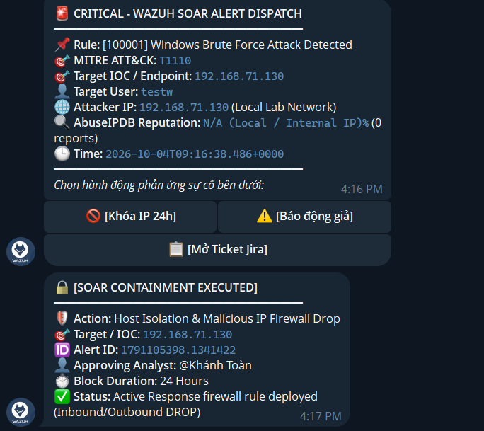

# 📸 Visual Showcase & Đối Chiếu Kiến Trúc SOC Lab (Benchmark & Showcase Guide)

Tài liệu đối chiếu kiến trúc và hướng dẫn xây dựng phân mục **Visual Showcase (Trưng bày Thực nghiệm Trực quan)** cho dự án Wazuh SOC & SOAR Lab, dựa theo chuẩn các dự án An ninh mạng chuyên nghiệp trên GitHub.

---

## 📊 Bảng Đối Chiếu 1-1 (Mapping Matrix)

Bảng đối chiếu trực tiếp giữa cấu trúc của repo tham khảo quốc tế và các thành phần thực tế trong dự án của bạn:

| STT | Phân Mục Repo Tham Khảo (GitHub) | Phân Mục Tương Ứng Trong Dự Án Của Bạn | Căn Cứ & Ảnh Minh Chứng Thực Tế Trong Lab |
| :---: | :--- | :--- | :--- |
| **1** | **Bird's Eye View of my SOC Infrastructure** | **Tổng quan Toàn cảnh Hạ tầng SOC & Network Topology** | Sơ đồ kiến trúc tổng thể 3 máy ảo (`Kali Linux 192.168.71.130`, `Windows 10 192.168.71.129`, `Ubuntu Wazuh Manager 192.168.71.128`) + Cụm Wazuh Manager/Indexer/Dashboard Docker.<br>*(File sơ đồ vector: `architecture/architecture_soar_pipeline.svg`)* |
| **2** | **Incident Handling Workflow** | **Quy trình Tự động hóa SOAR & Human-in-the-Loop** | Sơ đồ chi tiết quy trình 3 Workflows n8n: Ingest Webhook $\rightarrow$ Dual-Mode IOC Resolution $\rightarrow$ Tra cứu AbuseIPDB $\rightarrow$ Gửi Interactive Alert Telegram $\rightarrow$ 3 nhánh hành động (Firewall, False Positive, Jira Cloud).<br>*(Ảnh canvas: `reports/Phase-5/images/03_n8n_workflow_1_enrichment.png`)* |
| **3** | **Incident Case notification via Slack** | **Cảnh báo Tương tác qua Telegram ChatOps 2-Way Bot** | Tin nhắn cảnh báo gửi về Telegram bot `@my_wazuh_soc_alert_bot` trong < 3 giây, hiển thị đầy đủ kỹ thuật MITRE ATT&CK, điểm uy tín AbuseIPDB và **3 nút bấm phản ứng** (`[🚫 Khóa IP 24h]`, `[⚠️ Báo động giả]`, `[📋 Mở Ticket Jira]`).<br>*(Ảnh minh chứng: `reports/Phase-5/images/06_telegram_interactive_alert.png`)* |
| **4** | **TheHive Case information, enriched by AI** | **Quản lý Sự cố trên Atlassian Jira Cloud (Project `KAN`)** | Giao diện Jira Cloud hiển thị Incident Issue được n8n khởi tạo tự động qua REST API v3 với cấu trúc chuẩn Atlassian Document Format (ADF), Alert ID, Rule ID, IOC IP mục tiêu và khuyến nghị điều tra L2.<br>*(Ảnh minh chứng: `reports/Phase-5/images/10_jira_cloud_ticket_details.png`)* |
| **5** | **RAG-knowledgebase assistant integration** | **Cơ sở Tri thức Threat Intel & Bộ Quy trình Chuẩn SOP** | • Đối soát Threat Intelligence tự động (**AbuseIPDB** & **VirusTotal API**).<br>• Bộ quy trình chuẩn ứng phó sự cố NIST/SANS: [`SOP-01`](../playbooks/SOP-01_RDP_Brute_Force_Response.md), [`SOP-02`](../playbooks/SOP-02_Web_LFI_Mitigation.md), [`SOP-03`](../playbooks/SOP-03_SOAR_Automated_Containment.md).<br>• Bộ kiểm thử tự động toàn trình E2E (*Detection-as-Code*). |

---

## 📑 Khung Trình Bày Mẫu (Đưa Vào README.md / Báo Cáo Tốt Nghiệp)

Dưới đây là đoạn mã Markdown mẫu hoàn chỉnh có thể chèn trực tiếp vào `README.md` hoặc các báo cáo đồ án:

```markdown
## 📸 Visual Showcase & Proof of Concept

### 1. 🌐 Bird's Eye View of my SOC & SOAR Infrastructure

> **Mô hình kiến trúc phòng Lab hoàn chỉnh:** Tích hợp giữa Wazuh SIEM v4.14.5, Windows 10 Sysmon EDR, n8n SOAR Automation Engine, AbuseIPDB Threat Intel, Telegram ChatOps 2-way và Atlassian Jira Cloud.

---

### 2. ⚡ Incident Handling & Containment Workflow

> **Quy trình tiếp nhận & xử lý tự động:** Cảnh báo từ Wazuh Manager được truyền qua Webhook JSON, chuẩn hóa với cơ chế Dual-Mode IOC Resolution, tra cứu danh tiếng IP độc hại tự động và phân luồng xử lý phản ứng sự cố theo thời gian thực.

---

### 3. 📲 Real-time Interactive ChatOps via Telegram

> **Cảnh báo tức thì & Phản ứng tương tác (Human-in-the-Loop):** Thông báo gửi về Telegram trong < 3 giây với đầy đủ thông tin bối cảnh tấn công và 3 nút bấm hành động cho phép SOC Analyst ra quyết định trực tiếp từ điện thoại.

---

### 4. 🎫 Automated Jira Cloud Incident Case Management

> **Quản lý hồ sơ sự cố tự động:** Khởi tạo Ticket Incident trên Atlassian Jira Cloud REST API v3 (Project `KAN`), lưu trữ đầy đủ Alert ID, MITRE ATT&CK ID, IOC và hướng dẫn điều tra cho Analyst L2.

---

### 5. 🛡️ Threat Intelligence Enrichment & Incident Playbooks (SOP)

> • **Tự động làm giàu dữ liệu (Enrichment):** Kiểm tra danh tiếng IP qua **AbuseIPDB API** và file mã độc qua **VirusTotal API**.
> • **Quy trình phản ứng chuẩn hóa (NIST SP 800-61 / SANS PICERL):**
>   - [`SOP-01: RDP Brute Force Response`](playbooks/SOP-01_RDP_Brute_Force_Response.md)
>   - [`SOP-02: Web Application LFI Mitigation`](playbooks/SOP-02_Web_LFI_Mitigation.md)
>   - [`SOP-03: SOAR Automated Containment & Case Management`](playbooks/SOP-03_SOAR_Automated_Containment.md)
```

---

## 💎 Điểm Lab Của Bạn Vượt Trội Hơn Repo Tham Khảo

1. **Khả năng phản ứng thực chiến (Active Response / Real Containment):**
   - Hầu hết các repo mẫu trên mạng chỉ dừng lại ở mức gửi tin nhắn hoặc mở ticket thụ động.
   - Lab của bạn **thực sự phát lệnh chặn Firewall trên Endpoint Windows 10** (Inbound & Outbound DROP) chỉ sau một cú chạm trên điện thoại của Analyst.
2. **Tương tác 2 chiều (2-Way Interactive ChatOps):**
   - Triển khai tiến trình `telegram_bridge.py` (Long-Polling Daemon) giúp bắt sự kiện callback tức thì từ mạng Private Lab mà không cần mở Port hay dùng IP Public.
3. **Detection-as-Code & Tự động hóa kiểm thử hồi quy:**
   - Sở hữu bộ kiểm thử tự động toàn trình Python Runners (`scenario_full_killchain.py`, `scenario_rdp_bruteforce.py`, `scenario_lfi_web.py`, `test_soar_webhook.py`).
4. **Công cụ 1-Click Sync Engine:**
   - Sở hữu `sync_env.bat` và `scripts/sync_env.py` giúp tự động kiểm tra tính hợp lệ của API Key và nạp toàn bộ cấu hình lên Wazuh & n8n chỉ bằng một lần nhấp chuột.
