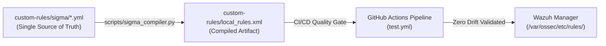

# Sigma Rules — Detection-as-Code (SSOT)

This directory serves as the **Single Source of Truth (SSOT)** for all custom detection rules in the SOC lab. Direct manual editing of `custom-rules/local_rules.xml` is deprecated in favor of this GitOps-driven Detection-as-Code pipeline.

---

## 🏗️ Architecture & SigWaz Translation Pipeline

All detection logic is authored using standard **Sigma YAML** specifications and compiled into production-grade Wazuh XML rules via `scripts/sigma_compiler.py`:

### Core Engine Features (SigWaz Specification):
1. **Logsource Resolution:** Maps Sigma `logsource` (category, product, service) to Wazuh parent rule IDs (`<if_sid>` / `<if_matched_sid>`) to prevent unindexed rule evaluation.
2. **Field Schema Translation:** Automatically maps OS-agnostic Sigma fields (`CommandLine`, `TargetObject`, `User`) to Wazuh Eventchannel paths (`win.eventdata.*`).
3. **PCRE2 Modifier Compilation:** Differentiates `|contains`, `|startswith`, `|endswith`, and `|re` regex patterns with case-insensitive `(?i)` modifiers.
4. **MITRE ATT&CK Extraction:** Parses tags (`attack.t1059.001`) into `<mitre><id>T1059.001</id></mitre>`.
5. **Hierarchical Child Suppression Rules (`level="0"`):** Automatically generates linked child suppression rules for authorized SOAR remediation (`socrunner` via WinRM) to prevent alert storms and self-triggering feedback loops.

---

## 📁 Rule Catalog

| File | Scenario / Stage | Wazuh Rule ID | MITRE ATT&CK | Alert Level |
| :--- | :--- | :---: | :---: | :---: |
| `win_rdp_brute_force.yml` | Scenario 1: Windows RDP Brute Force | `100001` | T1110 | 12 (Critical) |
| `web_lfi_directory_traversal.yml` | Scenario 2: Web LFI / Path Traversal | `100002` | T1190 | 10 (High) |
| `win_powershell_malicious_execution.yml` | Stage 1: Encoded PowerShell Execution | `100004` (Base: `100003`, Sup: `100008`) | T1059.001 | 12 (Critical) |
| `win_registry_uac_bypass_ms_settings.yml` | Stage 2: UAC Bypass via ms-settings | `100007` (Sup: `100009`) | T1548.002 | 12 (Critical) |
| `win_registry_persistence_run_keys.yml` | Stage 3: Persistence Run / RunOnce Keys | `100006` (Sup: `100010`) | T1547.001 | 10 (High) |
| `win_lsass_access_credential_dumping.yml` | Stage 4: LSASS Memory Access / Dumping | `100005` | T1003.001 | 12 (Critical) |
| `net_suricata_nmap_scan.yml` | NIDS Scenario 1: Nmap Network Reconnaissance | `100011` | T1046 | 10 (High) |
| `net_suricata_web_traversal.yml` | NIDS Scenario 2: Web Path Traversal on Wire | `100012` | T1190 | 12 (Critical) |
| `net_suricata_vulnerability_scanner.yml` | NIDS Scenario 3: Automated Scanner Probing | `100013` | T1595.002 | 10 (High) |

---

## 🛠️ CLI Tooling & Workflows

> [!IMPORTANT]
> **Working Directory:** Always execute commands from the **repository root directory** (`D:\Downloads\ATTT\Wazuh-SOC-lab\`).

### Quick Command Reference

| Action | Command (PowerShell / Terminal) | Description |
| :--- | :--- | :--- |
| **Validate Syntax** | `python scripts/sigma_compiler.py --validate` | Validates YAML structure, required fields, and MITRE format |
| **Compile to XML** | `python scripts/sigma_compiler.py --compile` | Compiles all Sigma YAMLs into `custom-rules/local_rules.xml` |
| **Check CI/CD Drift** | `python scripts/sigma_compiler.py --check` | Compares in-memory compiled rules against `local_rules.xml` |
| **Run Test Suite** | `pytest tests/unit/ -v` | Executes complete 16-check automated unit test suite |
