# Suricata NIDS — Network Threat Detection & XDR Architecture

This directory contains the deployment files, custom signatures, and operational tooling to integrate **Suricata 7.x Network Intrusion Detection System (NIDS)** with **Wazuh SIEM**, creating a unified **Extended Detection and Response (XDR)** ecosystem.

---

## 🏗️ Architecture & Telemetry Pipeline

```mermaid
flowchart LR
    subgraph Attacker ["Kali Linux (192.168.71.130)"]
        A["Nmap Scan / Web LFI / Nikto Probing"]
    end

    subgraph NIDS ["Suricata NIDS Engine (Ubuntu 192.168.71.128)"]
        B["AF_PACKET Sniffer (ens33)"] --> C["Signatures (local.rules)"]
        C --> D["/var/log/suricata/eve.json\n(EVE JSON Stream)"]
    end

    subgraph SIEM ["Wazuh Manager (192.168.71.128)"]
        E["wazuh-logcollector\n(<localfile> json)"] --> F["Rule Group: suricata\n(Rules 86600 - 86604)"]
    end

    subgraph SOAR ["SOAR Automation (n8n + Telegram)"]
        G["custom-n8n Webhook"] --> H["Telegram ChatOps Alert"]
    end

    A -->|Raw Packets| B
    D -->|Real-Time Tail| E
    F --> G --> H
```



---

## 📁 File Structure

* **`suricata.yaml`**: Resource-optimized Suricata 7 configuration tailored for VM lab environments (`ens33`, 64MB memcaps, `eve-log` JSON output).
* **`local.rules`**: Production-ready signatures for the SOC lab:
  * `SID 2000001`: Nmap Stealth SYN Scan (T1046).
  * `SID 2000002`: Web LFI / Directory Traversal Attempt (T1190).
  * `SID 2000003`: Automated Vulnerability Scanner Probing (T1595.002 - Nikto/Sqlmap).
  * `SID 2000004`: RDP Connection Flood / Brute Force Probing (T1110).
* **`setup_suricata.sh`**: 1-Click deployment script for the Ubuntu Wazuh VM.

---

## 🚀 Quick Deployment (on Ubuntu VM 192.168.71.128)

```bash
# 1. Run the 1-Click setup script as root
sudo bash deployment/suricata/setup_suricata.sh

# 2. Verify Suricata service is active
systemctl status suricata

# 3. Monitor live EVE JSON alerts
tail -f /var/log/suricata/eve.json | jq .
```
