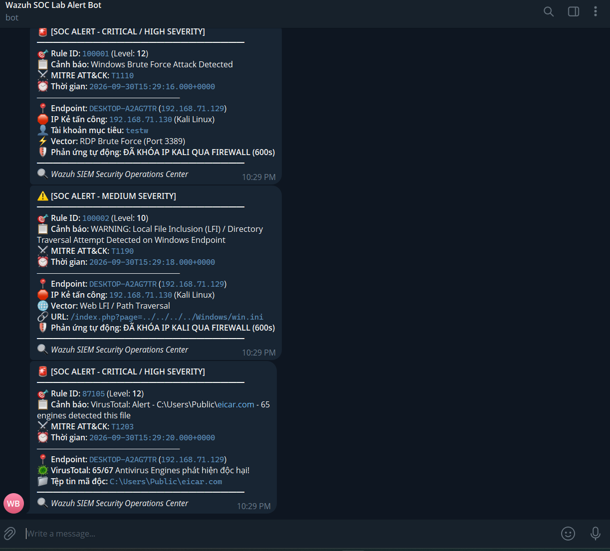

# 📱 CHATOPS INTEGRATION: AUTOMATED ALERTING VIA TELEGRAM (WAZUH SIEM)

This document guides connecting the **Wazuh Manager** system with **Telegram** to automatically send real-time SOC alerts containing comprehensive incident details: Attacking IP, Severity level, MITRE ATT&CK technique, and firewall Active Response containment status.

---

## 📌 1. OPERATING PRINCIPLE (CHATOPS PIPELINE)

```
 [Attack Event] (RDP Brute Force, Web LFI, Malicious File)
         │
         ▼
 [Wazuh Manager]
         │
         │ (1) Matches Rule 100001 / 100002 / 87105
         ▼
 [wazuh-integratord]
         │
         │ (2) Passes alert JSON to /var/ossec/integrations/custom-telegram
         ▼
 [custom-telegram.py]
         │
         │ (3) Formats professional HTML message & transmits via Telegram Bot API
         ▼
 [SOC Team Telegram Channel]
   Receives instant notifications on mobile / desktop (< 1 second)
```

---

## 🤖 2. STEP 1: CREATE TELEGRAM BOT & RETRIEVE CHAT ID (2 MINUTES)

### 2.1. Create Telegram Bot to obtain `BOT_TOKEN`:
1. Open the Telegram app, search for the official bot: **`@BotFather`** (verified checkmark).
2. Click **Start** and send command: `/newbot`
3. Enter a display name for the bot (e.g., `Wazuh SOC Lab Alert Bot`).
4. Enter a username ending in `bot` (e.g., `my_wazuh_soc_alert_bot`).
5. `@BotFather` will return your **HTTP API Token** (format `1234567890:ABCdefGhIJKlmNoPQRsTUVwxyZ`).

### 2.2. Retrieve `CHAT_ID` to receive messages:
1. Click the link of your newly created bot (e.g., `t.me/my_wazuh_soc_alert_bot`) and click **Start** (mandatory to start the bot).
2. Search for bot: **`@userinfobot`**, click **Start** -> The bot returns your numerical **`Id`** (e.g., `987654321`).
   > *Tip:* To send alerts to a Group: Add your bot to the Group, send any message, then open your browser and navigate to: `https://api.telegram.org/bot<TOKEN>/getUpdates` to locate the string `"chat":{"id": -100xxxxxxxxxx}`.

---

## 🧪 3. STEP 2: CONFIGURE `.env` & EXECUTE LIVE TESTING

1. Open the `.env` file in the project root and configure:
   ```text
   TELEGRAM_BOT_TOKEN=1234567890:ABCdefGhIJKlmNoPQRsTUVwxyZ
   TELEGRAM_CHAT_ID=987654321
   ```
2. Run the included test tool to trigger test alerts:
   ```powershell
   # Send test RDP Brute Force alert:
   python integrations/telegram/test_telegram_alert.py --scenario rdp

   # Send test Web LFI alert:
   python integrations/telegram/test_telegram_alert.py --scenario lfi

   # Send test VirusTotal alert:
   python integrations/telegram/test_telegram_alert.py --scenario virustotal
   ```
   *Verify your Telegram application to confirm prompt receipt of formatted alert cards.*



## ⚙️ 4. STEP 3: INSTALL ON WAZUH MANAGER

### 4.1. Copy integration scripts to `wazuh.manager` container
From the Host machine, copy both integration files into `/var/ossec/integrations/` on the Manager:

```powershell
# Copy via SSH to Ubuntu then inject into Docker:
scp integrations/telegram/custom-telegram integrations/telegram/custom-telegram.py wazuh-vm:/tmp/
ssh wazuh-vm "docker cp /tmp/custom-telegram single-node-wazuh.manager-1:/var/ossec/integrations/; docker cp /tmp/custom-telegram.py single-node-wazuh.manager-1:/var/ossec/integrations/; docker exec single-node-wazuh.manager-1 chmod 750 /var/ossec/integrations/custom-telegram /var/ossec/integrations/custom-telegram.py; docker exec single-node-wazuh.manager-1 chown root:wazuh /var/ossec/integrations/custom-telegram /var/ossec/integrations/custom-telegram.py"
```

### 4.2. Declare `<integration>` block in `ossec.conf`
Open `/var/ossec/etc/ossec.conf` on the Manager and add the integration block:

```xml
  <!-- Real-time Telegram ChatOps Alerting Integration -->
  <integration>
    <name>custom-telegram</name>
    <api_key>YOUR_TELEGRAM_BOT_TOKEN</api_key>
    <hook_url>YOUR_TELEGRAM_CHAT_ID</hook_url>
    <rule_id>100001, 100002, 100004, 100005, 100006, 100007, 87105, 92900, 92302, 92305</rule_id>
    <alert_format>json</alert_format>
  </integration>
```

### 4.3. Restart Wazuh Service
```bash
docker exec single-node-wazuh.manager-1 /var/ossec/bin/wazuh-control restart
```
