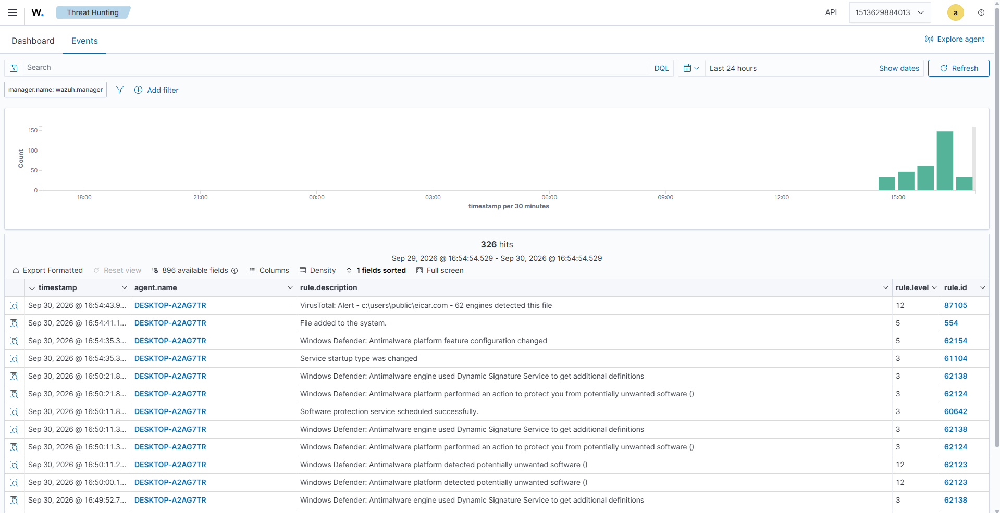
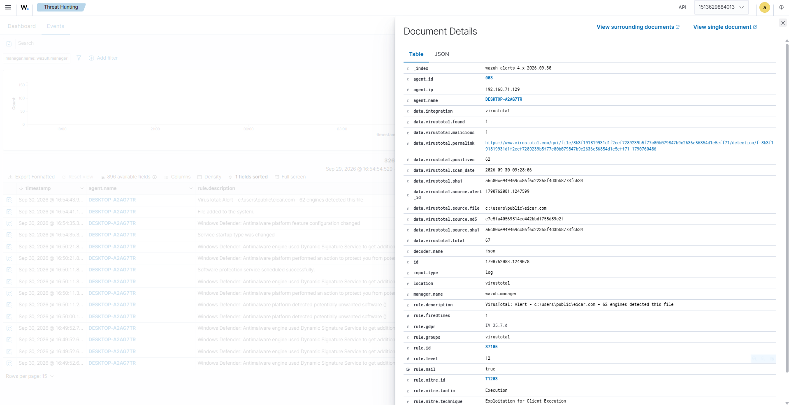

# 🌐 THREAT INTELLIGENCE INTEGRATION: VIRUSTOTAL API IN WAZUH SIEM

This document provides detailed instructions for connecting the **Wazuh Manager** system with the **VirusTotal** Threat Intelligence (TI) database to automatically query the reputation of suspicious files, downloaded binaries, or malware on Windows Endpoints.

---

## 📌 1. OPERATING PRINCIPLE (THREAT INTEL PIPELINE)

```
 [Windows Endpoint]
         │
         │ (1) Detects new file in monitored directory (FIM / Syscheck)
         ▼
 [Wazuh Agent]
         │
         │ (2) Calculates SHA256/MD5 hash and forwards Alert to Manager
         ▼
 [Wazuh Manager]
         │
         │ (3) wazuh-integratord extracts hash and invokes VirusTotal REST API v3
         ▼
 [VirusTotal Cloud Engine]
         │
         │ (4) Cross-checks hash against >70 Antivirus Engines (Kaspersky, Microsoft, CrowdStrike...)
         ▼
 [Wazuh Manager]
         │
         │ (5) If >= 1 Engine flags malicious -> Triggers Rule 87105 (Level 12 - High Severity)
         ▼
 [Wazuh Dashboard]
   Displays comprehensive details: Filename, detection engine count, permalink to VirusTotal
```

---

## 🔑 2. STEP 1: REGISTER FREE VIRUSTOTAL API KEY

1. Visit the official registration page: [https://www.virustotal.com/gui/join-us](https://www.virustotal.com/gui/join-us)
2. Register for a free account (Free Community Account).
3. Log in and click your profile avatar in the top right corner -> Select **API Key**.
4. Copy your API Key string (64-character hexadecimal string).
   > *Note: Free Community accounts permit 4 requests/minute and 500 requests/day.*
5. Run [test_virustotal_lookup.py](test_virustotal_lookup.py) to test whether the lookup succeeds.

---

## ⚙️ 3. STEP 2: CONFIGURE WAZUH MANAGER

### 3.1. Add `<integration>` block to `ossec.conf`
SSH into the Ubuntu Wazuh server and edit the configuration file:

```bash
# Access container or edit directly via Docker:
sudo docker exec -it single-node-wazuh.manager-1 bash
nano /var/ossec/etc/ossec.conf
```

Locate the `<ossec_config>` section and append the following block (replace `<YOUR_VIRUSTOTAL_API_KEY>` with your actual API key):

```xml
  <!-- VirusTotal Threat Intelligence Integration Configuration -->
  <integration>
    <name>virustotal</name>
    <api_key>YOUR_VIRUSTOTAL_API_KEY_HERE</api_key>
    <group>syscheck,</group>
    <alert_format>json</alert_format>
  </integration>
```

> 💡 **Explanation:**
> * `<name>virustotal</name>`: Utilizes Wazuh built-in integration module (located at `/var/ossec/integrations/virustotal`).
> * `<group>syscheck,</group>`: Automatically triggers lookups whenever the File Integrity Monitoring module (FIM - Syscheck) detects a new or modified file on an Endpoint.
> * `<alert_format>json</alert_format>`: Ensures JSON-formatted data transmission.

### 3.2. Restart Wazuh Manager Service
```bash
/var/ossec/bin/wazuh-control restart
```
Following the restart, the `wazuh-integratord` service transitions to **`running`** state (previously exited cleanly when no integrations were configured).

---

## 📂 4. STEP 3: CONFIGURE FIM (SYSCHECK) ON WINDOWS AGENT

To enable Wazuh to compute file hashes and forward them to VirusTotal for inspection, designate sensitive directories on the Windows Endpoint.

Open `C:\Program Files (x86)\ossec-agent\ossec.conf` on Windows 10 (as Administrator), locate the `<syscheck>` block, and add:

```xml
  <syscheck>
    <disabled>no</disabled>
    <frequency>300</frequency>
    <scan_on_start>yes</scan_on_start>

    <!-- Real-time directory monitoring (Note: space between realtime="yes" and check_all="yes") -->
    <directories realtime="yes" check_all="yes">C:\Users\Public</directories>
    <directories realtime="yes" check_all="yes">C:\xampp\htdocs</directories>
    <directories realtime="yes" check_all="yes">C:\Users\testw\Downloads</directories>
  </syscheck>
```

Restart Wazuh Agent service on Windows:
```powershell
Restart-Service WazuhSvc
```

---

## 🧪 5. STEP 4: VERIFICATION & EVIDENCE COLLECTION (POC)

### Test 1: Add Defender Exclusion & Deploy EICAR Test File
> ⚠️ **Note:** Windows Defender will automatically quarantine the EICAR file before Wazuh can compute its hash. Therefore, add the test directory to Defender exclusions prior to creating the file.

Open PowerShell (Run as Administrator) on Windows 10 and execute:

```powershell
# 1. Add C:\Users\Public to Windows Defender exclusion list:
Add-MpPreference -ExclusionPath "C:\Users\Public"

# 2. Generate standard EICAR anti-malware test file:
Set-Content -Path "C:\Users\Public\eicar.com" -Value 'X5O!P%@AP[4\PZX54(P^)7CC)7}$EICAR-STANDARD-ANTIVIRUS-TEST-FILE!$H+H*'
```

### Test 2: Observe Results in Wazuh SIEM
1. **Wazuh Agent** detects `eicar.com` created in `C:\Users\Public`, computes the SHA256 hash: `275a021bbfb6489e54d471899f7db9d1663fc695ec2fe2a2c4538aabf651fd0f`, and forwards the Alert to the Manager.
2. **Wazuh Manager** (`wazuh-integratord`) captures the hash and queries the VirusTotal API.
3. **VirusTotal** returns threat intelligence results with >65 security vendors flagging the sample as malicious.
4. **Wazuh Dashboard** fires an alert:
   * **Rule ID 87105 (Level 12):** `Virustotal: Alert - C:\Users\Public\eicar.com - 65 engines detected this file`
   * Click on Alert details to view: detecting vendor list (`Kaspersky`, `Microsoft`, `Sophos`), threat score, and direct permalink to VirusTotal.



---

## 📊 6. ASSOCIATED DETECTION RULES IN WAZUH

Wazuh bundles default `virustotal` rules in `/var/ossec/ruleset/rules/0490-virustotal_rules.xml`:

| Rule ID | Level | Description | Practical Operational Context in SOC |
| :--- | :--- | :--- | :--- |
| **87101** | 0 | `Virustotal: Integration started` | Records that integration service has started. |
| **87104** | 3 | `Virustotal: File not found or clean` | File not found in database or 0/70 engines flagged as malicious. |
| **87105** | **12** | `Virustotal: Alert - Engines detected this file` | **Confirmed Malware!** Immediately trigger containment and eradication procedures per SOP. |
| **87106** | 0 | `Virustotal: Error querying API` | API error (quota exceeded or invalid API key). |
