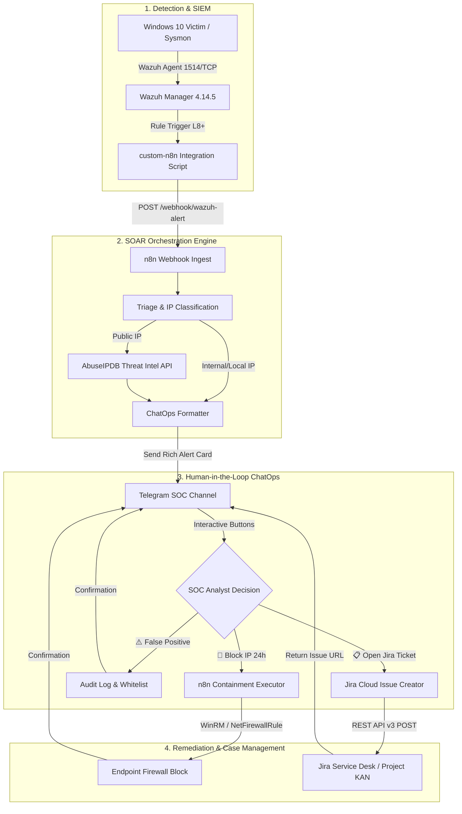

# Wazuh SOAR & SecOps Automation with n8n

This document guides the deployment, configuration, and operation of the **SOAR (Security Orchestration, Automation, and Response)** system, connecting **Wazuh SIEM Manager** directly with **n8n Automation Engine**, **Telegram ChatOps (bidirectional - Human-in-the-Loop)**, **AbuseIPDB Threat Intelligence**, and **Jira Cloud Case Management**.

---

## 1. Architecture Overview



---

## 2. Components & Directory Layout

| File / Directory | Function | Deployment Location |
| :--- | :--- | :--- |
| `custom-n8n` | Bash wrapper script triggered by Wazuh daemon | `/var/ossec/integrations/custom-n8n` |
| `custom-n8n.py` | Python script standardizing JSON alerts and transmitting to Webhook | `/var/ossec/integrations/custom-n8n.py` |
| `workflows/01_wazuh_soar_threat_enrichment.json` | Workflow 1: Alert ingestion, AbuseIPDB lookup, and Telegram interactive card dispatch | Import into n8n Web UI |
| `workflows/02_containment_action_executor.json` | Workflow 2: Callback button ingestion (Block IP / False Positive / Open Jira Ticket) | Import into n8n Web UI |
| `workflows/03_scheduled_healthcheck_cron.json` | Workflow 3: 6-hour recurring cron health check of entire SOC Lab | Import into n8n Web UI |
| `manager/docker/docker-compose-n8n.yml` | Docker Compose configuration for n8n on Wazuh VM | `~/n8n-docker/docker-compose.yml` |

---

## 3. Wazuh Manager Integration Configuration

Configure the `<integration>` block in `/var/ossec/etc/ossec.conf` on Wazuh Manager:

```xml
  <!-- SOAR Workflow Automation Integration (n8n Engine) -->
  <integration>
    <name>custom-n8n</name>
    <hook_url>http://192.168.71.128:5678/webhook/wazuh-alert</hook_url>
    <rule_id>100001, 100002, 100004, 100005, 100006, 100007, 87105</rule_id>
    <alert_format>json</alert_format>
  </integration>
```

Restart Wazuh Manager to reload configuration:
```bash
docker exec -it single-node-wazuh.manager-1 /var/ossec/bin/wazuh-control restart
```

---

## 4. Jira Cloud Case Management Integration

The SOAR system supports the **`[📋 Open Jira Ticket]`** button, automatically generating an Issue via Jira Cloud REST API v3 without requiring manual analyst login:

### 4.1. Generate API Token on Atlassian
1. Navigate to: [https://id.atlassian.com/manage-profile/security/api-tokens](https://id.atlassian.com/manage-profile/security/api-tokens)
2. Click **Create API token** $\rightarrow$ Name it `Wazuh-SOAR-n8n` $\rightarrow$ Copy Token.

### 4.2. Configure Environment Variables in n8n
Add environment variables to `deployment/docker-compose-n8n.yml` or n8n Settings:
- `JIRA_DOMAIN`: Your Atlassian domain (e.g. `tn421015.atlassian.net`)
- `JIRA_EMAIL`: Atlassian account email (e.g. `tn421015@gmail.com`)
- `JIRA_API_TOKEN`: Newly generated API Token
- `JIRA_PROJECT_KEY`: Incident management Project key (e.g. `KAN`)

### 4.3. Jira REST API v3 Payload Schema
When the analyst clicks the button on Telegram, n8n executes the request:
- **Endpoint:** `POST https://<JIRA_DOMAIN>.atlassian.net/rest/api/3/issue`
- **Headers:**
  - `Authorization: Basic <base64(JIRA_EMAIL:JIRA_API_TOKEN)>`
  - `Content-Type: application/json`
- **Fields:**
  - `summary`: `[Wazuh SOAR Incident] Threat Detected on <Attacker_IP>`
  - `issuetype`: `Task` / `Incident`
  - `priority`: `High`

Upon successful creation, n8n directly posts the tracking link `https://<JIRA_DOMAIN>.atlassian.net/browse/<KEY>` to Telegram.

---

## 5. Workflow Import & Activation Guide

1. Access n8n Web UI: `http://192.168.71.128:5678`
2. Create initial administrative account (if first-time access).
3. Click **Add workflow** $\rightarrow$ Menu $\rightarrow$ **Import from File...**
4. Import each of the 3 files sequentially from `integrations/n8n/workflows/`:
   - `01_wazuh_soar_threat_enrichment.json`
   - `02_containment_action_executor.json`
   - `03_scheduled_healthcheck_cron.json`
5. Toggle the **Active** switch in the top right corner of each workflow to begin listening for events.

---

## 6. Verification & End-to-End Testing

Execute automated E2E test script from the workstation:

```powershell
python tests/e2e/test_soar_webhook.py
```

Standard test run output:
```text
=================================================================
  WAZUH SOAR / n8n / TELEGRAM CHATOPS AUTOMATION E2E TEST
=================================================================
[*] Step 1: Checking n8n container health at http://192.168.71.128:5678...
  [+] PASS: n8n Engine is UP (HTTP 200)
[*] Step 2: Testing local 'custom-n8n.py' parser and dispatch logic...
  [+] Script executed with returncode 0
[*] Step 3: Testing ChatOps Callback Webhook at http://192.168.71.128:5678/webhook/telegram-callback...
  [+] Callback Webhook responded with HTTP 200
=================================================================
  [SUCCESS] ALL SOAR / N8N PIPELINE INTEGRATION TESTS PASSED (PASS)
=================================================================
```
