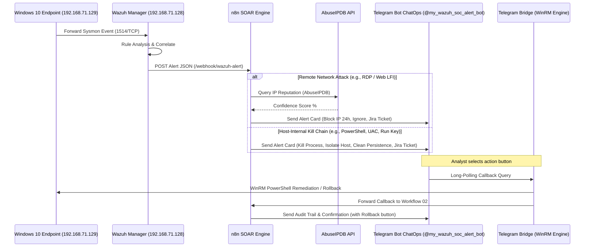

# 📋 QUY TRÌNH ỨNG PHÓ SỰ CỐ TỰ ĐỘNG HÓA QUA SOAR VÀ CHATOPS KHÉP KÍN (SOP-03)
> **Mã quy trình:** SOP-SOC-IR-003  
> **Kỹ thuật MITRE ATT&CK:** [T1110 - Brute Force](https://attack.mitre.org/techniques/T1110/), [T1190 - Exploit Public-Facing App](https://attack.mitre.org/techniques/T1190/), [T1059.001 - PowerShell](https://attack.mitre.org/techniques/T1059/001/), [T1548.002 - Bypass UAC](https://attack.mitre.org/techniques/T1548/002/), [T1547.001 - Registry Run Keys](https://attack.mitre.org/techniques/T1547/001/), [T1003.001 - LSASS Memory](https://attack.mitre.org/techniques/T1003/001/)  
> **Cảnh báo liên quan:** Wazuh Rule IDs `100001, 100002, 100004, 100005, 100006, 100007, 87105`  
> **Hệ thống điều phối:** Wazuh SIEM Manager 4.14.5 + n8n SOAR Engine + Telegram ChatOps + Jira Cloud REST API v3 + WinRM Endpoint Automation  
> **Đối tượng áp dụng:** SOC Analyst L1/L2, Incident Response Lead, SecOps Automation Engineer  

---

## 🎯 1. TỔNG QUAN & MỤC TIÊU

Quy trình này chuẩn hóa các bước tiếp nhận cảnh báo, làm giàu thông tin tình báo mối đe dọa (Threat Enrichment), và thực thi các biện pháp ngăn chặn – hoàn tác khép kín thông qua **mô hình phối hợp Người - Máy (Human-in-the-Loop ChatOps & Closed-Loop Containment)**.

### Mục tiêu cốt lõi:
1. **Giảm thiểu MTTA & MTTR:** Rút ngắn thời gian tiếp nhận cảnh báo (MTTA) xuống dưới **3 giây** và thời gian phản ứng cô lập/xử lý (MTTR) từ 30 phút xuống dưới **15 giây**.
2. **Ngăn chặn & Hoàn tác khép kín (Closed-Loop Containment & Rollback):** Hỗ trợ cách ly tức thời kèm cơ chế hoàn tác 1-click (`[🟢 Mở khóa IP]`) nhằm đảm bảo tính sẵn sàng dịch vụ (High Availability) khi có trường hợp báo động nhầm.
3. **Phản ứng đa tầng (Multi-vector Remediation):** Không chỉ chặn IP mạng mà còn có khả năng tiêu diệt tiến trình độc hại (`[🛑 Diệt Tiến Trình]`) và dọn sạch mã độc bám rễ (`[🧹 Dọn Persistence]`) trên Endpoint qua WinRM.
4. **Kiểm soát chặt chẽ quyết định phản ứng:** Mọi hành động can thiệp Endpoint hoặc khởi tạo ticket điều tra đều yêu cầu xác nhận của SOC Analyst qua ChatOps Telegram 2 chiều.

---

## 🔍 2. GIAI ĐOẠN 1: TIẾP NHẬN CẢNH BÁO & LÀM GIÀU THÔNG TIN (ENRICHMENT)

Khi bất kỳ Rule mức độ cao nào (Level 8 – 12) được kích hoạt trên Wazuh Manager:



---

## 🎮 3. GIAI ĐOẠN 2: MA TRẬN HÀNH ĐỘNG TƯƠNG TÁC 2 CHIỀU (CHATOPS DECISION MATRIX)

Dựa trên bản chất của mối đe dọa (tấn công từ mạng ngoài hay chuỗi tấn công nội bộ Endpoint), giao diện ChatOps tự động hiển thị các nút phản ứng ngữ cảnh:

| Loại Cảnh Báo | Nút Bấm Tương Tác | Callback Payload | Hành Động Tự Động Được Kích Hoạt |
| :--- | :--- | :--- | :--- |
| **Tấn công Mạng (Remote Attack)** | **`[🚫 Khóa IP 24h]`** | `action:block:<ip>:<alert_id>` | WinRM tạo Inbound & Outbound Block Rules trên Windows Defender Firewall; Gửi kèm nút **`[🟢 Mở khóa IP]`** để Rollback. |
| **Sau khi Khóa IP (Rollback)** | **`[🟢 Mở khóa IP]`** | `action:unblock:<ip>:<alert_id>` | WinRM xóa quy tắc chặn tường lửa, khôi phục lưu thông mạng tức thì mà không cần đăng nhập máy nạn nhân. |
| **Tiến trình Độc hại (Kill Chain)** | **`[🛑 Diệt Tiến Trình]`** | `action:killproc:<proc>:<alert_id>` | WinRM cưỡng chế dừng tiến trình độc hại (`Stop-Process -Force`), ngắt phiên điều khiển của tin tặc. |
| **Bám rễ Hệ thống (Persistence)** | **`[🧹 Dọn Persistence]`** | `action:cleanpersist:<ip>:<alert_id>` | WinRM gỡ bỏ Registry Run Key (`WazuhLabPersistenceTest`) và xóa nhánh hijack UAC (`ms-settings`). |
| **Hồ sơ Sự cố (Case Management)** | **`[📋 Mở Ticket Jira]`** | `action:jira:<rule_id>:<target>:<alert_id>` | n8n gọi Jira Cloud REST API v3 tạo Task/Incident trong Project `KAN`, trả về URL theo dõi trực tiếp. |
| **Báo động Giả (False Positive)** | **`[⚠️ Báo động giả]`** | `action:ignore:<target>:<alert_id>` | Ghi nhận sự kiện vào SOAR Audit Trail với trạng thái False Positive, không can thiệp Endpoint. |

---

## 🛡️ 4. CHI TIẾT THỰC THI PHẢN ỨNG TỰ ĐỘNG & HOÀN TÁC (CLOSED-LOOP RUNBOOK)

### 4.1. Cách ly Tường lửa & Sinh nút Hoàn tác (`action:block`)
1. **Lệnh PowerShell thực thi qua WinRM:**
   ```powershell
   New-NetFirewallRule -DisplayName "SOAR-BLOCK-$TargetIP" -Direction Inbound -Action Block -RemoteAddress $TargetIP -ErrorAction SilentlyContinue
   New-NetFirewallRule -DisplayName "SOAR-BLOCK-Out-$TargetIP" -Direction Outbound -Action Block -RemoteAddress $TargetIP -ErrorAction SilentlyContinue
   ```
2. **Thông báo Telegram:** n8n gửi Card xác nhận thành công kèm nút bấm inline:
   - Label: `🟢 [Mở khóa IP (Rollback)]`
   - Callback: `action:unblock:$TargetIP:$AlertID`

### 4.2. Hoàn tác Mở khóa Tường lửa (`action:unblock`)
1. **Lệnh PowerShell thực thi qua WinRM:**
   ```powershell
   Remove-NetFirewallRule -DisplayName "SOAR-BLOCK-$TargetIP*" -ErrorAction SilentlyContinue
   ```
2. **Kết quả:** Lưu lượng mạng giữa Endpoint và IP được phục hồi ngay lập tức, phục vụ kịch bản điều tra hoàn tất hoặc khắc phục lỗi chặn nhầm (False Positive Containment).

### 4.3. Tiêu diệt Tiến trình Độc hại (`action:killproc`)
1. **Lệnh PowerShell thực thi qua WinRM:**
   ```powershell
   $ProgressPreference = 'SilentlyContinue'
   Get-Process -Name "$CleanProcName" -ErrorAction SilentlyContinue | Stop-Process -Force -ErrorAction SilentlyContinue
   ```
2. **Kết quả:** Các tiến trình nguy hiểm như `powershell.exe`, `fodhelper.exe`, mã độc inject bộ nhớ bị chấm dứt tức thì.

### 4.4. Dọn dẹp Mã độc Bám rễ (`action:cleanpersist`)
1. **Lệnh PowerShell thực thi qua WinRM:**
   ```powershell
   $ProgressPreference = 'SilentlyContinue'
   Remove-ItemProperty -Path "HKCU:\Software\Microsoft\Windows\CurrentVersion\Run" -Name "WazuhLabPersistenceTest" -Force -ErrorAction SilentlyContinue
   if (Test-Path "HKCU:\Software\Classes\ms-settings") {
       Remove-Item -Path "HKCU:\Software\Classes\ms-settings" -Recurse -Force -ErrorAction SilentlyContinue
   }
   ```
2. **Kết quả:** Triệt tiêu điểm bám tự khởi động (Autorun Foothold) và kỹ thuật Hijack cơ chế kiểm soát tài khoản (UAC Bypass Registry Hijacking).

### 4.5. Tạo Hồ sơ Sự cố Jira Cloud REST API v3 (`action:jira`)
1. **Gọi API Atlassian Jira Cloud:**
   - **Method:** `POST https://tn421015.atlassian.net/rest/api/3/issue`
   - **Payload:** Tự động tạo Issue loại `Task` kèm thông tin MITRE ATT&CK, Rule ID, Target IOC, và Reporter là tài khoản Telegram của Analyst.
2. **Kết quả:** Phản hồi tin nhắn Telegram chứa Issue Key (ví dụ: `KAN-24`) và đường dẫn Direct link để chuyên viên SOC L2 mở tiếp nhận điều tra.

---

## 🧪 5. KIỂM THỬ HỒI QUY TỰ ĐỘNG (AUTOMATED E2E VERIFICATION)

Quy trình phản ứng khép kín được kiểm thử tự động toàn diện qua kịch bản:
```bash
python tests/e2e/test_soar_closed_loop.py
```
Bộ kiểm thử thực hiện 15 bài test tự động bao gồm:
- Kiểm tra sức khỏe n8n SOAR Engine & Windows 10 WinRM.
- Gửi Alert Ingest mô phỏng đe dọa nội bộ Kill Chain vào Workflow 01.
- Gửi 5 callback tương tác (Block, Unblock, KillProc, CleanPersist, Ignore) vào Workflow 02.
- Kiểm thử thực tế chu trình Tạo Rule Firewall $\rightarrow$ Xác thực có Rule $\rightarrow$ Hoàn tác Rollback Rule $\rightarrow$ Xác thực đã xóa Rule trên Windows 10.
- Kiểm thử thực tế tạo và dọn sạch Registry Run Key & an toàn cú pháp Stop-Process.
