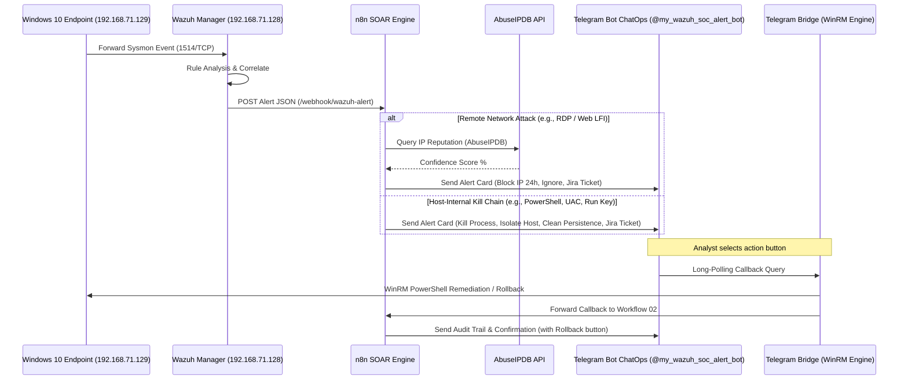

# 📋 AUTOMATED INCIDENT RESPONSE PLAYBOOK VIA SOAR AND CLOSED-LOOP CHATOPS (SOP-03)
> **Playbook Code:** SOP-SOC-IR-003  
> **MITRE ATT&CK Techniques:** [T1110 - Brute Force](https://attack.mitre.org/techniques/T1110/), [T1190 - Exploit Public-Facing App](https://attack.mitre.org/techniques/T1190/), [T1059.001 - PowerShell](https://attack.mitre.org/techniques/T1059/001/), [T1548.002 - Bypass UAC](https://attack.mitre.org/techniques/T1548/002/), [T1547.001 - Registry Run Keys](https://attack.mitre.org/techniques/T1547/001/), [T1003.001 - LSASS Memory](https://attack.mitre.org/techniques/T1003/001/)  
> **Associated Alerts:** Wazuh Rule IDs `100001, 100002, 100004, 100005, 100006, 100007, 87105`  
> **Orchestration Stack:** Wazuh SIEM Manager 4.14.5 + n8n SOAR Engine + Telegram ChatOps + Jira Cloud REST API v3 + WinRM Endpoint Automation  
> **Target Audience:** SOC Analyst L1/L2, Incident Response Lead, SecOps Automation Engineer  

---

## 🎯 1. OVERVIEW & OBJECTIVES

This procedure standardizes the steps for alert ingestion, threat intelligence enrichment (Threat Enrichment), and execution of closed-loop containment and rollback actions through a **Human-in-the-Loop ChatOps & Closed-Loop Containment collaborative model**.

### Core Objectives:
1. **Minimize MTTA & MTTR:** Shorten Mean Time to Acknowledge (MTTA) to under **3 seconds** and containment/remediation response time (MTTR) from 30 minutes to under **15 seconds**.
2. **Closed-Loop Containment & Rollback:** Support immediate isolation accompanied by a 1-click rollback mechanism (`[🟢 Unblock IP]`) to maintain service availability (High Availability) in false positive scenarios.
3. **Multi-vector Remediation:** Expand beyond network IP blocking to terminate malicious processes (`[🛑 Kill Process]`) and purge persistence footholds (`[🧹 Clean Persistence]`) on the Endpoint via WinRM.
4. **Strict Decision Control:** All Endpoint intervention actions or investigation ticket creation require confirmation from a SOC Analyst via bidirectional 2-way Telegram ChatOps.

---

## 🔍 2. PHASE 1: ALERT INGESTION & ENRICHMENT

When any high-severity Rule (Level 8 – 12) is triggered on the Wazuh Manager:



---

## 🎮 3. PHASE 2: 2-WAY CHATOPS DECISION MATRIX

Based on the nature of the threat (external network attack vs host-internal endpoint kill chain), the ChatOps interface dynamically presents contextual response buttons:

| Alert Type | Interactive Button | Callback Payload | Automated Action Triggered |
| :--- | :--- | :--- | :--- |
| **Network Attack (Remote Attack)** | **`[🚫 Block IP 24h]`** | `action:block:<ip>:<alert_id>` | WinRM creates Inbound & Outbound Block Rules on Windows Defender Firewall; Appends a **`[🟢 Unblock IP]`** button for Rollback. |
| **Post-Block (Rollback)** | **`[🟢 Unblock IP]`** | `action:unblock:<ip>:<alert_id>` | WinRM removes firewall block rules, immediately restoring network traffic without requiring host login. |
| **Malicious Process (Kill Chain)** | **`[🛑 Kill Process]`** | `action:killproc:<proc>:<alert_id>` | WinRM forcibly terminates the malicious process (`Stop-Process -Force`), severing the attacker's command-and-control session. |
| **Persistence Foothold (Persistence)** | **`[🧹 Clean Persistence]`** | `action:cleanpersist:<ip>:<alert_id>` | WinRM removes Registry Run Key (`WazuhLabPersistenceTest`) and deletes the hijacked UAC branch (`ms-settings`). |
| **Case Management** | **`[📋 Open Jira Ticket]`** | `action:jira:<rule_id>:<target>:<alert_id>` | n8n invokes Jira Cloud REST API v3 to create a Task/Incident in Project `KAN`, returning a direct tracking URL. |
| **False Positive** | **`[⚠️ False Positive]`** | `action:ignore:<target>:<alert_id>` | Records the event into the SOAR Audit Trail as False Positive without intervening on the Endpoint. |

---

## 🛡️ 4. AUTOMATED RESPONSE EXECUTION & ROLLBACK RUNBOOK (CLOSED-LOOP RUNBOOK)

### 4.1. Firewall Isolation & Rollback Button Generation (`action:block`)
1. **PowerShell command executed via WinRM:**
   ```powershell
   New-NetFirewallRule -DisplayName "SOAR-BLOCK-$TargetIP" -Direction Inbound -Action Block -RemoteAddress $TargetIP -ErrorAction SilentlyContinue
   New-NetFirewallRule -DisplayName "SOAR-BLOCK-Out-$TargetIP" -Direction Outbound -Action Block -RemoteAddress $TargetIP -ErrorAction SilentlyContinue
   ```
2. **Telegram Notification:** n8n sends a success confirmation Card with an inline button:
   - Label: `🟢 [Unblock IP (Rollback)]`
   - Callback: `action:unblock:$TargetIP:$AlertID`

### 4.2. Firewall Unblock Rollback (`action:unblock`)
1. **PowerShell command executed via WinRM:**
   ```powershell
   Remove-NetFirewallRule -DisplayName "SOAR-BLOCK-$TargetIP*" -ErrorAction SilentlyContinue
   ```
2. **Result:** Network traffic between the Endpoint and the IP is immediately restored, supporting completed investigation scenarios or remediating false-positive containment.

### 4.3. Malicious Process Termination (`action:killproc`)
1. **PowerShell command executed via WinRM:**
   ```powershell
   $ProgressPreference = 'SilentlyContinue'
   Get-Process -Name "$CleanProcName" -ErrorAction SilentlyContinue | Stop-Process -Force -ErrorAction SilentlyContinue
   ```
2. **Result:** Malicious processes such as `powershell.exe`, `fodhelper.exe`, or memory-injected payloads are immediately terminated.

### 4.4. Persistence Cleanup (`action:cleanpersist`)
1. **PowerShell command executed via WinRM:**
   ```powershell
   $ProgressPreference = 'SilentlyContinue'
   Remove-ItemProperty -Path "HKCU:\Software\Microsoft\Windows\CurrentVersion\Run" -Name "WazuhLabPersistenceTest" -Force -ErrorAction SilentlyContinue
   if (Test-Path "HKCU:\Software\Classes\ms-settings") {
       Remove-Item -Path "HKCU:\Software\Classes\ms-settings" -Recurse -Force -ErrorAction SilentlyContinue
   }
   ```
2. **Result:** Eradicates the auto-run foothold (Autorun Foothold) and the User Account Control bypass hijacking mechanism (UAC Bypass Registry Hijacking).

### 4.5. Case Management via Jira Cloud REST API v3 (`action:jira`)
1. **Invoke Atlassian Jira Cloud API:**
   - **Method:** `POST https://tn421015.atlassian.net/rest/api/3/issue`
   - **Payload:** Automatically creates a Task issue containing MITRE ATT&CK details, Rule ID, Target IOC, with Reporter set to the Analyst's Telegram account.
2. **Result:** Returns a Telegram message containing the Issue Key (e.g., `KAN-24`) and a Direct link for the SOC L2 analyst to proceed with the investigation.

---

## 🧪 5. AUTOMATED REGRESSION TESTING (AUTOMATED E2E VERIFICATION)

The closed-loop response procedure is comprehensively and automatically tested via the scenario script:
```bash
python tests/e2e/test_soar_closed_loop.py
```
The test suite executes 15 automated test cases, including:
- Health check for n8n SOAR Engine & Windows 10 WinRM.
- Alert ingestion simulating host-internal Kill Chain threats into Workflow 01.
- 5 interactive callbacks (Block, Unblock, KillProc, CleanPersist, Ignore) dispatched to Workflow 02.
- End-to-end verification of the cycle: Create Firewall Rule $\rightarrow$ Verify Rule presence $\rightarrow$ Rollback Rule $\rightarrow$ Verify Rule removal on Windows 10.
- Live testing of Registry Run Key creation and cleanup & safe Stop-Process syntax.
