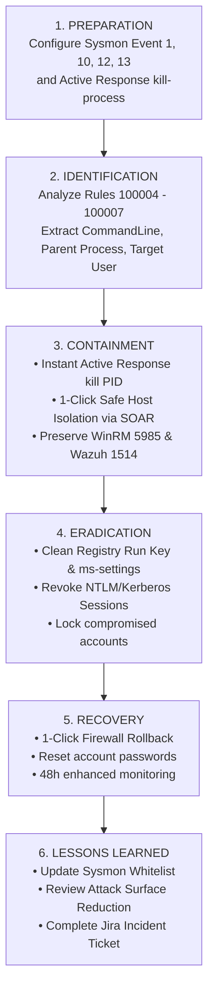

# 📋 INCIDENT RESPONSE PLAYBOOK: ENDPOINT MALWARE KILL CHAIN & CREDENTIAL THEFT (SOP-04)
> **Playbook Code:** SOP-SOC-IR-004  
> **MITRE ATT&CK Techniques:** [T1059.001 - Command and Scripting Interpreter: PowerShell](https://attack.mitre.org/techniques/T1059/001/), [T1548.002 - Abuse Elevation Control Mechanism: Bypass UAC](https://attack.mitre.org/techniques/T1548/002/), [T1547.001 - Boot or Logon Autostart Execution: Registry Run Keys](https://attack.mitre.org/techniques/T1547/001/), [T1003.001 - OS Credential Dumping: LSASS Memory](https://attack.mitre.org/techniques/T1003/001/)  
> **Detection Rules:** Wazuh Rule `100004` (PowerShell Base64), `100007` (UAC Bypass Fodhelper), `100006` (Persistence Run Key), `100005` (LSASS ProcessAccess)  
> **Compliance Standards:** NIST SP 800-61 Rev. 2 (Computer Security Incident Handling Guide) & SANS PICERL  
> **Target Audience:** SOC Analyst L1/L2, Incident Response Engineer, Endpoint Security Specialist  

---

## 🎯 1. OVERVIEW & OBJECTIVES

This procedure standardizes the investigation, containment, and remediation steps when an advanced attack chain (Full Cyber Kill Chain) targeting Windows Endpoint workstations is detected via Microsoft Sysmon telemetry.

### Core Objectives:
1. **Rapid Behavioral Chain Identification:** Detect phases spanning obfuscated code execution (Execution) $\rightarrow$ privilege escalation (Privilege Escalation) $\rightarrow$ persistence establishment (Persistence) $\rightarrow$ in-memory credential extraction (Credential Access).
2. **Instant Active Response Activation:** Terminate malicious processes (`kill-process.ps1`) backed by a Safe Whitelist to prevent Blue Screens (BSOD).
3. **Complete Persistence Eradication:** Thoroughly eliminate auto-start Registry keys and sanitize manipulated environment variables.
4. **Account Protection & Session Revocation:** Purge Kerberos/NTLM tickets of administrative accounts upon evidence of unauthorized access to `lsass.exe` memory.

---

## 🧭 2. 6-STEP INCIDENT RESPONSE PROCESS (NIST / SANS FRAMEWORK)



---

## 🔍 3. DETAILED EXECUTION STEPS

### Step 1: Incident Reception & Triage (Triage & Severity Classification)
Upon receiving an alert from Wazuh SIEM or Telegram ChatOps, the Analyst examines the telemetry fields:

| Rule ID | Alert Title | Severity | Critical Telemetry Indicators to Audit |
| :---: | :--- | :---: | :--- |
| **`100004`** | Malicious PowerShell EncodedCommand | Level 12 (Critical) | `win.eventdata.commandLine` (check flags `-enc`, `-w hidden`, `-nop`), `win.eventdata.parentImage`. Decode Base64 payload. |
| **`100007`** | UAC Bypass via Registry Hijacking | Level 12 (Critical) | `win.eventdata.targetObject` contains `ms-settings\Shell\Open\command`. Parent process is `fodhelper.exe`. |
| **`100006`** | Registry Persistence Run Key Created | Level 10 (High) | `win.eventdata.targetObject` contains `CurrentVersion\Run`. Identify executable path registered for autostart. |
| **`100005`** | LSASS Memory Access / Dumping | Level 12 (Critical) | `win.eventdata.targetImage` is `lsass.exe`, `grantedAccess` contains `0x1010` or `0x1F0FFF` (indicators of Mimikatz / Procdump). |

---

### Step 2: Emergency Containment (Containment)
1. **Verify Active Response Status:**
   - Confirm the malicious process was terminated by `kill-process.ps1`.
   - Check log on the Windows host: `C:\Program Files (x86)\ossec-agent\active-response\active-responses.log`.
2. **Safe Host Isolation:**
   - If an LSASS dump (Rule 100005) or successful UAC bypass is detected, the Analyst clicks the **`[🔒 Isolate Host]`** button on Telegram.
   - SOAR enforces Inbound/Outbound Firewall block rules while **preserving WinRM port 5985 and Wazuh port 1514/1515** to maintain remote management access.

---

### Step 3: Threat Eradication (Eradication)
Execute cleanup commands via WinRM or click the **`[🧹 Clean Persistence]`** button on Telegram ChatOps:

```powershell
# 1. Remove malicious auto-start Registry key
Remove-ItemProperty -Path "HKCU:\Software\Microsoft\Windows\CurrentVersion\Run" -Name "WazuhLabPersistenceTest" -ErrorAction SilentlyContinue

# 2. Purge UAC ms-settings Hijack structure
Remove-Item -Path "HKCU:\Software\Classes\ms-settings" -Recurse -Force -ErrorAction SilentlyContinue

# 3. Purge all Kerberos tickets and current logon sessions
klist purge
```

---

### Step 4: Recovery & Post-Incident (Recovery & Lessons Learned)
1. Click the **`[🟢 Unblock IP / Rollback]`** button on Telegram after malware eradication, restoring workstation network connectivity within 5 seconds.
2. Enforce immediate password resets for accounts logged onto the victim machine (especially Local Admin / Domain Admin accounts).
3. Enable **Attack Surface Reduction (ASR)** rules in Windows Defender:
   - *Block credential stealing from the Windows local security authority subsystem (lsass.exe)*.
   - *Block executable content from email client and webmail*.
4. Update the Jira Incident Ticket with the malware analysis findings and close the case.
