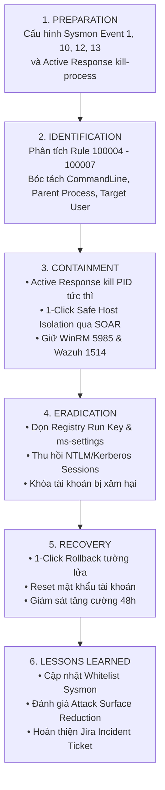

# 📋 QUY TRÌNH ỨNG PHÓ CHUỖI TẤN CÔNG ENDPOINT MALWARE & CHIẾM ĐOẠT THÔNG TIN XÁC THỰC (SOP-04)
> **Mã quy trình:** SOP-SOC-IR-004  
> **Kỹ thuật MITRE ATT&CK:** [T1059.001 - Command and Scripting Interpreter: PowerShell](https://attack.mitre.org/techniques/T1059/001/), [T1548.002 - Abuse Elevation Control Mechanism: Bypass UAC](https://attack.mitre.org/techniques/T1548/002/), [T1547.001 - Boot or Logon Autostart Execution: Registry Run Keys](https://attack.mitre.org/techniques/T1547/001/), [T1003.001 - OS Credential Dumping: LSASS Memory](https://attack.mitre.org/techniques/T1003/001/)  
> **Quy tắc phát hiện:** Wazuh Rule `100004` (PowerShell Base64), `100007` (UAC Bypass Fodhelper), `100006` (Persistence Run Key), `100005` (LSASS ProcessAccess)  
> **Chuẩn tuân thủ:** NIST SP 800-61 Rev. 2 (Computer Security Incident Handling Guide) & SANS PICERL  
> **Đối tượng áp dụng:** SOC Analyst L1/L2, Incident Response Engineer, Endpoint Security Specialist  

---

## 🎯 1. TỔNG QUAN & MỤC TIÊU QUY TRÌNH

Quy trình này chuẩn hóa các bước điều tra, ngăn chặn và khắc phục sự cố khi phát hiện chuỗi tấn công nâng cao (Full Cyber Kill Chain) nhắm vào máy trạm Windows Endpoint thông qua Microsoft Sysmon telemetry.

### Mục tiêu cốt lõi:
1. **Nhận diện nhanh chuỗi hành vi:** Phát hiện các giai đoạn từ thực thi mã ẩn danh (Execution) $\rightarrow$ leo thang đặc quyền (Privilege Escalation) $\rightarrow$ thiết lập bám rễ (Persistence) $\rightarrow$ trích xuất mật khẩu trong bộ nhớ (Credential Access).
2. **Kích hoạt ngăn chặn tức thì (Instant Active Response):** Tiêu diệt tiến trình độc hại (`kill-process.ps1`) với cơ chế Safe Whitelist chống lỗi màn hình xanh (BSOD).
3. **Triệt tiêu bám rễ hoàn toàn:** Xóa bỏ triệt để các khóa Registry tự khởi động và dọn dẹp biến môi trường bị thao túng.
4. **Bảo vệ tài khoản & Kiểm soát phiên:** Thu hồi vé Kerberos/NTLM của các tài khoản quản trị khi có dấu hiệu truy cập trái phép vào bộ nhớ `lsass.exe`.

---

## 🧭 2. QUY TRÌNH ỨNG PHÓ 6 BƯỚC (NIST / SANS FRAMEWORK)



---

## 🔍 3. CHI TIẾT CÁC BƯỚC THỰC HIỆN

### Bước 1: Tiếp Nhận & Phân Loại Sự Cố (Triage & Severity Classification)
Khi nhận cảnh báo từ Wazuh SIEM hoặc Telegram ChatOps, Analyst kiểm tra các trường telemetry:

| Rule ID | Tên Cảnh Báo | Mức Độ | Chỉ Số Telemetry Trọng Yếu Cần Rà Soát |
| :---: | :--- | :---: | :--- |
| **`100004`** | Malicious PowerShell EncodedCommand | Level 12 (Critical) | `win.eventdata.commandLine` (tìm cờ `-enc`, `-w hidden`, `-nop`), `win.eventdata.parentImage`. Giải mã Base64 payload. |
| **`100007`** | UAC Bypass via Registry Hijacking | Level 12 (Critical) | `win.eventdata.targetObject` chứa `ms-settings\Shell\Open\command`. Tiến trình cha là `fodhelper.exe`. |
| **`100006`** | Registry Persistence Run Key Created | Level 10 (High) | `win.eventdata.targetObject` chứa `CurrentVersion\Run`. Xác định đường dẫn file thực thi được đăng ký tự khởi động. |
| **`100005`** | LSASS Memory Access / Dumping | Level 12 (Critical) | `win.eventdata.targetImage` là `lsass.exe`, `grantedAccess` chứa quyền `0x1010` hoặc `0x1F0FFF` (dấu hiệu Mimikatz / Procdump). |

---

### Bước 2: Ngăn Chặn Khẩn Cấp (Containment)
1. **Kiểm tra trạng thái Active Response:**
   - Xác nhận tiến trình độc hại đã bị tiêu diệt bởi `kill-process.ps1`.
   - Kiểm tra log tại máy Windows: `C:\Program Files (x86)\ossec-agent\active-response\active-responses.log`.
2. **Cách ly máy trạm an toàn (Safe Host Isolation):**
   - Nếu phát hiện LSASS dump (Rule 100005) hoặc UAC bypass thành công, Analyst bấm nút **`[🔒 Cách ly Host]`** trên Telegram.
   - SOAR áp dụng luật chặn Firewall Inbound/Outbound, **bảo toàn cổng WinRM 5985 và Wazuh 1514/1515** để duy trì kênh điều khiển từ xa.

---

### Bước 3: Diệt Trừ Mối Đe Dọa (Eradication)
Thực thi các lệnh dọn dẹp qua WinRM hoặc bấm nút **`[🧹 Dọn Persistence]`** trên Telegram ChatOps:

```powershell
# 1. Gỡ bỏ khóa Registry tự khởi động độc hại
Remove-ItemProperty -Path "HKCU:\Software\Microsoft\Windows\CurrentVersion\Run" -Name "WazuhLabPersistenceTest" -ErrorAction SilentlyContinue

# 2. Xóa sạch cấu trúc Hijack UAC ms-settings
Remove-Item -Path "HKCU:\Software\Classes\ms-settings" -Recurse -Force -ErrorAction SilentlyContinue

# 3. Thu hồi toàn bộ vé Kerberos và phiên đăng nhập hiện tại
klist purge
```

---

### Bước 4: Khôi Phục & Hậu Sự Cố (Recovery & Lessons Learned)
1. Bấm nút **`[🟢 Mở khóa IP / Rollback]`** trên Telegram sau khi đã diệt trừ mã độc, khôi phục mạng cho máy trạm trong vòng 5 giây.
2. Yêu cầu đổi mật khẩu ngay lập tức cho các tài khoản đăng nhập trên máy nạn nhân (đặc biệt là tài khoản Local Admin / Domain Admin).
3. Bổ sung chính sách **Attack Surface Reduction (ASR)** trên Windows Defender:
   - *Block credential stealing from the Windows local security authority subsystem (lsass.exe)*.
   - *Block executable content from email client and webmail*.
4. Cập nhật Jira Incident Ticket với báo cáo phân tích mã độc và đóng vụ việc.
