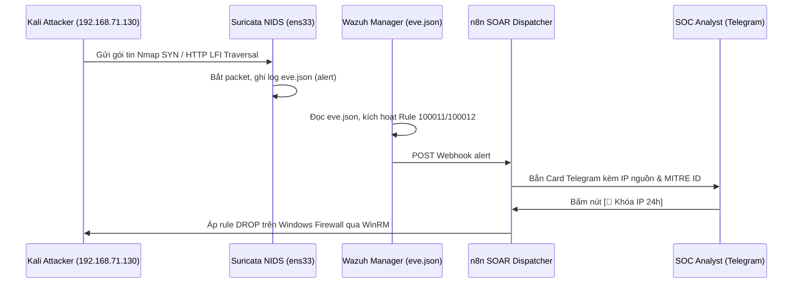

# 📋 QUY TRÌNH ỨNG PHÓ XÂM NHẬP TẦNG MẠNG SURICATA NIDS & XDR (SOP-05)
> **Mã quy trình:** SOP-SOC-IR-005  
> **Kỹ thuật MITRE ATT&CK:** [T1046 - Network Service Discovery](https://attack.mitre.org/techniques/T1046/), [T1595 - Active Scanning](https://attack.mitre.org/techniques/T1595/), [T1190 - Exploit Public-Facing Application](https://attack.mitre.org/techniques/T1190/)  
> **Quy tắc phát hiện:** Wazuh Rule `100011` (Nmap Stealth SYN Scan), `100012` (Web LFI on Wire), `100013` (Vulnerability Scanners)  
> **Nguồn Telemetry:** Suricata 8.0.7 NIDS EVE JSON Stream (`/var/log/suricata/eve.json`)  
> **Chuẩn tuân thủ:** NIST SP 800-61 Rev. 2 & SANS PICERL  
> **Đối tượng áp dụng:** SOC Analyst L1/L2, Network Security Engineer, XDR Operations Specialist  

---

## 🎯 1. TỔNG QUAN & MỤC TIÊU QUY TRÌNH

Quy trình này chuẩn hóa các bước tiếp nhận, phân tích lưu lượng mạng thô và ứng phó các cuộc tấn công do thám mạng, dò quét cổng và khai thác lỗ hổng web được bắt bởi **Suricata NIDS Engine** trên card mạng giám sát (`ens33`).

### Mục tiêu cốt lõi:
1. **Phát hiện sớm ở giai đoạn trinh sát (Pre-Attack Reconnaissance):** Chặn đứng kẻ tấn công ngay khi thực hiện quét cổng ngầm (Stealth SYN scan) trước khi chúng kịp tìm ra dịch vụ có lỗ hổng.
2. **Đối chiếu XDR đa nguồn (Network + Host Correlation):** Kết hợp cảnh báo mạng từ Suricata với log ứng dụng Web Apache và Sysmon trên Endpoint để xác định cuộc tấn công có thành công hay không.
3. **Phản ứng chặn IP tự động trên mạng (Perimeter & Host Blocking):** Tự động phát lệnh khóa IP nguồn thông qua SOAR n8n và Windows Firewall.

---

## 🔍 2. BẢNG PHÂN LOẠI CẢNH BÁO SURICATA TRỌNG YẾU

| Suricata SID | Wazuh Rule ID | Tên Cảnh Báo Mạng | Mức Độ | Hành Vi Kẻ Tấn Công |
| :---: | :---: | :--- | :---: | :--- |
| **`2000001`** | **`100011`** | Suricata: Nmap Stealth SYN Scan Detected | Level 8 (Medium) | Kali quét dồn dập gói TCP SYN với cờ `flags: S;` trên nhiều cổng khác nhau để vẽ bản đồ mạng nội bộ. |
| **`2000002`** | **`100012`** | Suricata: Web LFI Directory Traversal on Wire | Level 10 (High) | Payload chứa chuỗi URL traversal (`..%2f`, `win.ini`) đi qua dây mạng trước khi chạm tới tầng ứng dụng Web. |
| **`2000003`** | **`100013`** | Suricata: Suspicious Vulnerability Scanner UA | Level 8 (Medium) | Máy quét tự động (Nikto, sqlmap, gobuster, dirb) gửi HTTP Request với User-Agent đặc trưng. |

---

## 🧭 3. CÁC BƯỚC THỰC HIỆN ỨNG PHÓ (STEP-BY-STEP)



### Bước 1: Điều Tra & Bóc Tách Luồng Mạng (Network Packet Triage)
1. Truy vấn chi tiết sự kiện Suricata trên Wazuh Server:
   ```bash
   grep "2000001" /var/log/suricata/eve.json | tail -n 5 | jq .
   ```
2. Rà soát các trường quan trọng:
   - `src_ip`: Địa chỉ IP nguồn phát động tấn công.
   - `dest_port`: Cổng dịch vụ đang bị thăm dò (ví dụ: 80 HTTP, 3389 RDP, 21 FTP).
   - `http.url` và `http.http_user_agent`: Nội dung chuỗi payload và công cụ quét.

### Bước 2: Đối Chiếu Trạng Thái XDR (Correlation Check)
* **Kịch bản LFI (Rule 100012):** Đối chiếu với Apache Access Log trên máy trạm Windows:
  - Nếu mã phản hồi là `HTTP 404` hoặc `403` $\rightarrow$ Tấn công thất bại, xếp mức **P3 - Medium**.
  - Nếu mã phản hồi là `HTTP 200` và dung lượng response lớn (chứa nội dung `win.ini`) $\rightarrow$ Tấn công thành công, nâng mức khẩn cấp lên **P1 - Critical**.

### Bước 3: Ngăn Chặn Khẩn Cấp (Containment)
* Bấm nút **`[🚫 Khóa IP 24h]`** trên Telegram ChatOps để chặn ngay toàn bộ gói tin từ IP kẻ tấn công.
* Trường hợp có dải IP quét mạng rộng lớn (Subnet Scan), cấu hình rule chặn trực tiếp trên Router/Tường lửa hoặc iptables trên Ubuntu:
  ```bash
  sudo iptables -I INPUT -s 192.168.71.130 -j DROP
  ```

### Bước 4: Tối Ưu Hóa & Đóng Vụ Việc (Tuning & Lessons Learned)
1. Trường hợp cảnh báo phát sinh từ máy quét bảo mật nội bộ hợp lệ (Nessus, Qualys):
   - Cập nhật Whitelist trong file cấu hình Suricata: `/etc/suricata/rules/local.rules` hoặc tạo suppress rule.
2. Kiểm tra lại lưu lượng mạng trên OpenSearch Dashboards đảm bảo không còn gói tin độc hại từ IP vi phạm.
3. Ghi nhận báo cáo vào Jira Cloud Ticket và hoàn tất xử lý.
