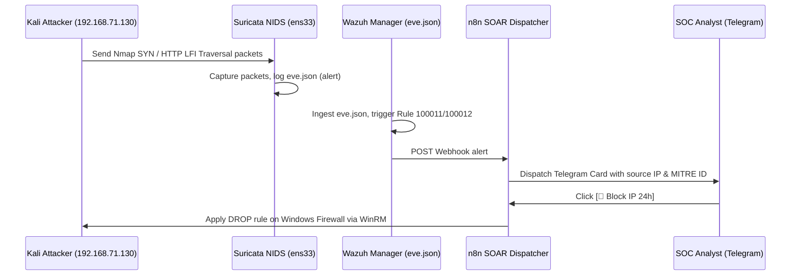

# 📋 INCIDENT RESPONSE PLAYBOOK: SURICATA NIDS NETWORK INTRUSION & XDR (SOP-05)
> **Playbook Code:** SOP-SOC-IR-005  
> **MITRE ATT&CK Techniques:** [T1046 - Network Service Discovery](https://attack.mitre.org/techniques/T1046/), [T1595 - Active Scanning](https://attack.mitre.org/techniques/T1595/), [T1190 - Exploit Public-Facing Application](https://attack.mitre.org/techniques/T1190/)  
> **Detection Rules:** Wazuh Rule `100011` (Nmap Stealth SYN Scan), `100012` (Web LFI on Wire), `100013` (Vulnerability Scanners)  
> **Telemetry Source:** Suricata 8.0.7 NIDS EVE JSON Stream (`/var/log/suricata/eve.json`)  
> **Compliance Standards:** NIST SP 800-61 Rev. 2 & SANS PICERL  
> **Target Audience:** SOC Analyst L1/L2, Network Security Engineer, XDR Operations Specialist  

---

## 🎯 1. OVERVIEW & OBJECTIVES

This procedure standardizes the steps for receiving, analyzing raw network traffic, and responding to network reconnaissance, port scanning, and web exploitation attacks captured by the **Suricata NIDS Engine** on the monitoring network interface (`ens33`).

### Core Objectives:
1. **Early Detection at Pre-Attack Reconnaissance:** Halt attackers during covert port scanning (Stealth SYN scan) before they discover vulnerable services.
2. **Cross-source XDR Correlation (Network + Host Correlation):** Correlate network alerts from Suricata with Apache Web application logs and Sysmon telemetry on the Endpoint to determine attack success.
3. **Automated Network & Host IP Blocking:** Automatically trigger source IP block commands through SOAR n8n and Windows Firewall.

---

## 🔍 2. KEY SURICATA ALERT CLASSIFICATION TABLE

| Suricata SID | Wazuh Rule ID | Network Alert Title | Severity | Attacker Behavior |
| :---: | :---: | :--- | :---: | :--- |
| **`2000001`** | **`100011`** | Suricata: Nmap Stealth SYN Scan Detected | Level 8 (Medium) | Kali floods TCP SYN packets with flag `flags: S;` across multiple ports to map the internal network. |
| **`2000002`** | **`100012`** | Suricata: Web LFI Directory Traversal on Wire | Level 10 (High) | Payload contains URL traversal strings (`..%2f`, `win.ini`) traversing the network wire before reaching the Web application layer. |
| **`2000003`** | **`100013`** | Suricata: Suspicious Vulnerability Scanner UA | Level 8 (Medium) | Automated vulnerability scanners (Nikto, sqlmap, gobuster, dirb) sending HTTP requests with distinctive User-Agents. |

---

## 🧭 3. INCIDENT RESPONSE EXECUTION (STEP-BY-STEP)



### Step 1: Investigation & Network Packet Triage
1. Query detailed Suricata events on Wazuh Server:
   ```bash
   grep "2000001" /var/log/suricata/eve.json | tail -n 5 | jq .
   ```
2. Examine critical fields:
   - `src_ip`: Source IP address launching the attack.
   - `dest_port`: Targeted service port (e.g., 80 HTTP, 3389 RDP, 21 FTP).
   - `http.url` and `http.http_user_agent`: Malicious payload strings and scanning tool signatures.

### Step 2: XDR Correlation Check
* **LFI Scenario (Rule 100012):** Correlate with Apache Access Logs on the Windows endpoint:
  - If response code is `HTTP 404` or `403` $\rightarrow$ Attack failed, classify as **P3 - Medium**.
  - If response code is `HTTP 200` with substantial payload response size (containing `win.ini` content) $\rightarrow$ Attack succeeded, escalate to **P1 - Critical**.

### Step 3: Emergency Containment
* Click the **`[🚫 Block IP 24h]`** button on Telegram ChatOps to immediately drop all traffic from the attacking IP.
* In case of broad subnet scans (Subnet Scan), configure direct drop rules on the Router/Firewall or iptables on Ubuntu:
   ```bash
   sudo iptables -I INPUT -s 192.168.71.130 -j DROP
   ```

### Step 4: Rule Tuning & Case Closure (Tuning & Lessons Learned)
1. In case of alerts generated by legitimate internal vulnerability scanners (Nessus, Qualys):
   - Update whitelist in Suricata rules: `/etc/suricata/rules/local.rules` or create suppression rules.
2. Verify network traffic in OpenSearch Dashboards to confirm no further malicious packets from the offending IP.
3. Document findings in the Jira Cloud Ticket and close the case.
