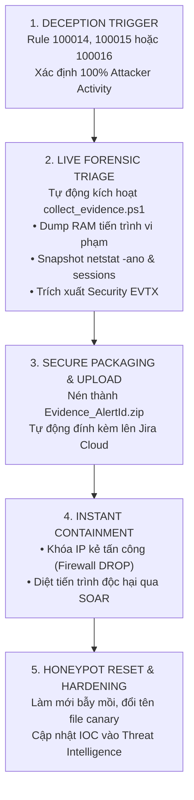

# 📋 QUY TRÌNH ỨNG PHÓ BẪY MỒI DECEPTION & THU THẬP CHỨNG CỨ PHÁP Y SỐ (SOP-06)
> **Mã quy trình:** SOP-SOC-IR-006  
> **Kỹ thuật MITRE ATT&CK:** [T1083 - File and Directory Discovery](https://attack.mitre.org/techniques/T1083/), [T1078 - Valid Accounts](https://attack.mitre.org/techniques/T1078/), [T1046 - Network Service Discovery](https://attack.mitre.org/techniques/T1046/)  
> **Quy tắc phát hiện:** Wazuh Rule `100014` (Canary Honey-File SACL 4663), `100015` (Honey-Account 4625), `100016` (FTP Decoy 21)  
> **Cơ chế đặc thù:** **Zero False Positive (0% FP)** — Phòng thủ chủ động (Active Defense)  
> **Tiêu chuẩn pháp y số:** NIST SP 800-86 (Guide to Integrating Forensic Techniques into Incident Response)  
> **Đối tượng áp dụng:** SOC Analyst L2, DFIR Specialist, Incident Response Lead  

---

## 🎯 1. TỔNG QUAN & NGUYÊN TẮC ZERO FALSE POSITIVE

Bẫy mồi (Deception Grid) là các tài nguyên ảo, không phục vụ bất kỳ mục đích kinh doanh hay vận hành bình thường nào của doanh nghiệp. Do đó, **bất kỳ hành vi tương tác nào vào bẫy mồi đều là dấu hiệu 100% của kẻ tấn công hoặc mã độc đang do thám hệ thống**.

### Nguyên tắc ứng phó khẩn cấp:
1. **Phân loại mặc định là P1 - Critical:** Không cần qua bước xác minh người dùng hợp lệ hay lo ngại cảnh báo giả (Alert Fatigue).
2. **Bảo tồn chứng cứ số trước khi tiêu diệt (Forensics Preservation First):** Tiến trình độc hại phải được thu thập RAM dump và snapshot kết nối mạng trước khi bị diệt (`Stop-Process`), nhằm giữ nguyên vẹn chuỗi bằng chứng pháp lý (Chain of Custody).
3. **Tự động đóng gói & đính kèm hồ sơ:** File chứng cứ số nén `.zip` được đẩy trực tiếp lên Jira Cloud Ticket phục vụ phân tích chuyên sâu.

---

## 🔍 2. DANH MỤC CÁC TẦNG BẪY MỒI & CHỈ SỐ KÍCH HOẠT

| Tầng Bẫy Mồi | Tài Nguyên Mồi Nhử | Nguồn Log / Event ID | Wazuh Rule | Hành Vi Kẻ Tấn Công |
| :---: | :--- | :---: | :---: | :--- |
| **Tầng 1: Canary File** | `C:\Users\Public\IT_Admin_Credentials.xlsx` | Windows Security SACL<br/>**Event ID 4663** (`ReadData`) | **`100014`** | Kẻ tấn công hoặc ransomware mở file đọc mật khẩu quản trị. |
| **Tầng 2: Honey-Account** | Local User: `backup_admin` | Windows Security<br/>**Event ID 4625** (Logon Failure) | **`100015`** | Kẻ tấn công thử đăng nhập bằng tài khoản quản trị mồi nhử. |
| **Tầng 3: Network Decoy** | TCP Port 21 (FTP Listener Socket) | Decoy Service Console<br/>`[FTP-DECOY]` prefix | **`100016`** | Kali dò quét cổng hoặc gửi lệnh USER/PASS vào dịch vụ FTP giả lập. |

---

## 🧭 3. QUY TRÌNH ĐIỀU TRA & BẢO TỒN CHỨNG CỨ PHÁP Y SỐ



---

## 🛠️ 4. CHI TIẾT THỰC THI DFIR

### Bước 1: Thu Thập Chứng Cứ Số Trực Tiếp (Live Forensics Collection)
Ngay khi Rule Deception được kích hoạt, kịch bản [`collect_evidence.ps1`](../endpoint/deception/collect_evidence.ps1) được thực thi:

```powershell
# 1. Trích xuất MiniDump của tiến trình nghi vấn
rundll32.exe C:\Windows\System32\comsvcs.dll, MiniDump $TargetPID "$EvidenceDir\dump_$TargetPID.dmp" full

# 2. Thu thập bảng kết nối mạng thời gian thực
netstat -ano > "$EvidenceDir\network_connections.txt"

# 3. Thu thập danh sách các phiên đăng nhập đang hoạt động
query user > "$EvidenceDir\active_sessions.txt"
qwinsta > "$EvidenceDir\terminal_sessions.txt"

# 4. Trích xuất bản sao log bảo mật Windows EVTX
wevtutil epl Security "$EvidenceDir\Security_Evidence.evtx" /q:"*[System[(EventID=4663 or EventID=4625)]]"

# 5. Nén gói chứng cứ pháp y
Compress-Archive -Path "$EvidenceDir\*" -DestinationPath "C:\Forensics\Evidence_$AlertID.zip" -Force
```

### Bước 2: Xác Thực Đính Kèm Hồ Sơ Sự Cố Trên Jira Cloud
1. Truy cập ticket sự cố tương ứng trong Jira Project `KAN`: `https://tn421015.atlassian.net/jira/software/projects/KAN/issues/`
2. Kiểm tra phần **Attachments** của ticket, xác nhận file `Evidence_<AlertId>.zip` đã được tải lên thành công.
3. Chuyên viên DFIR tải file zip về máy phân tích cô lập (Remnux / SANS SIFT) để dịch ngược chuỗi lệnh, trích xuất chuỗi C2 IP và khóa giải mã trong file `.dmp`.

### Bước 3: Ngăn Chặn & Khôi Phục Hiện Trường Bẫy Mồi
1. Bấm nút **`[🔒 Cách ly Host]`** hoặc **`[🚫 Khóa IP 24h]`** trên Telegram để cô lập kẻ tấn công.
2. Kiểm tra tính toàn vẹn của file Canary trên máy nạn nhân:
   - Nếu file bị chỉnh sửa hoặc mã hóa, khôi phục lại file gốc từ template:
     ```powershell
     powershell -ExecutionPolicy Bypass -File deployment\deception\setup_canary.ps1
     ```
3. Đóng hồ sơ sự cố trên Jira Cloud sau khi đã hoàn tất báo cáo nguyên nhân gốc rễ (Root Cause Analysis - RCA).
