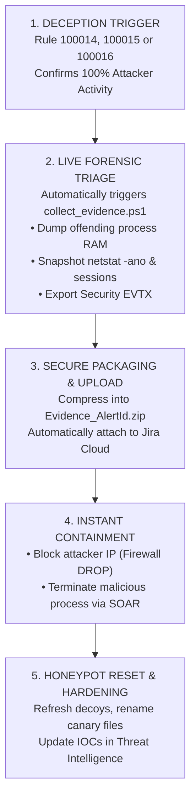

# 📋 INCIDENT RESPONSE PLAYBOOK: DECEPTION HONEYPOT & DIGITAL FORENSICS (SOP-06)
> **Playbook Code:** SOP-SOC-IR-006  
> **MITRE ATT&CK Techniques:** [T1083 - File and Directory Discovery](https://attack.mitre.org/techniques/T1083/), [T1078 - Valid Accounts](https://attack.mitre.org/techniques/T1078/), [T1046 - Network Service Discovery](https://attack.mitre.org/techniques/T1046/)  
> **Detection Rules:** Wazuh Rule `100014` (Canary Honey-File SACL 4663), `100015` (Honey-Account 4625), `100016` (FTP Decoy 21)  
> **Distinctive Mechanism:** **Zero False Positive (0% FP)** — Active Defense  
> **Digital Forensics Standard:** NIST SP 800-86 (Guide to Integrating Forensic Techniques into Incident Response)  
> **Target Audience:** SOC Analyst L2, DFIR Specialist, Incident Response Lead  

---

## 🎯 1. OVERVIEW & ZERO FALSE POSITIVE PRINCIPLE

Deception Grid resources are decoy assets that serve no business or standard operational function within the enterprise. Consequently, **any interaction with a deception decoy represents 100% confirmed attacker activity or malware reconnaissance**.

### Emergency Response Principles:
1. **Default P1 - Critical Classification:** No requirement for legitimate user verification or alert fatigue triage.
2. **Forensics Preservation First:** Malicious processes must have RAM dumps and network connection snapshots captured prior to termination (`Stop-Process`), maintaining an intact chain of custody (Chain of Custody).
3. **Automated Packaging & Case Attachment:** The compressed digital evidence package (`.zip`) is automatically attached directly to the Jira Cloud Ticket for deep forensic analysis.

---

## 🔍 2. DECEPTION TIERS & TRIGGER INDICATORS CATALOG

| Deception Tier | Decoy Resource | Log Source / Event ID | Wazuh Rule | Attacker Behavior |
| :---: | :--- | :---: | :---: | :--- |
| **Tier 1: Canary File** | `C:\Users\Public\IT_Admin_Credentials.xlsx` | Windows Security SACL<br/>**Event ID 4663** (`ReadData`) | **`100014`** | Attacker or ransomware opens file to read administrative credentials. |
| **Tier 2: Honey-Account** | Local User: `backup_admin` | Windows Security<br/>**Event ID 4625** (Logon Failure) | **`100015`** | Attacker attempts authentication using decoy administrative account. |
| **Tier 3: Network Decoy** | TCP Port 21 (FTP Listener Socket) | Decoy Service Console<br/>`[FTP-DECOY]` prefix | **`100016`** | Kali scans port or transmits USER/PASS commands into simulated FTP service. |

---

## 🧭 3. INVESTIGATION & FORENSIC EVIDENCE PRESERVATION WORKFLOW



---

## 🛠️ 4. DFIR EXECUTION DETAILS

### Step 1: Live Forensics Collection
Immediately upon Deception Rule triggering, script [`collect_evidence.ps1`](../endpoint/deception/collect_evidence.ps1) executes:

```powershell
# 1. Extract MiniDump of suspicious process
rundll32.exe C:\Windows\System32\comsvcs.dll, MiniDump $TargetPID "$EvidenceDir\dump_$TargetPID.dmp" full

# 2. Collect real-time network connection table
netstat -ano > "$EvidenceDir\network_connections.txt"

# 3. Collect list of active logon sessions
query user > "$EvidenceDir\active_sessions.txt"
qwinsta > "$EvidenceDir\terminal_sessions.txt"

# 4. Export copy of Windows Security EVTX log
wevtutil epl Security "$EvidenceDir\Security_Evidence.evtx" /q:"*[System[(EventID=4663 or EventID=4625)]]"

# 5. Compress forensic evidence package
Compress-Archive -Path "$EvidenceDir\*" -DestinationPath "C:\Forensics\Evidence_$AlertID.zip" -Force
```

### Step 2: Validate Jira Cloud Incident Ticket Attachments
1. Access corresponding incident ticket in Jira Project `KAN`: `https://tn421015.atlassian.net/jira/software/projects/KAN/issues/`
2. Check the **Attachments** section of the ticket to verify `Evidence_<AlertId>.zip` was uploaded successfully.
3. DFIR specialist downloads the zip package to an isolated analysis workstation (Remnux / SANS SIFT) to reverse-engineer command sequences, extract C2 IPs, and identify decryption keys within the `.dmp` file.

### Step 3: Containment & Decoy Environment Restoration
1. Click the **`[🔒 Isolate Host]`** or **`[🚫 Block IP 24h]`** button on Telegram to contain the attacker.
2. Verify Canary file integrity on the victim machine:
   - If the file was modified or encrypted, restore original file from template:
     ```powershell
     powershell -ExecutionPolicy Bypass -File deployment\deception\setup_canary.ps1
     ```
3. Close incident ticket on Jira Cloud upon completing Root Cause Analysis (RCA).
