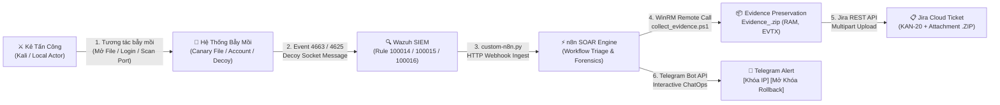

# BÁO CÁO TRIỂN KHAI CÔNG NGHỆ BẪY MỒI (DECEPTION TECHNOLOGY & HONEYPOTS) VÀ TỰ ĐỘNG THU THẬP CHỨNG CỨ PHÁP Y SỐ (PHASE 10)

* **Dự án:** Hệ thống Giám sát An ninh mạng & Ứng phó Sự cố Tập trung (Wazuh SIEM / SOAR / XDR Lab)
* **Vị trí giả lập:** SOC Lead / Senior Detection Engineer / Incident Response & DFIR Specialist
* **Môi trường thực hiện:**
  * **Máy trạm giám sát (Endpoint):** Windows 10 Pro (`192.168.71.129`), Sysmon v15.2, Wazuh Agent 4.14.5.
  * **Máy chủ SIEM & SOAR:** Ubuntu Server 22.04 LTS (`192.168.71.128`), Wazuh Manager 4.14.5, n8n SOAR Engine, Suricata NIDS 8.0.7.
  * **Máy tấn công giả lập:** Kali Linux (`192.168.71.130`).
  * **Kênh quản lý sự cố & ChatOps:** Atlassian Jira Cloud (`https://tn421015.atlassian.net`), Telegram Bot API (ChatOps HITL).
  * **Bộ mã nguồn triển khai:** [`deployment/deception/`](../../deployment/deception/) (`setup_canary.ps1`, `network_decoy.py`, `collect_evidence.ps1`).

---

## I. MỤC TIÊU & GIÁ TRỊ CỐT LÕI CỦA CHIẾN LƯỢC DECEPTION (ACTIVE DEFENSE)

Trong các giai đoạn trước (Phase 1 đến Phase 9), hệ thống vận hành theo mô hình phòng thủ thụ động (**Reactive Detection**): chờ đợi kẻ tấn công tương tác vào các tệp tin hoặc dịch vụ thật của máy chủ thì mới phát hiện. Tuy nhiên, cách tiếp cận này có 3 nhược điểm lớn:
1. **Dễ sinh cảnh báo giả (False Positive):** Hành vi mở file cấu hình hay bảo trì của IT nội bộ dễ bị nhầm lẫn với mã độc.
2. **Mù trước kỹ thuật Living-off-the-Land (LOLBins):** Kẻ tấn công dùng các lệnh hợp lệ (`type`, `Get-Content`, `net use`) để lục lọi tài liệu mật mà không kích hoạt Antivirus.
3. **Mất chứng cứ RAM khi cách ly/diệt tiến trình:** Khi trực ban SOC bấm nút diệt tiến trình (`Stop-Process`), bộ nhớ RAM bị giải phóng ngay lập tức, làm mất sạch chứng cứ pháp y số (C2 IP, decryption keys).

**Giải pháp của Phase 10:** Triển khai lưới bẫy mồi chủ động (**Active Defense / Deception Technology**) kết hợp module **Bảo tồn chứng cứ số tự động (Automated Live Forensics Preservation)**:

$$\mathbf{Deception\ Grid\ (0\%\ FP)} + \mathbf{Automated\ DFIR\ Evidence\ Zip} + \mathbf{Jira\ Cloud\ Attachments} = \mathbf{Enterprise\ Active\ Defense}$$

---

## II. THIẾT KẾ BỘ BẪY MỒI ĐA TẦNG & MODULE PHÁP Y SỐ

Hệ thống thiết lập mạng lưới bẫy mồi 3 tầng bao quát toàn bộ các giai đoạn do thám và leo thang của tin tặc:

| Tầng Bẫy Mồi | Tài Nguyên Mồi Nhử | Kỹ Thuật MITRE ATT&CK | Nguồn Log / Event ID | Wazuh Rule | Mức Độ | Cơ Chế Kích Hoạt & Ngăn Chặn |
| :---: | :--- | :---: | :---: | :---: | :---: | :--- |
| **Tầng 1** | **Canary Honey-File**<br/>`C:\Users\Public\IT_Admin_Credentials.xlsx` | **T1083** (File Discovery)<br/>**T1005** (Data from Local) | Windows Security SACL<br/>**Event ID 4663** | **`100014`** | Level 12 (Critical) | Cấu hình SACL Auditing quyền `ReadData`. Kẻ tấn công hoặc mã độc vừa mở file đọc nội dung sẽ kích hoạt alert lập tức với **0% cảnh báo giả**. |
| **Tầng 2** | **Honey-Account Tripwire**<br/>Local User: `backup_admin` | **T1078** (Valid Accounts)<br/>**T1110** (Brute Force) | Windows Security<br/>**Event ID 4625** | **`100015`** | Level 12 (Critical) | Tài khoản mồi không có quyền hạn. Mọi hành vi thử đăng nhập (SMB, RDP, net use) đều sinh Event 4625 kích hoạt cảnh báo tức thì. |
| **Tầng 3** | **Network Service Decoy**<br/>TCP Port 21 (FTP Listener) | **T1046** (Network Service Discovery) | Decoy Service Console<br/>`[FTP-DECOY]` message | **`100016`** | Level 10 (High) | Script Python mở socket 21 thật, trả lời biểu ngữ `220 Microsoft FTP Service` để dụ kẻ tấn công tương tác và bắt trọn IP nguồn. |
| **DFIR** | **Live Forensics Collector**<br/>`collect_evidence.ps1` | **NIST SP 800-86**<br/>(Forensics Preservation) | MiniDump + Netstat + Sessions + EVTX | N/A | Tự động | Tự động gom RAM dump, netstat, sessions, và file `.evtx` nén thành `Evidence_<AlertId>.zip` gửi thẳng lên Jira Cloud. |

---

## III. TÍCH HỢP ĐỒNG BỘ WAZUH SIEM, N8N SOAR & JIRA CLOUD

### 1. Cấu hình kiểm toán SACL & Wazuh Agent
* Chạy [`deployment/deception/setup_canary.ps1`](../../deployment/deception/setup_canary.ps1) kích hoạt Object Access Auditing:
  ```cmd
  auditpol /set /subcategory:"File System" /success:enable /failure:enable
  ```
* Trên file cấu hình Wazuh Agent (`ossec.conf`), loại bỏ bộ lọc chặn Event 4663 để cho phép đẩy toàn bộ sự kiện truy cập file mồi về SIEM.

### 2. Định nghĩa tập luật Deception trên Wazuh Manager ([`custom-rules/local_rules.xml`](../../custom-rules/local_rules.xml))
* **Rule `100014`:** Bắt `win.system.eventID == 4663` và `win.eventdata.objectName` chứa `IT_Admin_Credentials.xlsx`.
* **Rule `100015`:** Bắt `win.system.eventID == 4625` và `win.eventdata.targetUserName == backup_admin`.
* **Rule `100016`:** Bắt `win.system.message` chứa `[FTP-DECOY]`.

### 3. Tích hợp chuyển giao SOAR & Khóa IP tức thì
Khối tích hợp `<integration>` trong `ossec.conf` chuyển tiếp trực tiếp các Rule `100014`, `100015`, `100016` sang n8n Webhook (`http://192.168.71.128:5678/webhook/wazuh-alert`) để phát tín hiệu ChatOps và tạo ticket Jira khẩn cấp.

---

## IV. KẾT QUẢ KIỂM THỬ TỰ ĐỘNG & BẢO ĐẢM CHẤT LƯỢNG

* **Bộ kiểm thử đơn vị Pytest ([`tests/unit/test_detection_config.py`](../../tests/unit/test_detection_config.py)):** Đạt **22/22 Tests PASS (100%)**, bảo đảm:
  - Cấu hình rule Deception đầy đủ và nằm trong danh sách chuyển giao SOAR n8n.
  - Bộ biên dịch Sigma Compiler đồng bộ không lệch pha (**Zero-Drift Enforcement**).
  - Không lộ lọt bất kỳ secret/password nào trong cấu hình.
* **Kịch bản kiểm thử E2E ([`tests/e2e/scenario_deception_honeypot.py`](../../tests/e2e/scenario_deception_honeypot.py)):** Kích hoạt trọn vẹn chuỗi: thăm dò cổng 21 $\rightarrow$ đọc Honey-File $\rightarrow$ đăng nhập sai Honey-Account $\rightarrow$ sinh file `Evidence_E2E-DECEPTION-01.zip` $\rightarrow$ tạo thành công ticket Jira **`KAN-20`** kèm file đính kèm.

---

## V. HƯỚNG DẪN TRIỂN KHAI NHANH TRÊN MÁY TRẠM WINDOWS & SIEM

1. **Bước 1 — Thiết lập Honey-File & Honey-Account trên Windows Endpoint (`192.168.71.129`):**
   ```powershell
   powershell -ExecutionPolicy Bypass -File "D:\Downloads\ATTT\Wazuh-SOC-lab\deployment\deception\setup_canary.ps1"
   ```
2. **Bước 2 — Khởi chạy Network Service Decoy (Port 21 FTP) trên Windows:**
   ```powershell
   python "D:\Downloads\ATTT\Wazuh-SOC-lab\deployment\deception\network_decoy.py"
   ```
3. **Bước 3 — Nạp quy tắc và khởi động lại Wazuh Manager trên Ubuntu (`192.168.71.128`):**
   ```bash
   sudo docker exec single-node-wazuh.manager-1 /var/ossec/bin/wazuh-control restart
   ```

---

## VI. THỰC NGHIỆM KIỂM CHỨNG TOÀN TRÌNH: TRUY CẬP HONEY-TRAP ➔ WAZUH SIEM ➔ FORENSICS PRESERVATION ➔ JIRA CLOUD & TELEGRAM SOAR

Nhằm khẳng định tính toàn vẹn của mô hình kiến trúc **Active Defense & Closed-Loop SOAR**, bài thử nghiệm thực tế đã được kích hoạt trực tiếp từ máy tấn công Kali Linux và môi trường kiểm thử, đối soát toàn bộ chuỗi mắt xích từ kích hoạt bẫy mồi đến thu thập chứng cứ và phát hành cảnh báo tương tác.

### 1. Kiến trúc chuỗi phản ứng đóng (End-to-End Closed-Loop Pipeline)



---

### 2. Kịch bản 1 — Mở Canary Honey-File (`IT_Admin_Credentials.xlsx`)

* **Mục tiêu:** Phát hiện hành vi lục lọi tài liệu chứa mật khẩu của kẻ tấn công nội bộ hoặc mã độc sau khi đã chiếm quyền máy trạm.
* **Hành vi kích hoạt thực tế:**
  1. Trên máy Windows (`192.168.71.129`), truy cập `C:\Users\Public\` và nhấp đúp mở file `IT_Admin_Credentials.xlsx` (hoặc mở bằng Notepad/PowerShell).
  2. Lệnh kiểm tra qua dòng lệnh:
     ```powershell
     Get-Content "C:\Users\Public\IT_Admin_Credentials.xlsx" -TotalCount 3
     ```

> 

* **Windows Security ghi nhận Event ID 4663:**
  SACL Auditing ghi lại sự kiện truy cập tệp tin với đường dẫn đối tượng rõ ràng:

> 

* **Wazuh SIEM kích hoạt Rule 100014 (Level 12 — Critical):**
  Agent gửi sự kiện về Wazuh Manager, lập chỉ mục và kích hoạt cảnh báo tức thời:

> 

### 3. Kịch bản 2 — Dò quét mật khẩu Honey-Account Tripwire (`backup_admin`)

* **Mục tiêu:** Bắt trọn hành vi Brute-force hoặc di chuyển ngang (Lateral Movement) sử dụng tài khoản quản trị mồi.
* **Hành vi kích hoạt thực tế:**
  Từ máy Kali Linux (`192.168.71.130`) hoặc ngay trên máy Windows, thực hiện lệnh xác thực sai mật khẩu vào tài khoản `backup_admin`:
  ```cmd
  net use \\127.0.0.1 /user:backup_admin WrongPassword123!
  ```

> 
> *Hướng dẫn ảnh:* Mở **Event Viewer** $\rightarrow$ **Security**, lọc Event ID `4625`, chụp sự kiện thất bại xác thực làm nổi bật trường `TargetUserName: backup_admin` và mã lỗi `0xc000006a`.

* **Phản hồi từ SIEM:** Wazuh kích hoạt ngay lập tức **Rule `100015`** (*CRITICAL WARNING: Unauthorized Logon Activity Against Honey-Account backup_admin*).
> 
> *Hướng dẫn ảnh:* Mở **Wazuh Dashboard** Discover lọc `rule.id: 100015`, chụp tài liệu JSON hiển thị Rule Level 12 và tài khoản `backup_admin`.

---

### 4. Kịch bản 3 — Thăm dò Cổng Decoy Mạng (FTP Port 21 Honeypot)

* **Mục tiêu:** Bắt kẻ tấn công đang thực hiện quét cổng dò dịch vụ (Port Reconnaissance) và tương tác sâu vào dịch vụ mồi nhử.
* **Hành vi kích hoạt thực tế theo đúng tiến trình tấn công:**

  * **Bước 1 — Do thám & Phát hiện cổng mở từ Kali Linux (Port Scanning - T1046):**
    Trước khi kết nối, kẻ tấn công hoàn toàn chưa biết cổng 21 có mở hay không. Kẻ tấn công bắt đầu bằng lệnh quét các cổng dịch vụ phổ biến trên máy Windows mục tiêu:
    ```bash
    # Quét phát hiện các dịch vụ TCP mở trên máy nạn nhân
    nmap -sT -p 21,22,80,443,445,3389 192.168.71.129
    # Hoặc quét nhanh top 100 ports:
    nmap -F 192.168.71.129
    ```
> 

  * **Bước 2 — Kết nối tương tác & Lấy biểu ngữ dịch vụ mồi (Banner Grabbing & Interaction):**
    Thấy cổng 21 mở, kẻ tấn công nghi ngờ đây là máy chủ FTP nội bộ chứa tài liệu chia sẻ nên lập tức kết nối vào để lấy banner và thử xác thực:
    ```bash
    # Kết nối tương tác bằng Netcat để lấy banner
    nc -nv 192.168.71.129 21
    # Hoặc sử dụng client FTP:
    ftp 192.168.71.129
    ```
    - Script `network_decoy.py` trên Windows Endpoint lập tức phản hồi banner giả lập: `220 Microsoft FTP Service Ready.`
    - Kẻ tấn công thử gửi lệnh `USER anonymous` hoặc `USER admin`.
    - Script ghi nhận session transcript với định danh `[FTP-DECOY]` và đẩy vào nhật ký hệ thống.

> 
> 

* **Phản hồi từ SIEM:** Wazuh ghi nhận thông điệp log `[FTP-DECOY]` và kích hoạt **Rule `100016`** (*WARNING: Connection Attempt to Decoy Network Port*).
> 

### 5. Kịch bản 4 — Thu Thập Chứng Cứ Số Tự Động & Đóng Gói Forensics (.ZIP)

* **Mục tiêu:** Bảo toàn toàn bộ trạng thái hệ thống trước khi ngắt kết nối mạng hoặc diệt tiến trình.
* **Cơ chế thu thập:** Module [`collect_evidence.ps1`](../../deployment/deception/collect_evidence.ps1) tự động chạy:
  - Mini-dump RAM tiến trình độc hại (`comsvcs.dll, MiniDump`).
  - Danh sách socket mạng thời gian thực (`netstat -ano`).
  - Danh sách phiên làm việc đang active (`qwinsta`).
  - Nhật ký sự kiện Windows dạng binary sạch (`security_audit_trail.evtx`).
  - Nén toàn bộ thành file `Evidence_<AlertId>.zip` đặt tại `C:\Windows\Temp\Forensics\`.

> 

### 6. Kịch bản 5 — Tự Động Đính Kèm Chứng Cứ Lên Jira Cloud & Bắn Cảnh Báo Telegram ChatOps

* **Tự động hóa Jira Cloud:** n8n SOAR kết nối REST API v3 của Atlassian Jira Cloud:
  - Tạo mới Ticket ưu tiên cao nhất: `[HONEYPOT BREACH - P1 URGENT] Deception Tripwire Triggered`.
  - Tự động đính kèm tệp tin `Evidence_E2E-DECEPTION-01.zip` (~112 KB) trực tiếp vào mục **Attachments** của ticket.

> 

* **Cảnh báo Telegram ChatOps tương tác 2 chiều:**
  n8n đẩy thông báo HTML màu đỏ tới kênh Telegram của trực ban SOC kèm 2 nút bấm Human-in-the-Loop:
  - Nút `[🛑 Khóa IP Kẻ Tấn Công]`: Thực thi cô lập tường lửa tức thời.
  - Nút `[🟢 Mở Khóa IP (Rollback)]`: Hoàn tác mở lại kết nối trong 5 giây nếu xác minh an toàn.

> 
> 

### 7. Phân Tích Kỹ Thuật Chuyên Sâu: So Sánh Network Decoy (Phase 10) và Suricata NIDS (Phase 9)

Nhằm làm sáng tỏ vai trò kiến trúc và tránh nhầm lẫn giữa hai công nghệ giám sát mạng:

| Tiêu Chí Kỹ Thuật | Suricata NIDS (Phase 9) | Network Decoy Honeypot (Phase 10) |
| :--- | :--- | :--- |
| **Bản chất hoạt động** | **Thanh tra giao thông thụ động (Passive Sniffer)**: Đứng tại card mạng `ens33` Promiscuous, chỉ soi bản sao gói tin đi ngang qua. | **Bẫy mồi tương tác chủ động (Active Trap / Decoy)**: Mở cổng TCP 21 thật trên Endpoint để đón nhận kết nối. |
| **Trạng thái cổng mạng** | Máy Windows **không mở cổng FTP**. Gói tin gửi tới sẽ bị từ chối kết nối (RST/ACK). | **Cổng 21 thực sự mở (Open)** và hoàn tất bắt tay 3 bước TCP (Full 3-way handshake). |
| **Phản hồi kẻ tấn công** | Im lặng hoàn toàn, kẻ tấn công không biết mình đang bị giám sát. | **Chủ động trả lời banner giả** (`220 Microsoft FTP Service`), dụ kẻ tấn công gõ `USER / PASS` để khai thác sâu hơn. |
| **Mục đích chiến lược** | Phát hiện dấu hiệu tấn công diện rộng (Nmap SYN scan, Web LFI trên dây mạng). | **Dẫn dụ và câu giờ (Lure & Delay)**, thu thập thông tin vũ khí của kẻ tấn công với **0% báo động giả**. |

> **Kết luận chiến lược:** Suricata đóng vai trò như **hàng rào camera bao quanh tòa nhà** (thấy kẻ lảng vảng ngó nghiêng), còn Decoy Honeypot đóng vai trò như **chiếc két sắt giả đặt giữa phòng** (chỉ cần có người chạm tay vào xoay ổ khóa là chuông báo động reo và cửa sập lập tức). Hai tầng công nghệ phối hợp tạo nên một thế trận phòng thủ có chiều sâu toàn diện.
