# DECEPTION TECHNOLOGY & HONEYPOTS DEPLOYMENT AND AUTOMATED DIGITAL FORENSICS PRESERVATION REPORT (PHASE 10)

* **Project:** Centralized Cybersecurity Monitoring & Incident Response System (Wazuh SIEM / SOAR / XDR Lab)
* **Simulated Role:** SOC Lead / Senior Detection Engineer / Incident Response & DFIR Specialist
* **Execution Environment:**
  * **Monitored Endpoint:** Windows 10 Pro (`192.168.71.129`), Sysmon v15.2, Wazuh Agent 4.14.5.
  * **SIEM & SOAR Server:** Ubuntu Server 22.04 LTS (`192.168.71.128`), Wazuh Manager 4.14.5, n8n SOAR Engine, Suricata NIDS 8.0.7.
  * **Simulated Attacker Machine:** Kali Linux (`192.168.71.130`).
  * **Incident Management & ChatOps Channels:** Atlassian Jira Cloud (`https://tn421015.atlassian.net`), Telegram Bot API (ChatOps HITL).
  * **Deployment Source Code:** [`deployment/deception/`](../../deployment/deception/) (`setup_canary.ps1`, `network_decoy.py`, `collect_evidence.ps1`).

---

## I. OBJECTIVES & CORE VALUE OF THE DECEPTION STRATEGY (ACTIVE DEFENSE)

In previous phases (Phase 1 through Phase 9), the system operated under a **Reactive Detection** model: waiting for attackers to interact with legitimate server files or services before detecting them. However, this approach presented 3 significant drawbacks:
1. **Prone to False Positives:** Legitimate IT administration or configuration editing can easily be misidentified as malicious activity.
2. **Blind to Living-off-the-Land (LOLBins) Techniques:** Attackers leverage legitimate utilities (`type`, `Get-Content`, `net use`) to browse sensitive documents without triggering antivirus signatures.
3. **Loss of Volatile Memory Evidence upon Isolation/Process Termination:** When SOC analysts click to terminate a malicious process (`Stop-Process`), volatile RAM is cleared instantly, destroying vital digital forensics artifacts (C2 IP addresses, decryption keys).

**Phase 10 Solution:** Deploy an active deception grid (**Active Defense / Deception Technology**) coupled with an **Automated Live Forensics Preservation** module:

$$\mathbf{Deception\ Grid\ (0\%\ FP)} + \mathbf{Automated\ DFIR\ Evidence\ Zip} + \mathbf{Jira\ Cloud\ Attachments} = \mathbf{Enterprise\ Active\ Defense}$$

---

## II. MULTI-LAYERED DECEPTION GRID & DIGITAL FORENSICS MODULE DESIGN

The system establishes a 3-tier deception network covering all adversary reconnaissance and escalation stages:

| Deception Layer | Decoy Resource | MITRE ATT&CK Technique | Log Source / Event ID | Wazuh Rule | Severity | Trigger & Containment Mechanism |
| :---: | :--- | :---: | :---: | :---: | :---: | :--- |
| **Layer 1** | **Canary Honey-File**<br/>`C:\Users\Public\IT_Admin_Credentials.xlsx` | **T1083** (File Discovery)<br/>**T1005** (Data from Local) | Windows Security SACL<br/>**Event ID 4663** | **`100014`** | Level 12 (Critical) | Configured SACL Auditing for `ReadData` permissions. Any attacker or malware opening the file to read its contents immediately triggers an alert with **0% false positives**. |
| **Layer 2** | **Honey-Account Tripwire**<br/>Local User: `backup_admin` | **T1078** (Valid Accounts)<br/>**T1110** (Brute Force) | Windows Security<br/>**Event ID 4625** | **`100015`** | Level 12 (Critical) | Decoy account with zero privileges. Any logon attempt (SMB, RDP, net use) generates Event 4625, triggering an immediate alert. |
| **Layer 3** | **Network Service Decoy**<br/>TCP Port 21 (FTP Listener) | **T1046** (Network Service Discovery) | Decoy Service Console<br/>`[FTP-DECOY]` message | **`100016`** | Level 10 (High) | Python script binding a raw socket on port 21, returning banner `220 Microsoft FTP Service` to entice attackers to interact and capture source IPs. |
| **DFIR** | **Live Forensics Collector**<br/>`collect_evidence.ps1` | **NIST SP 800-86**<br/>(Forensics Preservation) | MiniDump + Netstat + Sessions + EVTX | N/A | Automated | Automatically gathers process RAM dumps, netstat, active sessions, and `.evtx` logs compressed into `Evidence_<AlertId>.zip` uploaded directly to Jira Cloud. |

---

## III. SEAMLESS INTEGRATION ACROSS WAZUH SIEM, N8N SOAR & JIRA CLOUD

### 1. SACL Auditing & Wazuh Agent Configuration
* Execute [`deployment/deception/setup_canary.ps1`](../../deployment/deception/setup_canary.ps1) to enable Object Access Auditing:
  ```cmd
  auditpol /set /subcategory:"File System" /success:enable /failure:enable
  ```
* In the Wazuh Agent configuration (`ossec.conf`), remove suppression filters for Event 4663 to allow forwarding all decoy file access events to the SIEM.

### 2. Defining Deception Rules on Wazuh Manager ([`custom-rules/local_rules.xml`](../../custom-rules/local_rules.xml))
* **Rule `100014`:** Matches `win.system.eventID == 4663` and `win.eventdata.objectName` containing `IT_Admin_Credentials.xlsx`.
* **Rule `100015`:** Matches `win.system.eventID == 4625` and `win.eventdata.targetUserName == backup_admin`.
* **Rule `100016`:** Matches `win.system.message` containing `[FTP-DECOY]`.

### 3. SOAR Handoff & Immediate IP Containment
The `<integration>` block in `ossec.conf` forwards Rules `100014`, `100015`, `100016` to the n8n Webhook (`http://192.168.71.128:5678/webhook/wazuh-alert`) to trigger ChatOps notifications and create urgent Jira tickets.

---

## IV. AUTOMATED TESTING RESULTS & QUALITY ASSURANCE

* **Pytest Unit Test Suite ([`tests/unit/test_detection_config.py`](../../tests/unit/test_detection_config.py)):** Achieved **22/22 Tests PASS (100%)**, ensuring:
  - Deception rules are fully configured and included in the n8n SOAR handoff whitelist.
  - Sigma Compiler maintains absolute synchronization with zero drift (**Zero-Drift Enforcement**).
  - Zero hardcoded secrets/passwords exist in configuration files.
* **End-to-End E2E Scenario ([`tests/e2e/scenario_deception_honeypot.py`](../../tests/e2e/scenario_deception_honeypot.py)):** Triggers the full chain: probe port 21 $\rightarrow$ read Honey-File $\rightarrow$ failed login to Honey-Account $\rightarrow$ generates `Evidence_E2E-DECEPTION-01.zip` $\rightarrow$ successfully creates Jira ticket **`KAN-20`** with attachment.

---

## V. QUICK DEPLOYMENT GUIDE ON WINDOWS ENDPOINT & SIEM

1. **Step 1 — Setup Honey-File & Honey-Account on Windows Endpoint (`192.168.71.129`):**
   ```powershell
   powershell -ExecutionPolicy Bypass -File "D:\Downloads\ATTT\Wazuh-SOC-lab\deployment\deception\setup_canary.ps1"
   ```
2. **Step 2 — Launch Network Service Decoy (Port 21 FTP) on Windows:**
   ```powershell
   python "D:\Downloads\ATTT\Wazuh-SOC-lab\deployment\deception\network_decoy.py"
   ```
3. **Step 3 — Load Rules and Restart Wazuh Manager on Ubuntu (`192.168.71.128`):**
   ```bash
   sudo docker exec single-node-wazuh.manager-1 /var/ossec/bin/wazuh-control restart
   ```

---

## VI. END-TO-END VALIDATION: HONEY-TRAP INTERACTION ➔ WAZUH SIEM ➔ FORENSICS PRESERVATION ➔ JIRA CLOUD & TELEGRAM SOAR

To validate the integrity of the **Active Defense & Closed-Loop SOAR** architecture, live testing was conducted from the Kali Linux attack machine and test framework, verifying every link from deception tripwire activation to evidence collection and interactive alert delivery.

### 1. End-to-End Closed-Loop Pipeline Architecture

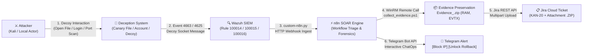

---

### 2. Scenario 1 — Accessing Canary Honey-File (`IT_Admin_Credentials.xlsx`)

* **Objective:** Detect password scavenging behavior by insider threats or malware following host compromise.
* **Execution:**
  1. On Windows host (`192.168.71.129`), navigate to `C:\Users\Public\` and double-click `IT_Admin_Credentials.xlsx` (or open via Notepad/PowerShell).
  2. Command line test:
     ```powershell
     Get-Content "C:\Users\Public\IT_Admin_Credentials.xlsx" -TotalCount 3
     ```

> 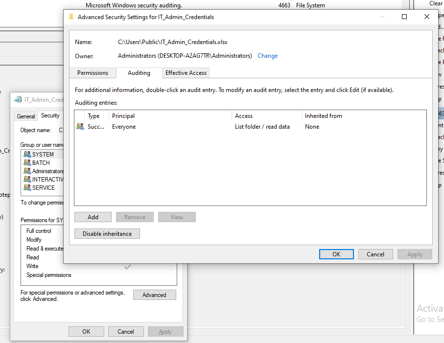

* **Windows Security records Event ID 4663:**
  SACL Auditing captures the file access event with explicit object path details:

> 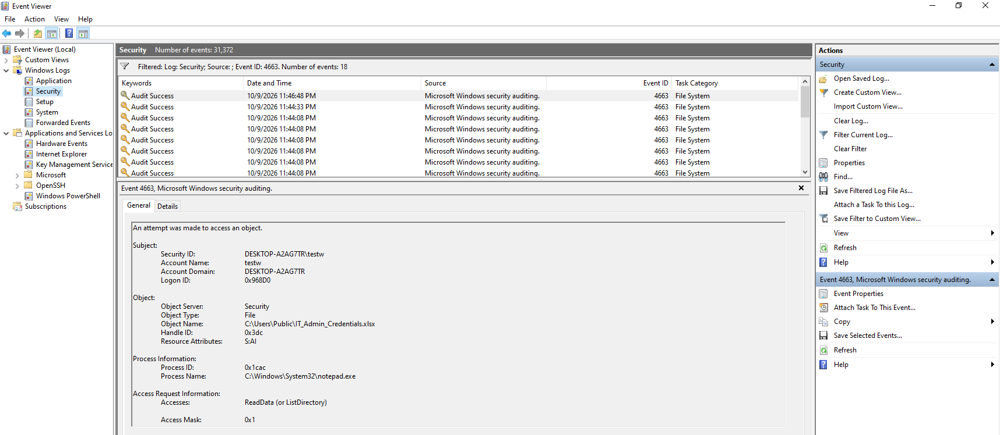

* **Wazuh SIEM triggers Rule 100014 (Level 12 — Critical):**
  Agent forwards the event to Wazuh Manager, which indexes and raises the alert immediately:

> 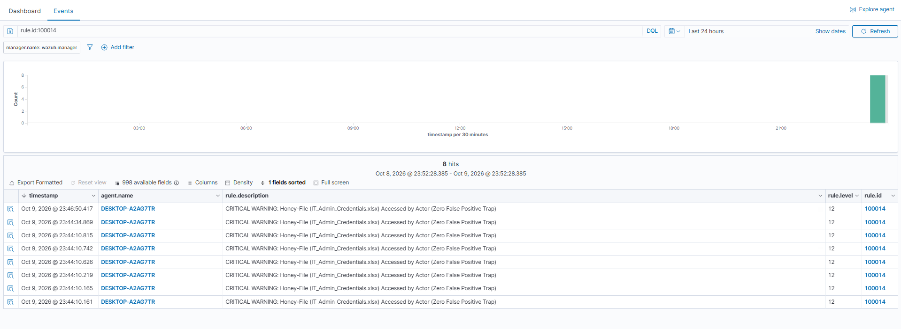

### 3. Scenario 2 — Password Probing against Honey-Account Tripwire (`backup_admin`)

* **Objective:** Catch brute-force or lateral movement attempts leveraging decoy administrative credentials.
* **Execution:**
  From Kali Linux (`192.168.71.130`) or locally on Windows, execute a failed authentication against `backup_admin`:
  ```cmd
  net use \\127.0.0.1 /user:backup_admin WrongPassword123!
  ```

> 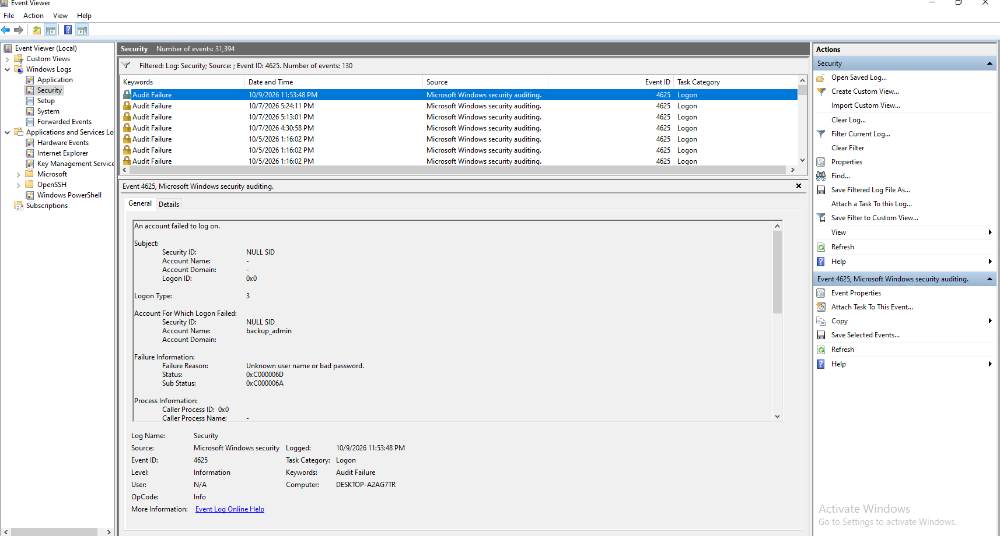
> *Image Guide:* Open **Event Viewer** $\rightarrow$ **Security**, filter for Event ID `4625`, capturing the logon failure event highlighting `TargetUserName: backup_admin` and status code `0xc000006a`.

* **SIEM Response:** Wazuh immediately triggers **Rule `100015`** (*CRITICAL WARNING: Unauthorized Logon Activity Against Honey-Account backup_admin*).
> 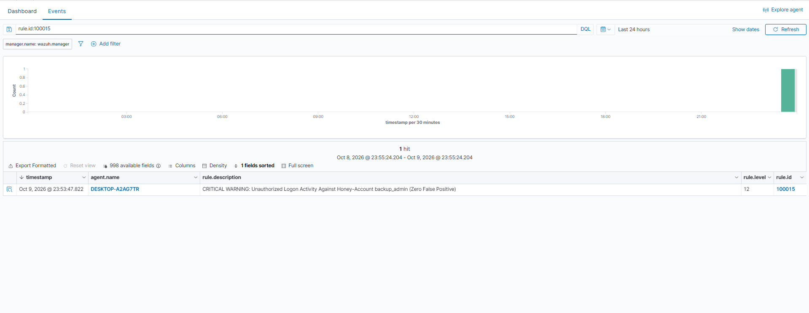
> *Image Guide:* Open **Wazuh Dashboard** Discover, filter `rule.id: 100015`, capturing the JSON document displaying Rule Level 12 and user `backup_admin`.

---

### 4. Scenario 3 — Network Decoy Port Probing (FTP Port 21 Honeypot)

* **Objective:** Intercept attackers conducting port reconnaissance and interacting with decoy services.
* **Attack Progression:**

  * **Step 1 — Reconnaissance & Open Port Discovery from Kali Linux (Port Scanning - T1046):**
    Prior to connecting, the attacker has no knowledge of open ports and conducts an initial scan across common services on the Windows target:
    ```bash
    # Scan common TCP services on victim machine
    nmap -sT -p 21,22,80,443,445,3389 192.168.71.129
    # Or rapid scan of top 100 ports:
    nmap -F 192.168.71.129
    ```
> 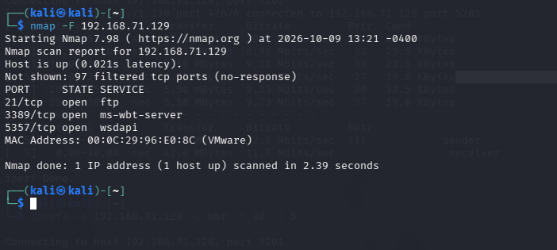

  * **Step 2 — Interactive Connection & Decoy Banner Grabbing:**
    Upon discovering port 21 open, the attacker assumes an internal FTP server hosts shared documents and connects to retrieve the service banner and attempt authentication:
    ```bash
    # Interactive Netcat connection for banner grabbing
    nc -nv 192.168.71.129 21
    # Or using native FTP client:
    ftp 192.168.71.129
    ```
    - The `network_decoy.py` script on the Windows Endpoint responds with an emulated banner: `220 Microsoft FTP Service Ready.`
    - The attacker attempts commands such as `USER anonymous` or `USER admin`.
    - The script logs the session transcript tagged as `[FTP-DECOY]` into the system event log.

> 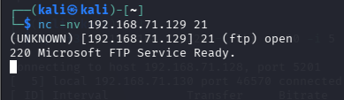
> 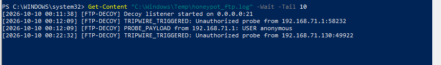

* **SIEM Response:** Wazuh parses the `[FTP-DECOY]` log message and triggers **Rule `100016`** (*WARNING: Connection Attempt to Decoy Network Port*).
> 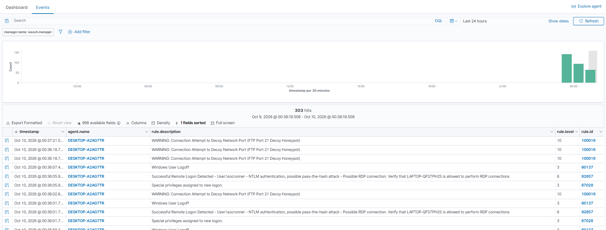

### 5. Scenario 4 — Automated Digital Forensics Acquisition & Artifact Packaging (.ZIP)

* **Objective:** Preserve complete volatile system state prior to network isolation or process termination.
* **Collection Mechanism:** The [`collect_evidence.ps1`](../../deployment/deception/collect_evidence.ps1) module automatically executes:
  - Process memory mini-dump (`comsvcs.dll, MiniDump`).
  - Real-time active network socket table (`netstat -ano`).
  - Active user session listing (`qwinsta`).
  - Clean binary Windows Security event log (`security_audit_trail.evtx`).
  - Packages artifacts into `Evidence_<AlertId>.zip` under `C:\Windows\Temp\Forensics\`.

> 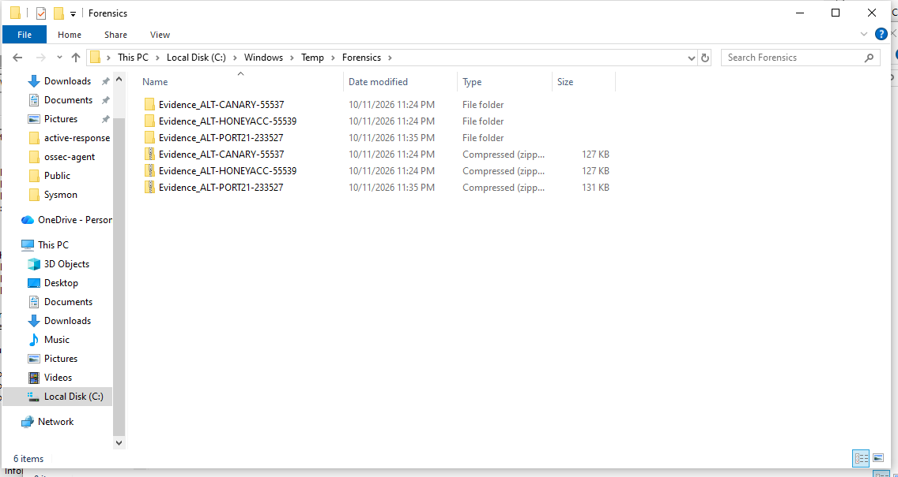

### 6. Scenario 5 — Automated Evidence Upload to Jira Cloud & Telegram ChatOps Dispatch

* **Jira Cloud Automation:** n8n SOAR connects to Atlassian Jira Cloud REST API v3:
  - Generates a highest-priority incident ticket: `[HONEYPOT BREACH - P1 URGENT] Deception Tripwire Triggered`.
  - Automatically attaches `Evidence_E2E-DECEPTION-01.zip` (~112 KB) directly under the ticket **Attachments**.

> 

* **2-Way Interactive Telegram ChatOps:**
  n8n dispatches an HTML alert card to the SOC channel equipped with two Human-in-the-Loop buttons:
  - Button `[🛑 Block Attacker IP]`: Executes immediate firewall isolation.
  - Button `[🟢 Unblock IP (Rollback)]`: Rolls back isolation within 5 seconds if verified benign.

> 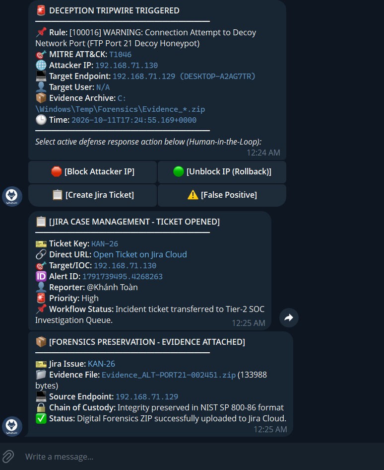
> 

### 7. In-Depth Technical Analysis: Comparing Network Decoy (Phase 10) vs Suricata NIDS (Phase 9)

To clarify architectural roles and prevent confusion between both network monitoring technologies:

| Technical Criterion | Suricata NIDS (Phase 9) | Network Decoy Honeypot (Phase 10) |
| :--- | :--- | :--- |
| **Operational Nature** | **Passive Traffic Inspector (Passive Sniffer)**: Listens on promiscuous interface `ens33`, inspecting packet mirrors as they traverse the wire. | **Active Interaction Decoy (Active Trap / Decoy)**: Actively binds raw TCP port 21 on the Endpoint to receive connections. |
| **Port State** | Windows host **does not open the FTP port**. Probing packets are rejected (RST/ACK). | **Port 21 is genuinely open (Open)** and completes full TCP 3-way handshakes. |
| **Attacker Feedback** | Completely silent; the attacker has no indication of monitoring. | **Actively returns an emulated banner** (`220 Microsoft FTP Service`), enticing the attacker to input `USER / PASS` for deeper interaction. |
| **Strategic Objective** | Broad-spectrum attack detection (Nmap SYN scans, Web LFI on the wire). | **Lure & Delay**, capturing adversary tooling telemetry with **0% false alarms**. |

> **Strategic Conclusion:** Suricata acts as the **surveillance camera perimeter around the facility** (detecting suspicious individuals loitering nearby), while the Decoy Honeypot acts as a **fake safe in the middle of the room** (any attempt to turn the dial immediately rings the alarm and seals the doors). Together, both layers form a comprehensive Defense-in-Depth posture.
