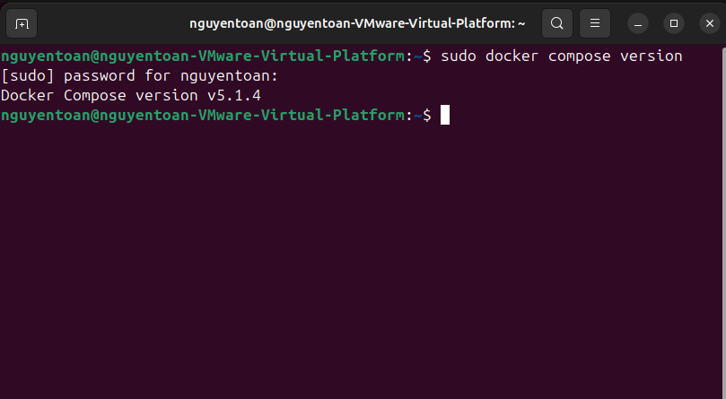
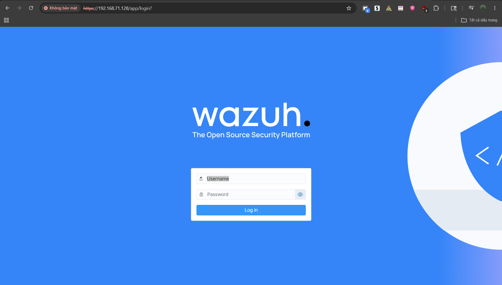
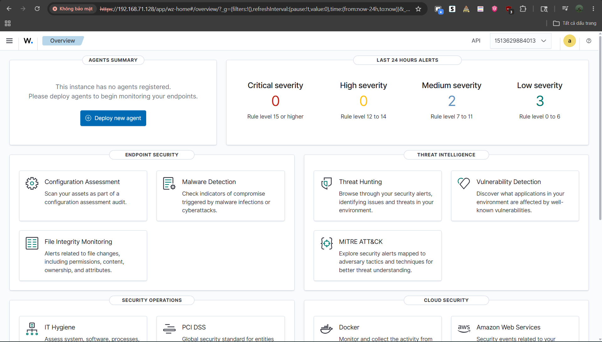

# WAZUH SIEM INFRASTRUCTURE DEPLOYMENT (PHASE 1)

* **Project:** Detection Engineering Research and Wazuh SIEM System
* **Simulated Role:** SOC Engineer / Detection Engineer
* **Execution Environment:** Ubuntu Server v24.04 / v22.04 LTS (Running on VMware Workstation)
* **Phase 1 Objective:** Successfully deploy the Wazuh Stack central cluster (Indexer, Manager, Dashboard) using Docker Compose, optimize hardware resources, expand disk storage space, and configure admin password changes for system security hardening.

---

## I. RESOURCE PREPARATION & KERNEL HARDENING

Wazuh Indexer uses a big data analysis storage core based on OpenSearch (Java). The system requires Linux kernel virtual memory settings higher than default to prevent bottlenecks or process crashes upon startup.

### 1. Initial Virtual Machine Resource Allocation (Ubuntu Server)
* **vCPU:** 2 Cores (minimum).
* **RAM:** 4GB RAM (Minimum operational requirement for a single-agent lab environment).
* **Storage:** Expanded configuration reaching **65GB SSD** (Expanded system partition to ensure storage space for logs and buffer files).

### 2. Disk Partition Resizing
After expanding the hardware capacity on VMware from 40GB to 65GB, proceed to synchronize the Ubuntu logical partition to fully utilize the additional 25GB of allocated free space using command-line tools:

```bash
# 1. Instruct the Linux kernel to rescan partition sda2 size
sudo resizepart /dev/sda 2

# 2. Force the file system to expand the actual storage space
sudo resize2fs /dev/sda2
```
Re-checking storage space with the command `df -h /`, the system confirms the partition capacity reaches **~63GB** with ample available free space (Ready to prevent disk bottlenecks).

### 3. Virtual Memory Tuning

Increase the virtual memory parameter `vm.max_map_count` temporarily and persist it to the system configuration file to maintain a stable state after rebooting the virtual machine:

```bash
# Set temporary configuration in real time
sudo sysctl -w vm.max_map_count=262144

# Persist configuration to the system configuration file
echo "vm.max_map_count=262144" | sudo tee -a /etc/sysctl.conf
```


---

## II. DOCKER & DOCKER COMPOSE ENVIRONMENT SYNCHRONIZATION

To ensure encapsulation, easy configuration management, and avoid library conflicts with the host operating system, the entire Wazuh infrastructure is deployed using containerization technology (Docker Engine).

### 1. Official Docker Engine Installation Commands

Update package lists, configure the secure repository GPG key, and install Docker along with the Docker Compose plugin:

```bash
# 1. Update system and install dependencies
sudo apt update && sudo apt install -y apt-transport-https ca-certificates curl gnupg lsb-release

# 2. Set up secure Docker GPG key
sudo mkdir -p /etc/apt/keyrings
curl -fsSL https://download.docker.com/linux/ubuntu/gpg | sudo gpg --dearmor -o /etc/apt/keyrings/docker.gpg

# 3. Add official Docker repository matching OS version
echo "deb [arch=$(dpkg --print-architecture) signed-by=/etc/apt/keyrings/docker.gpg] https://download.docker.com/linux/ubuntu $(lsb_release -cs) stable" | sudo tee /etc/apt/sources.list.d/docker.list > /dev/null

# 4. Install official Docker packages
sudo apt update && sudo apt install -y docker-ce docker-ce-cli containerd.io docker-compose-plugin

# 5. Enable and start Docker service on system boot
sudo systemctl enable docker && sudo systemctl start docker
```

Check the operational status of Docker Compose on the virtual machine using the command: `sudo docker compose version`.



---

## III. WAZUH STACK CENTRAL CLUSTER DEPLOYMENT (SINGLE-NODE ARCHITECTURE)

Use a single-node architecture configuration (suitable for research environments and small/medium enterprise labs) to consolidate all management components into a single processing entity.

### 1. Clone Configuration Source Code from Vendor

Download the pre-configured Docker setup from the Wazuh repository:

```bash
cd ~
git clone https://github.com/wazuh/wazuh-docker.git --depth=1 -b v4.14.5
cd wazuh-docker/single-node
```
### 2. Configure System Log File Rotation Limits

To prevent containers from generating looping error logs that exhaust disk space upon abrupt system shutdowns, add logging limit parameters (`logging`) to the `docker-compose.yml` file:

```yaml
logging:
  driver: "json-file"
  options:
    max-size: "10m"
    max-file: "3"
```

---

## IV. ADMIN ACCOUNT PASSWORD SECURITY HARDENING

To ensure maximum information security for the SOC monitoring center, the default password `SecretPassword` must be replaced with a strong password mechanism using a hash string.

### Step 1: Stop the cluster and generate a new encrypted password string

Invoke an intermediary container to run the OpenSearch cryptographic script to generate a secure hash:

```bash
sudo docker compose down

sudo docker run --rm -ti wazuh/wazuh-indexer:4.14.5 bash /usr/share/wazuh-indexer/plugins/opensearch-security/tools/hash.sh
```
*Enter the new password at the system prompt to obtain the output hash string formatted like:* `$2y$12$...`

### Step 2: Update internal configuration files

1. Configure the new hash string in the internal user management file:
```bash
nano config/wazuh_indexer/internal_users.yml
```
*Paste the hash string obtained in Step 1 into the `hash` field of the `admin` account.*
2. Configure the new plaintext password in the `docker-compose.yml` file under the `INDEXER_PASSWORD` environment parameters for both `wazuh.manager` and `wazuh.dashboard` services.

### Step 3: Apply changes inside the Indexer Container

Restart the service cluster and enter the management container to enforce loading the security configuration:

```bash
# Start service cluster in detached mode
sudo docker compose up -d

# Access the execution environment of the Indexer container
sudo docker exec -it single-node-wazuh.indexer-1 bash
```

When the terminal switches to the `bash-5.2$` prompt, execute the command sequence to load superuser permissions:

```bash
export INSTALLATION_DIR=/usr/share/wazuh-indexer
export CONFIG_DIR=$INSTALLATION_DIR/config
CACERT=$CONFIG_DIR/certs/root-ca.pem
KEY=$CONFIG_DIR/certs/admin-key.pem
CERT=$CONFIG_DIR/certs/admin.pem
export JAVA_HOME=/usr/share/wazuh-indexer/jdk

bash /usr/share/wazuh-indexer/plugins/opensearch-security/tools/securityadmin.sh -cd $CONFIG_DIR/opensearch-security/ -nhnv -cacert $CACERT -cert $CERT -key $KEY -p 9200 -icl
```

The system displays the message: **`Done with success`** (Confirming that the new password configuration has officially taken effect across the entire SIEM cluster). Type `exit` to leave the container.

---

## V. STABILITY TESTING & ACCESS VALIDATION

Run the health check command for the entire system:

```bash
sudo docker ps
```

Requirement: all 3 entities `wazuh.indexer`, `wazuh.manager`, and `wazuh.dashboard` maintain long-term stable states (`Up` / `healthy`).

### Central Web Interface Administrative Validation Results

* **Secure Connection URL:** `https://192.168.71.128` (Via static/dynamic IP of primary network adapter `ens33` connected to VMware Host-Only/NAT network).
* **New Authentication Credentials:**
* *Username:* `admin`
* *Password:* `<CONFIGURED_NEW_PASSWORD>`





---

## VI. SAFE OPERATIONAL AND MAINTENANCE PROCEDURES

To ensure the data integrity of the Indexer big data store and prevent accumulation of junk files, the virtual machine shutdown/startup procedure is standardized as follows:

* **Before shutting down the VM / VMware:** Gracefully stop services to persist Java processes:
```bash
sudo docker compose stop
```


*(Strictly avoid using `down -v` unless you intend to completely wipe the lab and restart from scratch).*
* **After powering on the VM:** Re-launch background services and free up the terminal:
```bash
sudo docker compose up -d
```


---

## VII. NEXT STEPS (PHASE 2)

The central SIEM cluster infrastructure (Wazuh Stack) is fully operational and ready to ingest telemetry.

**Phase 2 Implementation Plan:**

1. Boot the **Windows 10 (Victim)** workstation, download and connect **Wazuh Agent** to forward telemetry streams to server address `192.168.71.128`.
2. Deeply integrate **Microsoft Sysmon** audit tooling on the target host, customize the `ossec.conf` file to perform deep analysis on specific Event IDs, preparing for real-world attack simulation and detection.

## REFERENCES
- [Deploying Wazuh with Docker](https://documentation.wazuh.com/current/deployment-options/docker/wazuh-container.html)