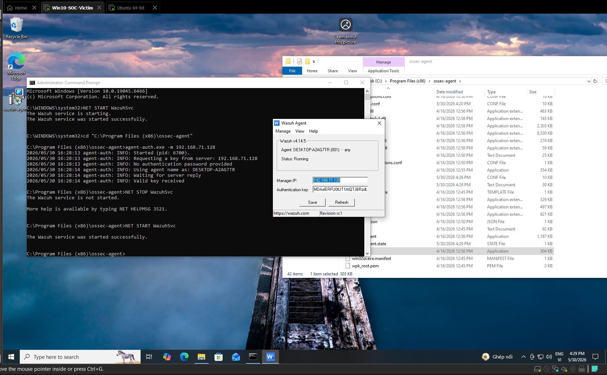
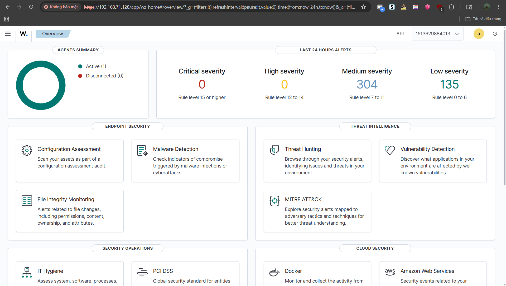
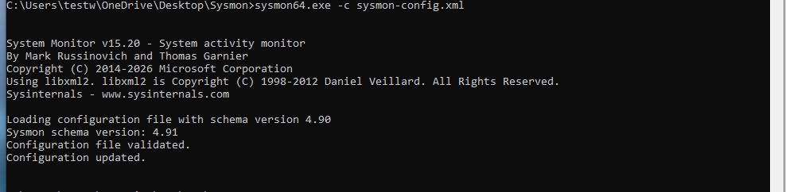

# WAZUH AGENT DEPLOYMENT & CONFIGURATION ON ENDPOINT (PHASE 2)

* **Project:** Detection Engineering Research and Wazuh SIEM System
* **Simulated Role:** SOC Engineer / Detection Engineer
* **Execution Environment:** Windows 10 Pro (Victim VM running on VMware)
* **Phase 2 Objective:** Package, install, and activate the log collection system (Wazuh Agent) on the target workstation; establish a secure authentication mechanism (Authentication Key) to set up an encrypted real-time communication channel to the central server.

---

## I. INSTALLATION AND AGENT ENROLLMENT PROCESS

Fundamentally, Wazuh Agent on Windows operates as a background system service (`WazuhSvc`). To ensure information security, the Agent cannot connect freely but must undergo an enrollment procedure to obtain an encrypted authentication token from the Wazuh Manager.

### 1. Software Package Installation

* **Synchronized Version:** `wazuh-agent-4.14.5-1.msi` (Ensures version parity with the central cluster to prevent log routing library conflicts).
* **System Requirements:** Execute under administrative privileges (`Administrator`) to grant permission to interact with the Windows Services management subsystem.

### 2. Configuration Commands and Authentication Key Injection (CLI Hardening)

When installed via GUI or standard command line, the system displays the error `Agent: Auth key not imported` and remains in `Not Running` state. Resolve this definitively by opening **Command Prompt (CMD)** as **Run as Administrator** and executing the following commands:

```cmd
:: 1. Navigate to the Agent root distribution directory
cd "C:\Program Files (x86)\ossec-agent"

:: 2. Specify the Manager server IP to trigger the automated key enrollment process
agent-auth.exe -m 192.168.71.128

:: 3. Restart the system service to apply the new configuration
NET STOP WazuhSvc
NET START WazuhSvc
```

### 3. Local Operational Status Verification on Endpoint

The Command Prompt window displays `Valid key received. Merging key and restarting...` and the service reports `started successfully`. When launching the internal management interface via `win32ui.exe` (or `wazuh-agentui.exe`), the system confirms:

* **Manager IP:** Correctly registers address `192.168.71.128`.
* **Authentication Key:** Automatically populates the secure cryptographic hash key issued by the server.
* **Status:** Changes to **`Running`** state.



---

## II. STABILITY TESTING AND DATA STREAM VALIDATION ON SOC DASHBOARD

Once the Agent on the Victim machine enters the `Running` state, cybersecurity telemetry is immediately packaged, encrypted, and forwarded to the central service port of Wazuh Manager.

### 1. Overall Connection Verification (Agents Summary)

Access the central Web Dashboard interface at `https://192.168.71.128`; the system displays status charts for the entire monitoring infrastructure:

* **Active Section:** Metric transitions from `0` to **`1`** (Confirms 1 Agent successfully connected directly).
* **Disconnected Section:** Displays `0` (No stalled connections or lost signals).

### 2. Initial System Log Ingestion

Even before running real-world attack scenarios, the **Last 24 Hours Alerts** subsystem begins capturing standard security events forwarded from the Windows 10 workstation (including system audit logs and local process state changes) across Medium severity and Low severity alert categories (`Medium severity` and `Low severity`). This demonstrates that the SOC communications pipeline is 100% operational.



---
## III. MICROSOFT SYSMON v15.2 INSTALLATION AND CONFIGURATION

### 1. OVERVIEW OF SYSMON CAPABILITIES

System Monitor (Sysmon) is a Windows system service and device driver. Once installed, Sysmon runs persistently in the background across reboots to monitor and log deep activity into the Windows Event Log.

By correlating Sysmon events with SIEM systems (such as Wazuh), SOC analysts can readily identify abnormal behaviors and malware operation patterns. The service runs as a Protected Process, preventing most unauthorized tampering attempts by users.

---

### 2. STEP-BY-STEP INSTALLATION GUIDE (WINDOWS VICTIM MACHINE)

To deploy Sysmon on the target Windows virtual machine, follow these standard command-line steps. **Note:** The installation process does not require a VM reboot.

- Step 1: Launch Administrative Command Environment

Click `Start` $\rightarrow$ Type `cmd` $\rightarrow$ Right-click **Command Prompt** $\rightarrow$ Select **Run as administrator**.

- Step 2: Navigate to the Sysmon Directory

Use `cd` to navigate to the directory where you extracted the downloaded archive (e.g., Downloads folder):

```cmd
cd "C:\Users\testw\Downloads\Sysmon"
```

(Note that the standard 64-bit installer executable is named `sysmon64.exe` or `sysmon.exe`).

- Step 3: Execute System Installation Command
* **Installation with XML Configuration File:**
Apply pre-loaded filters from a configuration file (e.g., `sysmon-config.xml`) to filter out noise processes and enable deep monitoring:
```cmd
sysmon64.exe -c sysmon-config.xml
```

* You can refer to this sysmon-config.xml file:
```xml
<Sysmon schemaversion="4.90">
  <HashAlgorithms>MD5,SHA256</HashAlgorithms>
  <EventFiltering>
    <ProcessCreate onmatch="exclude">
    </ProcessCreate>

    <NetworkConnect onmatch="include">
      <Image condition="contains">cmd.exe</Image>
      <Image condition="contains">powershell.exe</Image>
    </NetworkConnect>

    <FileCreate onmatch="include">
      <TargetFilename condition="contains">\.exe</TargetFilename>
      <TargetFilename condition="contains">\.ps1</TargetFilename>
      <TargetFilename condition="contains">\.bat</TargetFilename>
    </FileCreate>
  </EventFiltering>
</Sysmon>
```
---

### 3. SYSMON ADMINISTRATIVE COMMANDS QUICK REFERENCE

After successful installation, you can manage the Sysmon service directly using the following command syntax:

| Command Syntax | Technical Purpose |
| --- | --- |
| `sysmon64 -c` | Dump current Sysmon configuration to console.|
| `sysmon64 -c <path_to_config.xml>` | Update/overwrite active event filtering configuration in running driver.|
| `sysmon64 -c --` | Remove custom configuration and reset Sysmon to default configuration.|
| `sysmon64 -s` | Print entire event configuration schema format.|
| `sysmon64 -u` | Completely uninstall Sysmon service and driver from Windows.|

---

### 4. LOG VERIFICATION PATH IN WINDOWS EVENT VIEWER

Following successful installation, all logs audited by Sysmon are stored in UTC time standard at the following fixed path on Windows (Windows Vista and newer):

📂 **`Applications and Services Logs / Microsoft / Windows / Sysmon / Operational`**

---

### 5. SUMMARY OF CRITICAL EVENT IDs IN ATTACK LAB

To configure the Wazuh `ossec.conf` file to accurately ingest telemetry streams, pay particular attention to these core Event IDs:

* **Event ID 1 (Process creation):** Logs detailed information for every process created, including **full command line execution** for both the current and parent processes. Extremely valuable for detecting attacker shell command executions.


* **Event ID 2 (A process changed a file creation time):** Detects file timestomping techniques. This technique is often used by malware to alter the creation timestamp of dropped backdoors to match OS installation dates to evade administrator suspicion.


* **Event ID 3 (Network connection):** Records all TCP/UDP connections on the host. Identifies source/destination IP, source/destination Port, and which process initiated the connection (Disabled by default; must be enabled via configuration file).


* **Event ID 8 (CreateRemoteThread):** Detects code injection techniques where a process creates a covert execution thread inside another legitimate process.


* **Event ID 9 (RawAccessRead):** Detects direct disk read operations using the `\\.\` delimiter notation. This technique allows malware to bypass standard file audit tools to steal locked system files.


* **Event ID 11 (FileCreate):** Records all file creation and overwrite operations. Critical for monitoring sensitive directories such as Startup, Temp, or Downloads.


* **Event ID 12, 13, 14 (RegistryEvent):** Monitors Registry key/value creation, deletion, renaming, or modification. Helps detect persistence mechanisms across autostart locations (Autostart/Run/RunOnce).


* **Event ID 22 (DNSEvent):** Logs all DNS queries across all applications (successful or failed), helping identify C2 beaconing and command-and-control communications.


### 6. END-TO-END PIPELINE VALIDATION & SIMULATION EXECUTION

To verify Sysmon's deep logging capability in tandem with the SIEM, we must prepare the infrastructure to eliminate default log filtering constraints.

#### a. Prerequisites
1. **Start all service containers on Ubuntu server:**
```bash
sudo docker compose up -d
```

2. **Restart Wazuh Agent service on Windows Victim machine:**
Open CMD as Admin and execute:
```cmd
NET START WazuhSvc
```
3. **Lower alert threshold on Wazuh Manager (Ubuntu):** By default, Wazuh Manager only displays logs with `Rule Level >= 3` in the Web GUI. Because standard command executions or network setups in Sysmon are sometimes categorized at lower audit levels (Level 0 to 2), we modify `/var/ossec/etc/ossec.conf` inside container `single-node-wazuh.manager-1`, changing `<log_alert_level>` from `3` to **`0`**. This forces the system to log all raw operational telemetry to the Dashboard, preventing logs from being hidden inside the raw `alerts.json` file.
4. **Perimeter Firewall Bypass:** Completely disable Windows Defender Firewall on the Victim machine to ensure port `1514/TCP` (encrypted log forwarding stream from Agent to Manager) remains unobstructed by local Windows security policies.

#### b. Triggering Simulated Events on Windows 10 Victim Machine

After confirming the workstation status shows `Active` on the Dashboard, generate a broad command execution behavior to compel Sysmon to emit both Event ID 1 (Process Creation) and Event ID 3 (Network Connection):

1. On Windows 10 Victim machine, open a standard **Command Prompt (CMD)** or **PowerShell** window.
2. Execute a command invoking nested shells and establishing an outbound HTTP/HTTPS web session to the Internet:
```cmd
powershell -Command "Invoke-WebRequest -Uri https://google.com"
```
- Check Results on Web Dashboard 
    - Now open a browser on the host machine and access the **Wazuh Dashboard** management interface (`https://192.168.71.128`) to hunt for generated telemetry:
1. In the left navigation menu (hamburger icon) $\rightarrow$ Select **Threat Intelligence (then Threat Hunting)** $\rightarrow$ Then select the **Events** tab (adjacent to the Dashboard tab).
2. Examining Document Details displays:
```
data.win.eventdata.commandLine
\"C:\\WINDOWS\\System32\\WindowsPowerShell\\v1.0\\powershell.exe\" -Command \"Invoke-WebRequest -Uri https://google.com\"
```

---


## IV. NEXT STEPS (PHASE 3): REAL-WORLD ATTACK SIMULATION AND DETECTION ENGINEERING

Following the completion of Phase 2 – successfully clearing the log ingestion pipeline from **Sysmon $\rightarrow$ Wazuh Agent $\rightarrow$ Wazuh Manager $\rightarrow$ Indexer/Dashboard** and reducing the alert threshold to Level 0, the entire SOC Lab infrastructure is primed for the next core phase.

Research and technical execution in **Phase 3** will center on the following key pillars:

### 1. Real-World Attack Scenario Execution (Attack Simulation)

Rather than relying on harmless connectivity test commands, Phase 3 will deploy advanced attack techniques mapped to the **MITRE ATT&CK Framework** directly against the Windows 10 Victim endpoint:

* **Credential Access (Mimikatz simulation):** Simulate memory dumping of the `lsass.exe` process to steal credentials (Credential Dumping), triggering critical severity alerts mapped to Sysmon Event ID 10 (ProcessAccess) and Event ID 1.
* **Persistence:** Simulate malware establishing system footholds by creating malicious scheduled tasks via `Schtasks`, or modifying autostart Registry keys (`Run/RunOnce`), compelling Sysmon to trigger Event ID 12, 13 (RegistryEvent) chains.
* **Defense Evasion:** Test evasion techniques such as disabling security services via `net stop` or abusing legitimate Windows binaries to execute malicious code (LOLBins).

### 2. Custom Detection Rule Development (Custom Rules & Decoders)

Although Wazuh provides an extensive default rule set, sophisticated attack techniques (such as hidden EICAR strings or advanced PowerShell payloads) may be missed or scored at low severity levels:

* **`local_rules.xml` Tuning:** Access the Wazuh Manager configuration directory structure on the Ubuntu server to author custom detection logic blocks.
* **Rule Level Tuning:** Formulate intelligent filtering conditions based on high-fidelity telemetry fields captured from Sysmon, such as `data.win.eventdata.image`, `data.win.eventdata.commandLine`, or `data.win.eventdata.parentImage`. Escalate alert severity to **Level 10 - 15 (High/Critical Severity)** immediately upon detecting signature malicious patterns.

### 3. SOC Operational Standardization & Monitoring Framework

* **Custom Visualization Dashboards:** Configure pinned filters and aggregations in the Threat Hunting module to construct dedicated tracking dashboards for malicious Sysmon telemetry.
* **Active Response Investigation:** Explore Manager `ossec.conf` configurations to automatically invoke bundled response scripts (such as IP isolation or terminating malicious background processes on the Windows Victim machine) upon detecting high-severity alerts, completing the closed-loop cycle: **Detection $\rightarrow$ Analysis $\rightarrow$ Alerting $\rightarrow$ Automated Containment.**

## References
- [Sysmon Installation](https://learn.microsoft.com/en-us/sysinternals/downloads/sysmon)
- [Wazuh Agent Installation](https://documentation.wazuh.com/current/installation-guide/wazuh-agent/index.html)