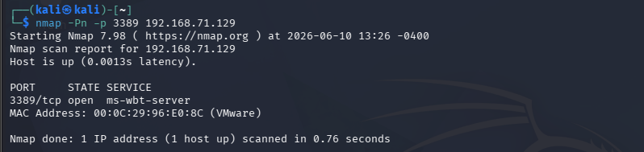
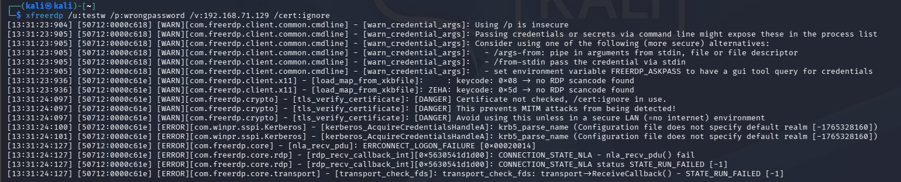
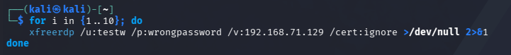
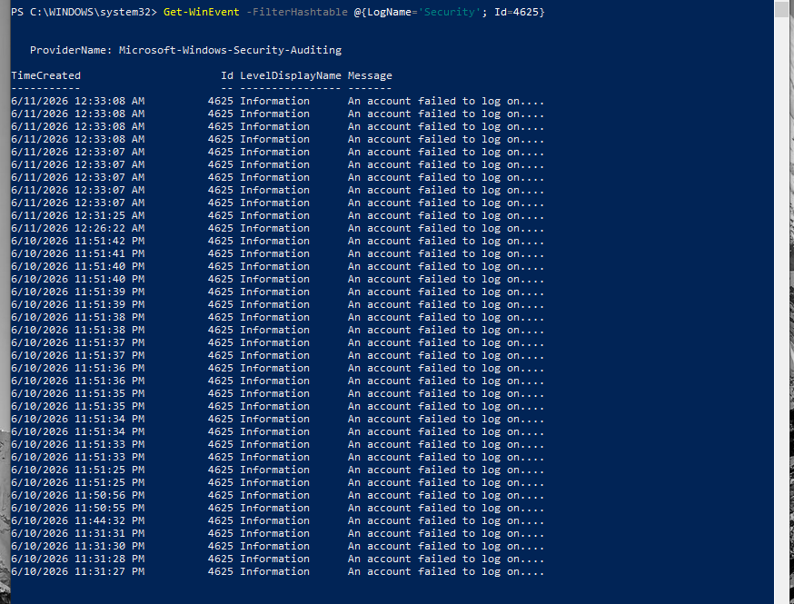
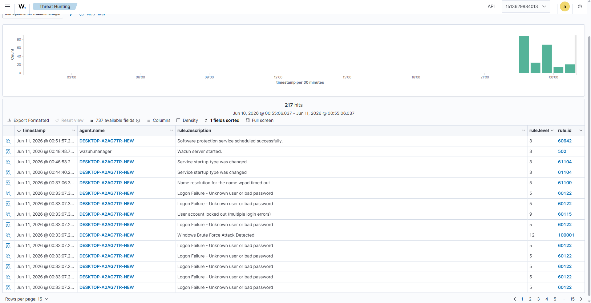
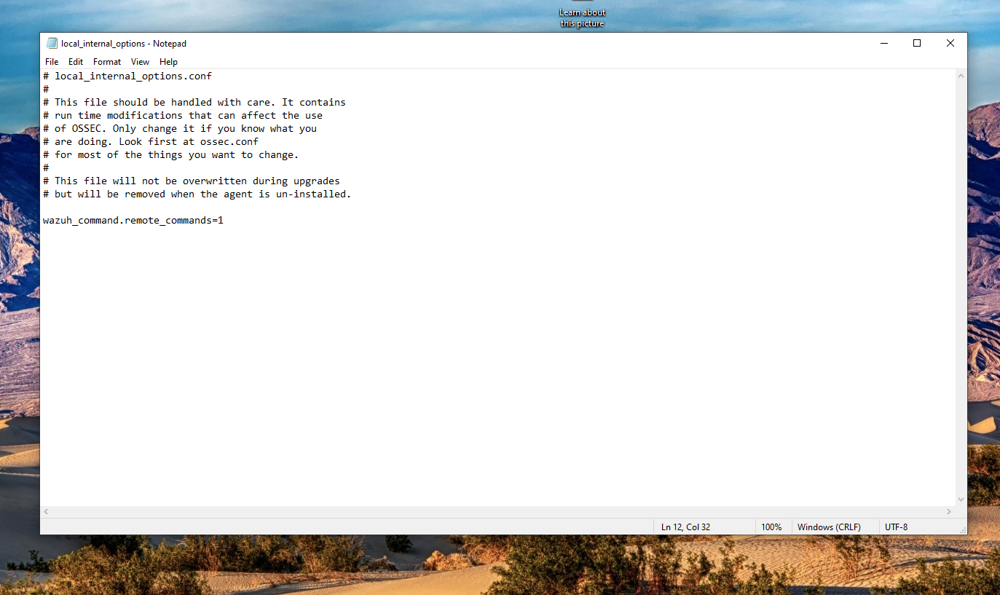
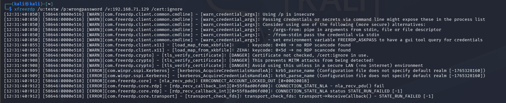
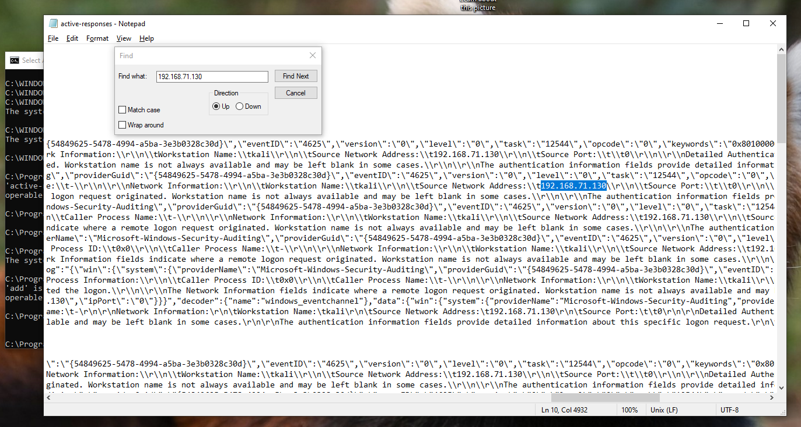

# REAL-WORLD ATTACK & DETECTION SCENARIOS (PHASE 3)

## 🔹 SCENARIO 1: T1110 - BRUTE FORCE ATTACK DETECTION & AUTOMATED IP BLOCKING (ACTIVE RESPONSE)

This scenario demonstrates the **Active Response** capabilities of the SIEM system – not merely stopping at detection, but directly interacting with the host firewall to isolate the attacker in real time.

## Objectives

The objective of Phase 3 - Scenario 1 is to simulate a Brute Force attack from Kali Linux against the Windows Victim machine and leverage Wazuh to detect failed authentications via the Windows Security Event Log.

Expected outcomes:

* Windows Agent forwards logs to Wazuh Manager.
* Wazuh detects failed logon attempts.
* Develop a Custom Rule to detect Brute Force activity.
* Map to MITRE ATT&CK T1110 (Brute Force).

---

## Deployment Architecture

The deployment architecture comprises three main components:

```
                   ┌─────────────────────┐
                   │ Kali Linux          │
                   │ Attacker            │  
                   │ (IP: 192.168.71.130)│
                   └───────┬─────────────┘
                           │
                           │ RDP Brute Force
                           ▼
                   ┌──────────────────────┐
                   │ Windows 10           │
                   │ Wazuh Agent          │
                   │ (IP: 192.168.71.129) │
                   └───────┬──────────────┘
                           │
                           │ Security Logs
                           ▼
                   ┌─────────────────────────────┐
                   │ Wazuh Manager               │
                   │ Docker                      │
                   │ (Ubuntu IP: 192.168.71.128) │
                   └───────┬─────────────────────┘
                           │
                           │ Alerts
                           ▼
                   ┌───────────────┐
                   │ Dashboard     │
                   │ Threat Hunt   │
                   └───────────────┘
```
--- 
## I. Configuring Wazuh for Brute Force Detection

### 1. Verifying RDP Service

From Kali Linux, perform a port scan against the Windows machine's RDP port.
```bash
nmap -Pn -p 3389 192.168.71.129
```

Result:
```text
3389/tcp open ms-wbt-server
```

=> This confirms the Remote Desktop service is active and ready to accept remote connections.


---

### 2. Simulating Failed RDP Logon

Use xfreerdp on Kali Linux.
```bash
xfreerdp /u:testw /p:wrongpassword /v:192.168.71.129 /cert:ignore
```

Result:
```text
ERRCONNECT_LOGON_FAILURE
```

=> This proves the Windows machine received the authentication request and rejected the logon due to invalid credentials.


### 3. Developing Custom Rule for Brute Force Detection

Add the Rule into `local_rules.xml`, see **link to local_rules.xml in custom-rules/**:

### 4. Simulating Brute Force Attack

Send multiple consecutive invalid authentication requests.
```bash
for i in {1..10}; do
    xfreerdp /u:testw \
             /p:wrongpassword \
             /v:192.168.71.129 \
             /cert:ignore
done
```

The above command generates numerous failed logon events within a short time window on the Windows system.


---

### 5. Inspecting Windows Event Log

After executing the simulated attack, inspect the Security Event Log.
```powershell
Get-WinEvent -FilterHashtable @{LogName='Security'; Id=4625}
```

Multiple events appear in the output:
```text
Event ID: 4625
An account failed to log on
```

Event ID 4625 is the standard Windows event used to log failed logon attempts.


---

### 6. Analyzing Logs on Wazuh Dashboard

Navigate to Threat Hunting to observe newly created `rule.id` 100001:

```text
Windows Brute Force Attack Detected
Rule ID: 100001
Level : 12
```



---


## II. Deploying Automated IP Blocking (Active Response)

To elevate the system from passive monitoring to proactive defense, an **Active Response** mechanism is integrated to command the Windows Agent to automatically trigger the firewall, completely isolating the attacker IP the moment Rule `100001` fires.

### Step 1: Configure Active Response on Wazuh Manager (Ubuntu)

To ensure system stability and avoid permission issues affecting background processes (`wazuh-db`), the procedure to extract, edit, and overwrite the configuration file from the Ubuntu host into Docker is executed as follows:

1. **Extract original configuration file:** In the Ubuntu terminal, run the command to copy the global configuration file out of the Container:
```bash
sudo docker cp single-node-wazuh.manager-1:/var/ossec/etc/ossec.conf ./ossec.conf.bak
```


2. **Edit configuration file:** Open the copied `ossec.conf.bak` file using `gedit`:
```bash
gedit ./ossec.conf.bak
```


Scroll to the end of the file, locate the position before closing tag `</ossec_config>`, and insert the Active Response configuration invoking the Windows `netsh` command:
```xml
  <active-response>
    <command>netsh</command>
    <location>local</location> 
    <rules_id>100001</rules_id>
    <timeout>600</timeout> 
  </active-response>
```


*Click **Save** and close the editor.*
3. **Push file into Container and enforce strict permissions:** Execute the following command sequence to update the file and restore file ownership to the `wazuh` user inside Docker to prevent service crashes:
```bash
# Copy configured file into container
sudo docker cp ./ossec.conf.bak single-node-wazuh.manager-1:/var/ossec/etc/ossec.conf

# Update ownership and file permissions immediately
sudo docker exec -it single-node-wazuh.manager-1 chown wazuh:wazuh /var/ossec/etc/ossec.conf
sudo docker exec -it single-node-wazuh.manager-1 chmod 660 /var/ossec/etc/ossec.conf

# Restart Wazuh internally to apply fresh configuration
sudo docker exec -it single-node-wazuh.manager-1 /var/ossec/bin/wazuh-control restart
```

### Step 2: Enable Remote Command Execution on Windows Agent

By default, for security reasons, the Wazuh Agent on Windows prevents the Manager from executing remote scripts. This feature must be unlocked locally on the victim machine:

1. On the **Windows 10 Victim** machine, open Notepad as Administrator (**Run as Administrator**).
2. Open the file at path: `C:\Program Files (x86)\ossec-agent\local_internal_options.conf`.
3. Navigate to the bottom of the file and append the following line to permit remote command execution:
```text
wazuh_command.remote_commands=1
```


4. Save the file (`Ctrl + S`).
5. Open Command Prompt (CMD) as Admin on Windows and restart the Agent service:
```cmd
NET STOP WazuhSvc && NET START WazuhSvc
```
---

### Step 3: Real-World Verification and Forensic Evidence Collection (PoC)

Once the SIEM and Windows Agent infrastructure configurations are verified, trigger the Brute Force attack scenario again from the **Kali Linux** machine using a throttled loop:

```bash
for i in {1..10}; do xfreerdp /u:testw /p:wrongpassword /v:192.168.71.129 /cert:ignore; sleep 1; done
```



Around attempt 6 to 8, as rapid streams of Event ID 4625 logs trigger Rule `100001`, the defensive mechanism engages immediately. The Windows host rejects authentication right at the network level (NLA) and returns a fatal error code directly to Kali Linux's terminal:

```text
[ERROR][com.freerdp.core] - [nla_recv_pdu]: ERRCONNECT_ACCOUNT_LOCKED_OUT [0x00020018]
```

This proves the Brute Force attack was completely disrupted; the attacker cannot proceed with password spraying or brute forcing.




Inspecting the Agent Active Response execution log file at `C:\Program Files (x86)\ossec-agent\active-responses.log` on the **Windows 10** machine, the system records real-time binary execution entries:

```text
active-response/bin/netsh.exe add - 192.168.71.130
```

This log confirms the Agent successfully received the command from the Ubuntu SIEM brain and immediately invoked `netsh.exe` to establish defensive perimeter rules.


Access the *Windows Defender Firewall with Advanced Security* $\rightarrow$ *Inbound Rules* management interface on the victim machine. The system automatically generated an emergency rule named **`WAZUH ACTIVE RESPONSE BLOCKED IP`**. Checking properties under the *Scope* tab confirms that the Kali Linux IP address (`192.168.71.130`) has been locked into the **Block** list.


On the **Wazuh Dashboard** interface (`Threat Hunting` $\rightarrow$ `Events`), alongside the high-severity Level 12 alert for Rule `100001` detecting Brute Force, the system concurrently records a Level 3 alert confirming the response command executed successfully:

```text
Active response: active-response/bin/netsh.exe - add
Rule ID: 657
```

---

## III. Scenario 1 Summary

This scenario simulates an RDP Brute Force attack and triggers Active Response. The Docker-deployed SIEM system demonstrates centralized log ingestion, custom parsing aligned with MITRE ATT&CK T1110, and automated threat containment (SOAR Automation Capabilities), safeguarding Windows workstation assets.


## References
- https://attack.mitre.org/techniques/T1110/