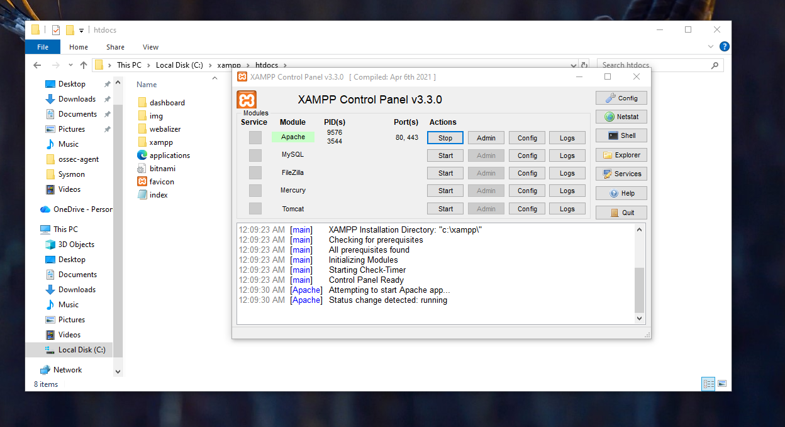
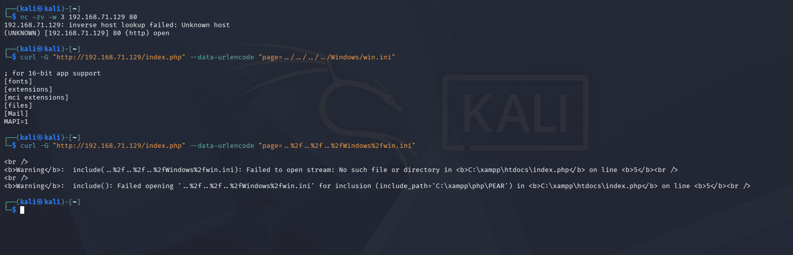
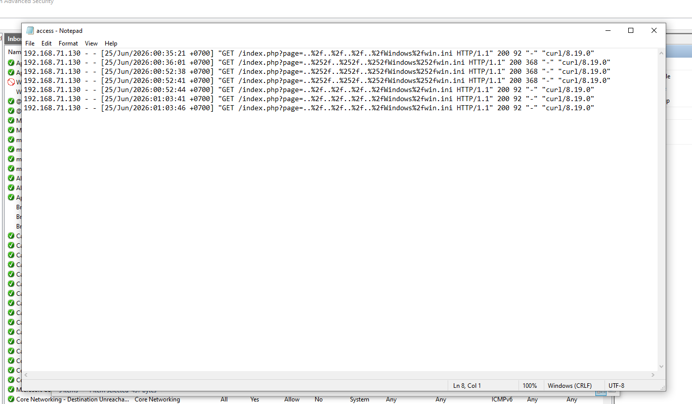
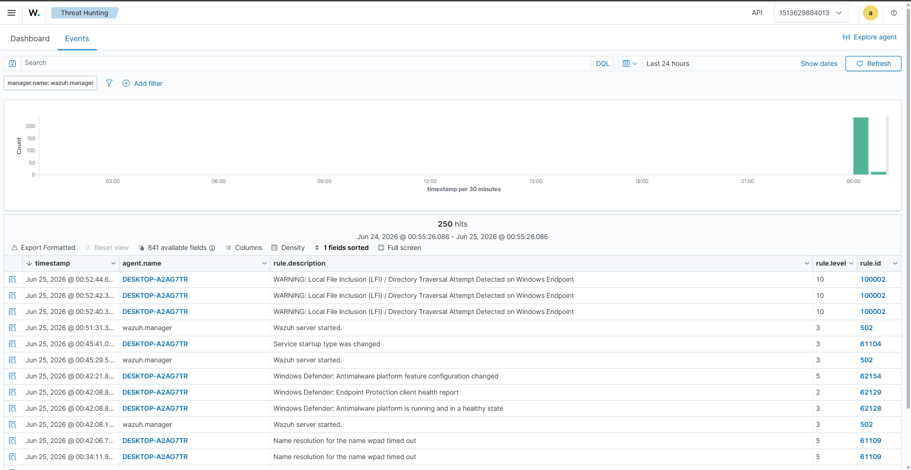
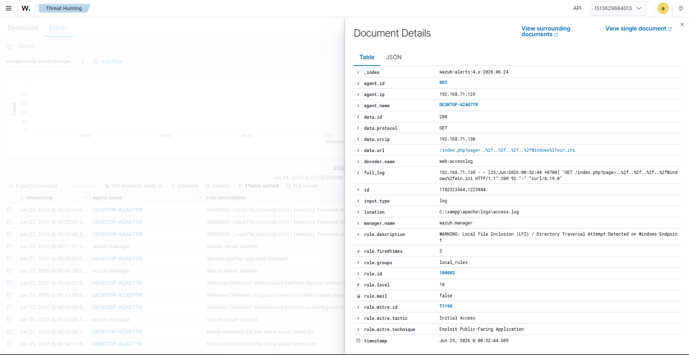
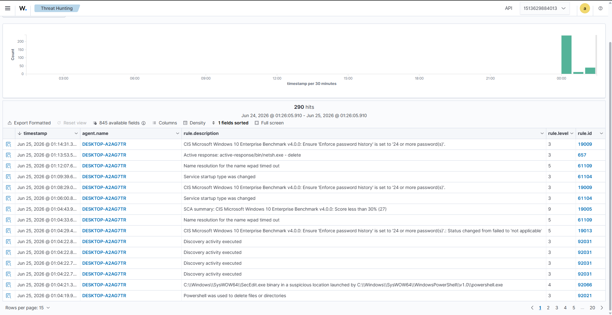
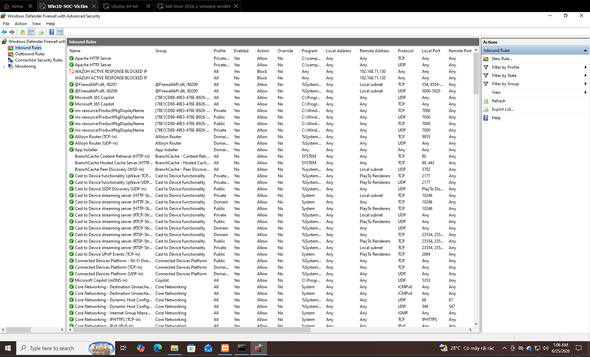
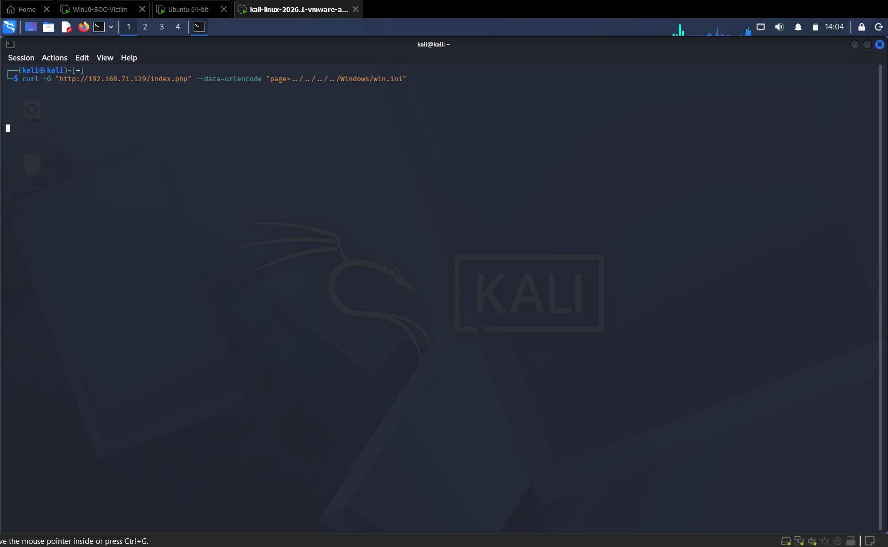

# REAL-WORLD ATTACK & DETECTION SCENARIOS (PHASE 3)

## 🔹 SCENARIO 2: T1190 - WEB APPLICATION EXPLOITATION (LOCAL FILE INCLUSION - LFI / DIRECTORY TRAVERSAL)

This scenario analyzes exotic character parsing using advanced regular expressions, third-party application log collection configuration, overwriting system definitions with **Custom Decoders / Custom Rules**, and integrating a proactive **Active Response** defense mechanism engineered by a Detection Engineer to protect public-facing applications.

## Objectives

* **Attacker's Goal:** The attacker targets the **Initial Access** tactic via the **`T1190 - Exploit Public-Facing Application`** technique. By exploiting a Local File Inclusion (LFI) / Directory Traversal vulnerability on an external-facing Web application (Apache), the hacker attempts to read sensitive operating system configuration files (`win.ini`) to gather reconnaissance intelligence.
* **SIEM/SOC Validation Goal:**
* Validate third-party application log monitoring capabilities (XAMPP Apache) via Wazuh Agent log collection pipelines.
* Evaluate the sensitivity and precision of **Custom Decoders** in parsing complex URL parameters.
* Test the detection capabilities of **Custom Rules (PCRE2 Regex)** against evasion and string obfuscation techniques such as single encoding (`%2f`) and double encoding (`%252f`).
* Verify the **Active Response** mechanism, triggering Windows Defender Firewall (`netsh.exe`) to automatically isolate and block the attacker source IP in real time.


## I. Web Server Configuration and Log Ingestion Pipeline

### 1. Setting up an LFI-Vulnerable Web Application Environment

To provide an environment that generates Web access logs for Wazuh, a local Apache Web Server is configured using the XAMPP suite installed at `C:\xampp` on the Windows 10 Victim machine to avoid UAC permission conflicts.

In the source code directory `C:\xampp\htdocs\`, construct a source file named `index.php` containing an unsanitized input vulnerability feeding directly into a system include function:

```php
<?php
    // LFI Vulnerability: Extracts 'page' parameter directly from URL and passes to include without sanitization
    if (isset($_GET['page'])) {
        $file = $_GET['page'];
        include($file);
    } else {
        echo "<h1>Welcome to My Public Web Application</h1>";
    }
?>
```

Start the **Apache** service from the XAMPP Control Panel, ensuring the status turns green and listens on default ports (80, 443).


### 2. Configuring Wazuh Agent to Ingest Access Logs

To forward the Web event stream to the central analysis engine, edit the Agent's global configuration file with administrative privileges:

```cmd
notepad "C:\Program Files (x86)\ossec-agent\ossec.conf"
```

Append the configuration block monitoring local Apache log files:

```xml
<localfile>
  <log_format>syslog</log_format>
  <location>C:\xampp\apache\logs\access.log</location>
</localfile>
```

Restart the Agent service from an Administrator Command Prompt to activate the log pipeline:

```cmd
NET STOP WazuhSvc && NET START WazuhSvc
```

---

## II. Developing Advanced LFI Detection on Wazuh Manager

### 1. Writing Custom Decoder for Deep URL Parameter Extraction

By default, Wazuh uses the `web-accesslog` decoder to parse Apache logs. To specifically extract raw payloads trailing behind the `GET` method, extract and modify the custom decoder in `local_decoder.xml` inside the Docker Container:

```bash
sudo docker cp single-node-wazuh.manager-1:/var/ossec/etc/decoders/local_decoder.xml ./local_decoder.xml.bak
```

Configure a regular expression (Regex) to extract the entire malicious parameter string into a dynamic field:

```xml
<decoder name="web-access-lfi">
  <parent>web-accesslog</parent>
  <regex>GET (\S+)\sHTTP</regex>
  <order>url</order>
</decoder>
```

### 2. Constructing Rule System to Counter Evasion (Double Encoding)

Hackers frequently employ string obfuscation techniques such as single encoding (`%2f`) or double encoding (`%252f`) to bypass standard rule sets. Copy the rule file to add a broad-coverage filter:

```bash
sudo docker cp single-node-wazuh.manager-1:/var/ossec/etc/rules/local_rules.xml ./local_rules.xml.bak
```

```xml
<group name="web,attack,lfi,">
  <rule id="100002" level="10" overwrite="yes">
    <if_sid>31100</if_sid>
    <match>win.ini|boot.ini|..%2f|..%252f|../</match>
    <description>WARNING: Local File Inclusion (LFI) / Directory Traversal Attempt Detected on Windows Endpoint</description>
    <mitre>
      <id>T1190</id>
    </mitre>
  </rule>
</group>
```

Synchronize the modified configuration files back into the Container, enforce strict ownership for user `wazuh`, and restart:

```bash
sudo docker cp ./local_decoder.xml.bak single-node-wazuh.manager-1:/var/ossec/etc/decoders/local_decoder.xml
sudo docker cp ./local_rules.xml.bak single-node-wazuh.manager-1:/var/ossec/etc/rules/local_rules.xml

sudo docker exec -it single-node-wazuh.manager-1 chown wazuh:wazuh /var/ossec/etc/decoders/local_decoder.xml /var/ossec/etc/rules/local_rules.xml
sudo docker exec -it single-node-wazuh.manager-1 chmod 660 /var/ossec/etc/decoders/local_decoder.xml /var/ossec/etc/rules/local_rules.xml

sudo docker exec -it single-node-wazuh.manager-1 /var/ossec/bin/wazuh-control restart
```

---

## III. Deploying Automated IP Blocking (Active Response)

To elevate the system with automated incident response capabilities (SOAR Capabilities), configure the active response mechanism to instruct the Agent to automatically block the attacker IP via Windows Defender Firewall.

### 1. Configure Active Response on Wazuh Manager

Extract central configuration file `ossec.conf` from Docker to the Ubuntu host:

```bash
sudo docker cp single-node-wazuh.manager-1:/var/ossec/etc/ossec.conf ./ossec.conf.bak
```

Navigate to the active response section, append the configuration block binding directly to newly created Rule `100002`, invoking system command `netsh` with a 10-minute (600-second) temporary containment timeout:

```xml
  <active-response>
    <command>netsh</command>
    <location>local</location> 
    <rules_id>100002</rules_id>
    <timeout>600</timeout> 
  </active-response>
```

Push the configuration file back into the container, enforce permissions, and restart as described above.
---

## IV. Real-World Verification and Forensic Evidence Collection (PoC)

> ⚠️ **Operational Note:** Prior to testing, access the firewall interface `wf.msc` on the Windows Victim machine to delete or disable legacy blocking rules `Wazuh_ActiveResponse_...` left over from Scenario 1 to restore connectivity for the Kali machine.

### 1. Simulating LFI Exploitation from Kali Linux Attack Machine

From the Kali Linux machine (`192.168.71.130`), launch the exploit command using raw path traversal parameters:

```bash
curl -G "http://192.168.71.129/index.php" --data-urlencode "page=../../../../Windows/win.ini"
```

The command outputs the contents of the Windows security configuration file `win.ini` directly to the console, verifying successful exploitation:

```text
; for 16-bit app support
[fonts]
[extensions]
```

Next, simulate subtle evasion techniques using a Double Encoding attack:

```bash
curl -G "http://192.168.71.129/index.php" --data-urlencode "page=..%252f..%252f..%252fWindows%252fwin.ini"
```

Although the application returns an error warning because `include()` does not automatically double-decode the string, the entire malicious payload footprint is captured and recorded intact in Apache's `access.log`.

### 2. Validating Parsing Structure via `wazuh-logtest`

Invoke the internal test utility on the Ubuntu Manager to evaluate the parsing quality of the malicious log line:

```bash
sudo docker exec -it single-node-wazuh.manager-1 /var/ossec/bin/wazuh-logtest
```

Pasting the actual Double Encoding log line recorded from Apache confirms that `Phase 2` successfully decodes the malicious parameter into the `url` field, and `Phase 3` triggers **Rule 100002** at Level 10:

```text
**Phase 2: Completed decoding.
	name: 'web-accesslog'
	url: '/index.php?page=..%252f..%252f..%252fWindows%252fwin.ini'

**Phase 3: Completed filtering (rules).
	id: '100002'
	level: '10'
	description: 'WARNING: Local File Inclusion (LFI) / Directory Traversal Attempt Detected on Windows Endpoint'

```

### 3. Analyzing Response Execution Results on Wazuh Dashboard

Access the **Wazuh Dashboard** monitoring center (`Threat Hunting` $\rightarrow$ `Events`). The system fires two high-fidelity alert categories simultaneously:

* **Attack Detection Alert (Rule 100002):** An orange Level 10 alert triggers, warning of unauthorized directory traversal targeting the Windows endpoint. Inspecting `Document Details` clearly displays `data.srcip: 192.168.71.130` and the anomalous payload in `data.url`, validating the Custom Decoder's extraction capability.




* **Active Response Alert (Rule 657):** The system logs the successful execution of blocking command `netsh.exe - add`.
Inspecting the local `active-responses.log` at `C:\Program Files (x86)\ossec-agent\active-responses.log` on the Windows host confirms real-time firewall execution entries:
```text
active-response/bin/netsh.exe add - 192.168.71.130
```


Concurrently, inspecting *Inbound Rules* in Windows Defender Firewall on the victim host reveals an emergency rule named **`WAZUH ACTIVE RESPONSE BLOCKED IP`**, locking the Kali IP (`192.168.71.130`) into the block list.


As final proof, executing a third exploit or reconnaissance request from Kali toward the Web Server results in packets being dropped at the network boundary; the `curl` command hangs:


---

## V. Scenario 2 Summary

The simulated web application attack via Local File Inclusion (LFI) and subsequent Active Response containment completed successfully. This demonstrates proficiency in decoding complex character sets, crafting custom rules that override system defaults (`overwrite="yes"`), and effectively handling filter evasion variants.

In particular, the closed-loop security cycle spanning Detection, Alerting, and Automated Containment at the network perimeter affirms the operational readiness of a modern enterprise SOC in shielding application infrastructure against public-facing exploitation techniques (`T1190`).

## References

* [https://attack.mitre.org/techniques/T1190/](https://attack.mitre.org/techniques/T1190/)