# REAL-WORLD ATTACK & DETECTION SCENARIOS (PHASE 3)

## 🔹 SCENARIO 3: FULL KILL CHAIN ATTACK & DETECTION WITH MICROSOFT SYSMON TELEMETRY (T1059, T1548, T1547, T1003)

This scenario demonstrates the SOC system's **Deep Kernel Telemetry** capabilities and the construction of an end-to-end detection chain (**Full Attack Lifecycle / Kill Chain Detection**). Rather than solely capturing isolated application-level events (such as Web or RDP authentication), this scenario authentically simulates advanced techniques an adversary performs post-compromise on the victim endpoint.

---

## Objectives

The objective of Phase 3 - Scenario 3 is to construct and validate a closed multi-stage attack chain aligned with the **MITRE ATT&CK** matrix:
1. **Execution (T1059.001):** Execute stealthy PowerShell commands using Base64 obfuscation (`-EncodedCommand`, `-w hidden`, `-nop`).
2. **Privilege Escalation (T1548.002):** Elevate privileges via Registry Hijacking (`ms-settings\Shell\Open\command`) to bypass User Account Control (UAC).
3. **Persistence (T1547.001):** Establish long-term footholds by registering autostart keys under `HKCU\...\CurrentVersion\Run`.
4. **Credential Access (T1003.001):** Extract sensitive credentials from memory by opening a process access handle to system process `lsass.exe`.

Expected outcomes:
* Microsoft Sysmon v15.2 on Windows Endpoint captures deep kernel telemetry (Kernel Events 1, 10, 12, 13).
* Windows EventChannel seamlessly forwards event log telemetry to Wazuh Manager.
* The Wazuh SIEM system accurately parses and triggers Custom Rules (`100004`, `100005`, `100006`, `100007`).
* The ChatOps subsystem automatically dispatches real-time detailed alerts to the Telegram Bot.
* 100% regression testing automation via `tests/e2e/scenario_full_killchain.py` with post-test environment cleanup.

---

## Deployment Architecture

Overall architectural model of the Full Kill Chain scenario:

```text
       ┌────────────────────────────────────────────────────────┐
       │                   KALI LINUX / ADMIN                   │
       │                   Automation Engine                    │
       │                 (IP: 192.168.71.130)                   │
       └───────────────────────────┬────────────────────────────┘
                                   │
                                   │ WinRM / Simulated Exploit Stages
                                   ▼
       ┌────────────────────────────────────────────────────────┐
       │                  WINDOWS 10 VICTIM                     │
       │              (Agent IP: 192.168.71.129)                │
       │                                                        │
       │  [Stage 1] Encoded PowerShell (T1059.001)              │
       │  [Stage 2] UAC Bypass ms-settings (T1548.002)          │
       │  [Stage 3] Registry Run Key Persistence (T1547.001)    │
       │  [Stage 4] LSASS Memory Access (T1003.001)             │
       │                                                        │
       │      ▲                   ▲                   ▲         │
       │      │                   │                   │         │
       │   Sysmon EID 1      Sysmon EID 12/13    Sysmon EID 10  │
       │ (Process Create)   (Registry Event)    (ProcessAccess) │
       │      └───────────────────┼───────────────────┘         │
       │                          │                             │
       │               Wazuh Agent 4.14.5                       │
       │          (Microsoft-Windows-Sysmon/Op)                 │
       └──────────────────────────┬─────────────────────────────┘
                                  │
                                  │ Encrypted Sysmon EventChannel (TCP 1514)
                                  ▼
       ┌────────────────────────────────────────────────────────┐
       │                   WAZUH MANAGER                        │
       │              (Single-Node Container)                   │
       │             (Ubuntu IP: 192.168.71.128)                │
       │                                                        │
       │  • Rule 100004: Malicious PowerShell Execution (L12)   │
       │  • Rule 100007: UAC Bypass ms-settings (L12)           │
       │  • Rule 100006: Persistence Run Key (L10)              │
       │  • Rule 100005: LSASS Process Access Dump (L12)        │
       └──────────────┬──────────────────────────┬──────────────┘
                      │                          │
       Alerts Stream  │                          │ Webhook Integration
                      ▼                          ▼
       ┌────────────────────────┐      ┌────────────────────────┐
       │    WAZUH DASHBOARD     │      │     TELEGRAM CHATOPS   │
       │  Threat Hunting Events │      │   Realtime SOC Alerts  │
       └────────────────────────┘      └────────────────────────┘
```

---

## I. Microsoft Sysmon v15.2 & Custom Rules Configuration on Wazuh

### 1. Advanced Sysmon Configuration on Windows Endpoint (`sysmon-config.xml`)

To ensure Sysmon captures deep Registry interactions and `lsass.exe` process access handles, configuration file [`deployment/sysmon-config.xml`](../../deployment/sysmon-config.xml) is tuned:

```xml
<Sysmon schemaversion="4.90">
  <HashAlgorithms>MD5,SHA256</HashAlgorithms>
  <EventFiltering>
    <!-- Event 1: Monitor all newly created processes -->
    <ProcessCreate onmatch="exclude" />

    <!-- Event 3: Monitor network connections from cmd/powershell -->
    <NetworkConnect onmatch="include">
      <Image condition="contains">cmd.exe</Image>
      <Image condition="contains">powershell.exe</Image>
    </NetworkConnect>

    <!-- Event 10: ProcessAccess - Capture handles opened against lsass.exe -->
    <ProcessAccess onmatch="include">
      <TargetImage condition="end with">lsass.exe</TargetImage>
    </ProcessAccess>

    <!-- Event 12, 13: RegistryEvent - Capture Persistence Run Key & UAC Bypass -->
    <RegistryEvent onmatch="include">
      <TargetObject condition="contains">CurrentVersion\Run</TargetObject>
      <TargetObject condition="contains">ms-settings</TargetObject>
    </RegistryEvent>
  </EventFiltering>
</Sysmon>
```

Load the configuration directly into the OS driver using the command:
```powershell
& "C:\Windows\Sysmon64.exe" -c C:\Users\Public\sysmon-config.xml
```

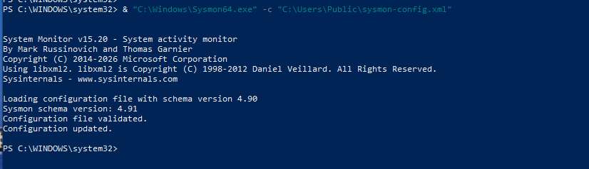

### 2. Developing Custom Rules Suite for Full Kill Chain Detection (`local_rules.xml`)

On the **Wazuh Manager** server, open [`custom-rules/local_rules.xml`](../../custom-rules/local_rules.xml) and add the specialized rule group capturing Sysmon EventChannel streams:

```xml
<group name="local_rules,sysmon,windows,killchain,">

  <!-- ===================================================================== -->
  <!-- STAGE 1: Malicious PowerShell Execution (T1059.001)                    -->
  <!-- ===================================================================== -->
  <rule id="100003" level="0">
    <if_sid>92021, 92066, 92031, 92032, 92052, 60000, 61603</if_sid>
    <description>Sysmon Event 1 Process Create Base Filter</description>
  </rule>

  <rule id="100004" level="12">
    <if_sid>100003</if_sid>
    <field name="win.system.message" type="pcre2">(?i)CommandLine:.*(-EncodedCommand|-enc|-w\s+hidden|-nop)</field>
    <description>CRITICAL WARNING: Malicious PowerShell Execution with Encoded/Hidden parameters detected!</description>
    <mitre>
      <id>T1059.001</id>
    </mitre>
  </rule>

  <!-- ===================================================================== -->
  <!-- STAGE 2: Privilege Escalation - UAC Bypass via Registry (T1548.002)   -->
  <!-- ===================================================================== -->
  <rule id="100007" level="12">
    <if_sid>61614, 61615, 61616</if_sid>
    <field name="win.system.message" type="pcre2">(?i)ms-settings</field>
    <description>CRITICAL WARNING: UAC Bypass attempt detected via ms-settings registry hijacking</description>
    <mitre>
      <id>T1548.002</id>
    </mitre>
  </rule>

  <!-- ===================================================================== -->
  <!-- STAGE 3: Persistence - Registry Run / RunOnce Keys (T1547.001)        -->
  <!-- ===================================================================== -->
  <rule id="100006" level="10">
    <if_sid>61614, 61615, 61616</if_sid>
    <field name="win.system.message" type="pcre2">(?i)CurrentVersion\\Run</field>
    <description>WARNING: Persistence Mechanism - Registry Run/RunOnce Key Created or Modified</description>
    <mitre>
      <id>T1547.001</id>
    </mitre>
  </rule>

  <!-- ===================================================================== -->
  <!-- STAGE 4: Credential Access - LSASS Memory Access (T1003.001)           -->
  <!-- ===================================================================== -->
  <rule id="100005" level="12">
    <if_sid>61612</if_sid>
    <field name="win.system.message" type="pcre2">(?i)TargetImage:.*lsass\.exe</field>
    <field name="win.system.message" type="pcre2" negate="yes">(?i)SourceImage:.*(MsMpEng\.exe|wmiprvse\.exe)</field>
    <field name="win.system.message" type="pcre2" negate="yes">(?i)GrantedAccess:\s*0x1000\b</field>
    <description>CRITICAL WARNING: Suspicious Process Access to LSASS detected (Potential Credential Dumping)</description>
    <mitre>
      <id>T1003.001</id>
    </mitre>
  </rule>

</group>
```

Validate syntax and reload configuration on Wazuh Manager:
```bash
docker exec single-node-wazuh.manager-1 /var/ossec/bin/wazuh-analysisd -t
docker exec single-node-wazuh.manager-1 /var/ossec/bin/wazuh-control restart
```

---

## II. 4-Stage Simulation Details & Forensic Evidence (PoC)

---

### 🔴 Stage 1: Execution (T1059.001 - Malicious PowerShell Execution)

#### 1. Simulated Behavior
Upon obtaining initial access, an attacker executes obfuscated malicious code using the Base64 flag `-EncodedCommand` combined with window suppression `-WindowStyle Hidden` and profile bypass `-NoProfile`.
```powershell
powershell.exe -NoProfile -ExecutionPolicy Bypass -WindowStyle Hidden -EncodedCommand VwByAGkAdABlAC0ATwB1AHQAcAB1AHQAIAAiAFMATwBDAC0ATABhAGIAIABLAGkAbABsAEMAaABhAGkAbgAgAFMAdABhAGcAZQAxACAAVABlAHMAdAAgAEEAYwB0AGkAdgBlACI=
```
Upon command execution, the system immediately fires an alert to Telegram:

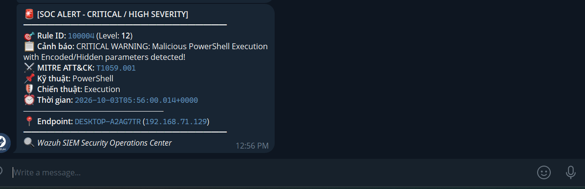

#### 2. Telemetry Artifacts (Sysmon Event ID 1)
Sysmon records the process creation event with full command-line arguments:
* **Event ID:** 1 (Process Create)
* **Image:** `C:\Windows\System32\WindowsPowerShell\v1.0\powershell.exe`
* **CommandLine:** `powershell.exe -NoProfile -ExecutionPolicy Bypass -WindowStyle Hidden -EncodedCommand ...`
* **ParentImage:** `C:\Windows\System32\cmd.exe`

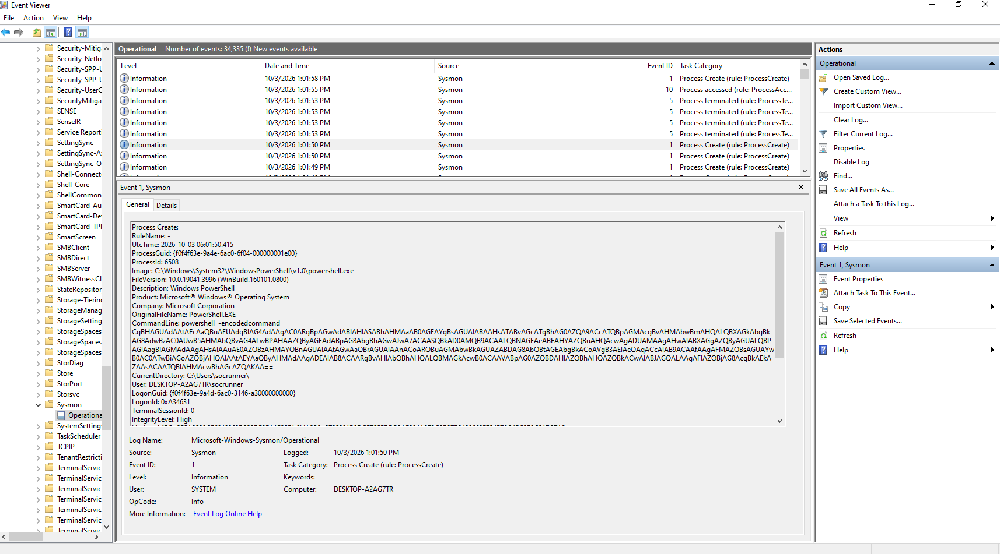

#### 3. Alerts on Wazuh SIEM
The system triggers **Rule ID 100004 (Level 12 - High Severity)**:

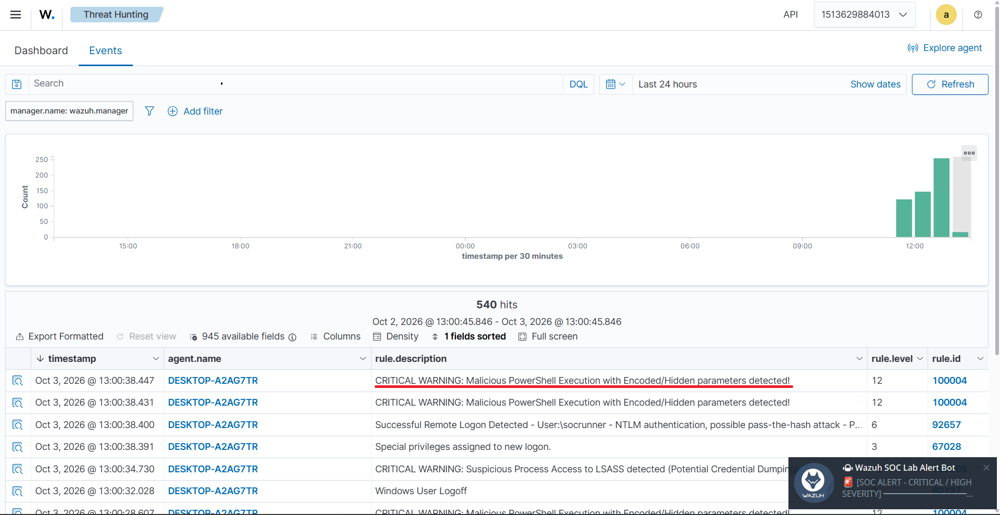
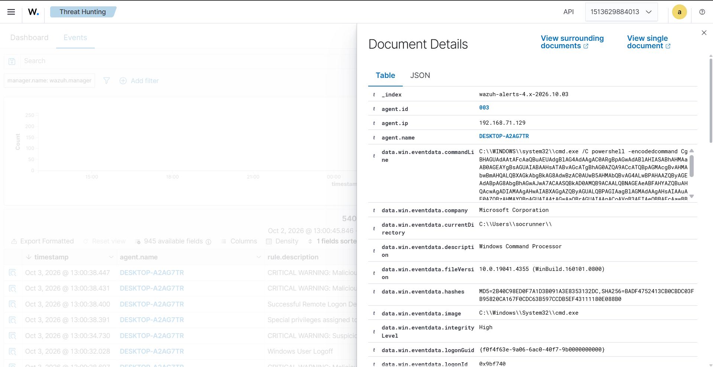

---

### 🔴 Stage 2: Privilege Escalation (T1548.002 - UAC Bypass via Registry)

#### 1. Simulated Behavior
The attacker leverages **Registry Hijacking** targeting the `ms-settings` protocol (standard Atomic Red Team T1548.002 methodology). By overriding the command key `HKCU\Software\Classes\ms-settings\Shell\Open\command`, auto-elevated processes (such as `fodhelper.exe` or `ComputerDefaults.exe`) execute arbitrary commands with Administrator privileges without presenting a UAC Prompt:
```powershell
$regPath = "HKCU:\Software\Classes\ms-settings\Shell\Open\command"
New-Item -Path $regPath -Force
Set-ItemProperty -Path $regPath -Name "DelegateExecute" -Value "" -Force
Set-Item -Path $regPath -Value "cmd.exe /c echo SOC_UAC_Bypass_Simulated" -Force
```
Notification on Telegram: 
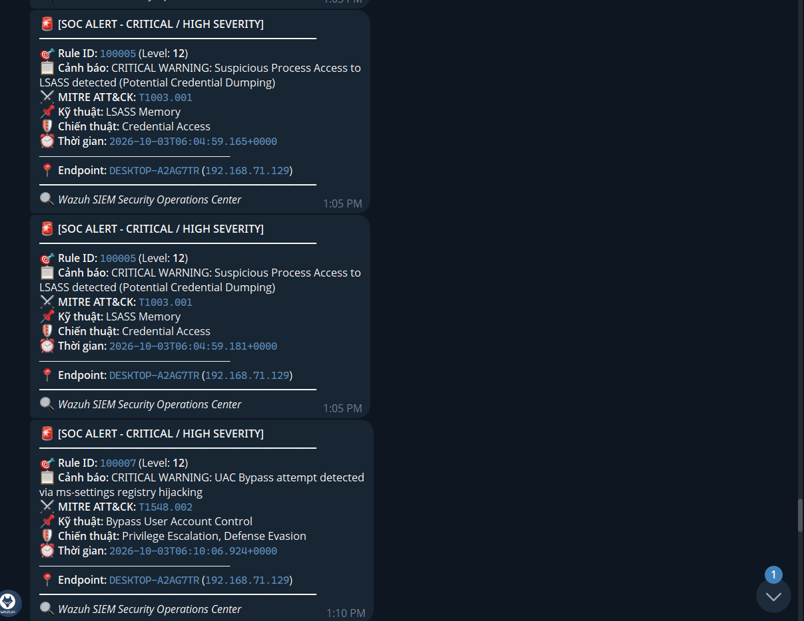


#### 2. Telemetry Artifacts (Sysmon Event ID 12 & 13)
Sysmon immediately intercepts the Registry interaction event:
* **Event ID:** 12 (CreateKey) & 13 (SetValue)
* **TargetObject:** `HKU\S-1-5-..._Classes\ms-settings\Shell\Open\command`
* **Details:** `cmd.exe /c echo SOC_UAC_Bypass_Simulated`

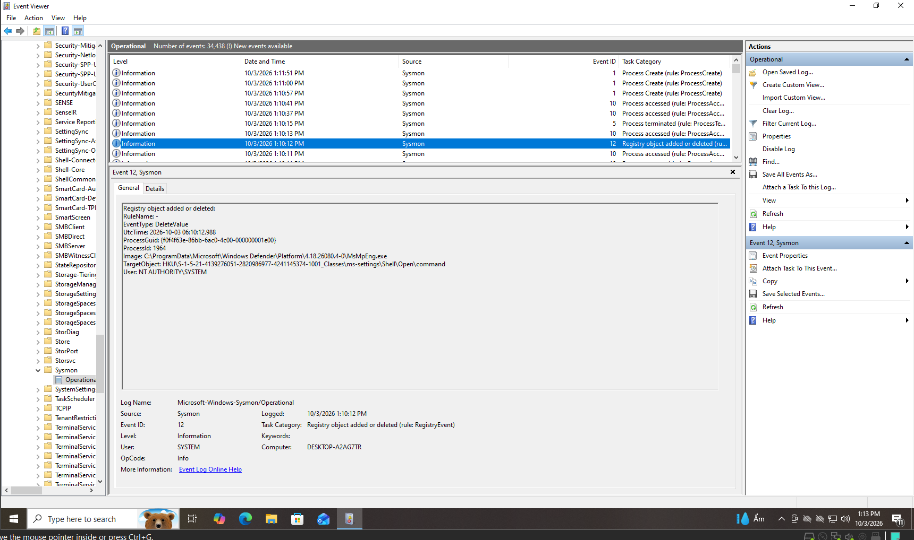

#### 3. Alerts on Wazuh SIEM
The system triggers **Rule ID 100007 (Level 12 - High Severity)**:

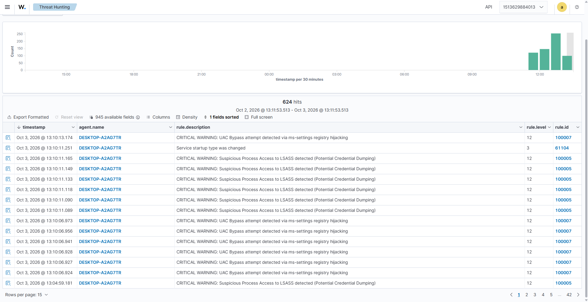

---

### 🔴 Stage 3: Persistence (T1547.001 - Registry Run Key Persistence)

#### 1. Simulated Behavior
The attacker establishes an autostart mechanism upon user logon to maintain persistent control (Persistence) using the `reg.exe` command-line utility:
```cmd
reg.exe add "HKCU\Software\Microsoft\Windows\CurrentVersion\Run" /v "SOCLabPersistTest" /t REG_SZ /d "C:\Windows\System32\cmd.exe /c echo soc_persist" /f
```

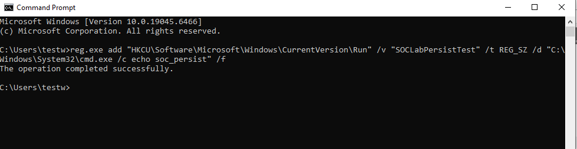

#### 2. Telemetry Artifacts (Sysmon Event ID 13)
Sysmon records the modified Registry value:
* **Event ID:** 13 (SetValue)
* **Image:** `C:\Windows\system32\reg.exe`
* **TargetObject:** `HKU\S-1-5-...\SOFTWARE\Microsoft\Windows\CurrentVersion\Run\SOCLabPersistTest`
* **Details:** `C:\Windows\System32\cmd.exe /c echo soc_persist`

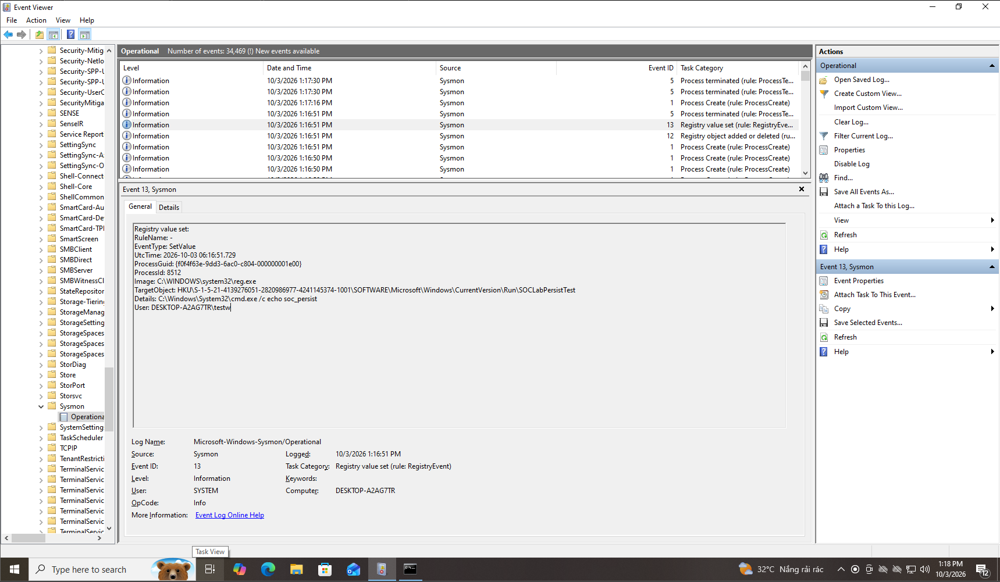

#### 3. Alerts on Wazuh SIEM
The system triggers **Rule ID 100006 (Level 10 - Medium/High Severity)**:

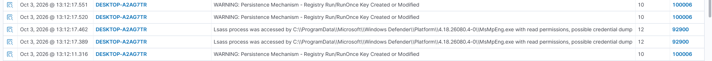

---

### 🔴 Stage 4: Credential Access (T1003.001 - LSASS Memory Access)

#### 1. Simulated Behavior
In real-world attacks, adversaries use Mimikatz, ProcDump, or Task Manager to dump memory from the `lsass.exe` process (Local Security Authority Subsystem Service) to harvest NTLM hashes and Kerberos tickets. 
In this lab, the activity is safely and realistically simulated using the .NET Process Diagnostics API (invoking Win32 `OpenProcess` to open a read handle against `lsass.exe`):
```powershell
$p = Get-Process -Name lsass -ErrorAction Stop
$h = $p.Handle
$id = $p.Id
$p.Dispose()
```

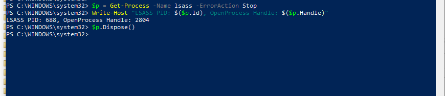

#### 2. Telemetry Artifacts (Sysmon Event ID 10)
Sysmon intercepts and records the sensitive memory access event:
* **Event ID:** 10 (ProcessAccess)
* **SourceImage:** `C:\Windows\System32\WindowsPowerShell\v1.0\powershell.exe`
* **TargetImage:** `C:\WINDOWS\system32\lsass.exe`
* **GrantedAccess:** Memory read/query access rights.

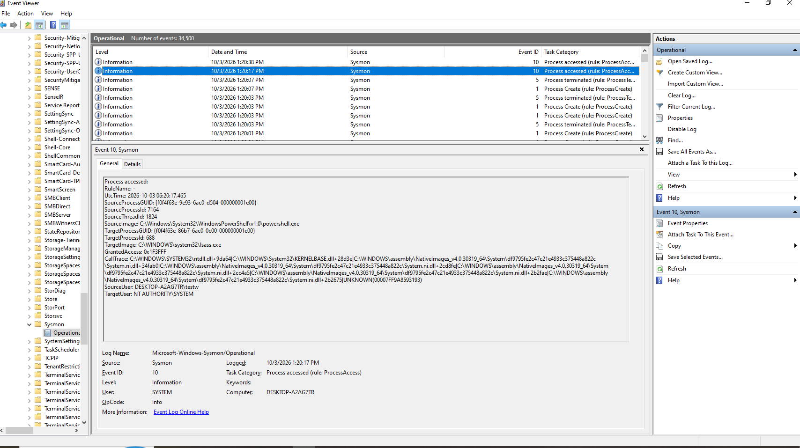

#### 3. Alerts on Wazuh SIEM
The system triggers **Rule ID 100005 (Level 12 - High Severity)**:

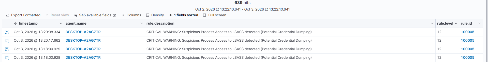

---

## III. End-to-End Test Automation (E2E Runner) & Telegram ChatOps

### 1. Comprehensive Automation Script (`scenario_full_killchain.py`)

The entire workflow from baseline setup, executing 4 attack stages, dynamic telemetry verification, to environment teardown is consolidated in [`tests/e2e/scenario_full_killchain.py`](../../tests/e2e/scenario_full_killchain.py).

Execute the script with:
```bash
python tests/e2e/scenario_full_killchain.py --execute
```


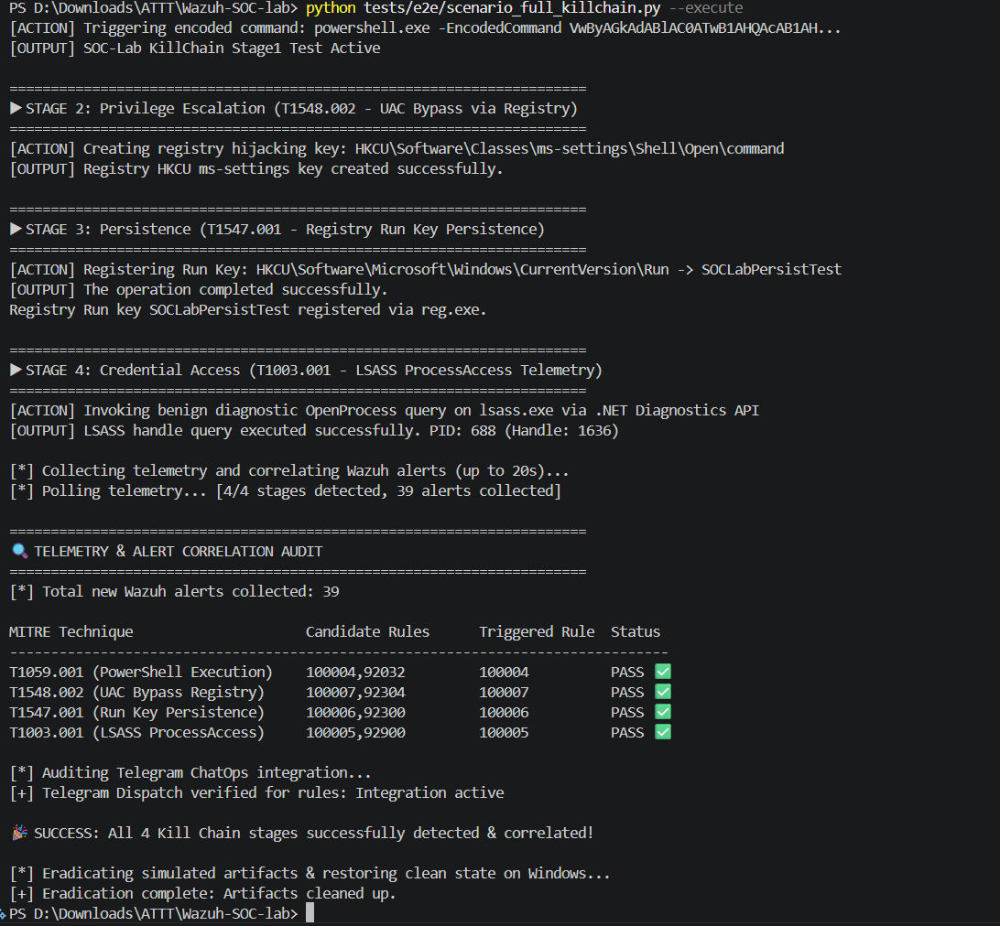

---

### 2. Real-Time Alert Notifications via Telegram ChatOps

All rules `100004`, `100005`, `100006`, `100007` are configured to forward alerts directly to the Telegram Bot. The SOC team receives detailed notifications containing:
* Severity Level (Level 10 - 12).
* Technique name and mapped **MITRE ATT&CK** ID.
* Endpoint name and triggering user context.
* Violating process / Registry key telemetry trace.
---

## IV. Forensic Investigation & Incident Remediation (Eradication & Remediation)

Following attack execution, the script automatically carries out standard incident response procedures (**NIST SP 800-61 / SANS**) to eradicate threats completely:
1. **Eradicate UAC Bypass Key:** Remove the entire `HKCU:\Software\Classes\ms-settings` hive to prevent unauthorized privilege escalation.
2. **Eradicate Persistence Mechanism (Run Key):** Use `reg.exe delete` to remove the `SOCLabPersistTest` value from `HKCU\...\CurrentVersion\Run`.
3. **Close Handle & Release Resources:** The PowerShell process releases the read handle against `lsass.exe` memory, ensuring Windows authentication service integrity.

Manual remediation commands:
```powershell
# 1. Eradicate UAC Bypass hijacking
Remove-Item -Path "HKCU:\Software\Classes\ms-settings" -Recurse -Force -ErrorAction SilentlyContinue

# 2. Eradicate Persistence Run Key
reg.exe delete "HKCU\Software\Microsoft\Windows\CurrentVersion\Run" /v "SOCLabPersistTest" /f
```

---

## V. Scenario 3 Summary

Scenario 3 validated:
* **Deep Monitoring Capabilities:** The synergy between **Wazuh Agent** and **Microsoft Sysmon v15.2** empowers the SOC to monitor abnormal operating system kernel activities comprehensively.
* **Complete Attack Lifecycle Coverage:** Moving beyond perimeter network alerts, the system maintains detection coverage across the entire intruder lifecycle (Execution $\rightarrow$ Privilege Escalation $\rightarrow$ Persistence $\rightarrow$ Credential Access).
* **Standardized Detection-as-Code:** The testing pipeline is fully automated with open-source tooling, integrating unit tests (`pytest`) and end-to-end tests (`E2E Runner`), ready for enterprise SOC/MDR deployment.

---

## References
* [MITRE ATT&CK T1059.001 - Command and Scripting Interpreter: PowerShell](https://attack.mitre.org/techniques/T1059/001/)
* [MITRE ATT&CK T1548.002 - Abuse Elevation Control Mechanism: Bypass User Account Control](https://attack.mitre.org/techniques/T1548/002/)
* [MITRE ATT&CK T1547.001 - Boot or Logon Autostart Execution: Registry Run Keys / Startup Folder](https://attack.mitre.org/techniques/T1547/001/)
* [MITRE ATT&CK T1003.001 - OS Credential Dumping: LSASS Memory](https://attack.mitre.org/techniques/T1003/001/)
* [Sysinternals Sysmon Documentation](https://learn.microsoft.com/en-us/sysinternals/downloads/sysmon)
