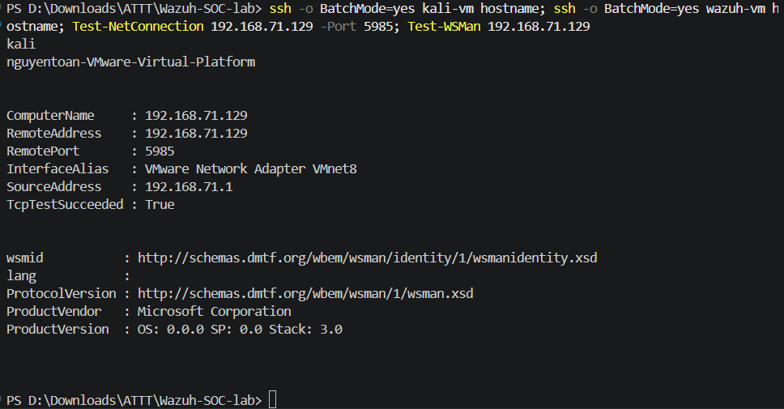
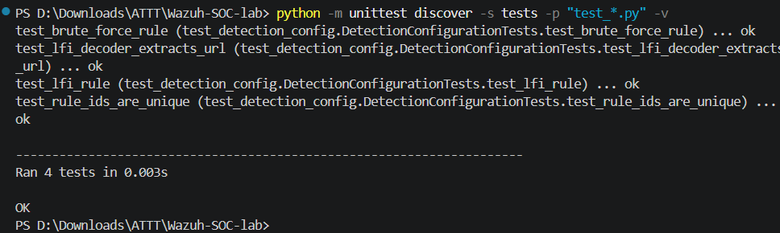
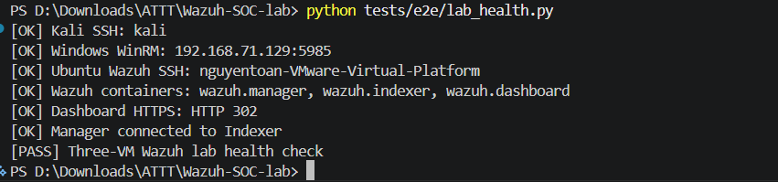
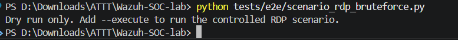
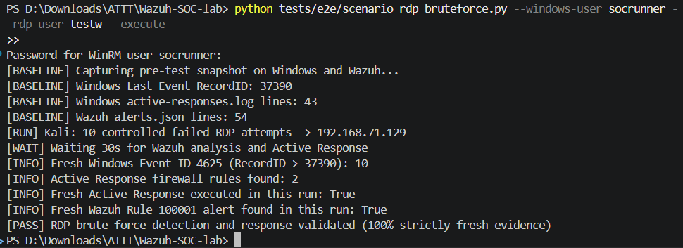
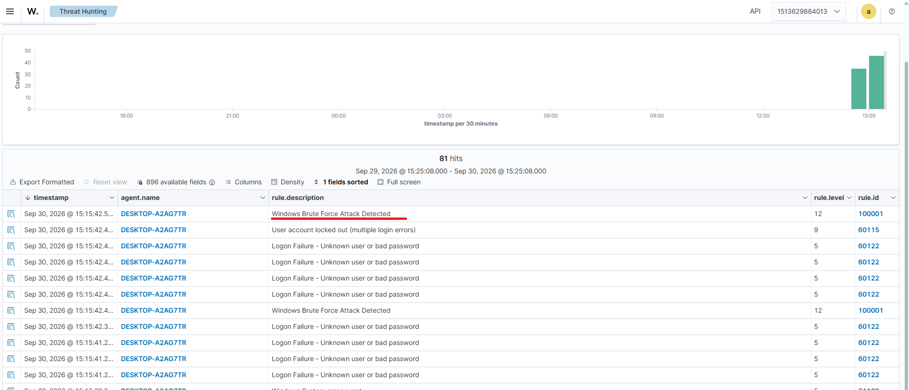
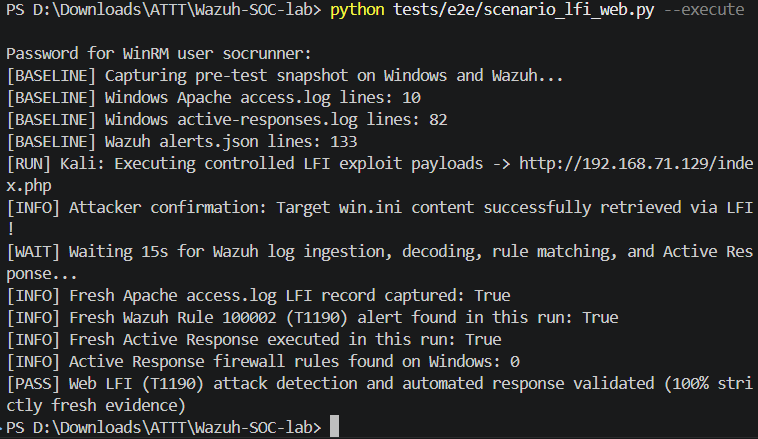
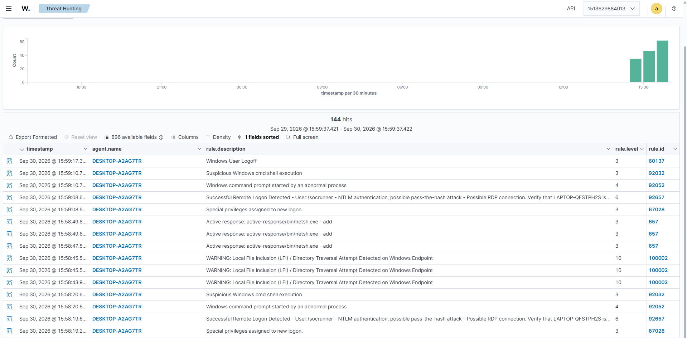

# REGRESSION TEST AUTOMATION FOR SOC SYSTEMS (PHASE 4 - REGRESSION TEST AUTOMATION)

* **Project:** Centralized Cybersecurity Monitoring & Incident Response System (Wazuh SIEM/XDR Lab)
* **Simulated Role:** Detection Engineer / SOC Automation Engineer (DevSecOps)
* **Execution Environment:** 
  * Test Controller (Windows Host): Python 3.11, OpenSSH, WinRM
  * Monitoring Server: Ubuntu Server 24.04 LTS (Wazuh Single-Node Docker Stack - IP: `192.168.71.128`)
  * Victim Workstation: Windows 10 Pro (Wazuh Agent + Sysmon v15.2 - IP: `192.168.71.129`)
  * Attack Host: Kali Linux (xfreerdp, nmap - IP: `192.168.71.130`)

---

## I. OVERVIEW & DETECTION-AS-CODE PHILOSOPHY

### 1. Why is Phase 4 Critical for a Modern SOC?
In Phase 3, we manually demonstrated (Manual PoC) the capability to detect RDP Brute Force attacks and trigger automated responses (Active Response). However, in enterprise operational environments:
* **Risk of Detection Regression:** When SOC teams upgrade Wazuh versions, tune Sysmon configuration files, or add new XML Rules, it is common to inadvertently "break" the logic of existing rules without detection until an actual incident occurs.
* **Prohibitive Manual Testing Overhead:** Manually booting 3 virtual machines, typing `xfreerdp` commands, and squinting at logs in Event Viewer each time rules are adjusted is labor-intensive and error-prone.

**Phase 4 solves this problem definitively using Detection-as-Code principles:**
Build a closed-loop automated testing pipeline (End-to-End Regression Testing Pipeline) using Python. Whenever rules or configurations change, a single command executes end-to-end automated verification from A to Z, returning a clean `[PASS]` or `[FAIL]` verdict.

---

### 2. 3-Tier Testing Architecture

```text
       ┌────────────────────────────────────────────────────────┐
       │                 TIER 1: STATIC TEST                    │
       │   XML syntax validation, unique Rule IDs, Regex check  │
       │         (Runs offline, no VM startup required)         │
       └──────────────────────────┬─────────────────────────────┘
                                  │ PASS
                                  ▼
       ┌────────────────────────────────────────────────────────┐
       │              TIER 2: LAB HEALTH CHECK                  │
       │     SSH to Kali/Ubuntu, WinRM to Windows, Docker       │
       │      (Ensures all 3 VMs and SOC services are ready)    │
       └──────────────────────────┬─────────────────────────────┘
                                  │ PASS
                                  ▼
       ┌────────────────────────────────────────────────────────┐
       │    TIER 3: AUTOMATED REAL-WORLD TESTING (E2E SCENARIO) │
       │  Snapshot Baseline -> Controlled Attack -> Multi-point │
       │      evidence collection -> Objective PASS/FAIL eval   │
       └────────────────────────────────────────────────────────┘
```

---

## II. AUTOMATION TOOLKIT COMPONENTS

All automation source code is modularized in the `tests/` directory:

```text
Wazuh-SOC-lab/
├── tests/
│   ├── test_detection_config.py      # Unit tests verifying integrity of Rule & Decoder XML
│   └── e2e/
│       ├── lab_health.py             # Health check script verifying connectivity & service states across all 3 VMs
│       ├── scenario_rdp_bruteforce.py# Automated runner launching attacks and validating Active Response
│       └── README.md                 # Quick run guide
├── requirements-e2e.txt              # Python dependencies (pywinrm, requests-ntlm)
└── Makefile                          # Shortened shortcuts for CI/CD environments
```

---

## III. STEP-BY-STEP IMPLEMENTATION & VISUAL PROOF GUIDE

### 1. Step 1: Verify Network Connectivity and Remote Management Services Across 3 VMs

Before executing automation scripts, ensure the controller machine (Windows Host) can seamlessly communicate with all 3 virtual machines via remote management protocols: **SSH** (for Linux) and **WinRM** (for Windows).

> 💡 **Why does the Windows Victim machine utilize WinRM?**
> * **Native Windows Management Protocol:** Analogous to SSH on Linux, **WinRM (Windows Remote Management - Port 5985)** is the standard remote command-line administration protocol for Windows based on the WS-Management industry standard.
> * **Automated Evidence Collection:** WinRM allows Python scripts on the Host machine to directly run background PowerShell commands on the Victim to:
>   1. Deeply query the Windows Event Log database (accurately counting Event ID `4625` by `RecordID`).
>   2. Instantly verify firewall rule states (`Get-NetFirewallRule`) generated by Wazuh Active Response.
>   3. Read local `active-responses.log` entries **without requiring manual mouse/GUI interaction** on the Victim machine.

* **Execution Environment:** PowerShell on main computer (Windows Host).
* **Commands to run:**

```powershell
ssh -o BatchMode=yes kali-vm hostname
ssh -o BatchMode=yes wazuh-vm hostname
Test-Connection 192.168.71.129 -Count 2
Test-NetConnection 192.168.71.129 -Port 5985
Test-WSMan 192.168.71.129
```



---

### 2. Step 2: Static Detection Configuration Testing (Static Regression Test)

Verify Python source code syntax validity and audit Wazuh Rule/Decoder XML configuration files prior to deploying into production.

* **File to execute:** `tests/test_detection_config.py`
* **Execution Environment:** PowerShell on Windows Host.
* **Commands to run:**

```powershell
# 1. Verify Python syntax with zero compilation errors
python -m py_compile tests/e2e/lab_health.py tests/e2e/scenario_rdp_bruteforce.py

# 2. Run 4 unit tests auditing Rules & Decoders
python -m unittest discover -s tests -p "test_*.py" -v
```

* **Unit Test Audit Scope:**
  1. `test_rule_ids_are_unique`: Ensures no duplicate Rule IDs exist in `local_rules.xml`.
  2. `test_brute_force_rule`: Verifies Rule `100001` has `level="12"`, `frequency="5"`, `timeframe="60"`, inherits rule `60122`, and properly maps to MITRE `T1110`.
  3. `test_lfi_rule`: Verifies Rule `100002` has `level="10"`, matches payloads `win.ini`, `boot.ini`, `..%2f`, `..%252f`, and maps to MITRE `T1190`.
  4. `test_lfi_decoder_extracts_url`: Verifies Custom Decoder `web-access-lfi` extracts the `url` field from regex `GET (\S+)\sHTTP`.




### 3. Step 3: Comprehensive 3-VM Lab Health Check

The `lab_health.py` script serves as an automated health monitoring probe (Liveness & Readiness Probe) before permitting attack scenarios to launch.

* **File to execute:** `tests/e2e/lab_health.py`
* **Execution Environment:** PowerShell on Windows Host.
* **Commands to run:**

```powershell
python tests/e2e/lab_health.py
```

* **Automated Audit Criteria:**
  1. Verify SSH connectivity to Kali attack host (`kali-vm`).
  2. Verify WinRM service on port 5985 on Windows 10 host (`192.168.71.129`).
  3. Verify SSH connectivity to Wazuh server (`wazuh-vm`).
  4. Verify running health status of all 3 Docker containers: `wazuh.manager`, `wazuh.indexer`, `wazuh.dashboard`.
  5. Send HTTPS requests to ensure Web Dashboard readiness (HTTP 200/302).
  6. Inspect `wazuh.manager` logs to confirm successful connection to database core `wazuh.indexer:9200`.



### 4. Step 4: Scenario Testing in Dry-run Mode

Prior to launching network attacks, the runner supports Dry-run mode to validate input parameters and guarantee that no rogue traffic is emitted without explicit flags.

* **Execution Environment:** PowerShell on Windows Host.
* **Commands to run:**

```powershell
python tests/e2e/scenario_rdp_bruteforce.py
```



### 5. Step 5: Execute Automated Real-World Testing (Full E2E Scenario Runner)

This represents the most critical milestone, where the RDP Brute Force attack scenario, Sysmon/Windows event logging, Wazuh Rule 100001 correlation, and Active Response containment are verified in a fully automated pipeline.

* **Install WinRM control library (initial setup only):**
  ```powershell
  python -m pip install -r requirements-e2e.txt
  ```

* **Command to execute real-world test:**
  ```powershell
  python tests/e2e/scenario_rdp_bruteforce.py --windows-user socrunner --rdp-user testw --execute
  ```

#### Intelligent Architecture & Zero False-Pass Design:
1. **Baseline Snapshot:**
   * WinRM connection to Windows host: Capture the latest `RecordID` for Event 4625 (e.g., `37380`) and count current line numbers of `active-responses.log`.
   * Automatically inspect and **remove legacy Firewall rules** (if the Kali IP was blocked from a previous run) to clear the path for fresh testing.
   * SSH connection to Wazuh Manager: Record line count of `/var/ossec/logs/alerts/alerts.json`.
2. **Controlled Attack Launch from Kali:**
   * Script SSHs into Kali and executes 10 iterations of `xfreerdp` with invalid credentials, setting environment variable `DISPLAY="${DISPLAY:-:0}"` to allow execution in headless SSH sessions.
3. **Analysis Wait:**
   * Pause for 30 seconds to allow the Wazuh Agent to package logs to Manager, and for Manager to execute its frequency correlation algorithm (`frequency="5" timeframe="60"`).
4. **Independent Evidence Verification:**
   * **Windows Event Log:** ONLY count Event ID 4625 entries where `RecordID > LastRecordId` (independent of timezone or datetime formatting).
   * **Active Response Log:** Disregard historical entries; ONLY inspect newly appended lines in `active-responses.log` for `netsh.exe` and Rule `100001`.
   * **Wazuh Alerts:** Use `tail -n +<new_line>` to ONLY match Rule `100001` alerts generated in this run.
5. **Outcome Evaluation (PASS/FAIL):**
   * Must satisfy concurrently: New Events $> 0$, New Active Response $= True$, New Wazuh Alert $= True$.




---

### 6. Step 6: Execute Automated Real-World Testing for Scenario 2 (Web LFI / Directory Traversal - T1190)

The `scenario_lfi_web.py` runner automates defense verification for the Web application: URL parameter exploitation, string extraction via Custom Decoder `web-access-lfi`, matching evasion-resistant rule `100002` (level 10), and triggering Active Response to automatically isolate the attacker IP.

* **File to execute:** `tests/e2e/scenario_lfi_web.py`
* **Execution Environment:** PowerShell on Windows Host.
* **Command to execute real-world test:**
  ```powershell
  python tests/e2e/scenario_lfi_web.py --execute
  ```

#### Intelligent Mechanism (Zero False-Pass):
1. **Pre-flight & Baseline Snapshot:**
   * Verify Apache service on Windows 10 is listening on port 80.
   * Automatically flush stale Wazuh Active Response IP blocking rules on Windows Defender Firewall.
   * Record current line count for `C:\xampp\apache\logs\access.log` and `active-responses.log`.
   * Record current line count for `/var/ossec/logs/alerts/alerts.json` on Wazuh Manager.
2. **Controlled Attack Launch from Kali:**
   * Script directs Kali to dispatch standard exploit payloads (`?page=../../../../Windows/win.ini`) and WAF/IDS evasion double-encoded payloads (`..%252f..%252f`) concurrently.
   * Validate response payload content contains `win.ini` to confirm vulnerability presence.
3. **Independent Evidence Verification:**
   * **Apache Access Log:** Disregard legacy entries; confirm new log entry capturing the LFI request from Kali IP.
   * **Wazuh Manager Alert:** Verify new alert entry in `alerts.json` for Rule `100002` (MITRE ATT&CK `T1190`, Level `10`).
   * **Active Response & Firewall:** Verify new log entry in `active-responses.log` invoking `netsh.exe` with rule `100002`; confirm the firewall rule blocking the Kali IP was successfully provisioned.
4. **Outcome Evaluation (PASS/FAIL):**
   * Only yields `[PASS]` when satisfying concurrently: New Apache Log $= True$, New Wazuh Alert $= True$, New Active Response $= True$.




## IV. TECHNICAL CHALLENGES & TROUBLESHOOTING LOG

During the development of the automated testing suite, engineering addressed 5 complex real-world challenges:

### 1. UAC Remote Restrictions & Microsoft Account Authentication (Error 8646)
* **Symptom:** When WinRM connects to Windows 10 using a personal account, the system throws `HTTP 401 Unauthorized / InvalidCredentialsError`. When attempting to change the password via command line, Windows errors with `System error 8646: The system is not authoritative for the specified account`.
* **Root Cause:** Personal accounts on Windows 10 are linked to Microsoft Accounts (online Live IDs). WinRM over NTLM does not support cloud account authentication, and Windows 10 UAC security policies restrict standard local network accounts.
* **Solution:** 
  1. Create a dedicated pure Local Administrator account for SOC automation purposes:
     ```cmd
     net user socrunner <Password> /add
     net localgroup administrators socrunner /add
     ```
  2. Enable remote WinRM access for Local Admin accounts:
     ```cmd
     reg add HKLM\SOFTWARE\Microsoft\Windows\CurrentVersion\Policies\System /v LocalAccountTokenFilterPolicy /t REG_DWORD /d 1 /f
     ```

### 2. Headless X11 Display Issue when Calling `xfreerdp` via SSH
* **Symptom:** The attack command from Kali executed via SSH terminates immediately without dispatching requests to Windows.
* **Root Cause:** By default, `xfreerdp` requires the graphical display environment variable `$DISPLAY`. In non-interactive SSH sessions, this variable is missing, resulting in `failed to open display: Please check that the $DISPLAY environment variable is properly set`.
* **Solution:** Prefix the execution command with `DISPLAY="${DISPLAY:-:0}"` to attach to the existing Kali Linux desktop display.

### 3. Timezone Desynchronization in Windows Event Log Filtering (Zero False-Pass)
* **Symptom:** Checking Event ID 4625 using filter `StartTime = (Get-Date)` always returns 0 events despite the attack taking place.
* **Root Cause:** Windows Event Log stores internal timestamps in UTC (`18:xx`), whereas PowerShell evaluates against the local system clock UTC+7 (`01:xx`). Comparing timestamp strings resulted in a 7-hour forward skew.
* **Solution:** Switch to **`RecordID`** comparisons. `RecordID` is a monotonically increasing integer identifier assigned sequentially by Windows. By comparing `RecordID > LastRecordId`, the system achieves 100% accurate event matching independent of timezones or locale formatting.

### 4. Automatic Kali IP Unblocking Prior to Test Runs
* **Symptom:** Running tests back-to-back causes the runner to report `Event 4625: 0` and fail.
* **Root Cause:** The previous run's Active Response blocked Kali's IP via Windows Defender Firewall with a 10-minute (600-second) timeout. A subsequent run within this window results in packets dropped before reaching RDP port 3389.
* **Solution:** Upgrade `snapshot_baseline` to automatically detect and flush legacy Wazuh Active Response firewall rules before initiating a new test run, ensuring clean test conditions.

### 5. Manager - Indexer Connection Monitoring & `--since=6h` Log Boundary
* **Symptom:** `lab_health.py` reports `[FAIL] Manager-to-Indexer connection not found` even though the system is operating normally.
* **Root Cause:** Filebeat inside `wazuh.manager` logs `Connection to backoff(...) established` only once upon container startup. When the container has run continuously for over 6 hours, `docker compose logs --since=6h` skips this startup entry.
* **Solution:** Switch to an active real-time connectivity probe (Live Readiness Probe): directly execute `docker compose exec -T wazuh.manager filebeat test output` to perform TLS handshakes and verify connectivity directly to Indexer port 9200, with a fallback reading `--tail=2000` logs rather than bounding by time.

---

## V. CONCLUSION

Phase 4 transformed the lab from a manual exercise into a fully realized **Detection-as-Code Framework** for cybersecurity operations. 

The convergence of **Static XML audits**, **3-VM infrastructure health checks**, and **Automated real-world scenario runners with baseline snapshot mechanisms** guarantees enterprise-grade resilience, scalability, and high reliability across the SOC Lab.
