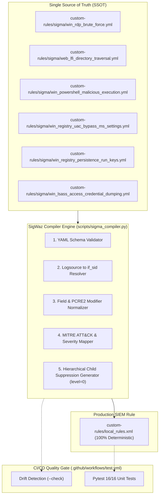

# DETECTION ENGINEERING STANDARDIZATION REPORT USING SIGMA RULES (DETECTION-AS-CODE SSOT) (PHASE 8)

* **Project:** Centralized Cybersecurity Monitoring & Incident Response System (Wazuh SIEM/XDR Lab)
* **Simulated Role:** SOC Lead / Senior Detection Engineer / SIEM Architect
* **Execution Environment:**
  * **SIEM Infrastructure:** Wazuh SIEM 4.14.5 on Ubuntu Server 22.04 LTS (`192.168.71.128`).
  * **Sigma Rules Repository (SSOT):** [`custom-rules/sigma/`](../../custom-rules/sigma/).
  * **SigWaz Engine Compiler:** [`scripts/sigma_compiler.py`](../../scripts/sigma_compiler.py).
  * **Target Production XML File:** [`custom-rules/local_rules.xml`](../../custom-rules/local_rules.xml).
  * **Quality Assurance Pipeline:** GitHub Actions (`.github/workflows/test.yml`) & Pytest Unit Test Suite.

---

## I. OBJECTIVES & CONTEXT OF THE TRANSITION TO DETECTION-AS-CODE (DaC)

In traditional SOC models, detection engineers often manually configure SIEM XML files directly (such as Wazuh's `local_rules.xml`). This manual approach exposes several critical weaknesses:
1. **Syntax Errors and Performance Degradation:** Missing parent rule binding tags `<if_sid>` forces Wazuh Manager to evaluate regex across all incoming logs, leading to CPU exhaustion and dropped log packets.
2. **Difficult to Share and Reuse:** Rules written exclusively in proprietary Wazuh XML cannot be shared directly with the global cybersecurity community (which standardized on Sigma).
3. **Rule Drift:** SIEM server configurations become arbitrarily modified without Git code reviews or version control history.

**Phase 8 Solution:** Establish **Sigma YAML** as the sole **Single Source of Truth (SSOT)** within `custom-rules/sigma/`, coupled with the automated **SigWaz Core Engine** compiler and **Zero-Drift Enforcement** mechanisms on the CI/CD Pipeline.



---

## II. CORE LOGICAL ARCHITECTURE OF THE SIGWAZ COMPILER ENGINE

The compiler [`scripts/sigma_compiler.py`](../../scripts/sigma_compiler.py) is implemented in pure Python (using only `pyyaml`), inheriting and extending all 5 core technical principles of SigWaz:

1. **Logsource Resolution & Parent Rule Binding (`if_sid` Engine):**
   * Automatically maps `category: process_creation` $\rightarrow$ `if_sid: 100003` (Sysmon Event 1 Base Filter).
   * Maps `category: registry_set` $\rightarrow$ `if_sid: 61614, 61615, 61616`.
   * Maps `category: process_access` $\rightarrow$ `if_sid: 61612` (Sysmon Event 10 LSASS Access).
   * Maps `service: security` $\rightarrow$ `if_matched_sid: 60122` (Windows Logon Failure).
   * Maps `category: webserver` $\rightarrow$ `if_sid: 31100` (Web access log).
2. **Field Schema Mapping:**
   * Automatically normalizes Sigma's OS-agnostic fields (`CommandLine`, `Image`, `TargetObject`, `User`...) to Wazuh Eventchannel hierarchical fields (`win.eventdata.*`).
3. **Compiling Modifiers to PCRE2 Regex:**
   * Supports `|contains`, `|startswith`, `|endswith`, `|re` combined with the case-insensitive flag `(?i)`.
   * Automatically collapses multi-value arrays into optimized regex OR expressions `(val1|val2)`.
4. **MITRE ATT&CK Extraction & Severity Scoring:**
   * Extracts tag `attack.t1059.001` into `<mitre><id>T1059.001</id></mitre>`.
   * Translates `critical` $\rightarrow$ Level 12, `high` $\rightarrow$ Level 10, `medium` $\rightarrow$ Level 7.
5. **Hierarchical Child Suppression Rules Mechanism (`level="0"`):**
   * Enforces the Closed-Loop SOAR principles outlined in `AGENTS.md`. When a Sigma rule defines `soar_suppression`, the compiler automatically generates a child rule with `level="0"` pointing `<if_sid>` directly to the parent rule to suppress alerts generated by the `socrunner` account executing remediation via WinRM.

---

## III. INVENTORY OF 6 STANDARDIZED DETECTION RULES IN SIGMA YAML

All 6 threat scenarios in the lab have been successfully packaged:

| Sigma File Name | Scenario / Attack Stage | Wazuh Rule ID | MITRE ATT&CK | Alert Severity |
| :--- | :--- | :---: | :---: | :---: |
| [`win_rdp_brute_force.yml`](../../custom-rules/sigma/win_rdp_brute_force.yml) | Scenario 1: RDP Brute Force | `100001` | **T1110** | Level 12 (Critical) |
| [`web_lfi_directory_traversal.yml`](../../custom-rules/sigma/web_lfi_directory_traversal.yml) | Scenario 2: Web LFI / Directory Traversal | `100002` | **T1190** | Level 10 (High) |
| [`win_powershell_malicious_execution.yml`](../../custom-rules/sigma/win_powershell_malicious_execution.yml) | Stage 1: Malicious Encoded PowerShell Execution | `100004` (Base: `100003`, Sup: `100008`) | **T1059.001** | Level 12 (Critical) |
| [`win_registry_uac_bypass_ms_settings.yml`](../../custom-rules/sigma/win_registry_uac_bypass_ms_settings.yml) | Stage 2: UAC Bypass via Registry ms-settings | `100007` (Sup: `100009`) | **T1548.002** | Level 12 (Critical) |
| [`win_registry_persistence_run_keys.yml`](../../custom-rules/sigma/win_registry_persistence_run_keys.yml) | Stage 3: Persistence via Run Key | `100006` (Sup: `100010`) | **T1547.001** | Level 10 (High) |
| [`win_lsass_access_credential_dumping.yml`](../../custom-rules/sigma/win_lsass_access_credential_dumping.yml) | Stage 4: LSASS Credential Dumping | `100005` | **T1003.001** | Level 12 (Critical) |

---

## IV. AUTOMATED TESTING RESULTS & ZERO-DRIFT ASSURANCE

Automated testing is integrated directly into the CI/CD pipeline to ensure detection rule quality through two core mechanisms:

### 1. Operational Purpose of Zero-Drift Enforcement
* **Purpose:** Completely eliminate the risk of **Configuration Drift** — where the actual XML configuration on Wazuh Manager diverges from the Sigma source repository due to ad-hoc manual edits.
* **Operating Principle:** The compiler's `--check` flag translates all Sigma YAML files in-memory and compares them directly with [`custom-rules/local_rules.xml`](../../custom-rules/local_rules.xml). If any discrepancy exists (even a single regex character or rule attribute), the system exits with an error code (`exit code 1`), halting the Pull Request on GitHub Actions.
* **Result:** Achieved a **Zero Drift (100% Synchronized)** state between the Sigma SSOT and the deployed XML file.

### 2. Value of the Expanded Unit Test Suite (16/16 Tests PASS)
The test suite [`tests/unit/test_detection_config.py`](../../tests/unit/test_detection_config.py) was expanded with 3 rigorous validation checks for Detection-as-Code:
* **Sigma Schema Compliance Audit:** Verifies that 100% of YAML files contain all mandatory attributes (`title`, `id`, `logsource`, `detection`, `tags`) and properly formatted MITRE ATT&CK IDs.
* **Round-trip Compilation Integrity:** Ensures the automated translation accurately reproduces all 6 threat scenarios and 4 Windows Kill Chain stages.
* **SOAR Suppression Hierarchy Validation:** Confirms that child suppression rules (`100008`, `100009`, `100010`) are assigned `level="0"` and point directly to their respective parent `<if_sid>`.

---

## V. OPERATIONAL GUIDE FOR DETECTION ENGINEERS

> [!IMPORTANT]
> **Working Directory:** Always execute commands from the **repository root directory** (`D:\Downloads\ATTT\Wazuh-SOC-lab\`) when running validation and compilation commands. Do not `cd` into subdirectories to preserve correct module paths.

### 1. Python CLI Command Reference Table

| Operation | Command Line (PowerShell / Terminal) | Purpose |
| :--- | :--- | :--- |
| **1. Syntax & Schema Validation** | `python scripts/sigma_compiler.py --validate` | Scans all YAML files to validate schema, required attributes, and MITRE codes. |
| **2. Compile Sigma YAML to XML** | `python scripts/sigma_compiler.py --compile` | Automatically generates standard Wazuh-compatible `custom-rules/local_rules.xml`. |
| **3. Zero-Drift Check** | `python scripts/sigma_compiler.py --check` | Verifies absolute synchronization between `custom-rules/sigma/` and `local_rules.xml`. |
| **4. Run Full Unit Test Suite** | `pytest tests/unit/ -v` | Executes all 16 automated system unit tests. |

---

### 2. 4-Step Workflow for Adding or Updating Detection Rules

1. **Step 1 — Define Rule:** Create or modify the corresponding `.yml` file in [`custom-rules/sigma/`](../../custom-rules/sigma/).
2. **Step 2 — Validate Syntax:**
   ```powershell
   python scripts/sigma_compiler.py --validate
   ```
3. **Step 3 — Automatically Compile to `local_rules.xml`:**
   ```powershell
   python scripts/sigma_compiler.py --compile
   ```
4. **Step 4 — Full Validation Before Committing:**
   ```powershell
   python scripts/sigma_compiler.py --check
   pytest tests/unit/ -v
   ```

When opening a Pull Request, the GitHub Actions CI Pipeline automatically runs the drift check step (`--check`). If `local_rules.xml` was modified manually or has not been compiled from the Sigma SSOT, the pipeline fails immediately and blocks the merge!
