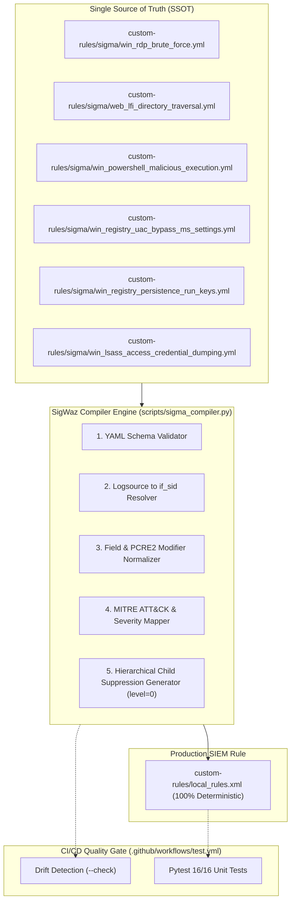

# BÁO CÁO CHUẨN HÓA LUẬT PHÁT HIỆN BẰNG NGÔN NGỮ SIGMA (DETECTION-AS-CODE SSOT) (PHASE 8)

* **Dự án:** Hệ thống Giám sát An ninh mạng & Ứng phó Sự cố Tập trung (Wazuh SIEM/XDR Lab)
* **Vị trí giả lập:** SOC Lead / Senior Detection Engineer / SIEM Architect
* **Môi trường thực hiện:**
  * **Hạ tầng SIEM:** Wazuh SIEM 4.14.5 trên Ubuntu Server 22.04 LTS (`192.168.71.128`).
  * **Kho lưu trữ luật Sigma (SSOT):** [`custom-rules/sigma/`](../../custom-rules/sigma/).
  * **Bộ biên dịch SigWaz Engine:** [`scripts/sigma_compiler.py`](../../scripts/sigma_compiler.py).
  * **Tệp XML đích triển khai:** [`custom-rules/local_rules.xml`](../../custom-rules/local_rules.xml).
  * **Pipeline kiểm định chất lượng:** GitHub Actions (`.github/workflows/test.yml`) & Pytest Unit Test Suite.

---

## I. MỤC TIÊU & BỐI CẢNH CHUYỂN DỊCH SANG DETECTION-AS-CODE (DaC)

Trong mô hình SOC truyền thống, các kỹ sư phát hiện (Detection Engineers) thường phải cấu hình trực tiếp các tệp XML của SIEM (như `local_rules.xml` của Wazuh). Cách làm thủ công này bộc lộ nhiều điểm hạn chế lớn:
1. **Lỗi cú pháp và hiệu năng:** Thiếu thẻ liên kết cha `<if_sid>` khiến Wazuh Manager quét regex toàn bộ log đổ về, dẫn tới nghẽn CPU và mất gói log.
2. **Khó chia sẻ và tái sử dụng:** Luật viết riêng cho Wazuh XML không thể trao đổi trực tiếp với cộng đồng an ninh mạng quốc tế (sử dụng chuẩn Sigma).
3. **Hiện tượng Rule Drift (lệch pha mã nguồn):** Cấu hình trên máy chủ SIEM bị chỉnh sửa tùy tiện mà không qua kiểm duyệt git, không có lịch sử version control.

**Giải pháp của Phase 8:** Thiết lập **Sigma YAML** làm **Single Source of Truth (SSOT)** duy nhất trong `custom-rules/sigma/`, kết hợp cùng bộ biên dịch tự động **SigWaz Core Engine** và cơ chế **Zero-Drift Enforcement** trên CI/CD Pipeline.



---

## II. KIẾN TRÚC LOGIC LÕI CỦA BỘ BIÊN DỊCH SIGWAZ ENGINE

Bộ biên dịch [`scripts/sigma_compiler.py`](../../scripts/sigma_compiler.py) được xây dựng thuần Python (chỉ sử dụng `pyyaml`), kế thừa và mở rộng trọn vẹn 5 nguyên lý kỹ thuật của SigWaz:

1. **Logsource Resolution & Parent Rule Binding (`if_sid` Engine):**
   * Tự động ánh xạ `category: process_creation` $\rightarrow$ `if_sid: 100003` (Sysmon Event 1 Base Filter).
   * Ánh xạ `category: registry_set` $\rightarrow$ `if_sid: 61614, 61615, 61616`.
   * Ánh xạ `category: process_access` $\rightarrow$ `if_sid: 61612` (Sysmon Event 10 LSASS Access).
   * Ánh xạ `service: security` $\rightarrow$ `if_matched_sid: 60122` (Windows Logon Failure).
   * Ánh xạ `category: webserver` $\rightarrow$ `if_sid: 31100` (Web access log).
2. **Chuẩn hóa trường dữ liệu (Field Schema Mapping):**
   * Chuyển hóa tự động các trường OS-agnostic của Sigma (`CommandLine`, `Image`, `TargetObject`, `User`...) sang trường phân cấp Eventchannel của Wazuh (`win.eventdata.*`).
3. **Biên dịch Modifier sang PCRE2 Regex:**
   * Hỗ trợ `|contains`, `|startswith`, `|endswith`, `|re` kết hợp cờ không phân biệt hoa thường `(?i)`.
   * Tự động gom mảng giá trị (Multi-value array) thành biểu thức OR tối ưu `(val1|val2)`.
4. **MITRE ATT&CK Extraction & Severity Scoring:**
   * Trích xuất tag `attack.t1059.001` thành `<mitre><id>T1059.001</id></mitre>`.
   * Quy đổi `critical` $\rightarrow$ Level 12, `high` $\rightarrow$ Level 10, `medium` $\rightarrow$ Level 7.
5. **Cơ chế Hierarchical Child Suppression Rules (`level="0"`):**
   * Đảm bảo nguyên tắc Closed-Loop SOAR trong `AGENTS.md`. Khi một luật Sigma có khai báo `soar_suppression`, compiler tự động sinh một rule con mang `level="0"` trỏ trực tiếp `<if_sid>` về rule cha để triệt tiêu alert do tài khoản `socrunner` thao tác qua WinRM.

---

## III. DANH MỤC 6 LUẬT PHÁT HIỆN CHUẨN HÓA BẰNG SIGMA YAML

Toàn bộ 6 kịch bản tấn công trong phòng Lab đã được đóng gói thành công:

| Tên File Sigma | Kịch Bản / Giai Đoạn Tấn Công | Rule ID Wazuh | MITRE ATT&CK | Mức Cảnh Báo |
| :--- | :--- | :---: | :---: | :---: |
| [`win_rdp_brute_force.yml`](../../custom-rules/sigma/win_rdp_brute_force.yml) | Kịch bản 1: RDP Brute Force | `100001` | **T1110** | Level 12 (Critical) |
| [`web_lfi_directory_traversal.yml`](../../custom-rules/sigma/web_lfi_directory_traversal.yml) | Kịch bản 2: Web LFI / Directory Traversal | `100002` | **T1190** | Level 10 (High) |
| [`win_powershell_malicious_execution.yml`](../../custom-rules/sigma/win_powershell_malicious_execution.yml) | Giai đoạn 1: PowerShell mã hóa tham số độc hại | `100004` (Base: `100003`, Sup: `100008`) | **T1059.001** | Level 12 (Critical) |
| [`win_registry_uac_bypass_ms_settings.yml`](../../custom-rules/sigma/win_registry_uac_bypass_ms_settings.yml) | Giai đoạn 2: Leo quyền UAC Bypass qua Registry | `100007` (Sup: `100009`) | **T1548.002** | Level 12 (Critical) |
| [`win_registry_persistence_run_keys.yml`](../../custom-rules/sigma/win_registry_persistence_run_keys.yml) | Giai đoạn 3: Trì hoãn Persistence qua Run Key | `100006` (Sup: `100010`) | **T1547.001** | Level 10 (High) |
| [`win_lsass_access_credential_dumping.yml`](../../custom-rules/sigma/win_lsass_access_credential_dumping.yml) | Giai đoạn 4: Đánh cắp thông tin xác thực LSASS | `100005` | **T1003.001** | Level 12 (Critical) |

---

## IV. KẾT QUẢ KIỂM THỬ TỰ ĐỘNG & BẢO ĐẢM ZERO DRIFT

Quá trình kiểm thử tự động được tích hợp trực tiếp vào quy trình CI/CD nhằm bảo đảm chất lượng luật phát hiện với hai cơ chế cốt lõi:

### 1. Ý nghĩa của cơ chế Chống Lệch Pha (Zero-Drift Enforcement)
* **Mục đích:** Triệt tiêu hoàn toàn rủi ro **Configuration Drift** — tình trạng cấu hình XML thực tế trên Wazuh Manager bị sửa đổi thủ công dẫn đến lệch pha với kho mã nguồn Sigma.
* **Nguyên lý hoạt động:** Cờ `--check` của bộ biên dịch sẽ dịch ngầm toàn bộ các file Sigma YAML trong bộ nhớ và đối soát trực tiếp với tệp [`custom-rules/local_rules.xml`](../../custom-rules/local_rules.xml). Nếu có bất kỳ sự sai lệch nào (dù chỉ là 1 ký tự regex hay 1 thuộc tính rule), hệ thống sẽ trả về mã lỗi (`exit code 1`) để chặn đứng Pull Request trên GitHub Actions.
* **Kết quả:** Đạt trạng thái **Zero Drift (100% Đồng bộ)** giữa Sigma SSOT và tệp XML triển khai.

### 2. Ý nghĩa của Bộ kiểm thử đơn vị mở rộng (16/16 Tests PASS)
Test suite [`tests/unit/test_detection_config.py`](../../tests/unit/test_detection_config.py) được mở rộng thêm 3 tiêu chí kiểm định nghiêm ngặt cho Detection-as-Code:
* **Kiểm định chuẩn hóa Schema Sigma:** Xác thực 100% các file YAML đầy đủ thuộc tính bắt buộc (`title`, `id`, `logsource`, `detection`, `tags`) và mã MITRE ATT&CK đúng định dạng chuẩn.
* **Kiểm định tính toàn vẹn biên dịch (Round-trip Integrity):** Đảm bảo quá trình dịch tự động tái tạo chính xác toàn bộ 6 kịch bản tấn công và 4 giai đoạn MITRE Windows Kill Chain.
* **Kiểm định cấu trúc phân cấp SOAR Suppression:** Xác minh các rule con triệt tiêu cảnh báo (`100008`, `100009`, `100010`) được gắn đúng `level="0"` và trỏ chính xác về `<if_sid>` của rule cha tương ứng.

---

## V. HƯỚNG DẪN VẬN HÀNH CHO KỸ SƯ DETECTION ENGINEERING

> [!IMPORTANT]
> **Vị trí thực thi:** Luôn đứng tại **thư mục gốc của repository** (`D:\Downloads\ATTT\Wazuh-SOC-lab\`) khi chạy các lệnh kiểm tra và biên dịch. Không `cd` vào các thư mục con để đảm bảo đường dẫn module luôn chính xác.

### 1. Bảng tra cứu câu lệnh Python CLI

| Thao Tác Kỹ Thuật | Lệnh Thực Thi (PowerShell / Terminal) | Mục Đích |
| :--- | :--- | :--- |
| **1. Kiểm tra tính hợp lệ cú pháp** | `python scripts/sigma_compiler.py --validate` | Quét toàn bộ file YAML kiểm tra schema, thuộc tính bắt buộc và mã MITRE. |
| **2. Biên dịch Sigma YAML sang XML** | `python scripts/sigma_compiler.py --compile` | Tự động sinh tệp `custom-rules/local_rules.xml` chuẩn cú pháp Wazuh. |
| **3. Kiểm tra chống lệch pha (Drift Check)** | `python scripts/sigma_compiler.py --check` | So sánh tính đồng bộ tuyệt đối giữa thư mục `sigma/` và `local_rules.xml`. |
| **4. Chạy toàn bộ Test Suite kiểm định** | `pytest tests/unit/ -v` | Chạy toàn bộ 16 bài kiểm thử tự động của hệ thống. |

---

### 2. Quy trình 4 bước khi thêm hoặc sửa luật phát hiện

1. **Bước 1 — Định nghĩa luật:** Tạo hoặc chỉnh sửa tệp `.yml` tương ứng trong thư mục [`custom-rules/sigma/`](../../custom-rules/sigma/).
2. **Bước 2 — Kiểm tra cú pháp:**
   ```powershell
   python scripts/sigma_compiler.py --validate
   ```
3. **Bước 3 — Biên dịch tự động sang `local_rules.xml`:**
   ```powershell
   python scripts/sigma_compiler.py --compile
   ```
4. **Bước 4 — Kiểm định toàn diện trước khi commit:**
   ```powershell
   python scripts/sigma_compiler.py --check
   pytest tests/unit/ -v
   ```

Khi tạo Pull Request, GitHub Actions CI Pipeline sẽ tự động chạy bước kiểm tra chống lệch pha (`--check`). Nếu phát hiện `local_rules.xml` bị sửa tay hoặc chưa được biên dịch từ Sigma SSOT, pipeline sẽ lập tức báo đỏ và chặn merge!
