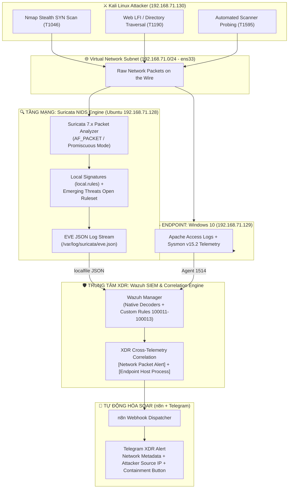
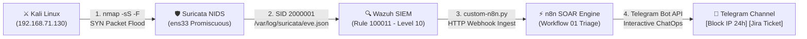
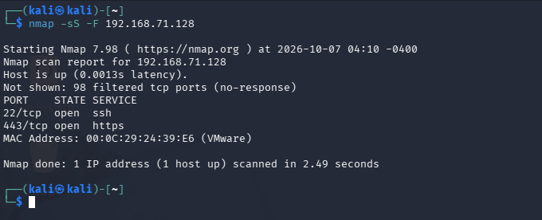
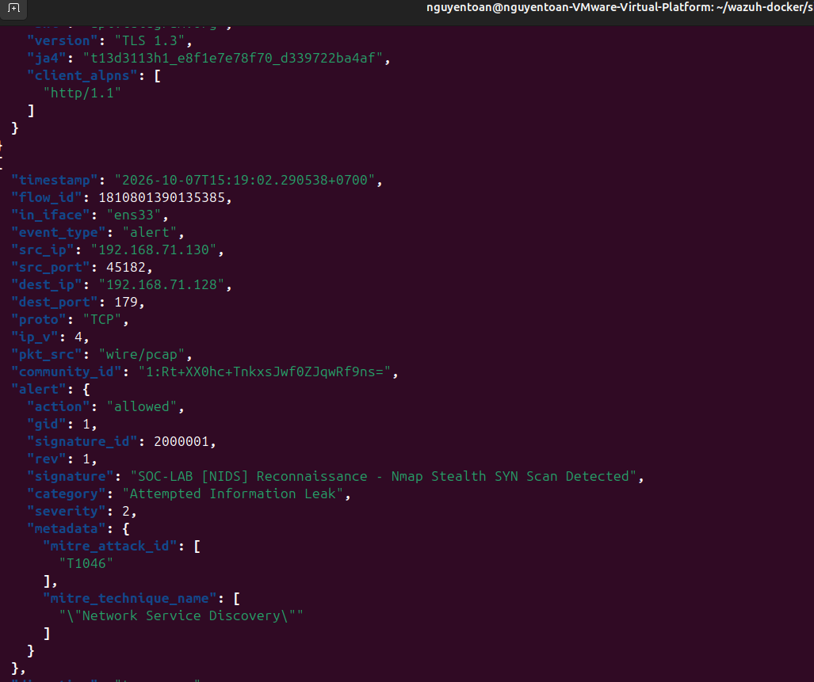
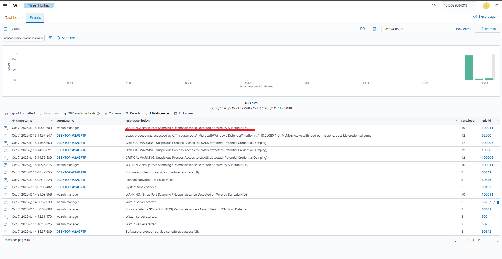
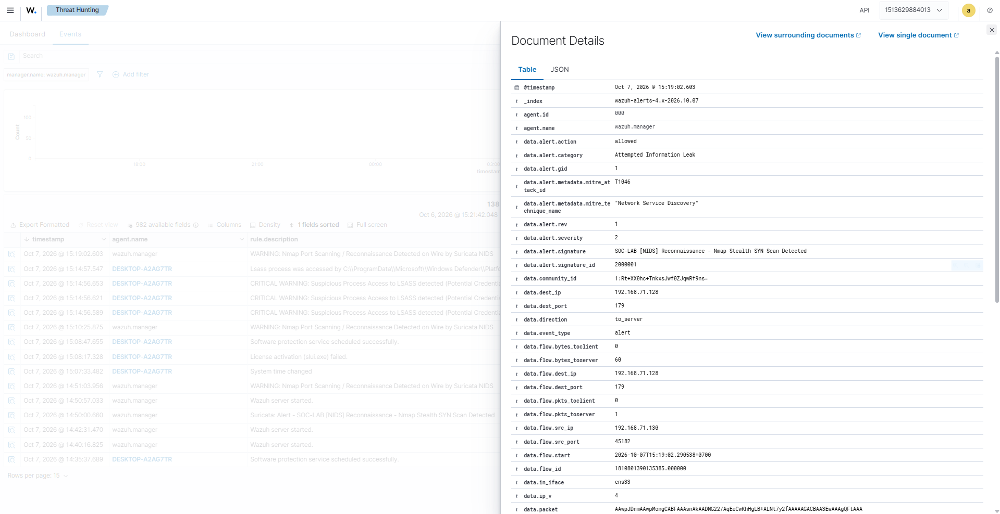
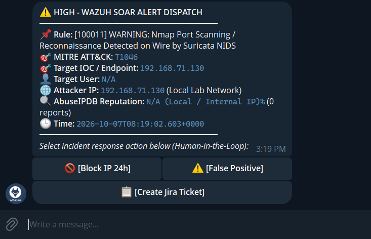

# BÁO CÁO GIÁM SÁT TẦNG MẠNG SÂU BẰNG NIDS (SURICATA) & MỞ RỘNG KIẾN TRÚC XDR (PHASE 9)

* **Dự án:** Hệ thống Giám sát An ninh mạng & Ứng phó Sự cố Tập trung (Wazuh SIEM/XDR Lab)
* **Vị trí giả lập:** SOC Lead / Senior Detection Engineer / Network Security Architect
* **Môi trường thực hiện:**
  * **Hạ tầng NIDS:** Suricata 7.x triển khai trên Ubuntu Server 22.04 LTS (`192.168.71.128`), lắng nghe card mạng ảo `ens33`.
  * **Hạ tầng SIEM & Indexer:** Wazuh Manager 4.14.5 & OpenSearch Dashboard 2.x (Port 443 - IP: `192.168.71.128`).
  * **Máy trạm giám sát (Endpoint):** Windows 10 Pro (`192.168.71.129`), Sysmon v15.2, Apache Web Server (XAMPP).
  * **Máy tấn công giả lập:** Kali Linux (`192.168.71.130`).
  * **Bộ cấu hình triển khai:** [`deployment/suricata/`](../../deployment/suricata/).
  * **Luồng telemetry mạng:** Chuẩn EVE JSON (`/var/log/suricata/eve.json`).

---

## I. MỤC TIÊU & GIÁ TRỊ CỐT LÕI CỦA KIẾN TRÚC XDR

Trong các giai đoạn trước (Phase 1 đến Phase 8), hệ thống phòng Lab đã sở hữu năng lực giám sát rất mạnh ở tầng máy trạm (**Endpoint Detection & Response - EDR**) nhờ Sysmon, Windows Event Logs và Apache Access Logs. Tuy nhiên, nếu chỉ giám sát máy trạm thì hệ thống vẫn gặp một số điểm mù (Blind Spots):
1. **Mù trước các kỹ thuật quét lén lút (Stealth Port Scans):** Kỹ thuật quét `nmap -sS` (SYN Stealth) hoặc FIN/NULL scan không hoàn tất bắt tay 3 bước TCP, do đó hệ điều hành Windows và Sysmon Event 3 hoàn toàn không ghi log.
2. **Thiếu khả năng kiểm tra gói tin sâu (Deep Packet Inspection - DPI):** Không phân tích được payload thô ở tầng mạng, cờ TCP bất thường hoặc các mẫu giao thức mạng bị biến dạng.
3. **Phát hiện chậm (Late Detection):** EDR chỉ bắt được khi gói tin đã chạm vào tiến trình ứng dụng máy trạm (ví dụ Apache nhận request mới ghi log).

**Giải pháp của Phase 9:** Tích hợp động cơ **Suricata NIDS 7.x** để tạo nên mô hình **Extended Detection and Response (XDR)** hoàn chỉnh:

$$\mathbf{EDR\ (Sysmon\ +\ WinLog)} + \mathbf{NIDS\ (Suricata)} = \mathbf{XDR\ Ecosystem}$$



---

## II. THIẾT KẾ BỘ SIGNATURES CHUYÊN BIỆT CHO PHÒNG LAB (`local.rules`)

Bên cạnh bộ luật mặc định của Emerging Threats, hệ thống được trang bị bộ luật tùy biến [`deployment/suricata/local.rules`](../../deployment/suricata/local.rules) may đo riêng cho 3 kịch bản mạng thực chiến:

| SID | Tên Luật Signature | Kỹ Thuật MITRE ATT&CK | Mức Độ | Ý Nghĩa Giám Sát & Cơ Chế Bắt Gói Tin |
| :---: | :--- | :---: | :---: | :--- |
| **`2000001`** | `Nmap Stealth SYN Scan Detected` | **T1046** (Network Service Discovery) | High | Phát hiện hành vi quét cổng tốc độ cao dựa trên cờ TCP SYN (`flags:S,12`), ngưỡng kích hoạt 20 kết nối trong 5 giây. |
| **`2000002`** | `Web Exploit - LFI / Path Traversal Attempt` | **T1190** (Exploit Public-Facing Application) | Critical | Bóc tách tầng HTTP, phát hiện chuỗi payload đường dẫn bất thường (`../`, `..%2f`, `win.ini`, `/etc/passwd`) ngay trên dây mạng. |
| **`2000003`** | `Active Scanning - Automated Vulnerability Scanner` | **T1595.002** (Vulnerability Scanning) | High | Nhận diện chuỗi nhận dạng công cụ quét tự động trong trường `User-Agent` (`Nikto`, `sqlmap`, `DirBuster`, `Gobuster`, `wpscan`). |
| **`2000004`** | `Credential Access - High-Rate RDP Connection Spike` | **T1110** (Brute Force) | High | Giám sát đột biến lưu lượng kết nối vào cổng TCP 3389 (RDP) để cảnh báo hành vi dò quét mật khẩu từ xa. |

---

## III. TÍCH HỢP ĐỒNG BỘ TELEMETRY MẠNG VÀO WAZUH & SOAR

### 1. Thu thập luồng EVE JSON qua `<localfile>`
Wazuh Manager đọc trực tiếp luồng log sự kiện mạng của Suricata thông qua cấu hình trong [`deployment/ossec.conf`](../../deployment/ossec.conf):
```xml
<localfile>
  <log_format>json</log_format>
  <location>/var/log/suricata/eve.json</location>
</localfile>
```
Định dạng JSON cho phép Wazuh trích xuất tức thì các trường dữ liệu phong phú: `data.src_ip`, `data.dest_port`, `data.proto`, `data.alert.signature`, `data.http.http_user_agent`.

### 2. Chuẩn hóa luật phát hiện NIDS theo chuẩn Sigma (SSOT)
Ba luật phát hiện tầng mạng được định nghĩa chuẩn hóa trong thư mục [`custom-rules/sigma/`](../../custom-rules/sigma/):
* [`net_suricata_nmap_scan.yml`](../../custom-rules/sigma/net_suricata_nmap_scan.yml) $\rightarrow$ Wazuh Rule `100011` (Level 10 - T1046).
* [`net_suricata_web_traversal.yml`](../../custom-rules/sigma/net_suricata_web_traversal.yml) $\rightarrow$ Wazuh Rule `100012` (Level 12 - T1190).
* [`net_suricata_vulnerability_scanner.yml`](../../custom-rules/sigma/net_suricata_vulnerability_scanner.yml) $\rightarrow$ Wazuh Rule `100013` (Level 10 - T1595.002).

### 3. Tương quan chéo XDR (Cross-Telemetry Correlation)
* Khi Kali Linux gửi payload khai thác LFI:
  1. **Tầng Mạng (Suricata):** Bắt request trên cáp mạng và kích hoạt Rule `100012` (NIDS Web Exploit).
  2. **Tầng Endpoint (Apache + Windows Agent):** Bắt log truy cập web của ứng dụng XAMPP và kích hoạt Rule `100002` (Web LFI on Endpoint).
  3. **Kết quả XDR:** Sự trùng khớp giữa IP nguồn, thời điểm và payload ở cả 2 tầng giúp loại bỏ hoàn toàn cảnh báo giả, khẳng định chắc chắn cuộc tấn công đang diễn ra thực sự.

---

## IV. KẾT QUẢ KIỂM THỬ TỰ ĐỘNG & BẢO ĐẢM CHẤT LƯỢNG

Hệ thống đã mở rộng và vượt qua toàn bộ các bài kiểm thử tự động nghiêm ngặt:

### 1. Bộ kiểm thử đơn vị Pytest mở rộng (20/20 Tests PASS)
Bộ test [`tests/unit/test_detection_config.py`](../../tests/unit/test_detection_config.py) đã được nâng cấp lên **20 tiêu chí kiểm định**:
* `test_suricata_localfile_configured`: Xác minh tệp cấu hình `ossec.conf` có đầy đủ khối `<localfile>` đọc `eve.json` dạng `json`.
* `test_suricata_soar_rules_included`: Xác minh các mã Rule Suricata (`86602, 86603, 86604`) được đưa vào danh sách nạp cho webhook n8n SOAR.
* `test_suricata_signatures_integrity`: Kiểm tra cú pháp, trường phân loại và mã MITRE của các signature trong `local.rules`.
* `test_suricata_yaml_config_integrity`: Kiểm tra card mạng `ens33` và luồng ghi `eve.json` trong `suricata.yaml`.
* `test_sigma_compiler_drift_check`: Bảo đảm không có sự lệch pha (Zero Drift) giữa Sigma SSOT và XML.

### 2. Kịch bản kiểm thử toàn trình E2E ([`tests/e2e/scenario_nids_suricata.py`](../../tests/e2e/scenario_nids_suricata.py))
Kịch bản mô phỏng trọn vẹn luồng tấn công từ Kali Linux: quét cổng Nmap, gửi request LFI, và giả mạo scanner User-Agent, sau đó đối soát trực tiếp log `eve.json` và `alerts.json` trên máy chủ SIEM.

---

## V. HƯỚNG DẪN TRIỂN KHAI NHANH TRÊN MÁY CHỦ UBUNTU WAZUH

Để kích hoạt động cơ Suricata NIDS trên máy ảo Ubuntu (`192.168.71.128`):

1. **Bước 1 — Chạy script cài đặt tự động 1-Click:**
   ```bash
   sudo bash deployment/suricata/setup_suricata.sh
   ```
2. **Bước 2 — Xác minh trạng thái dịch vụ:**
   ```bash
   systemctl status suricata
   ```
3. **Bước 3 — Theo dõi luồng sự kiện mạng thời gian thực:**
   ```bash
   tail -f /var/log/suricata/eve.json | jq .
   ```
4. **Bước 4 — Khởi động lại Wazuh Manager để nạp cấu hình mới:**
   ```bash
   sudo systemctl restart wazuh-manager
   ```

---

## VI. THỰC NGHIỆM KIỂM CHỨNG TOÀN TRÌNH: TẤN CÔNG NMAP TỪ KALI ➔ NIDS SURICATA ➔ WAZUH SIEM ➔ SOAR TELEGRAM

Nhằm khẳng định tính toàn vẹn của mô hình kiến trúc **XDR & Closed-Loop SOAR**, bài thử nghiệm thực tế đã được kích hoạt trực tiếp từ máy tấn công Kali Linux tới máy chủ dịch vụ, đối soát toàn bộ chuỗi mắt xích từ bắt gói tin thô trên dây cáp mạng đến khi tin nhắn tương tác xuất hiện trên điện thoại của trực ban SOC.

### 1. Kiến trúc chuỗi phản ứng đóng (End-to-End Closed-Loop Pipeline)



---

### 2. Thiết lập Kịch bản Thực nghiệm (Attack Execution)

* **Máy tấn công:** Kali Linux (`192.168.71.130`).
* **Mục tiêu giám sát:** Ubuntu Wazuh Server (`192.168.71.128`).
* **Lệnh khai hỏa:** Quét lén lút TCP SYN tốc độ cao trên 100 cổng phổ biến nhất:
  ```bash
  nmap -sS -F 192.168.71.128
  ```
> 

### 3. Bước 1 — Suricata NIDS Bắt Trọn Gói Tin & Kích Hoạt Signature

Khi lưu lượng gói tin SYN dồn dập đổ vào card mạng `ens33` (đang kích hoạt chế độ Promiscuous mode), động cơ Suricata kích hoạt signature `SID 2000001` do vượt ngưỡng 20 gói SYN trong vòng 5 giây và lập tức ghi nhận vào `/var/log/suricata/eve.json`:

> 

### 4. Bước 2 — Wazuh SIEM Logcollector & Kích Hoạt Rule 100011 (Level 10)

Module `wazuh-logcollector` đọc trực tiếp luồng JSON từ file `eve.json`, phân tích qua decoder `json` và khớp chính xác vào **Rule `100011`** (Severity **Level 10 — High**).

Sự kiện được lập chỉ mục và ghi vào `/var/ossec/logs/alerts/alerts.json`:

> 
> 

### 5. Bước 3 — SOAR Dispatcher (custom-n8n.py) Chuyển Giao Alert sang n8n Engine

Bộ tích hợp `custom-n8n.py` tự động trích xuất Attacker IP (`192.168.71.130`), phân loại IOC dạng `Network-Attacker`, và đẩy dữ liệu qua HTTP POST tới Webhook của n8n (`http://192.168.71.128:5678/webhook/wazuh-alert`).

Workflow **01_Wazuh_SOAR_Threat_Enrichment_ChatOps** trên n8n tiếp nhận alert, chuẩn hóa thông tin, tra cứu điểm danh tiếng IP qua AbuseIPDB và đóng gói thành Interactive Card.

### 6. Bước 4 — Bắn Cảnh Báo ChatOps Tương Tác Lên Telegram

n8n kết nối thành công tới Telegram Bot API và phát thông điệp cảnh báo trực quan với định dạng HTML chuẩn mực:

Các nút bấm **Inline Buttons** cho phép Chuyên viên SOC thực thi hành động ngăn chặn tức thì (chặn IP bằng tường lửa hoặc tạo Jira ticket) chỉ với 1 cú click chuột mà không cần truy cập máy chủ.

> 

### 7. Phân Tích Kỹ Thuật Chuyên Sâu: Hành Vi Virtual Switch & Điểm Lưu Ý Khi Kiểm Thử

Để hiểu đúng bản chất hoạt động của NIDS trong môi trường ảo hóa VMware Workstation / ESXi:

1. **Khi Kali quét đích danh IP Ubuntu (`192.168.71.128`):**
   * Gói tin được gửi trực tiếp tới card mạng `ens33`. Suricata bắt được 100% gói tin thô và kích hoạt cảnh báo lập tức.
2. **Khi Kali quét toàn bộ dải mạng Subnet (`nmap -sS -F 192.168.71.0/24`):**
   * Do quá trình quét duyệt qua mọi IP trong subnet bao gồm `.128`, Suricata trên Ubuntu vẫn bắt trọn vẹn và nổ chuông cảnh báo.
3. **Khi Kali chỉ quét riêng lẻ IP Windows Endpoint (`192.168.71.129`):**
   * Trong VMware Workstation, Switch ảo mặc định hoạt động theo cơ chế **Unicast Switching** (chuyển mạch theo bảng MAC). Gói tin trao đổi riêng giữa Kali và Windows sẽ không gửi bản sao sang card mạng của Ubuntu.
   * Đồng thời, do kỹ thuật quét `nmap -sS` (SYN Stealth) không hoàn tất bắt tay 3 bước TCP, Sysmon Event ID 3 (chỉ ghi nhận trạng thái `ESTABLISHED`) sẽ không sinh log cho hành vi quét này.
   * **Chiến lược Phòng thủ theo chiều sâu (Defense-in-Depth):**
     * Quét cổng chỉ là bước do thám ban đầu (Reconnaissance) và không thể gây hại nếu kẻ tấn công không tương tác với dịch vụ.
     * Ngay khi kẻ tấn công chuyển sang **khai thác dịch vụ thực tế** (như dò mật khẩu RDP port 3389, gửi request khai thác Web LFI trên Apache, hay chạy mã độc PowerShell/Dump LSASS), **Wazuh Agent, Sysmon (Event ID 1, 3, 10) và Windows Security Logs** trên máy trạm Windows sẽ lập tức kích hoạt các Rule tương ứng (`100001`, `100002`, `100004`, `100005`) và chuyển sang SOAR để tự động ngăn chặn khép kín.
     * Trong hạ tầng doanh nghiệp thực tế, điểm mù do thám nội bộ này được giải quyết triệt để bằng cách đặt NIDS tại **Network Gateway / Firewall** giữa các phân vùng mạng (VLANs) hoặc cấu hình **Port Mirroring (SPAN Port) / Network TAP** trên Core Switch.

