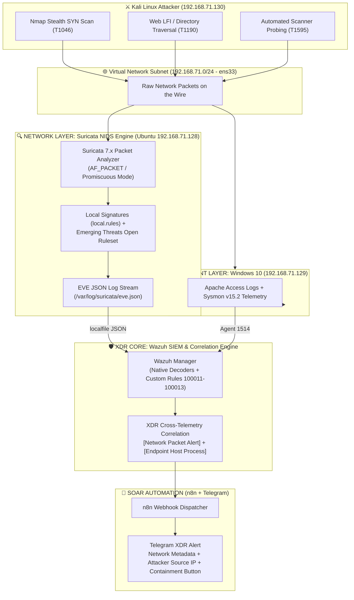
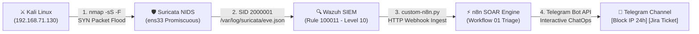

# DEEP NETWORK MONITORING WITH NIDS (SURICATA) & XDR ARCHITECTURE EXPANSION REPORT (PHASE 9)

* **Project:** Centralized Cybersecurity Monitoring & Incident Response System (Wazuh SIEM/XDR Lab)
* **Simulated Role:** SOC Lead / Senior Detection Engineer / Network Security Architect
* **Execution Environment:**
  * **NIDS Infrastructure:** Suricata 7.x deployed on Ubuntu Server 22.04 LTS (`192.168.71.128`), listening on virtual interface `ens33`.
  * **SIEM & Indexer Infrastructure:** Wazuh Manager 4.14.5 & OpenSearch Dashboard 2.x (Port 443 - IP: `192.168.71.128`).
  * **Monitored Endpoint:** Windows 10 Pro (`192.168.71.129`), Sysmon v15.2, Apache Web Server (XAMPP).
  * **Simulated Attacker Machine:** Kali Linux (`192.168.71.130`).
  * **Deployment Configuration Set:** [`deployment/suricata/`](../../deployment/suricata/).
  * **Network Telemetry Stream:** EVE JSON standard (`/var/log/suricata/eve.json`).

---

## I. OBJECTIVES & CORE VALUE OF THE XDR ARCHITECTURE

In previous phases (Phase 1 through Phase 8), the lab environment established strong host-layer visibility (**Endpoint Detection & Response - EDR**) via Sysmon, Windows Event Logs, and Apache Access Logs. However, relying solely on endpoint monitoring left several critical blind spots:
1. **Blindness to Stealth Port Scans:** Techniques like `nmap -sS` (SYN Stealth) or FIN/NULL scans do not complete the TCP 3-way handshake; consequently, Windows OS and Sysmon Event ID 3 generate no logs.
2. **Lack of Deep Packet Inspection (DPI):** Inability to inspect raw network payloads on the wire, anomalous TCP flags, or malformed protocol traffic.
3. **Late Detection:** EDR only catches activity once packets hit application processes on the host (e.g., Apache only logs upon processing a request).

**Phase 9 Solution:** Integrate the **Suricata NIDS 7.x** engine to construct a comprehensive **Extended Detection and Response (XDR)** ecosystem:

$$\mathbf{EDR\ (Sysmon\ +\ WinLog)} + \mathbf{NIDS\ (Suricata)} = \mathbf{XDR\ Ecosystem}$$



---

## II. DESIGNING CUSTOM LAB SIGNATURES (`local.rules`)

Alongside the default Emerging Threats ruleset, the system is equipped with custom rules in [`deployment/suricata/local.rules`](../../deployment/suricata/local.rules) tailored to 3 live network attack scenarios:

| SID | Signature Rule Name | MITRE ATT&CK Technique | Severity | Monitoring Significance & Packet Inspection Mechanism |
| :---: | :--- | :---: | :---: | :--- |
| **`2000001`** | `Nmap Stealth SYN Scan Detected` | **T1046** (Network Service Discovery) | High | Detects high-rate port scanning based on TCP SYN flags (`flags:S,12`), threshold triggered at 20 connections within 5 seconds. |
| **`2000002`** | `Web Exploit - LFI / Path Traversal Attempt` | **T1190** (Exploit Public-Facing Application) | Critical | Inspects the HTTP layer, identifying anomalous path traversal patterns (`../`, `..%2f`, `win.ini`, `/etc/passwd`) directly on the wire. |
| **`2000003`** | `Active Scanning - Automated Vulnerability Scanner` | **T1595.002** (Vulnerability Scanning) | High | Identifies automated scanner signatures within the `User-Agent` header (`Nikto`, `sqlmap`, `DirBuster`, `Gobuster`, `wpscan`). |
| **`2000004`** | `Credential Access - High-Rate RDP Connection Spike` | **T1110** (Brute Force) | High | Monitors connection spikes to TCP port 3389 (RDP) to alert on remote brute-force password guessing behavior. |

---

## III. SYNCHRONIZING NETWORK TELEMETRY INTO WAZUH & SOAR

### 1. Ingesting EVE JSON Stream via `<localfile>`
Wazuh Manager reads Suricata's network event stream directly via configuration in [`deployment/ossec.conf`](../../deployment/ossec.conf):
```xml
<localfile>
  <log_format>json</log_format>
  <location>/var/log/suricata/eve.json</location>
</localfile>
```
The JSON format enables Wazuh to instantly extract rich fields: `data.src_ip`, `data.dest_port`, `data.proto`, `data.alert.signature`, `data.http.http_user_agent`.

### 2. Standardizing NIDS Detection Rules via Sigma (SSOT)
Three network layer detection rules are standardized in [`custom-rules/sigma/`](../../custom-rules/sigma/):
* [`net_suricata_nmap_scan.yml`](../../custom-rules/sigma/net_suricata_nmap_scan.yml) $\rightarrow$ Wazuh Rule `100011` (Level 10 - T1046).
* [`net_suricata_web_traversal.yml`](../../custom-rules/sigma/net_suricata_web_traversal.yml) $\rightarrow$ Wazuh Rule `100012` (Level 12 - T1190).
* [`net_suricata_vulnerability_scanner.yml`](../../custom-rules/sigma/net_suricata_vulnerability_scanner.yml) $\rightarrow$ Wazuh Rule `100013` (Level 10 - T1595.002).

### 3. XDR Cross-Telemetry Correlation
* When Kali Linux delivers an LFI exploit payload:
  1. **Network Layer (Suricata):** Captures the request on the network wire and triggers Rule `100012` (NIDS Web Exploit).
  2. **Endpoint Layer (Apache + Windows Agent):** Ingests XAMPP web access logs and triggers Rule `100002` (Web LFI on Endpoint).
  3. **XDR Result:** Correlating the source IP, timestamp, and payload across both layers eliminates false positives and confirms active exploitation.

---

## IV. AUTOMATED TESTING RESULTS & QUALITY ASSURANCE

The system successfully passed all rigorous automated validation checks:

### 1. Expanded Pytest Unit Test Suite (20/20 Tests PASS)
The test suite [`tests/unit/test_detection_config.py`](../../tests/unit/test_detection_config.py) was enhanced to **20 audit criteria**:
* `test_suricata_localfile_configured`: Verifies that `ossec.conf` contains the `<localfile>` block reading `eve.json` in `json` format.
* `test_suricata_soar_rules_included`: Verifies that Suricata Rule IDs (`86602, 86603, 86604`) are routed to the n8n SOAR webhook.
* `test_suricata_signatures_integrity`: Checks syntax, classification fields, and MITRE IDs across signatures in `local.rules`.
* `test_suricata_yaml_config_integrity`: Validates interface `ens33` and `eve.json` output settings in `suricata.yaml`.
* `test_sigma_compiler_drift_check`: Ensures Zero Drift between the Sigma SSOT and deployed XML.

### 2. End-to-End E2E Testing Scenario ([`tests/e2e/scenario_nids_suricata.py`](../../tests/e2e/scenario_nids_suricata.py))
Simulates a complete attack chain from Kali Linux: Nmap port scan, LFI requests, and spoofed scanner User-Agents, subsequently validating logs against `eve.json` and `alerts.json` on the SIEM server.

---

## V. QUICK DEPLOYMENT GUIDE ON UBUNTU WAZUH SERVER

To activate the Suricata NIDS engine on the Ubuntu virtual machine (`192.168.71.128`):

1. **Step 1 — Run 1-Click Automated Setup Script:**
   ```bash
   sudo bash deployment/suricata/setup_suricata.sh
   ```
2. **Step 2 — Verify Service Status:**
   ```bash
   systemctl status suricata
   ```
3. **Step 3 — Monitor Real-Time Network Event Stream:**
   ```bash
   tail -f /var/log/suricata/eve.json | jq .
   ```
4. **Step 4 — Restart Wazuh Manager to Load New Configuration:**
   ```bash
   sudo systemctl restart wazuh-manager
   ```

---

## VI. END-TO-END VALIDATION: NMAP ATTACK FROM KALI ➔ SURICATA NIDS ➔ WAZUH SIEM ➔ SOAR TELEGRAM

To validate the integrity of the **XDR & Closed-Loop SOAR** architecture, an end-to-end live test was triggered directly from the Kali Linux attack machine to the service server, auditing every link in the chain from raw wire packet capture to interactive messages on the SOC duty phone.

### 1. End-to-End Closed-Loop Pipeline Architecture



---

### 2. Attack Scenario Setup (Attack Execution)

* **Attacker Machine:** Kali Linux (`192.168.71.130`).
* **Target Endpoint:** Ubuntu Wazuh Server (`192.168.71.128`).
* **Attack Command:** High-speed stealth TCP SYN scan against top 100 ports:
  ```bash
  nmap -sS -F 192.168.71.128
  ```
> 

### 3. Step 1 — Suricata NIDS Captures Raw Packets & Triggers Signature

When high-volume SYN packets hit `ens33` (operating in Promiscuous mode), Suricata triggers signature `SID 2000001` (exceeding 20 SYN packets within 5 seconds) and immediately logs to `/var/log/suricata/eve.json`:

> 

### 4. Step 2 — Wazuh SIEM Logcollector & Rule 100011 Activation (Level 10)

The `wazuh-logcollector` daemon ingests the JSON stream from `eve.json`, parses it via the `json` decoder, and matches **Rule `100011`** (Severity **Level 10 — High**).

The event is indexed and written to `/var/ossec/logs/alerts/alerts.json`:

> 
> 

### 5. Step 3 — SOAR Dispatcher (custom-n8n.py) Forwards Alert to n8n Engine

The `custom-n8n.py` integration script extracts the Attacker IP (`192.168.71.130`), classifies IOC type as `Network-Attacker`, and sends the payload via HTTP POST to the n8n Webhook (`http://192.168.71.128:5678/webhook/wazuh-alert`).

Workflow **01_Wazuh_SOAR_Threat_Enrichment_ChatOps** on n8n receives the alert, normalizes data, queries IP reputation from AbuseIPDB, and compiles an Interactive Card.

### 6. Step 4 — Dispatching Interactive ChatOps Alerts to Telegram

n8n connects to the Telegram Bot API and posts an interactive visual notification formatted in clean HTML:

The **Inline Buttons** allow SOC Analysts to execute containment immediately (blocking the IP via firewall or generating a Jira ticket) with 1 click without requiring server access.

> 

### 7. In-Depth Technical Analysis: Virtual Switch Behavior & Testing Considerations

To understand NIDS behavior in VMware Workstation / ESXi virtualized environments:

1. **When Kali scans Ubuntu IP specifically (`192.168.71.128`):**
   * Packets are routed directly to the `ens33` interface. Suricata captures 100% of raw packets and triggers alerts immediately.
2. **When Kali scans the entire subnet (`nmap -sS -F 192.168.71.0/24`):**
   * Because the scan iterates through every IP in the subnet including `.128`, Suricata on Ubuntu captures the packets and raises alerts.
3. **When Kali specifically scans only the Windows Endpoint IP (`192.168.71.129`):**
   * In VMware Workstation, virtual switches operate via **Unicast Switching** (MAC address table switching). Traffic exchanged solely between Kali and Windows does not mirror to the Ubuntu interface.
   * Furthermore, because `nmap -sS` (SYN Stealth) does not complete the TCP 3-way handshake, Sysmon Event ID 3 (which only records `ESTABLISHED` states) will not generate logs for this scan.
   * **Defense-in-Depth Strategy:**
     * Port scanning is merely initial reconnaissance (Reconnaissance) and causes no harm unless the attacker interacts with exposed services.
     * The moment the adversary moves to **active exploitation** (e.g., brute-forcing RDP on port 3389, delivering Web LFI payloads against Apache, or executing PowerShell malware / dumping LSASS), **Wazuh Agent, Sysmon (Event IDs 1, 3, 10), and Windows Security Logs** on the Windows endpoint trigger corresponding rules (`100001`, `100002`, `100004`, `100005`) and dispatch to SOAR for closed-loop automated containment.
     * In enterprise production environments, this reconnaissance blind spot is eliminated by placing NIDS sensors at the **Network Gateway / Firewall** between network segments (VLANs) or configuring **Port Mirroring (SPAN Port) / Network TAP** on the Core Switch.
